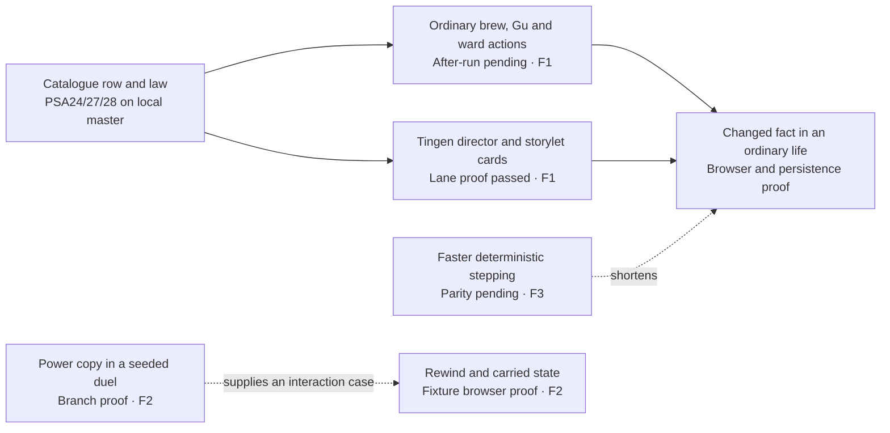

# OOPS effect wave progress · November 18, 2026

The wave has a shared path from catalogue rows into the engine, and the power-as-target branch shows what that can feel like in a duel. The main gap is getting effects to change an ordinary life and making the consequence visible. The committed zero is a short baseline, and the branches trying to move it are still producing evidence.

Snapshot refreshed around 1:55 p.m. EST. I matched the screenshot to the Claude coordinator and lane transcripts, checked local Git branches, worktree changes and active processes, and read selected runtime paths and receipts. Local `master` was `30c9847c1`, 36 commits ahead of the local `origin/master` ref, with concurrent edits in the primary checkout. Lane test and browser results below are attributed to their receipts. This audit did not rerun their suites or play the branches. Current focus and acceptance still live in [PROJECT.md](../../PROJECT.md) and the [AD43 delivery floor](../RULES_INDEX.md#definition-of-done-the-floor-ad43).

## F1 · From coverage to an ordinary life

| Lane | Evidence and assessment |
| --- | --- |
| PSA24 and PSA27 | Local master has the Workshop effect packs, coverage computed from case reachability, and Gu and spell sentences. PSA27 reported fresh browser Moonblade and Lumos cases, with light surviving save, reload, export and import. The Gu contest uses a bridge and the spell example uses Capability Runs. These establish that the laws can work through their tested routes. [PSA24 audit](PSA24_WIRE_PACKS_2026-11-17.md) · [PSA27 receipt](../research/power-catalogues-2026-11-16/lanes/laws-landeffect.md) |
| Ordinary-play entry points | Branch `0dece8045` records 0 attempts and 0 landings in seed-1 Village and RI traces, capped at 2,880 minutes or 300 actions. The runtime hooks are in the worktree, architecture check passed, and the after-run was started. It can change its own temporary world. The caller must read or apply the result for a consequence in the player's life. Count native state changes separately from publishes and temporary-world changes. |
| Life walk | Branch `0cfba481c` maps 15 life stages and ranks plug points. The observed stretch was Village days 1–4 and a first day in Tingen. HP timed out, and household, travel, crisis, mastery and legacy were inferred. This gives a grounded starting route and a reason to rerun after speed work. It gives no season-wide zero. |
| Director and deck | The worktree has five Tingen effect cards, a saved cursor and a path to Reports and mood. The lane reported passing its play proof after shortening the run to three landings. Its full suite and branch commit were pending. Check that a visible consequence survives save and occurs once across reload, long steps and short steps. A later check should compare which ambient events surface, since the active selector now sees candidates from both decks. |
| Effect UI | Branch `f57fc9fba` has 22 proposals and a docs check. Effect feedback, provenance and repeat folding are actionable in the first slice. Reproduce the suspected 30-minute splash missing from Condition before calling it a bug. Correct the standards' mapping of “entry-points” to brewed effects, Gu acts and wards. The coordinator already flagged that correction. |

The [Round 14 proposals](../research/power-catalogues-2026-11-16/README.md#round-14-from-runnable-rows-to-ordinary-play-2026-11-18-proposals) distinguish reachability from actual play and name the three first hooks. The strongest next receipt tracks one player action or NPC beat through its law, the native owner, the visible consequence and any persistence it needs. A ward changing an incoming threat or a brew changing a real condition gives a cleaner decision than a positive count alone.

## F2 · Powers and time have a concrete integration case

| Lane | Evidence and assessment |
| --- | --- |
| Power as target | Branch `f8e35d8a7`. Git range-diff found identical patches at `f8e35d8a7` and the lane-reported `cd33c9f3b`. The commit trailer changed. Reported full suite exit 0 and fresh 1920×1080 browser proof on bundle `4de12eadde2e` for copy, terms panel and save/reload/export/import. The player power was fixture-granted. Negate was tested through unit and tempo paths. The browser proof covered copy. Party battles and a player taking command remain outside the slice. The branch also changes grammar and two generated Worm rows. |
| Timeline substrate | Branch `97b7451fe` has one planner for seven rewind types and a namespaced save slice for bounded captures. The lane reports 20 focused tests passing and a fresh browser save/reload/export/import proof on an earlier candidate with test-hook-seeded memories. The later index has focused evidence. An earned memory route and completed full suite are still open. Current restore covers domain slices. Native clock, character and inventory are outside that scope, and restores are outside the effect chain budget. |
| PSA29 pins and mechanism foundation | Local master has one small-value pin store with manifest priority over cheat pins. The mechanism branch `66fa57367` reconciles the proposal to the timeline-owned restore record and its derived address index. Fate pins remain small values in the proposal. Its diagnostic maps 22,922 mechanism rows after excluding 6,033 label-debt rows. 12,340 (53.8%) have all mapped verbs judged present, a one-reader estimate of owner support. Law readiness, entry points and play are separate checks. |
| Extreme abilities and interaction oracle | The extreme-ability branch `a1a86cd15` maps 26 stress cases and proposes typed triggers, stated reach and a cause-chain budget. Estimated blocked rows overlap. The newer oracle submitted both readers across 500 total cases, including a 20-case pilot and 110 theft/rewind cases. A separate 3,860-row speed/tech labeling batch was submitted. The author had resumed collecting after a connection interruption. Normalized results were pending. The pilot's undecided cases can identify places that need a rule. Model agreement measures agreement between readers. |

Use the power-taking/rewind boundary as a contract test when both writers are ready. Rewind across a timed transfer twice, once with the power in the carried set and once without. Check holder, lease expiry, anchor ownership, memory, duplicate grants and reload. The small pin value can identify the restore record while the timeline owns the payload. If the default can be expressed through those two owners, one slice tests the real architecture decision behind several high-concept powers.

## F3 · Throughput and merge evidence gate the wave

| Lane | Evidence and assessment |
| --- | --- |
| Headless step and boot | Active worktree. The lane reported a Tingen purse-path improvement from roughly 8 to 13 game minutes per CPU second and was preparing parity against pristine HEAD. The main win would be cheaper repeated proof for director, rewind and life walks. Treat the speed figure as preliminary pending deterministic state, event and save comparisons. |
| Merge friction and test speed | Branch `5af2a4e05` has generator orchestration, self-registration, suite sharding and a private-pack check. The draft receipt reports a synthetic generated-file conflict resolved. Confirm successive regeneration is byte-identical and compare suite timing at fixed concurrency under comparable load. The private LOTM pack lacks required acts. The guard marks that gap and the pack still needs rebuilding for positive proof. |
| Six-branch integration | The isolated queue for power-target, extreme abilities, life walk, effect UI, discourse and JoJo collection exited 1 after four save-fixture worker failures. The coordinator was comparing runtime against master. The branch tips were absent from local master at the snapshot. [Queue test log](../../.git/merge-queue/2026-11-18T16-29-14-086Z/test.out) The stage touches `src/tempo_fight.js`, already dirty in the primary checkout. Also inspect shared files before later merges: director/rewind/entry points edit `src/native_tool_domains.js`, entry points/merge tooling both edit `src/capability_runs_domain.js`, and JoJo/oracle both edit `scripts/coverage_report.mjs`. The primary `src/main.js` also overlaps the step-speed lane. |
| Candidate evidence | The PSA29 pre-merge suite log ended exit 1 with the two attributed LOTM private-pack failures. PSA27 reproduced that pair on its base. Other branches reported green suites on their own inputs. Keep those receipts attached to their candidates. Close against the merged build and private-pack evidence, with the [verification procedure](../gm/AGENT_WORKFLOWS.md#verification) and `gate:push` when authorized. |

## F4 · Derivation results are useful because they expose where to stop

| Lane | Result on the local-master wave |
| --- | --- |
| PSA28 law defaults | Form transformation dry-ran 1,307/2,019 and expressed 1,204 rows. Reversal leaned heavily on a default that tied the held-out majority. Area fields took 245/2,921 (8.4%) against the 25% dial and stayed a spec. Missing verb objects, force and delayed pulses make that a design problem. [Lane receipt](../research/power-catalogues-2026-11-16/lanes/law-defaults.md) |
| PSA30 fit report | Reproducible held-out metrics with baseline and caveats. Novel pair support was 28–44% in the first run. Brew holdout had two rows and mock mind publishes flattered executes. Keep the tool, and read the counts and actual world mutations alongside its rates. [Lane receipt](../research/power-catalogues-2026-11-16/lanes/fit-report.md) |
| Circle of Inevitability | The local-master coverage reflects six reachable derived cases. Formula transfer nevertheless tied the majority baseline 9/13 on its verdict axis, and main-slot count scored 2/13 versus 11/13. Runtime reach and canon fit answer different questions. [Lane receipt](../research/power-catalogues-2026-11-16/lanes/derive-coi.md) |
| Worm and Shadow Slave | Worm class is a promising lead (18/28 vs 7/28 in the seen cohort, 2/5 vs 1/5 held out); numeric ratings remain thin. Shadow Slave creature exact rank missed baseline, and the item sample of nine was below the judgment floor. Those labels do not create new player effects. [Worm receipt](../research/power-catalogues-2026-11-16/lanes/derive-worm.md) · [Shadow Slave receipt](../research/power-catalogues-2026-11-16/lanes/derive-ss.md) |
| Regressor, adjacent lane | No stated recipe pairs or realm gates in the held labels. The lane recorded a source gap and added no learned rule. A narrow probe for a stated recipe has a clearer stop condition than funding a broad read. [Lane receipt](../research/power-catalogues-2026-11-16/lanes/derive-regressor.md) |

## F5 · Research is ready to supply fixtures

The prior-art scout (`37eb024cf`) gives specific experiments in rule ordering, typed triggers and situation-driven affordances. Some peer comparisons were recap-level. The discourse scout (`b94ec0a3d`) offers 54 community observations across sampled forums, useful for testing visible prices, partial counters and social pushback. Those are design inputs. The extreme-abilities author already folded the provisional JoJo trigger counts into the grammar gap list.

The collector (`a6a00a121`) reported six JoJo novels, 35 Toaru files and a 2020 Fandom dump held locally. Manga was queued behind a stopped runner, and no game or tabletop material was acquired. The separate reader worktree had a provisional 204-row wiki ledger. Haiku had returned and Luna was still queued. The lane had reached 19 of 49 JoJo chunks on a synchronous route. Keep provenance on fixtures and verify a few counterexamples in the actual text before promoting a wiki or community interpretation into a world rule. Operational reports were inspected as evidence, including the distinction between a submitted batch and a folded result.

## Proposed next moves

1. **A1 · Close what is already in flight.** Compare the four save-fixture failures with the same tests and conditions on master. Reconcile the dirty tempo file before applying a candidate. For the step and regen lanes, require parity and an identical second pass respectively. Close candidates with their own build and private-pack evidence.
2. **A2 · Prove one ordinary effect end to end.** Have the existing owner choose the earliest reliable ward, brew or Gu action. Show a native state change on a fresh route, one readable what/why/source receipt, and persistence where appropriate. Rerun the same baseline with a control for preview-only and publish-only effects. Use the director as the next consumer and verify the same effect fires once per eligible event.
3. **A3 · Turn an undecided oracle case into a test.** Start with theft across a rewind and a clear rule for what carries. Sample the biggest mechanism claims against actual owners before sizing a general resolver. Prefer a shared conflict layer once two real consumers need it.
4. **A4 · Spend on discriminating evidence.** Fold the submitted reader results, spot-check primary-text counterexamples, and pull new rows only when they exercise a named law or a planned player route. Keep fit claims at the strength of their holdouts.

Audit receipt: branch and worktree state, timestamped lane returns, running processes, selected code paths and the PSA29 exit record were inspected. No runtime changes, dispatches, merges, pushes or paid calls were made for this review.

## Follow-through on A1 and A2

Weibao approved A1 and A2 and asked this chat to take unowned work. The Claude coordinator owns the six-branch retry and the merge-friction lane owns suite timing. The ordinary-play lane owns the three completed-command hooks and their trace. This pass owns the archived-pack check and the existing Gu Keeper ward encounter.

- **A1 candidate.** Clean detached `74f34dc28` under `/tmp/oops-effect-proof.fHjLlF/tree`. The local archived LOTM cast was copied into the isolated fixture directory. The installed pack and shared checkout stay available to their owners. The test candidate uses the current source and an archived pack with the required acts.
- **A2 player route.** Fresh Gu Keeper, then earn Myriad Self through the existing practice. A plain Giant Hand costs one red date bead and two essence and the ward holds. With Self Strength, two beads and two essence pay for a strike that opens the crossing. The current trial resets its starting strength for each strike. Use the existing Gu sentence adapter and shared effect host for the committed hit. The Keeper's saved result still owns access and drives the existing player feedback.
- **A2 receipt plan.** Build in isolation, check the same near miss and break through native controls, verify the visible cost and gate, reload and import both outcomes, and check a revisit cannot spend or land the broken ward again. The save keeps its existing held/broken values (AD43, AR3, AR6). The owned code paths are the Keeper's Giant Hand settlement and its dedicated browser proof. The shared effect host and the entry-point branch stay with their current owners.

### Follow-through receipts

| Check | Result |
| --- | --- |
| A1 private-pack runtime | `node --test tests/lotm_method_session.test.js tests/lotm_seer_cast.test.js` exited 0 with 8 passed and 0 skipped on clean `74f34dc28` and exact six-branch candidate `c430a631f`. Archive input is [the local KJ3AV pre-edit cast](../research/novels/lord-of-mysteries/private/kj3av-daxter-2026-11-09/cast-before.json), SHA-256 `c54631101fb32d3e0f5eb3cc0924b4e0ae2e076c81cf7fcf76df973d6425728c`. Its wider private continuity check still reports findings. Use this copy as a positive test fixture. |
| A1 suite slot | The retry was waiting behind an earlier timeline `test:changed` wrapper reparented to PID 1. I terminated that abandoned wrapper (PID 83301) after confirming the timeline lane's newer full-suite request was separately queued (PID 92575). The retry acquired the slot (PID 27997), started the full suite, and remains with the coordinator. The review found four dirty/candidate path intersections, including `src/tempo_fight.js`. Follow the queue's three-way receipt for the primary checkout. |
| A2 build and route (FLR1–2) | `74f34dc28` plus the ward change, bundle SHA-256 `0dc4463e1d064dc54f401cd038365e1b7eabfdd3d8382f25dbce4abbe27bc724`. Background Chromium, fresh origin, 1920×1080. Earned Myriad Self and the real support loans using the play controls. The local headless runner also completed the held, broken and crossed sequence. |
| A2 shown and used (FLR3–4) | A force-4 hit took the shared ward state from 6 to 2 and the gate stayed locked. The force-6 hit took it to zero, and the existing saved gate opened. Previews preserved the ward at 6. The browser checked the existing ward status text, debit of one versus two beads and two essence each time, and entry to the far path after the break. |
| A2 kept and labelled (FLR5–6) | Save, reload, Export and literal Import passed for held, ready, broken and crossed. Reopening the broken ward left the paid amounts unchanged and the strike disabled. Agent-verified, earned optional Gu Keeper route. This proof exercises the native settlement and gate, distinct from the separate chores tally in the active entry-point lane. |
| A2 checks | Rebuild, `check:arch`, public `check:rules`, 49 focused tests, and the browser proof exited 0. The initial browser probe found the Gu house hidden after the UI move to Skills. The verified harness uses the visible Skills and Gu controls. Repo-wide `check:docs` exits 1 on the existing six findings in Reading Status and Download Wishlist. No full suite was launched for the ward. |

The [browser receipt](../../work/effect-wave-2026-11-18/ward-result.json), [held screenshot](../../work/effect-wave-2026-11-18/giant-hand-ward-held.png) and [broken screenshot](../../work/effect-wave-2026-11-18/giant-hand-ward-broken.png) are local evidence. The [private-pack test log](../../work/effect-wave-2026-11-18/lotm-merge-test.log) records the exact merge candidate's run. The ward source and proof script are in the primary checkout as uncommitted edits.

### Merge close and A3 contract

- **A1 applied.** The first scaled retry still failed. The timeout-scale declaration was inside the generated worker source, corrected in `bf1fa8ebd`. The subsequent [queue receipt](../../.git/merge-queue/2026-11-18T19-12-14-282Z/receipt.txt) records build, architecture, rules and full suite passing. The suite reported 7,965 pass, 0 fail and 30 skipped. Six branches landed at `e97acbcbc`. Four dirty paths synced by three-way merge with no conflicts or skips.
- **A2 committed.** `abc74afe6` contains the two ward files and the Giant Hand paragraph from the area guide. The merged-base candidate `f74ef7ddc` plus the ward files passed the rebuild, architecture check, 49 focused tests and fresh-browser replay. The [merged-base receipt](../../work/effect-wave-2026-11-18/ward-merged-result.json) identifies bundle `153f408df17ec11a536cffde8828316cdd75e73c9c5818260791fa88be45a899`. The gate's preceding full suite covers the merged wave. Focused and browser checks cover the ward addition.
- **A3 ownership and inputs.** The timeline branch owns its panel and focused fix, the oracle chat owns batch collection, and the entry-point chat owns the ordinary-play tally. The scoped contract had no identified writer. I used a detached local candidate combining `f74ef7ddc` and timeline `09c59dc93`, with the actual absorb/loan writer, rewind commands and expansion loader. The test supplies an expansion port and a small memory fixture. A learned practice power stands in for a transferable power. Mark rights remain tied to each fixture's rewind spec. Gameplay exposure needs an expansion restore port and an authored rule for whether a transferred rewind ability grants or inherits an anchor.
- **A3 result.** Rewinding all transfer rows restored the original sole owner and cleared the live kit. Carrying the source row, taker row and kit together preserved exactly one owner and the original expiry, then returned the power once. The taker kept their memory and own mark, the source had a familiarity echo, and the anchor index survived serialization and reload. The split control carried the taker's row and kit while the source rewound. Both then owned the power and the expansion loader reloaded the duplicate ownership. The integration should reject a split live loan or carry its affected rows together before enabling power restores. This is a pre-adoption fixture finding.
- **A3 checks.** `node --test tests/power_rewind_contract.test.js tests/power_taking.test.js tests/rewind.test.js` exited 0, 31 passed, including three new contract cases. The third is a diagnostic reproduction of the open defect. The [test patch](../../work/effect-wave-2026-11-18/a3-power-rewind.patch) and [test log](../../work/effect-wave-2026-11-18/a3-contract.log) are local. The contract has no shared runtime change.

### A3 fix and follow-up reviews

The isolated candidate combines `f74ef7ddc` with timeline `09c59dc93`. The timeline chat was idle, with its changes still on its own branch. I kept the loan fix in the combined candidate and left the shared source and timeline worktree with their owners. [Integration patch](../../work/effect-wave-2026-11-18/a3-atomic-loan.patch)

- **Loan unit.** Before loading any rewound slice, the power owner checks for one matching source mark, taker row and held kit entry, with consistent ownership, transfer minute and expiry. A split restore is refused before changing memory, powers, the mark, or the branch list. The player-facing default is to keep or rewind the complete transfer. Sparse ownership/loan-field writes cannot substitute for complete records.
- **Expiry.** The simulation now treats the earliest held loan or lease expiry as a boundary, including in a long headless step with no other work due. A whole historical loan restored after expiry settles against the current expansion clock. No save schema or ordinary import validation changed.
- **Evidence.** 70 focused tests passed on the changed candidate, including whole carry, whole rewind, split refusal, sparse historical refusal, expiry during bulk advance and save envelope round trips through the expansion and rewind loaders. Build, architecture and public rules checks passed. The fresh-origin [rewind smoke](../../work/effect-wave-2026-11-18/a3-rewind-browser.json) exercised the seeded memory route and literal export/import. The loan fixture supplies its expansion port. The player-facing recall/rewind ability has no expansion restore port yet. [Focused log](../../work/effect-wave-2026-11-18/a3-atomic-loan-tests.log)

The save and expiry review identified orphaned source ownership as the inverse of duplicate ownership and pointed to branch publication before validation. Both are now exercised by the fixture. The wave review identified the shared registration file between director and ordinary-play entry points, and the risk of using a transient-world counter as a gameplay measure. The two reviews ran read-only.

**Next integration work.** Gate timeline plus the atomic-loan patch together once the timeline owner releases the candidate. The next real feature decision is who owns the mark when a rewind ability transfers. In parallel, director and ordinary-play entry points should share one integration candidate when the director finishes its branch. Compare short steps with a long step across a story window and verify an authoritative player consequence survives reload without a second effect. Keep merge tooling in its own gate so a timing result or private-pack skip does not obscure the gameplay receipt.

### Five-branch integration and the next improvements

The merge requested on November 18 starts at local `abc74afe6`. The five inputs are prior art `37eb024cf`, mechanism foundation `66fa57367`, step speed `6a26ed89c`, timeline `09c59dc93` and JoJo readers `c1284f26e`. The mechanism catalogue README conflict was two independently appended rounds. The integration keeps both in order. A quota-failure probe then exposed a step-speed defect. A deferred write could publish a transaction's durable callback before storage wrote it. Integration commit `b79c029b1` keeps transaction writes synchronous and ordinary stepper autosaves batched. The probe failed before the fix and passed afterward with 30 focused tests. The candidate passed the coverage check for 224 ledgers and the isolated docs check before the durability edit. The A3 integration patch remains separate from the five branch inputs.

| Priority | Work | Discriminating check |
| --- | --- | --- |
| O1 · Less work per tick | Measure context construction, save projection and batch-close rendering on the same save and seed. Start with a larger render-free harness chunk and less repeated save projection. Preserve immediate transaction writes. Consider a pack compilation cache when cold boots dominate a job. | Compare game minutes per CPU second, wall duration and peak memory at 60/120/240-minute chunks. Inspect durable save bytes and injected failure behavior. Include a cold boot and an old 8 GB target. |
| O2 · Exact idle spans | Port one quiet native interval into the span path, accounting for passive XP, rest and effect expiry. Keep Village random draws and their ordered side effects in the normal minute path until they have a parity proof. Include job deadlines, story windows and time-law changes as span boundaries. | Compare canonical saves, stable storage keys, reports and RNG positions for Tingen, Village and a transition at expiry. Check loan expiry once its boundary patch and timeline are united. |
| O3 · Workers for independent jobs | Compare a small worker or process pool for seeded life walks, detached foresight branches and fixture matrices. Keep a single writer for each life. Background work can compute and return a result tagged with its state revision. | Compare 1, 2 and 4 jobs at fixed total inputs, with wall throughput, CPU and peak RSS. Stable result order and byte parity are the entry tests. The [Node worker docs](https://nodejs.org/download/release/v24.22.1/docs/api/worker_threads.html) describe CPU workloads and the overhead trade-off. |

The step-speed lane measured roughly 8 to 15 game minutes per CPU second in Tingen, with exact paired digests for its 180-minute default route. The separate span benchmark was faster and differed in native idle XP. Village also differed in its draw stream and reports. The [step-speed receipt](../tools/HEADLESS_STEP_SPEED_2026-11-18.md) records those limits and the machine load. Estimate improvements per scenario. A speed ratio from an idle Tingen run cannot establish parity or savings for an active fight. Our combined candidate repeated the 180-minute Tingen comparison with exact canonical and stored-data digests, using 18.574 CPU seconds on the reference and 11.748 on the candidate (1.58×). A fresh Village 120-minute probe differed on its first run. Three reruns paired exactly, with two different digests appearing on both revisions. The fresh-start variation still needs explanation. Keep a saved-fixture replay as the speed gate. [Paired Tingen check](../../work/effect-wave-2026-11-18/five-lane-tingen-parity.json) · [Combined rewind browser check](../../work/effect-wave-2026-11-18/five-lane-rewind-browser.json)

**A3 as an authored event.** A loan remains a single transfer. One useful exception would be a rewind creating an echo of a power. Give the echo its own identity, holder, visible expiry and a reference to the original mark. Start with one shared charge pool so the original and echo can act from different places without creating extra uses. Another option is a paid copy with its own charge pool. A third is two branches keeping separate versions until a rejoin settles the conflict. Test at least the source rewinding before the loan, the echo expiring, one holder spending the last charge and an export/import immediately before the branches meet. The split-loan refusal still handles malformed partial restores.

**UI.** Prioritize an ordinary effect line that answers what changed, why and from what source. Link that same receipt from Reports and Condition, show remaining duration where relevant and fold idle repeats. For rewind, preview the destination mark and three concrete outcomes in player language: what comes back, what carries, and what ends. Add the term and origin to an echoed power in the existing power sheet. Keep rules hidden until the character has learned them. The [effect UI proposals](../ui/EFFECT_UI_STANDARDS_2026-11-18.md) already contain the detailed controls and guardrails.

**Readers.** The newly combined ledgers give plenty of material for a small check against the held texts. The next paid pass has a better use if it resolves one implementation question, such as how an opponent learns and counters a conditional trigger. Start with 12–20 strongest and conflicting scenes across JoJo, MoL and a third source. Separate what was shown, what was claimed and what was inferred. Capture trigger, delivery, counter, duration and actual consequence. Turn three into fixtures the engine can settle. Queue a broader scan when the adjudicated slice identifies a gap that more examples can answer. The [reader report](../research/EXTREME_ABILITIES_JOJO_AND_READERS_2026-11-18.md) records the wiki/novel tiers, partial spend and catalogue noise.

The first full gate after the durability correction had one integration failure. New reader rows used `wish-grant`, which the mechanism branch had represented as XA5 but had never registered as a ledger slug. The integration added the canonical slug and mapped it to the planned `route` and `create` verbs in `767dd1e56`. The isolated candidate passed 32 focused coverage tests and `check:coverage` across 224 ledgers. The combined mechanism map now classifies 24,034 mechanism rows, with 51.8% mapped to owners that have every required verb. The changed denominator includes the newly read sources. [Initial suite receipt](../../.git/merge-queue/2026-11-18T19-53-32-971Z/receipt.txt)

**Merge landed.** The final queue passed on `eb029a974`. All five named tips and both integration repairs are ancestors of local `master`. Build, architecture, rules and full suite passed. The queue synced 39 paths, including clean three-way merges of the two edited files `src/main.js` and `docs/AREA_GUIDE.md`. No push. [Final merge receipt](../../.git/merge-queue/2026-11-18T20-01-34-555Z/receipt.txt)

### Rewind echo preflight

Weibao asked for one playable rewind echo with shared charges. The optional pump-station watch belongs under Return to the mark. The player stands at the supply lift, while their echo occupies the bell landing. Before the surge the one mark captures both mechanisms in working order. Afterward either holder can spend the last shared charge to restore the mechanism they can reach. The restored mechanism gates a distinct follow-through. The other stays jammed. The mark expires after one hour. Once spent, the charge stays spent across return, reload and import.

The scenario uses the existing object restore planner and the `rewind` save owner. Its optional nested record adds no top-level key. Older saves have no scenario until the player starts it. The receipt covers a fresh native route, visible cost and refusal, both consumers, expiry and persistence (AR3, AR6, AD43). The timeline branch is incorporated in local master. The A3 loan patch keeps its separate scope.

### Rewind echo receipt and reader notes

The playable Pump-station watch is under **All panels → Return to the mark**. At the lift you can send a repair crew to the lower pumps. Your echo can restore the bell so the night watch clears the lower walkways. Both draw from the station's one mark. The restore planner changes the selected mechanism. The spent decision persists in the watch, and the restored mechanism opens its corresponding follow-through. Expiry closes both spend actions and allows the watch to end without a restore.

| Check | Result |
| --- | --- |
| FLR1–2 | Isolated public `eb029a974` plus the scoped echo source. Rebuild passed. Bundle SHA-256 `482a75ffe1f52e4b6d2832370ecd6ddd9b3a2bc741a5e01ea9075526b85de60f`. Fresh 1920×1080 browser route uses the regular panel controls. The independent headless route also reached the bell ending. |
| FLR3–4 | Both controls show the same pool and lock after a spend. The lift and bell changes respectively authorize the repair and warning actions. A third route letting the mark fade leaves both jammed. |
| FLR5–6 | Save, reload and literal export/import passed for the spent bell route before completion and for the completed lift route. The focused tests exercise expiry, a double spend, and a forged second restored mechanism. Agent-verified in a bounded panel encounter. |
| Checks | 31 focused tests, build, architecture and public rules passed. Primary docs check still reports the six pre-existing findings. No full suite for this slice. |

[Browser receipt](../../work/effect-wave-2026-11-18/rewind-echo-browser.json) · [Screenshot](../../work/effect-wave-2026-11-18/rewind-echo-shared-charge.png) · [Focused tests](../../work/effect-wave-2026-11-18/rewind-echo-focused.log)

The useful Roblox pattern is how quickly the player can tell the scope and consequence. The creator of [HOURS](https://www.roblox.com/games/5732973455/HOURS) describes a set of distinct time powers. [Tower of Rewind](https://www.roblox.com/games/5308680600/Tower-of-Rewind) states the endpoint plainly, back to safety. A [Roblox creator's small clone prototype](https://devforum.roblox.com/t/time-stamps-time-travel-game/1128058) labels each clone with its creation time. A [community HOURS thread](https://www.reddit.com/r/HOURS_Roblox/comments/xmy3ez/if_you_could_make_a_fusion_of_two_tempos_to_have/) imagines stacking copies by repeatedly rewinding. That is a useful stress case for a shared budget. The JoJo notes distinguish changes to time flow from reset powers with explicit carried memory and describe triggers as counterplay. Apply that finding by telling the player what the mark can restore, what it preserves and when it expires. [JoJo and reader report](../research/EXTREME_ABILITIES_JOJO_AND_READERS_2026-11-18.md)

For a second scenario, compare a player-authorized echo with one that can act on a visible trigger. The interesting decision is whether to trust it with the last charge as the hazard develops. Keep one owner of the spend, make the trigger and tie order readable, and test a simultaneous attempt and an expiry on the same minute before expanding the mechanic. Keep the A3 transfer guard separate from deliberate echo creation.

## Loose-branch integration and follow-up review

The eight tips were checked against local `b862a6dc4`. The Tingen director (`cd31c726d`) and ordinary-play entry points (`261f1180a`) had already landed functionally via `c80548e36`. The candidate records their ancestry without changing that code or replacing the newer transactional dose path. It also includes Deeds (`24632ac82`), rules alignment (`3d56d4cfa`), the interaction oracle (`c5954389b`) and merge tooling (`e841598a8`). The merge-tooling README conflict was resolved by regenerating the coverage index from the combined inputs.

| Item | Evidence and disposition |
| --- | --- |
| M1 · Oracle input quality | Re-normalized the existing replies offline. The 499 paired answers are preserved, with 28 contradictory pre-theft restore-point prompts flagged and excluded from aggregate agreement, dispute ranking and the fixture file. That leaves 471 pairs, 132 agreeing on outcome and rule kind, and 31 candidate fixtures. An offline comparison checked every retained reply and fixture ID. One of 500 generated prompts lacks a pair. Agreement on a rule category can conceal different rules or different changes to the victim, thief or power row. Before a resolver test uses a case, adjudicate the named rule and expected state changes against source and engine behavior. The disputed anchor cases should state existence, ownership, permission, reach and what the restore carries as separate facts. |
| M2 · Merge tooling | Its focused merge, registration and scheduling checks passed 13/13. The first full gate ran at 15-way concurrency and three native save workers hit their wall-clock timeouts. The candidate now apportions shard slots without rounding total concurrency up. The retry uses 10 slots across three shards, the existing timeout scale and the archived cast fixture for the suite. Public lint and coverage run before attaching the archived fixture. An earlier retry tried the archive during lint and surfaced the archive's private cast continuity findings. |
| M3 · Deeds | Browser replay on rebuilt `236976b3a` used a fresh origin and the earned route. Unlock and profile behavior passed normal play, reload, literal Export/Import and a fresh run. There were 15 resource-load console messages and zero page exceptions, consistent with the original receipt's count. [Browser report](../../work/effect-wave-2026-11-18/loose-branch-deeds/report.json) |
| M4 · Carried skills | `49677660b` is still Claude-locked, with a headless Harry fixture and no released integration receipt found. The Harry fixture exercises an early crossing. The branch keys captured levels by world and uses a 120-minute observation window. Prefer capturing at the committed crossing and tying the record to that life. Test an old save, a late entry and a second life in the same world to cover stale and missed captures. |
| M5 · Here and Actions | `3019672c0` is still Claude-locked, with no released integrated browser proof found. The branch overlaps local Game MCP check edits. Once released, verify that the Here panel and Actions tab use the same available verbs and refusal reasons, and replay Go and Talk in the browser and through MCP across the current layout modes. |

**Gate status.** Local master moved to `ec3babdee` on November 19. Build, architecture, public rules and coverage passed. On the exact candidate tree the archived-fixture suite had 8,028 pass, 12 skips and one failure attributable to 156 duplicate-name findings in the archive. The three earlier save-worker failures passed. The only failing test was in the continuity file, which passed 13/13 with normal public inputs on the same tree. The queue verified the tree identity and the archived failure before applying the split evidence. It synced all 62 changed paths without conflicts or skips. Two of the eight branch tips remain outside master, both locked as described above. Local merge only.

[Applied merge receipt](../../.git/merge-queue/2026-11-19T05-09-40-592Z/receipt.txt) · [Archived-fixture full suite](../../.git/merge-queue/2026-11-19T04-58-23-571Z/test.out) · [Public continuity rerun](../../.git/merge-queue/2026-11-19T05-09-40-592Z/test.out)

## Closing the carried-skills and Here branches

Weibao asked to fix the crossing, replay Go and Talk, and land each branch after verification. The integration candidate `9cae5db23` keeps both original branch tips as parents. All implementation work was done in an isolated checkout. The original locked Claude checkouts and the primary checkout's in-progress MCP receipt work were preserved.

- **M4 · Skill capture.** The structured beginning and Tingen crossing attach their identity to the actual crossing plan. The skill-records domain takes the outgoing hero's discovered native levels before the durable write and applies the derived modifiers after publication. The record belongs to the entry instance in that save. A subsequent beginning replaces the snapshot, including a new life in the same world. A ready-made independent Klein life has no outgoing hero to capture. Loading an older life never backfills a crossing. Legacy world-only observations are dropped because they cannot identify which life was observed.
- **M5 · Go and Talk.** Fresh 1920×1080 Chrome replay covered both Here placements. The visible elder topic settled and Go round-tripped Village → Wild willow stand → Village. MCP initially returned generic keys for Here verbs and conversation topics. The headless runner now gives both stable keys, and the stdio replay discovers and uses Go and Talk by index and the topic by key.
- **Proof.** The headless crossing checks passed 5/5 with the archived fixture, including a start after minute 120, a second same-world beginning, loading an older save, reload, and literal export/import. Fresh Chrome exercised the late Harry crossing at minute 150 and showed the retained mind skill and the body-skill relearning bonus. The public suite had 8,018 pass and 31 skips. Its sole failure was a lead-bot test using the hidden Talk dropdown. The corrected test uses the visible Here route and its file passed 5/5. The final gate verified that only that test file changed from the full-suite candidate and applied `33e84f692` to local master. Both original branch tips are ancestors. The queue cleanly combined the concurrent MCP check edits and left one area-guide hunk for manual resolution. The primary guide now retains both the new Here guidance and the existing save-owner and display-gate notes. The post-sync primary MCP replay passed both Here and the separate 441-byte step receipt. [Applied gate](../../.git/merge-queue/2026-11-19T05-28-45-836Z/receipt.txt) · [Full suite](../../.git/merge-queue/2026-11-19T05-20-22-770Z/test.out) · [Primary step receipt](../../work/effect-wave-2026-11-18/last-two/primary-mcp-receipt.log) [Crossing browser](../../work/effect-wave-2026-11-18/last-two/carry-browser.log) · [Crossing headless](../../work/effect-wave-2026-11-18/last-two/carry-focused.log) · [Here browser](../../work/effect-wave-2026-11-18/last-two/here-browser.log) · [MCP replay](../../work/effect-wave-2026-11-18/last-two/here-mcp.log)

### Follow-up proposals

| Item | Next experiment |
| --- | --- |
| O9 · MCP reads | Nine warmed stdio reads per mode in an unchanged Village measured medians of 2.38 s full (12,149 bytes), 0.84 s Here-scoped (2,296 bytes), and 1.77 s compact (554 bytes). These were single-machine samples with the merge suite starting. Scope currently filters after the whole document's actionable controls are collected. [Samples](../../work/effect-wave-2026-11-18/last-two/look-profile.log) Start with a genuinely scoped control walk and a narrow clock read. Preserve action numbering within each reply and invalidate indices when the visible actions change. The existing dirty-worktree step receipt already reduces payload and has separate parity evidence. Measure control collection, text projection, and step cost independently before changing defaults. [Step speed and receipt](../tools/STEP_SPEED_UI_AND_READERS_2026-11-18.md) |
| O10 · JoJo and scenario worlds | Use the existing ferry proposal as the smallest follow-up to the JoJo conditional-trigger reading. The crossing rule recognizes the current charter holder when a crossing resolves. Keep the rescue, charter ownership, and service contract independently settled. Replay an ordinary repair, an independent rescue route, and a charter transfer on the same tick as a crossing. Verify which facts witnesses can learn and which outcomes survive reload. Source readings justify candidates for a holdout and leave the actual world rule open for design. [JoJo mechanisms](../research/EXTREME_ABILITIES_JOJO_AND_READERS_2026-11-18.md#f-what-to-feed-the-design-lane) · [Scenario ferry](../worlds/SCENARIO_WORLDS_AND_CHEATS_2026-11-18.md#d9-generate-situations-and-resolve-actions-through-ordinary-rules) |
| O11 · Idea board | Pair the ferry exercise with one power-and-rewind fixture from the oracle. Record who owns and can use the anchor, what carries through it, which body or world records change, and what the player can observe. Run below, at, and above the relevant boundary from one starting save. These two fixtures would test the same assumptions across the normal-play effect, scenario-settlement, and interaction-oracle designs. [Oracle](../research/power-catalogues-2026-11-16/INTERACTION_ORACLE_2026-11-18.md) |

## O9–O11 execution

**O9 · Scoped MCP landed.** Local `master` is `dc4e5ba49`. MCP enumerates only the requested scope's controls, including an actionable root and listener-only dropdowns. It reads the native calendar directly. The straddling primary worker and protocol tests merged cleanly with the working-copy step receipt. Build, architecture, public rules, scoped Go/Talk and clock, typing and the full public suite passed. The suite reported 8,019 passes and 31 skips. The primary step-receipt smoke passed after sync. [Merge receipt](../../.git/merge-queue/2026-11-19T06-26-39-657Z/receipt.txt) · [Primary receipt smoke](../../work/o9-o11/primary-receipt.log)

The benchmark used one warmed Village at seed 251036, nine stdio samples per mode, with the order rotated in each group. It measured complete replies. Payload sizes matched across the two builds.

| Look | Before median | After median | Structured reply |
| --- | ---: | ---: | ---: |
| Full | 917 ms | 889 ms | 12,195 B |
| Here scope | 798 ms | 37 ms | 2,296 B |
| Compact | 938 ms | 881 ms | 554 B |

Here was about 22× faster in this sample. The small changes to full and compact replies need repeated measurement to attribute. [Before](../../work/o9-o11/before.json) · [After](../../work/o9-o11/after.json) · [Benchmark script](../../work/o9-o11/look-benchmark.mjs)

**O10 · Ferry fixture passed four cases.** A substrate reactor reads the current charter holder and the pilot's location when the crossing settles. In one minute, transfer before settlement admits the new holder and rejects the former holder. Transfer after settlement changes future custody while the first settlement keeps its payee. A separate movement effect delivers the passenger to safety while leaving the ferry contract open. The witnessing bank records the crossing result, and the far-bank witness has no such record. Early, on-time and late cases branch from one checkpoint. Serialization preserves the results. The fixture models a settlement receipt and its payee. A native ferry job, purse transfer and player UI remain design work. [Fixture](../../work/o9-o11/ferry-charter.test.mjs)

**O11 · Power and rewind fixture exposed two independent requirements.** A real power transfer and rewind command run with an isolated expansion port. Trail reading stands in for the borrowed rewind ability. The fixture host proposes holder-only mark use. At expiry on master the borrower lost use, but a bulk step still left the lender's loan held. With the existing A3 patch overlaid in isolation, the lender recovered the power at the exact expiry. The authorized pre-expiry restore returned sole ownership to the lender and preserved the borrower's memory. A copied save preserved both mark identities and the expiry result. The low-level forced-capture entry accepted a foreign mark both times. The gameplay caller needs to check mark rights as well as whether the power can currently be used. The A3 overlay and both fixtures remain experimental. [Fixture](../../work/o9-o11/power-theft-rewind.test.mjs) · [Master run](../../work/o9-o11/fixtures.log) · [A3 run](../../work/o9-o11/fixtures-a3.log)

**Test-driving and performance.** Use direct engine fixtures for outcome and boundary matrices, the local headless runner for scripted journeys and save parity, and a fresh browser for real pointer, focus and layout checks. MCP is strongest for exploratory player-visible play and protocol behavior. For that path, the next high-value change is an optional scoped or receipt reply after a click. It avoids building a whole-page response for a caller that already knows its next target. Keep the existing action-index contract and invalidate any scoped handle when the relevant controls change. Benchmark lookup and rendering separately from step time, and compare resident worker counts under a memory budget before increasing test concurrency.
