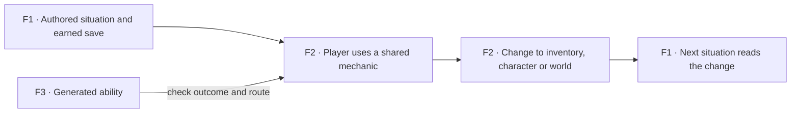

# Can the procedural systems carry a protagonist run?

November 20, 2026. Assessment of the shared working tree at HEAD `71c973050`. The foundations can support a developer building contiguous chapters now. A whole novel still needs authored situations, costs, character knowledge and consequences between chapters. How much new engine work later chapters will demand remains open.

| Finding | What the evidence supports | What limits a full run |
| --- | --- | --- |
| F1 · Campaign continuity | The rebuilt-browser record reaches Klein ch129, Fang Yuan ch140, Harry's Book 1 ending and Zorian's Arc 1 ending at ch26. Later earned saves are recorded for Klein ch163 and Fang Yuan ch171. | The first two arc targets are ch213 and ch199. The next browser windows are Klein ch130–135 and Fang Yuan ch141–145. The later saves make development cheaper while the intervening play still needs verification. [Checkpoint](../gm/dispatch/cross-world-systems-2026-11-07/CHECKPOINT.md) · [Earned saves](LEAD_CORE_FLOW_AUDIT_2026-11-13.md#endpoint-saves) |
| F2 · Reusable mechanics | Fang Yuan can find a seeded wild Gu, pay essence, save during refinement and finish with that Gu as his own. Klein's distinct readings feed potion digestion, and the six-reading result has a browser persistence receipt. Process crafts have engine fixtures in which changing the quench changes whether a piece survives a load. | Each lead needs a way to acquire the input, choose the action and encounter a later situation that uses the result. A separate ordinary-play sample recorded nine shared effects, all on two keeper actions, across one keeper and one village start. That sample neither exercises nor estimates a protagonist campaign. [Gu implementation](../../src/ri_wild_gu.js) · [Klein receipt](../gm/dispatch/foundation-run-2026-11-12/RUN.md#current-resume-block) · [Craft experiment](../gm/dispatch/foundation-run-2026-11-12/FAMILY_PROCESS_CRAFTS.md) · [Counted starts](../coverage/effect_landings.json) |
| F3 · Generalization | On held-out examples the brew runner matched 15 of 17 outcomes and 13 of 17 routes. The spell runner matched 13 of 99 outcomes, mismatched four and lacked data, a suitable probe or a mechanism for 82. Six of 53 Gu cases ran. | Reviewed brew data is a practical starting point. Gu and spell authoring still need per-family checks. These probes measure different things and have limited world state. The 432 reachable, executing catalogue cases across 71,348 catalogued things measure corpus coverage across worlds. A protagonist's required acts have a different denominator. [Fit report command](../../scripts/generation_fit_report.mjs) · [Coverage definitions](../coverage/README.md) |

**Recommended next proof.** Replay Klein ch130–135 from the earned ch129 save in the rebuilt browser. Track which decisions use existing rules with new data, which require connecting an existing system to play, and which truly require new mechanics. Check that one carried cost, observation or obligation changes a later choice after reload and export/import. That gives an estimate of authoring work for the next stretch. Later arcs bring different demands, including identity, travel, remote action and multiple controlled actors. They need their own representative cases. [Campaign plan](../gm/dispatch/refinement-audits-2026-10-31/LOTM_KLEIN_FULL_JOURNEY_PLAN.md)

Fresh checks were the generation-fit report, coverage validation (224 ledgers passed) and 37 passing focused tests across Gu refinement in the lead pack, LOTM acting, Harry's spell instruction and the three held-out families. Browser and story endpoints above come from the recorded runs. This assessment did not replay a whole arc, test an installed build or establish current full-suite status.
