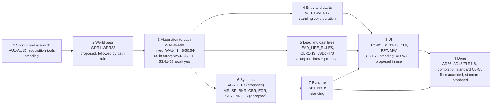

# World implementation rules map and audit, 2026-11-04

**Status: proposal (AD32).** Weibao asked to visualize and audit the rules for the avenues of implementing worlds, "from UI and more". This file extends the [rules reconciliation audit](RULES_RECONCILIATION_AUDIT_2026-10-30.md) (O1-O22, RRV1-RRV6, OWN1-OWN4) and does not repeat it. It changes no rulebook, AD line or runtime. Another session has uncommitted edits in the reconciliation audit and RULES_INDEX, so this is a separate file. Evidence: **shown** = I read the line; **counted** = a `grep -o | sort -u` count of distinct codes per owner file, 2026-11-04. No sealed world content appears here, only rule sets.

## The map

A world passes through nine stages. Each box names its owner and rule codes. Status comes from the [register](../RULES_INDEX.md#register-of-rule-sets).

Counted codes per owner (all match the register ranges): WPR 32, WER 17, SR 24, MR 36, UR 82, AR 16, WA 68, GTR 35, ABR 22, DSG 19, SUI 19, RPT 14, CLR 13, BHR 34, CBR 30, ECR 33, SLR 43, PIR 25, GR 17, MW 8. About 600 coded rules across 20 families, plus AD1-AD51 and Rulebook 1-12.

## Findings

| Code | Finding | Evidence |
|---|---|---|
| F1 | **No single answer to "what must a new world ship for UI?"** The pieces live in five places: RPT13 (Reports voice and place rows in `world_report_voice.js`), DSG12-DSG17 (glyphs, damage vocabulary, skins), AD46 (world-specific expression), WA54 (every control has an engine contract), WER (start list entry). The completion standard S00-S14 has sections for places, people and combat but no UI or surface section; WPR17 gives "Surfaces" one table row. A world pass can finish S00-S14 with its UI unmapped. This is the main UI gap. | shown: DESIGN.md:45-60, UI_RULES:359, COMPLETION_STANDARD:87-99, WPR17 |
| F2 | **Path rules for world-system code reach just the generic runtime-code rule.** `src/progression_gates.js`, `src/ability_*.js`, `src/book_world_*.js` and `src/world_report_voice.js` match `runtime-code.md` and nothing about gates, abilities, absorption or entry. `src/world_*.js` matches `sites-exploration.md`, so `world_report_voice.js` and `world_calendar.js` load the site rules and not the Reports voice rule (RPT13). No path rule exists for GTR, ABR, WA, WER or lead-life. | shown: path-rule frontmatter vs `ls src` |
| F3 | **Status drift is large and mostly benign.** Proposed rules that act as defaults: WPR (path rule says "follow"), GTR (proposed, `progression_gates.js` implemented), ABR (proposed, ability code shipped), UR76-UR82 (proposed, "in use as the default"), DSG6-DSG19 (proposed lines, owner accepted). Under AD32 registration gives no authority, so each should either be accepted by Weibao or be read as a prompt. Today agents cannot tell which from the path rule wording. | shown: register rows 48, 49, 67-69 |
| F4 | **WA is the biggest single read and the least settled.** 68 codes in about 8.2k words, with four different statuses inside one file (statuses per the register, AD32: dated acceptances, standing-requested, proposed awaiting yes). A lane cannot tell which of WA42-47, WA51-53, WA61-68 bind without reading the register cell, which runs about 450 words. | shown: register row 61 |
| F5 | **Router rows for the two main world tasks name 15+ ranges each.** "A new world or book adaptation" cites AD44, CLR, SUI, RPT, LSD, WA1-60, Rulebook 2-3, AD1-5, MR11-15, SR1-3, WER. "Any player-facing UI" cites DSG, UR, UIV, SUI, RPT, MW, AD34/40/43/46. The reconciliation audit tiered the UI read (L1 done) and the world-pass read; the new-world row is not tiered. | shown: router rows 102, 113 |
| F6 | **Three vocabularies for "what a world needs"** (K codes, S00-S14, WPR dimensions) remain unmapped. This is O19/L5 of the earlier audit, still open. | shown, carried over |
| F7 | **Entry and UI have no shared check.** WER17 covers hub/lobby worlds and WER14 requires a pass to record WER2-WER12 per start, but no rule says what the start screen, crossing screen or low-spoiler start list shows (SUI covers scenes and travel inside a world). Entry UI is the seam between stages 4 and 8. | shown: WER headings, SUI list |
| F8 | **Sealed secrets still have no codes** (L4/Q2 of the earlier audit) and are cited by name from about ten router rows. A world implementation touches them at stages 2, 3, 6 and 8. | carried over |
| F9 | **Systems rulebooks are well covered and well owned.** MR, SR, GR, AR, BHR, CBR, ECR, SLR, PIR have matching ranges, register-listed status (AD32) and DOMAIN_RULES homes. The reconciliation audit's O13-O16, O21-O22 found overlap by design. No new finding. | shown |

## Proposals (none adopted)

| Code | Proposal | Default and dial | Effort |
|---|---|---|---|
| A1 | **World UI kit checklist.** One short table in DESIGN.md "The per-world contract" listing what every enterable world ships: RPT13 voice rows, DSG12 glyph set, DSG14 harm vocabulary, WA54 control contracts for its new surfaces, entry-list rows (F7), plus the skin as optional (DSG17). Link it from WPR17 and add a "UI kit" row to the completion standard. No new rule codes. Dial: skip rows a world has a stated reason to omit (RPT13 already permits stated exceptions). | doc, 1 hour | small |
| A2 | **Add a path rule for world-system code** (`src/progression_gates.js`, `src/ability_*.js`, `src/book_world_*.js`, `src/world_report_voice.js`, `src/world_entry*`) that names the owners (GTR, ABR, WA, WER, RPT13) in about 80 words, and move `world_report_voice.js` out of the sites rule's glob. Merge with L6 of the earlier audit (one rule per path set). | tooling, 30 min | small |
| A3 | **Status sweep for the six proposed-but-in-use families** (WPR, GTR, ABR, UR76-82, DSG6-19, WA42-47/51-53/61-68): one table of "in use as default since / awaiting Weibao's yes", so one "accept these as defaults" answer clears several. This is a question for him, not an edit. | decision | one answer |
| A4 | **Tier the new-world router row** the way UI and world-pass rows were tiered: first read WPR + WA1-WA6 + WER; the rest by trigger. | doc, 30 min | small |
| A5 | **Carry over L5 (K/S/WPR mapping) and L4 (SEAL codes)** from the earlier audit now that this map shows both sit on the main path. | doc/rule | small |

If you want only one thing done, do A1: it closes the main UI gap with no authority change.

## Checks and limits

- Read: RULES_INDEX register and router (lines 1-200), the whole reconciliation audit, DESIGN.md per-world rows, UI_RULES RPT13, completion standard S-table, path-rule files. Counted code maxima with grep.
- Not done: no rulebook was read in full; F2 reads globs against filenames and was not tested by loading a rule in a live session; no build or tests, since the change is documentation.
- Nothing staged or committed.

## Round 2: evidence corrections, reconcile ledger and more to consider (2026-11-04)

Weibao: "Yes" to the A1 question, then asked for an advisor pass, more-to-consider and reconcile. Proposal status unchanged (AD32). His yes carries out A1 as a proposal; it changes no direction, so USER_VISION is untouched. Original F and A lines above stay as written; this section corrects them.

### Evidence corrections

- **F1 was overstated.** The completion standard's grep was cut at 14 lines. S13 "Presentation and usability" exists, and DESIGN.md already holds [DSG19](../../DESIGN.md#the-per-world-contract), "the basic kit": six on-screen questions per playable world, "also the checklist for a new world's first UI slice", with a [kit census](WORLD_UI_KIT_CENSUS_2026-10-30.md) per world. DSG12-DSG18 cover flourish, Reports voice, vocabulary, progress form, precedence, skins and diegetic UI. The real gap is narrower: WPR17 and S13 did not link to DSG19 or the census, so a world pass could close S13 without seeing it.
- **F7 mostly closed by existing text.** WER13 ties launch and the in-game Beginning view to one start list; the 2026-11-01 low-spoiler section says public start cards show commitments and immediate needs and must be tested for leakage. What remains unchecked is a world-level display check for the start list and crossing screen. Whether DSG19's six questions should gain a seventh (entry) is a question for the UI owner, not decided here.
- **Box 7 of the diagram was wrong.** "No path rule" belongs to world-system code (F2), not to Runtime.
- **A1 as first written was unnecessary.** DSG19 is the checklist. A1 became two single-hunk links, applied: WPR17 in [WORLD_PASS_RULES.md](../WORLD_PASS_RULES.md) and S13 in [WORLD_COMPLETION_STANDARD.md](../WORLD_COMPLETION_STANDARD.md). No new DSG code; DESIGN.md untouched.

### Reconcile ledger

Evidence rows follow the reconcile skill: "read" means I read the cited owner text; nothing here ran code or tests.

| ID | Class | Evidence reached | Disposition |
|---|---|---|---|
| F1 | stale or incomplete integration (links missing) | read: DESIGN DSG12-19, S13, WPR17 | Fixed by the two links. Original "no UI section" claim withdrawn. |
| F2 | missing proof | read globs vs `ls src`; no live rule-load trial | Unconfirmed. Test by opening a gate or ability file in a session and seeing which rules load before adding a path rule (A2). |
| F3 | compatible variant for UR76-82 (his CHOICES 4) and WA54-60 (his 2026-10-31 request); open question for WPR, GTR, ABR alone (proposed from his requests, no later acceptance seen) | read: register rows | A3 shrinks to three families. |
| F4 | incomplete integration (WA status spread, already routed by register) | read | Leave; tier via A4 if wanted. |
| F5 | incomplete integration | read: router row 113 | Open proposal A4. |
| F6 | duplicate vocabularies | carried over from O19/L5 | Unchanged. |
| F7 | compatible variant, display check unmapped | read: WER13, ST section | Narrowed as above. |
| F8 | missing codes | carried over from L4 | Unchanged. |
| F9 | none | read | Unchanged. |

### More to consider

**ACT NOW (done).** The two links, the corrections above, a register line already added. Evidence for the links: git diff shows one-line hunks in each file; `check:docs`, `check:rules` and `git diff --check` results are in the final report of this session.

**ACCOUNT FOR NOW.** A world's kit has three owners in three places (DSG19 on screen, RPT13 in `world_report_voice.js`, WER13 for starts) and the census is dated 2026-10-30. Read the census as a snapshot, not current state; any claim that a world "has" its kit needs a fresh probe on the current build.

| Code | LATER / DELEGATE item | Level, effort | Done check |
|---|---|---|---|
| L1 | Refresh the kit census for worlds added since 2026-10-30 | Luna low, small, scripted probe `scripts/playtest/world-look-probe.mjs` | Every playable world has a dated cell value on the current bundle |
| L2 | A mechanical check that every enterable world has a voice row and a kit census row. RPT13's test (RFX8) is the nearest existing check; extend it, build no new gate | Sol medium, small | Test fails on a world with no voice row and passes a stated exception |
| L3 | Decide whether entry (start list, crossing) is a seventh DSG19 question | UI owner, Weibao's call | Answer recorded in DESIGN or declined |
| L4 | Open-session trial of path-rule loading for gate, ability and report-voice files (F2) | Luna low, small | Recorded list of rules loaded per file |
| L5 | A2-A5 from round 1 stay as listed; A3 now covers WPR, GTR, ABR alone | decision | one answer |

Reopen L1-L3 when a new world's UI slice is selected.

## Round 3: other levels, deeper dive (2026-11-04)

Weibao asked whether everything was fixed, and about UI design and other levels. **Not everything is fixed.** This session changed two links and wrote this audit; the rest are proposals that need his yes or belong to other lanes (AD32). This round checks four levels below the documents: the instruction layer, enforcement, runtime and on-screen. New findings continue from F10. Evidence rows: **read** (source or owner text), **ran** (a command on the current tree), **probe** (one headless `yairpg-game` session, seed 1, fresh life, text only).

### Corrections to Round 2

- **A3 was narrowed too far.** The register still lists three groups as awaiting his yes (AD32): WPR1-WPR32, GTR1-GTR35 and ABR1-ABR22 (proposed from his requests, AD32); DSG6-DSG19 (lines proposed, apart from those restating an accepted rule); and WA42-WA47, WA51-WA53, WA61-WA68 (awaiting his yes). UR76-UR82 (his CHOICES 4) and WA54-WA60 (his 2026-10-31 request) stay compatible variants. One answer on these groups clears the status question for about 160 codes. A3 stands as: ask once, per group, whether to accept as defaults.
- **The kit census's "Report voice: generic" column is stale.** Commit `336c43bd9` added voice rows after the census (`1f40dd9e4`). `VOICED_FAMILIES` now holds nine families (frontier, glasshouse, hp, lotm, mol, nested, paradise, proto23, tidemark). Stale document, not a defect. Its other cells remain "unchecked" and are unverified, not failing.

### New findings

| Code | Level | Finding | Class | Evidence | Disposition |
|---|---|---|---|---|---|
| F10 | Instruction | **F2 confirmed.** Reading `src/progression_gates.js` and `src/ability_records.js` attached `runtime-code.md` alone. Reading `src/world_report_voice.js` attached `runtime-code.md` and `sites-exploration.md` (via `src/world_*.js`), not any Reports-voice rule. | incomplete integration | ran: three file reads, rules attached by the harness | A2 stands, now with evidence. Smallest fix: one short path rule for gate, ability and voice files and a glob change. |
| F11 | Enforcement | **RPT13 is a standing rule whose test misses two enterable worlds.** The live Beginning list offers Harry Potter (3 starts), Shadow Slave (3) and Reverend Insanity Gu (2). `VOICED_FAMILIES` has hp but neither Shadow Slave nor Gu, so those worlds fall back to generic lines. The test passes (10 of 10 in `tests/world_look.test.js`) because it scans six literal `*_LOCATIONS` tables and these worlds have none. This is the concrete case behind UIF6 and RFX8. | incomplete integration, missing proof | probe: Beginning panel; read: `world_report_voice.js` keys, test lines 92-102; ran: test file | LATER L2 sharpened: drive the test from the start records or the Beginning list instead of table shapes. Voice rows for Shadow Slave and Gu are world-lane work. |
| F12 | Enforcement | **No check covers the per-world kit (DSG19) or the census.** `grep` over `tests/` and `scripts/` for DSG19, kit census and kit names found no hit. The project's rule-to-test map, `scripts/check_rule_behavior.mjs`, lists four groups (knowledge, transactions, saves, navigation: AD6, AD7, AR3, AR6-AR8, MR4, MR5, MR33, UR9) and none for UI-world rules, gates or abilities. Tests for gates and abilities exist (`progression_gates.test.js`, `ability_*.test.js`) but are not routed from a rule code. | missing proof | ran: greps; read: map file header | A new gate would be extra weight; optionally add one group to the existing map (RPT13, UR70-UR75) when UI rules next change. |
| F13 | On screen | **CG7 reproduces on the current build.** A fresh Village life still lists "Cross to another world: Tingen" among the first verbs at minute zero. The Beginning panel itself reads clearly: eight named starts, "Keep my current opening", and a confirm that names what leaving costs. | owner-routed (UI_CAPABILITY_GAPS, routed to the GUI worlds lane) | probe: first screen and Beginning view | Keep CG7 open. Other CG1-CG9 and K1-K3 are "routed, unverified since 2026-10-30": CG1 and CG4 shipped in code that day, CG3, CG5, CG9 and K1-K3 were routed to other lanes, and I did not probe them. |
| F14 | UI owners | **The UI queue already has owners; none needs a new one.** CG1-CG9 and K1-K3 sit in UI_CAPABILITY_GAPS and the kit census; UIF1-UIF8 in UI_DESIGN_CORE_AUDIT (round 7 and the focused-auditor packet); UI directions and form fit are proposals (AD32). UIF6 already covers the voice-coverage narrowing. | duplicate owners, no conflict | read: UI_DESIGN_CORE_AUDIT from line 779, REFINEMENT_PRIORITIES, UI_DIRECTIONS and UI_FORM_FIT headers | Route new UI observations into these codes. |

### Levels table

Each cell gives its evidence row; "none" means I found none.

| Family | Doc owner | Path rule | Test or check | Runtime producer | On screen |
|---|---|---|---|---|---|
| World UI kit (DSG19) | DESIGN.md (read) | none for world files; `src/world_*.js` loads the sites rule (F10, ran) | none (F12, ran) | `world_look.js` flourish for lotm alone (read) | census 2026-10-30, mostly unchecked |
| Reports voice (RPT13) | UI_RULES (read) | misrouted (F10) | `world_look.test.js`, six tables (F11, ran) | `world_report_voice.js`, nine families (read) | Gu and Shadow Slave generic by code (F11) |
| Entry / starts (WER) | WORLD_ENTRY_RULES (read) | none | `foundation_start_content`, `frail_start` and others (read) | `start_records.js`, registered beginnings (read) | Beginning list reads clearly (F13, probe) |
| Gates and abilities (GTR, ABR) | proposed rulebooks (read) | runtime-code solely (F10, ran) | `progression_gates.test.js`, `ability_*.test.js` (read) | `progression_gates.js`, `ability_*.js` (read) | not probed |
| Runtime (AR) | ARCHITECTURE_RULES (read) | `runtime-code.md` (ran) | `check:arch` (read, not run) | n/a | n/a |

### More to consider

**ACT NOW (done).** A3 corrected, census column recorded as stale, F2 confirmed, F11 narrowed to two named worlds. This round and the rest of the file are docs only; no rulebook, AD line or runtime changed.

**ACCOUNT FOR NOW.** The Beginning list is the best single producer of "enterable worlds" (WER13), so a coverage check should read it, not table shapes or ID prefixes (which mix worlds with action ids such as `pocket.exit`). Worlds reached by crossing (Tingen, Cyoria, Paradise) come from the Worlds panel and are a second list to include. The kit census needs a refresh before any "world has its kit" claim (L1).

| Code | LATER / DELEGATE item | Level, effort | Done check |
|---|---|---|---|
| L6 | Voice rows for Shadow Slave and Gu (RPT13: a place row for the start and main work place, plus a general row) | Sonnet low, small, world lanes | `reportVoice` returns a voiced line for each family at 1920 |
| L7 | Rework the RPT13 test to read the Beginning list and Worlds panel producers | Sonnet medium, small | Fails on an enterable world with no voice row; passes a stated exception (RPT13 allows one) |
| L8 | Path rule for gate, ability, report-voice files; remove `world_report_voice.js` from the sites glob (A2 with L4) | Luna low, small | Reading each file attaches the intended rule |
| L9 | Probe CG3, CG5, CG9 and K2 on the current build and mark each fixed or open in UI_CAPABILITY_GAPS | Haiku through the MCP, half a session | One dated status per code |

No agents were spawned, no other chat was messaged, and nothing was committed in this round (AD32).

## Round 4: visual map and persistence level (2026-11-04)

Weibao repeated the ask with an advisor pass. New angle: the persistence level, plus an interactive visual. Proposal status unchanged (AD32).

**Visual.** [world_implementation_rules_map_2026-11-04.html](world_implementation_rules_map_2026-11-04.html), published privately as [World Rules Map](https://claude.ai/artifact/8KH6cZcnhoEUdJ1jcsgdze): pipeline stages colored by status, a family-by-level matrix (adds a Persistence row), and the open findings.

**Recount (ran).** Code counts for WPR, WER, SR, MR, UR, AR, WA, DSG, RPT match round 1. `world_report_voice.js` still keys nine families; F11 stands.

| Code | Level | Finding | Evidence | Disposition |
|---|---|---|---|---|
| F15 | Doc / instruction | Persistence is the one stage-9 family without rule codes. SAVES.md section 5 is a prose checklist (proposal); WORLD_PASS_RULES has no mention of saves, migration or compatibility lines; S14 is the only world-pass pointer. | ran: grep counts (WPR 0, WA 1, WER 3, standard 5); read: SAVES 5-6 | L10 |
| F16 | Runtime | World packs have a loader but no save path (SAVES G2). Recent worlds (Cyoria 6a-6c, `dnd_phandalin`) recorded per-change compatibility lines, which works but is per-world and ad hoc. | read: SAVES G2, 6a-6c | L11 |

| Code | LATER item | Level, effort | Done check |
|---|---|---|---|
| L10 | Link WPR17 (or S14) to SAVES section 5 so a world pass meets the compatibility-line step; no new codes | Haiku, 10 min | One-line hunk, check:docs passes |
| L11 | Design the world-pack save path before the first pack that holds per-life state (G2) | Sonnet, medium | SAVES G2 closed with a stated path and test |

Not done: L9 UI probes (CG3, CG5, CG9, K2) still open. Nothing committed.

## Round 5: focused reconcile of UI creation rules, and more to consider (2026-11-04)

Weibao asked for a reconcile pass on the rules for implementing and creating world UI, then more to consider. Proposal status unchanged (AD32). Source revision: HEAD `faeeeabc1` plus this file's uncommitted rounds 4-5. Scope: DSG12-DSG19, UR76-UR82, RPT13, WER13 start list. SUI1-SUI19 and UIV were not traced (unmapped residue).

### Ledger

Evidence rows follow the reconcile skill: **owner text** = rule is current; **source read** = producer or consumer read on the current tree; nothing here ran a build, test or browser journey.

| ID | Claim and locator | Class | Owner, consumer | Evidence reached | Disposition |
|---|---|---|---|---|---|
| F17 | DSG19 says every playable world answers six questions and the census marks each; the newest world, D&D Phandalin (`dnd_phandalin_panel.js`, commit `423808323`, 2026-11-03), has a desktop panel but no census row and no voice row in `world_report_voice.js` | incomplete integration | DESIGN DSG19 and RPT13; consumer `dnd_phandalin_panel.js` | source read: census grep 0 hits, voice keys 0 hits | Same class as F11; widens L6. How a player reaches Phandalin was not traced. |
| F18 | UR76 "fill the UI contract before building" names a system card, but no template or card file exists outside rule text; `docs/WORLD_CARDS.md` is a world card, not a UI contract | missing supplier | UI_RULES UR76; consumer: world lanes | source read: `ls docs`, grep "UI contract" (5 docs cite, none is a form) | Compatible variant if lane briefs carry the card inline; open whether a shared form is wanted (L13). |
| F19 | UR77 budgets homes in numbers ("83 panels today", 2026-10-30); the only code that cites UR77 is a comment in `book_world_lotm_acts_host.js`; no test or script counts panels or routes | missing proof | UI_RULES UR77; consumer: none | source read: grep UR77 over `src tests scripts` | Budget is reader-enforced. A count is cheap through the game MCP; no new gate (L14). |
| F20 | WER13: launch and the in-game Beginning view share one start list. Book starts register through one producer, `registerBookBeginnings` (`choices.register` per start: HP, Shadow Slave, Gu, more) | none (compatible) | WORLD_ENTRY_RULES WER13; producer `book_world_beginning_registration.js` | source read: producer only; launch consumer not read | Supports L7: the RPT13 coverage test can read this producer. |
| F21 | DSG6-DSG19 are proposed lines that new world UI already follows (DSG19 is the "O3 gate"); the gate cites Weibao's words, the lines themselves await his yes | genuine open question, already A3 | DESIGN.md | owner text | Stays in A3. |

Unmapped residue: SUI1-SUI19, RPT1-RPT12 and RPT14, UIV, UR78-UR82 consumers, mobile (deferred by standing priority).

### More to consider

**ACT NOW (done).** Ledger above; Phandalin added as a named case to the voice gap.

**ACCOUNT FOR NOW.**
- World UI is created three ways: a desktop panel file per world (`*_panel.js`, 19 files, two world-specific), a book start registration, and voice rows. Nothing ties the three, so a new world can ship one without the others (F11, F17). The cheapest tie is the start list producer (F20), not a new registry.
- DSG19's six questions are a creation checklist that nothing triggers at creation time; they are checked later by census. Putting the six questions into the lane brief template is the moment that matters, not a test.
- Proposed-in-use rules (UR76-UR82, DSG6-19) shape every new world panel. Until A3 is answered, lanes treat them as defaults, which is the current reading, and that is fine.

| Code | LATER item | Level, effort | Done check |
|---|---|---|---|
| L12 | Add DSG19's six questions and the RPT13 voice row to the world lane brief template (`LANE_BRIEF_TEMPLATE.md`) as a checklist block | Haiku, 15 min | Template shows the block; one-hunk diff |
| L13 | Decide if UR76's system card wants a shared form or stays inline in briefs | UI owner, Weibao's call if a new file | Answer recorded beside UR76 |
| L14 | Count panels, routes and tabs on the current build through the game MCP and refresh UR77's "today" figure | Haiku via MCP, small | UR77 number dated 2026-11 or later |
| L15 | Census rows for Phandalin and for worlds added since 2026-10-30 (folds into L1) | Haiku, small | Census lists every start the producer registers |
