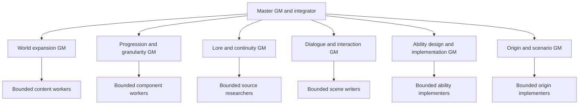

# Game master roles and local ownership

Latest finite runtime delivery,2026-10-06: [audited parallel workshop wave](audit-implementation/DELIVERY.md), root01a10fe7-c3cd-79a2-86d0-2eba1fcfcefd, canonical revision20, bundle `0365f6afe27c`, **implemented-unverified**. Three disjoint internal workers and one source-only reviewer completed/released; root shared/canonical scope is released at this finite source/UI/build completion. [Resume/ownership](audit-implementation/CHECKPOINT.md), [remaining candidates](audit-implementation/QUEUE.json) and [deferred gates](audit-implementation/ACCEPTANCE_BACKLOG.md) own the next state. Prior Paradise/fieldcraft and Reference deliveries remain historical; current input/output hashes live in the new BUILD. No competing shared writer or background automation was started.

The [master prompt](../GAME_MASTER_PROMPT.md) coordinates the workflow. These are sibling specializations at the world-GM tier; implementers remain bounded leaves. User-visible specialist chats are authorized in the current session. Reusable prompts do not start chats or agents by themselves.

| Role | Durable prompt | Current detail ownership | Execution state |
|---|---|---|---|
| Master | [GAME_MASTER_PROMPT](../GAME_MASTER_PROMPT.md) | PROJECT, index/vision, shared contracts, reservations and final review | Design delivery and document review completed in this chat |
| World expansion | [WORLD_EXPANSION_GM](WORLD_EXPANSION_GM_PROMPT.md) | Five CAMPAIGN/WORLD_BRIEF/GM_PROMPT/IMPLEMENTATION_PACKET sets | Chat `01a10487-5a34-71f3-9475-2587546a661a`, local, completed |
| Progression/granularity | [GRANULARITY_GM](GRANULARITY_GM_PROMPT.md) | Five MODULE_CATALOGUE files | Chat `01a10488-0145-7171-802f-274b034b7fd7`, local, completed |
| Lore/continuity/consequence | [LORE_CONTINUITY_GM](LORE_CONTINUITY_GM_PROMPT.md) | Five SOURCE_LEDGER files and LORE_AND_CONTINUITY | Chat `01a10488-b0c8-71c0-a54a-b3f2b9d7541a`, local, completed |
| Dialogue/reaction/interaction | [DIALOGUE_INTERACTION_GM](DIALOGUE_INTERACTION_GM_PROMPT.md) | DIALOGUE_AND_INTERACTIONS and five INTERACTIONS files | Chat `01a104a6-d618-7e52-957f-037ee74166b0`, local, completed |
| Ability design/implementation | [ABILITY_IMPLEMENTATION_GM](ABILITY_IMPLEMENTATION_GM_PROMPT.md) | Five ABILITY_VARIANTS plus conceptual REFERENCE_CASES/ENGINE_PACKET; master retains shared ABILITY_AUTHORING | Chat `01a104a2-fabf-7bf1-a95f-1e93353b9196`, local, completed |
| Origins/life stages/scenarios | [ORIGIN_SCENARIO_GM](ORIGIN_SCENARIO_GM_PROMPT.md) | ORIGINS_AND_WORLD_TIMELINES, assigned local origins/source packets | Prompt ready; master directly authors current origins and Harry Potter candidate |

The current five deep source families are Skyrim, Fallout 4, Elden Ring, Naruto and Bleach. A comic shortlist remains proposal work in the continuity lane. Harry Potter has a separate bounded source/origin candidate, outside those five full campaign/module assignments. Parent keeps each world's information in its local folder, linking shared rules instead of copying specifications.

Shared detail is locally indexed through [campaign composition](../worlds/CAMPAIGN_FRAMEWORK.md), [progression/assembly](../worlds/PROGRESSION_AND_ASSEMBLY.md), [ability authoring](../worlds/ABILITY_AUTHORING.md), [lore](../worlds/LORE_AND_CONTINUITY.md), [dialogue](../worlds/DIALOGUE_AND_INTERACTIONS.md), [origins/timelines](../worlds/ORIGINS_AND_WORLD_TIMELINES.md) and [multiverse scope](../worlds/MULTIVERSE_STRUCTURES.md). The [novel shortlist](../worlds/novel-worlds/CANDIDATES.md), [Harry Potter candidate](../worlds/harry-potter/WORLD_BRIEF.md) and [lived hub candidate](../worlds/paradise-hub/WORLD_BRIEF.md) retain their bounded status.

Each deep-world folder has eight linked owners: WORLD_BRIEF, CAMPAIGN, MODULE_CATALOGUE, SOURCE_LEDGER, ABILITY_VARIANTS, INTERACTIONS, GM_PROMPT and IMPLEMENTATION_PACKET. Its role/checkpoint can recover local work; the shared role graph does not have to remember another chat's transcript.

New roles receive exact file reservations, current source/prompt revisions, accepted direction, mode, source limits, checkpoints and gates. Model routing requires evidence; a lower-cost scene/ability writer is not trusted solely because the role is narrow. Use each independent chat's actual host pool under [capacity and succession](dispatch/GM_CAPACITY_AND_SUCCESSION.md). A prepared role is not a mandatory active agent; use useful disjoint scopes without a project-global slot grant or another delegation tier.

This is the reusable control graph, not the simultaneously running worker tree. Current live roles and file reservations are in PROJECT. Several specialty prompts can be available without simultaneously running every role. Actual live capacity and exclusive write scopes govern dispatch.

Other fine details are review responsibilities, not automatically new active GMs: targeting/effect ordering, material and component provenance, NPC observation/memory, duties and institutional enforcement, scene interruptions, failed/save-stale commands, accessibility/navigation, pacing/economy and hostile/offline policies. A dedicated playtest/economy role is useful when real content exists to exercise. Creating a new prompt does not establish that a missing gameplay adapter works.

Latest ability lane adds JoJo and Universal Thief reference cases plus conceptual/state-transforming mechanics and interaction-based challenge. Those stay source-bounded case studies with engine packets until a world or runtime slice is explicitly selected. Reusable roles and local owners preserve the little details across chats; they do not establish source canon or game implementation by their names alone.

PROJECT's active checkpoint owns live statuses and returned thread IDs. After refresh read the shared recovery protocol, current role/assignment, that checkpoint and local owner; inspect workers and files before replacing tasks or retrying uncertain writes.

## Iteration across roles

All active roles use the shared [autonomous iteration loop](../GAME_MASTER_PROMPT.md#autonomous-iteration). Reuse current owners and inspect actual output, adapt after evidence or steering, continue useful assigned work after a packet, and stop at the requested result. Design/source roles do not need to implement gameplay to finish their assigned finding; implementation roles do not finish at a plan. Current test deferral and delivery/acceptance distinctions remain in force.

## Current expanded implementation wave, 2026-10-04

[Capacity and succession](dispatch/GM_CAPACITY_AND_SUCCESSION.md) is the current human-authorized policy: project-wide four-role cap removed, bounded internal agents/useful project chats and fresh-context same-role successors permitted under actual host tools and exclusive ownership. [Parallel packet](dispatch/TRAILBLAZE_PARALLEL.md) owns the first code lanes; current queue/run/checkpoint track actual IDs and release. Current lanes: main native integration, World instances/content, Conceptual passage/boundary, Dialogue scenes, traveler/body profiles and Paradise source. Deferred tests are explicit; new native integration is unverified. Original opening/current baseline/private saves/attribution remain preserved.

## Autonomous assigned goals, latest human authority2026-10-04

Assigned goals follow [autonomous completion/full books](dispatch/AUTONOMOUS_GOALS_AND_FULL_BOOKS.md) and the shared [iteration loop](../GAME_MASTER_PROMPT.md#autonomous-iteration). Packet/context boundaries are checkpoints. Preserve actual authority, source coverage, exclusive succession and current test deferral; stop at the assigned finite result.

## Instruction upgrade, 2026-10-06

The user requested adaptable skills and better self-directed Game Master iteration. The master prompt owns one shared execution loop, with local/world/worker and specialist callers linked to it. Current capacity rules replace old global slot snapshots. Packet completion, finite task completion, deferred behavior checks and human acceptance remain distinct. Ambient fiction need not earn a mechanical payoff.

[Original instructions](history/2026-10-06-iteration-originals.md) preserve the pre-edit prompts and dispatch wording. Structural checks and independent scenario review apply to this change; no gameplay suite, current-build acceptance or measured runtime gain is established by editing prompts.
