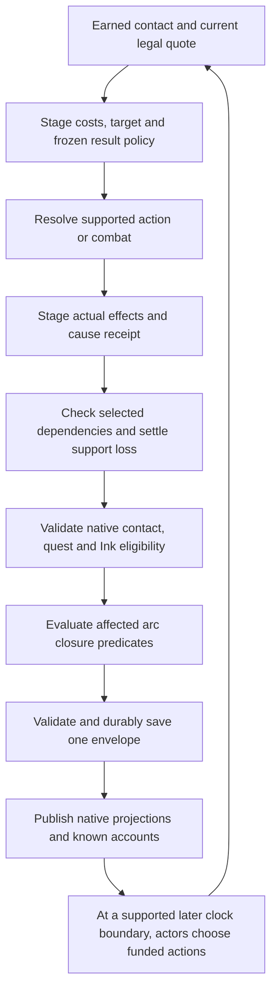

# Causal story contract, proposed CSE revision 1

This is an integration proposal, not a new gameplay/schema selection. [Current capabilities](CURRENT_CAPABILITIES.md) identify existing owners; [packets](IMPLEMENTATION_PACKETS.md) name the changes. Scope is finite local arcs and represented actions. No general simulation of every book scene or arbitrary natural-language action is claimed.

Revision2 adopts the user's world-specific strong fate/survival direction and investigates future anchors. [Direction history](evidence/DIRECTION_REVISION_2026_10_06.md) preserves superseded wording. A source-established or clearly original selected destiny rule may make an actor impossible to kill by ordinary means until its actual protection is overcome. The design does not presume that prediction, eventual strength, fate protection and power over time are the same capability.

## Stable requirements

| ID | Required behavior |
|---|---|
| CSE-01 | Freeze edition/hash/cutoff/instance/era and immutable expected source events; never advance them as if they occurred. |
| CSE-02 | Every consequential action has an actual target, current legal quote, owned means/costs, result policy and durable cause receipt. |
| CSE-03 | Attempt, contact, hit, physical outcome and resulting story facts are distinct. A rejected quote is no attack; a paid failed attack can leave witnessed hostility. |
| CSE-04 | Bind the named actor's actual body/controller/life/powers/stock to admitted combat and noncombat consumers. Preserve old nonlethal policies. |
| CSE-05 | Every selected pending event/job declares sufficient causes, required participants/support and loss policy; invalidate only dependents. |
| CSE-06 | Actors adapt through their own knowledge, agenda, funded legal actions and remaining means. No automatic alternative villain, victim or boss. |
| CSE-07 | Keep actual truth, attributed reports, author foreknowledge and actor beliefs separate; disclose only earned information. |
| CSE-08 | Dead/captured/absent/hostile actors affect contact, jobs, dialogue, quests, Ink, authority and plans through explicit consumers. |
| CSE-09 | Classify closure separately for protagonist, player, local society and world; use versioned predicates over committed evidence. |
| CSE-10 | Settle closure/reward once, preserve evidence/history and support continuing life without resetting the old arc. |
| CSE-11 | Retain instance/body/soul/loop/counterpart distinctions and allow restoration only under a selected sourced policy. |
| CSE-12 | Unsupported actions are honestly unavailable before costs. Rejected/stale/failed-durable actions publish no fictional success or aftermath. |
| CSE-13 | Optional saved meaning is explicitly enrolled/versioned with inert old-save defaults and defined frozen-job/Ink compatibility. |
| CSE-14 | Author finite source-specific branches and genuine consequence boundaries; label unknown source mechanics and original policy. |
| CSE-15 | Native UI explains represented contact/action/stakes/recovery and known aftermath; later behavior/director acceptance stays open. |
| CSE-16 | Apply selected survival protections with actual owner, domain, trigger, protected outcome and limits before terminal resolution; scripted intervention produces real effects/receipts. |
| CSE-17 | Severance/suppression/exhaustion/theft differ; an earned applicable counter changes the protection and its other supported consequences without automatically killing its holder. |
| CSE-18 | Freeze each world's time ontology and branch/identity/retention rules; prediction and a source baseline do not establish a fixed future. |
| CSE-19 | Future anchors and causal independence require actual source/owner/reach/identity/relation; terminal threat is judged against supported temporal authority, not raw level. |
| CSE-20 | Resolve conflicting protection/temporal effects with a finite versioned precedence and paradox policy inside the existing durable publisher; no ad hoc replay or self-funding loop. |

## Five owners of one story

| Layer | Proposed representation | Existing owner to extend |
|---|---|---|
| Immutable author baseline | `{snapshotId,editionSha,cutoff,context,expectedEvents:[{id,locator,preconditions,expectedResult}]}`. Locators and expectations never prove occurrence. | Book dossier/source-fit and selected content definition, e.g. Paradise content baseline |
| Actual committed history | Typed effect receipt `{cause,sequence,at,localAt,context,actionId,definitionRevision,targetId,resultId,evidenceRefs}` plus specific situation transition/support/closure receipts. Current state is its projection. | Shared staged plan/publisher; `simulation.causes`, situation receipts, selected campaign history |
| Present world and means | Existing actors/people/world facts, bodies, sources, power mastery/fuel, inventory/custody, authority, obligations and supported instance clocks | Current simulation/native/world/cargo owners, no second universe or inventory |
| Observer beliefs | Attributed knowledge for a particular observer with observation/report/recollection/inference and event-time versus learning-time | Existing `simulation.knowledge`, People/Events/Ink observation. Optional evidence extension where demanded |
| Possible future | Finite authored event/agenda/situation rule with prerequisites, support, participants, costs, time window, cancellation and alternate closures | Existing commands/events/controllers/jobs/situations plus demanded dependency adapter |

Current `knowledge` can overwrite a key and logs/events can be pruned. Consequently durable causal evidence must reference retained receipts or a specifically retained evidence record, not the last 100 log lines. Preserve contradicted forecasts as attributed historical claims, instead of treating the most recent value as the complete past.

## Concrete proposed rule shape

The following is an authoring shape. It is not an exported current API or a save field accepted today.

```json
{
  "id": "cse.mortal.courier_departure",
  "revision": 1,
  "context": {"worldId":"base.frontier","instanceId":"frontier.main","continuityId":"branch","eraId":"cse.proposed"},
  "dependsOn": ["cse.mortal.route_open", "cse.mortal.tarin_available"],
  "requires": {"all":[{"fact":"cse.tarin.free","op":"eq","value":true},{"fact":"cse.route.open","op":"eq","value":true}]},
  "participants": ["cse.mortal.tarin"],
  "consumes": ["one actually owned ration", "one paid local travel commitment"],
  "window": {"clock":"existing supported instance elapsed","opensAfterCause":"cse.notice","duration":12},
  "supportLoss": {"policy":"cancel_unspent_reservations","closure":"courier_route_unavailable"},
  "alternatives": ["seek a consenting paid ferry operator using already acquired message"],
  "resultConsumer": "authored delivery receipt, not source chapter advancement"
}
```

The example names original proposed actor/arc IDs, not new accepted canonical IDs. A closure ID must resolve to an authored executable consumer; descriptive strings above are not sufficient command definitions. Use the existing fact-rule language (`meets`), exact item keys and stock/authority owners when implementing. A dependency index can be derived from definitions; save the actual rule revision and status/support receipts, not a duplicate whole graph.

Dependencies mean **necessary causes**, not arbitrary plot associations. Removing Tarin prevents Tarin's personal departure, not the storm, another village's business or all future deliveries. If another actor has the document, permission, transport, funds and motive, a separately authored alternative can succeed. Missing expertise or a destroyed unreproduced record may make a plan impossible. “Someone else does it” is never a default cancellation policy.

## Resolution order and demanded joins



Use the existing shared scheduler and staged publisher. Proposed phase ordering inside an intervention: physical result and actual possession/life facts first, then selected support invalidation, then closure eligibility and refunds, then one durable write, then live projections. For later same-time scheduled work, preserve old scheduler semantics for unenrolled/frozen jobs. New causal jobs must recheck support before award; a dead participant cannot earn output simply because its due time sorts first. Freeze the new tie-break policy in the enrolled definition, rather than altering all historical work.

| Join | Current support | Required refinement |
|---|---|---|
| Contact → action | Simulation target/world/alive/colocation/participants and fixed encounter adapters | Instance/era identity plus scoped detection/reach, hostility/consent and exact named combat profile |
| Result → life/means | Typed life/body/source/item/custody effects exist | Physical result receipt policy; custody of a person is not item custody; no zero-HP death inference |
| Life/means → work | Optional `completionSupport` refunds at due time, alive-gated controllers | Immediate selected dependant invalidation; participant/teacher/source/site/consent edges, arbitrary life loss versus old-age actor-only cleanup |
| Work → future | Finite conditional controllers/events/situation phases exist | Frozen rule statuses: scheduled/eligible/committed/completed/cancelled/expired/averted; explicit reason/cause and alternative means |
| Truth → reaction | Actor-targeted knowledge and conditions exist | Witness/report transmission and suspicion rules; no reaction to hidden truth through conveniently global controller facts |
| Life/hostility → native availability | Selected nested-native life projection exists | Apply to admitted named arc contacts, quests/services/dialogue and resumable Ink; Tidemark/general NPC gaps remain |
| Facts → ending | Frontier conditional authored closures; nested localOutcome | Versioned affected-arc evaluator and once-only closure receipt; separate accounts and continued-life contracts |

## Attack semantics

There is no mandatory cross-world “protagonist” flag. A selected world **can** supply a protagonist-specific destiny law, source/patron survival, acquired restoration or an actual future anchor. Preview uses the body's real capabilities and those applicable protection rules. Ordinary lethal damage may then be insufficient until fate is severed or its counter is reached. Possible results require different content and mechanics:

1. **No represented reach/contact:** reject without spend; no actor knows an attack happened. A witnessed threat can be a separate paid/committed social action.
2. **Committed failed attempt or defense/escape:** retain cost, information and witness-specific hostility. Defense consumes its own applicable supports; escape uses a real route and changes location. A source scene proves its mechanism only in that scene's conditions.
3. **Player defeat or nonlethal opponent defeat:** keep disclosed fainting/yield/incapacitation policy. Treatment, capture or release are additional legal actions with real participants and costs, not an inferred death.
4. **Eligible actual death:** commit a final lethal result only after the selected physical, fate, body/soul and temporal protections permit it. An intercepted lethal hit is not a successful kill. A reversible body death is not automatically a terminal actor ending. For genuinely terminal death, terminate that actor's personal future; retain learned students' methods and existing records; cancel unique support and reconsider succession. No automatic loot/source/office/identity acquisition.
5. **Exceptional return:** determine body versus soul versus copy and exact survival method. Apparent death can mislead witnesses; restored life never erases the recorded attempt, costs, grievance or unavailable period. Loop reset and real-world resurrection have separate selected contracts.

The five points are result classes, not an instruction that every encounter supports every class. Current fixed fights remain nonlethal; adding lethal rules requires explicit new adapters and compatibility work.

## What can happen without a new branch

Reusable state effects can make a teacher unavailable, consume goods, pause funded work, change access, spread a particular report and select an already authored closure. This is emergent composition of represented rules. It does not automatically create new dialogue, legal succession, an unmodeled ritual, the politics of every kingdom or a different book ending.

Every disruptive request ends in one of three honest dispositions: (a) existing supported rules/content resolve it, (b) a finite new action/branch/consumer is implemented, or (c) the request is outside represented scope and shown as such before commitment. A successful supported rescue stays a rescue even if the author's next expected death scene becomes unreachable. If the entire represented conflict is averted, close that arc and keep useful ordinary life; there need not be a replacement battle.

Actor simulation is bounded to meaningful decisions. Controllers already rank finite candidates and legal quotes pay costs. Extend them with goals/commitments and explicit observed evidence as needed. An NPC can refuse, seek a lawful alternative, prepare, investigate, flee, relinquish a goal or complete a duty offscreen during supported played time. Freeze unsupported absence under current world policies; no browser-closed catastrophe or universal elapsed years are implied.

## Fate can be a real, overwhelming mechanic

Latest user direction permits very difficult protagonists and deliberately scripted survival. **O design:** assign protection to a real person/source/world law, not secretly to whatever NPC currently fills a quest. A protagonist may be vastly more capable now, protected by a patron, favored by probability, bound to a future mandate, restored after death, or anchored outside the attacked history. These mechanisms can coexist but do different work. Protecting survival does not automatically protect possessions, allies, freedom, trust, mission success, office or the exact route to ascension.

| Protection family | What it can legitimately do | What the actor/player may still change | Applicable counter/severance |
|---|---|---|---|
| Actual superior combat/awareness | Evade, block, counter, conceal, leave through real means; extraordinary capabilities remain extraordinary | Objectives, resources, public evidence, alliances or a location may still be contested | Mechanism-specific access/counter; no level matching or sudden weakness invented for fairness |
| Luck / favorable opportunity | Select or weight supported coincidences; an intact source can strongly favor a miss, timely route or rescue | Injury, costly escape, failure, ally loss and dangerous new opportunities if not protected | Actual suppression/exhaustion/theft rule; a statistic does not automatically defeat an absolute mandate |
| Fate/mandate survival law | Exclude terminal outcomes until stated conditions; scripted intervention can be guaranteed while the law applies | Defeat, captivity, lost opportunity or diverted development under that law's actual protected predicate | Sever the named mandate, its issuer/jurisdiction/condition, or apply a source-valid overriding authority |
| Acquired resurrection / continuity | Real body death then a specific later return under soul/anchor/source terms | Lost time/body/cargo, local knowledge, costs and interrupted plans persist unless the method covers them | Destroy/block the actual return means; ordinary hit strength may be irrelevant to that target |
| Future or extra-temporal anchor | A selected already-valid relation allows a future/independent existence to prevent local terminal erasure or restore a form | Local body loss, absence, relational damage, goals and branches outside protected scope | Reach/sever/isolate/contest the actual anchor under its chronology/authority; no universal anti-fate sword |

**Scripted rescue is implementation, not just prose.** A patron moves a real body; a protector intercepts with an owned function; a covenant redirects a fatal event through its selected law; a survivor returns through its declared soul/anchor. Freeze trigger, scope, means, effect and once/repeat policy. If an actor-based rescuer was killed, imprisoned or out of reach, that rescue cannot still happen unless a separate actual metaphysical rule supplies it. A genuine world law may need no finite fuel or cooldown; do not invent one just to make it defeatable. Then disclose/represent the earned exceptional counter or permit a nonlethal/goal-based victory.

The fate effect can be mysterious to the player while exact to the engine. A sword inexplicably slipping, a momentary future image or an uncannily timely convoy can be observable evidence without a tooltip revealing the hidden patron. Repeated evidence can support investigation. A static debug label `protagonist=true` is no explanation of protected scope, but an explicitly selected source rule protecting the named protagonist is allowed.

## A protection contract and severance are separate state

Proposed authoring fields, **not current accepted schema/API**:

```json
{
  "id":"cse.example.future_covenant",
  "revision":1,
  "holderId":"cse.example.chosen",
  "sourceOwnerId":"cse.example.covenant",
  "mechanism":"future_anchor",
  "scope":{"instanceId":"cse.example.main","identityId":"cse.example.chosen.soul","historyId":"cse.example.history"},
  "protects":["terminal_actor_erasure_before_crowning"],
  "conditionId":"covenant_intact_and_anchor_reachable",
  "interventionId":"covenant_intercepts_terminal_result",
  "repeatPolicy":"unlimited_while_condition_holds",
  "anchorId":"cse.example.crowning",
  "severanceConsumerId":"cse.example.sever_covenant",
  "knowledgeDisclosureId":"witnessed_time_echo",
  "provenance":"O original proposal, not a book rule"
}
```

Demand exact consumers and typed support refs, not arbitrary strings that narrate success. Definition carries the policy; current support/usage/severance/restoration receipts reside in the existing actor/source/instance/situation owners. A mutable protection record is not another inventory or clock. A represented fate source can affect a beneficiary without being loot in that person's bag. Source donor, beneficiary, issuer, anchor and future manifestation may be different owners.

Severance action requires actual target/reach, acquired method, compatible authority, current support and disclosed known risks. Distinguish suppression (temporary), exhaustion (spent actual capacity), contract release (legitimate changed terms), stolen relation (different beneficiary/custody), severance (broken connection) and source destruction. Removing a source may also affect forecasting, recognition, bonds, institutional eligibility or continued power support if its selected rules demand it. It does not automatically remove every learned skill, kill the person or transfer protection to the attacker.

An attacker can first lose, survive, investigate and earn a fate-specific counter. Alternatively they can refuse the kill, negotiate, defeat an objective or imprison the actor if the protection allows that. If captivity conflicts with an inevitable future appointment, the selected escape/causal-correction law must actually operate at its condition; if the mandate promises survival alone, eternal captivity may remain possible. Do not silently upgrade the mandate when the player finds a valid alternative.

## Does future power make timeline interference futile?

**Sometimes, under a selected world rule. Future power by itself does not.** A predicted end-of-book level is author information. A trained future person is not automatically an active present protector. In contrast, a being actually established across its whole history or connected through a future anchor can make attacks on its younger body ineffective even when that body is physically weak. The important change is causal jurisdiction and identity persistence, not simply larger damage numbers.

Choose a local time ontology; the following are compatible design families, not claims about real physics or all novels:

| Local model | What an earlier intervention can change | Meaning of “destined to ascend” |
|---|---|---|
| Contingent forward history | Change causes and thus the future; foreknowledge becomes stale | A prediction/likely path, unless a separate real protection source exists |
| Fate-shaped attractor | Many routes converge toward a selected endpoint, with actual correcting mechanisms | Survival/ascension can persist while companions, ideology, costs, timing or route differ; endpoint protected only within its precise predicate |
| Self-consistent fixed history | Represented attempts already belong to that history; contradictory outcomes do not occur under actual laws | If the future fact is genuinely established, attempts can fail or become its cause. Show the mechanism; do not accept a terminal kill and erase it afterward |
| Branching history | An intervention creates/enters a distinct history; original and counterpart futures are separate | A future strong self in one branch does not automatically own a newly diverged counterpart; cross-branch reach requires an actual power/connection |
| Editable history with protected anchors | Ordinary causes can change, but declared anchored facts/identities resist weaker temporal edits | Eventual ascent may itself be an anchor. Changing it needs the applicable anchor counter/authority, not merely travelling earlier |

“Future ascension is a cause of present survival” can be an explicit **O bootstrap/retrocausal** law. The world defines that the completed future exists as an anchor and supplies the earlier protection. Establish how that future exists: fixed-history fact, extra-temporal record/entity, another admitted branch or a source-mediated connection. Do not bootstrap a forecast into actual authority merely because the author plans to level the NPC later. Preserve the distinction between a legitimately self-consistent closed causal loop and an accidental program recursion.

Once this rule is selected, the player's failed assassination may become one of the causes of ascension: a scar changes the future person's philosophy, a confinement creates their breakthrough, or an exposed patron makes them seek independence. This is a strong trope proposal; it is not a compulsory response to every failure. If the player successfully severs the relevant connection, the future protection must genuinely cease or change according to its policy, and the now-unprotected outcome can diverge. If ascent is guaranteed, do not offer an ordinary growth-blocking action as capable of preventing it.

## Power over time is a capability profile

Record actual `temporalReach`, `affectedHistories`, `targetForms`, `identityRelation`, `authorityRule`, `resistance/anchorRefs`, `cost/support`, `memoryRetention` and `restorationScope`. These are demanded profile fields, not a universal new numeric tier. A fighter can have huge destructive output with no past reach; a much weaker specialist can sever a particular covenant if its method actually applies. A genuinely superior causal authority can remain superior. Fighting a past body, attacking a soul, deleting the historical cause of birth and removing an extra-temporal anchor are different operations.

“Acausal” must specify which dependence was escaped. Independence from an ancestor's death does not establish immunity to direct soul attack, source destruction, every branch, conceptual erasure or all knowledge loss. A copy surviving elsewhere does not prove the attacked person survived. A future counterpart with shared name/appearance needs an actual identity connection before its protection applies. Keep source-defined indivisible identity or collective existence where supported; do not manufacture extra bodies to grant immortality.

At very high power, historical clocks can remain useful for residents even when a particular being's identity is insensitive to their order. Represent that local exception rather than deleting calendars, jobs or all stakes. Distant followers, source carriers, institutions and collateral still have their own survival rules. High-level play can shift toward holding jurisdiction, isolating an anchor, preserving an ally, negotiating mandates, defending a history or choosing which future persists. A cosmic victory can coexist with a local loss and no protagonist death.

## Conflicting destinies and paradoxes need finite rules

Two mandates can demand incompatible results. Do not settle this with a universal ordering such as plot armor > fate > luck, or pretend equal combat level automatically cancels metaphysical powers. Compare their actual scope/authority/conditions: a boundary prevents external action; one source explicitly overrides another; a contested ritual must resolve; incompatible demands create separately authored branches; or a guaranteed-death action is unsupported while the intact survival law applies. The world chooses the exception rather than the engine inventing one mid-fight.

For a fixed-history source, reject a contradictory terminal action or resolve its real interception before commitment. For a branching source, pay the actual branch/identity/cargo/knowledge costs and leave the old history intact. For an editable source, stage the selected patch and declared dependent changes while retaining the committed intervention/evidence. For an independent anchor, local history loss leaves the anchor only if its rule actually says so. Restore neither spent items nor everybody's memories by default.

Use one bounded intervention batch with frozen policy revision, current support, priority/authority and cause IDs. Resolve each admitted protection at most as often as its repeat contract allows **for that one cause**, keep any stored RNG draw, validate actual costs/identity/histories and commit once. The source may author unlimited future interventions, but the host cannot loop indefinitely to search for a favored outcome or duplicate future-origin resources. If a causal cycle is represented, freeze its already-established constraints or explicit original resolution; a merely proposed future gift cannot fund its own origin through unlimited reruns.

Proposed temporal/fate join to P1–P5: legal target and physical candidate → protection/temporal authority resolution → actual prevented/yielded/body-dead/returned/terminal result → support invalidation → selected ending evaluation → one durable save/publication. **Prevention** means no true death occurred. **Restoration** retains the real body death and later return cause/cost. The existing `resurrection:true` guard is not a fate engine, and `checkpointScenario`/`rewindScenario` is not general history editing. Saved outcomes, actor reports and finality must name their actual scope.

## World fit and honest mystery

Qualified book mechanisms are summarized with exact locators in [FATE_TEMPORAL_SOURCES](evidence/FATE_TEMPORAL_SOURCES.md) and prior [SOURCE_EXCEPTIONS](evidence/SOURCE_EXCEPTIONS.md). Shadow Slave's reviewed fragments show fate theft/recognition and binding consequences with source-quality/chronology limits; no blanket immortal protagonist is inferred. Paradise's inspected early source has no established retrocausal Su Xiao protection; a stronger fate variant is allowed as an explicit O alternate-world rule, not misattributed canon. An original mortal world remains a legitimate contrast. Do not retrofit a fate exception into existing fights/saves by implication.

The player may discover a false prophecy, an exhausted patron, a surviving anchor or a severance that preserves life but destroys recognition. Author uncertainty can remain U; an activated protection must still have exact host behavior. Mysteries are playable through observation/investigation and retained evidence. Community theory and headcanon enrich those possibilities without silently becoming book facts or a mandatory cross-world cosmology. [Trope/theorycraft audit](evidence/TROPE_THEORYCRAFT_AUDIT.md) records public inspirations and five original scenario families.
