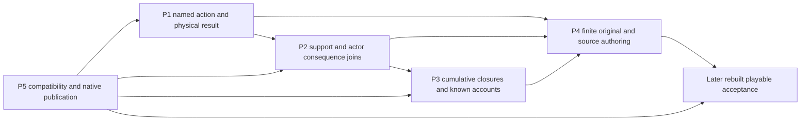

# Ranked executable integration packets

2026-10-06: all five packets now have **implemented-unverified source** under the [current continuation](../dispatch/AUDIT_REMAINDER_2026_10_06.md). Seven new `src/causal_story_*.js` modules implement finite original proofs. Sole shared/native/main/registry/save/UI/build/canonical integrator is audited GM `01a10fe7-c3cd-79a2-86d0-2eba1fcfcefd`. [INTEGRATION](INTEGRATION.md) and [exact release](INTEGRATION.json) own the current source handoff and required concrete shared consumers. This role ran syntax/import/definition/link checks; no build or game suite. Earlier source snapshots remain historical evidence. The detailed packet designs below remain useful wider requirements, not claims of complete source-world or arbitrary-NPC parity.

| Packet | Delivered source | Shared remaining gate |
| --- | --- | --- |
| P1 | IDs/core/host: current named native strike/protection/life/capture/release | Main command dispatch and real native context/publication |
| P2 | Actors/content/host: finite actual work/response/copy/current-support hooks | Generic completion/controller/current-context and common-clock joins |
| P3 | Core/host/UI/native: cumulative closure, attributed report and quest | Actual native render/save/report consumers |
| P4 | Actors/content/IDs: three original cases,63commands/five controllers | Registry admission; broader book rules remain source-qualified |
| P5 | Core/host/native: optional11/domain/job/envelope/source contracts | Schema coexistence, save/load/rollback and sole matching build |

Revision2 adds CSE-16–20 from direct user steering: strong world-specific/scripted fate survival, severance, future anchors, temporal authority, and source/community/headcanon inspiration. The same five packets remain the bounded integration route; no extra GM/engine/provider is dispatched. [Fate followup evidence](evidence/FATE_TEMPORAL_SOURCES.md), [trope audit](evidence/TROPE_THEORYCRAFT_AUDIT.md) and CAUSAL_MODEL's current protection/time sections qualify the added requirements.

P5 is listed last as the compatibility handoff but must be designed before activating saved semantics. There is one integrator and one durable publisher; independent pure/content workers may reserve distinct new files only through that owner.

## P1: An actual named action and physical outcome

**Type:** native adapter plus core reusable mechanism. **Requirements:** CSE-02–04,08,12,15. **Dependency:** explicit compatibility contract from P5; exact original case/selected source profile from P4. **First proof:** the original mortal courier case; do not convert old Mara/Lio/tollkeeper/elder encounters into lethal fights.

**Current files/APIs:** `simulation.previewSimulationCommand`, `commitSimulationCommand`, `simulation_effects.applySimulationEffects`; `native_battle{,_contracts,_host}.js`, `feature_expansion_battle{,_host}.js`; `main.actFeatureExpansion`/`persistExpansion`; `people_ui`/native location action producer. Select one native result owner, preferably a new pure admitted named-encounter adapter composed with existing actual stat/stock/energy/vital services. Do not broaden a fixed roster in place and call it arbitrary NPC combat.

**Demanded contract:** proposed `previewNamedIntervention(state,registry,request,context)` and `stageNamedIntervention(...)`/named encounter action resolver. Request binds actor and target IDs, instance/era/body/controller, intent, contact/reach, actual technique/item, selected stakes and expected sequence/profile/native revision. Target must be a real known reachable participant with its own acquired stats/powers/fuel/equipment/defenses, not the player's copied stats. Quotes carry legal result policy, paid costs, current support and truthful unsupported reasons. Committed result is `attempted/missed/defended/escaped/player_defeated/yielded/incapacitated/captured/body_dead` with separate hit/life/form causes, selected retained cargo/stock policy and exact affected actor/body.

**Finite delivery:** implement reached/denied attempt, actual paid miss/defense, nonlethal yield/player defeat and one separately selected lethal outcome for a newly enrolled mortal actor. Add person capture only if restraint/captor/location/escape consumers are implemented; otherwise expose no capture control. Body/soul/copy return requires a separately supplied source policy. No generic power/identity/office loot; any item transfer is its own lawful/hostile supported command with actual stock and equipped/custody terms.

**Later observable gate:** no contact costs nothing; a witnessed paid miss leaves no death; a yielding actor remains alive; real lethal Tarin result removes the same actor's future personal actions, while player and surviving locals remain playable. Fixed existing fights retain their prior results. Stale target/revision and failed storage leave all physical/knowledge/cursor/ending state unchanged. Source-fit Su Xiao statistics/defenses remain unknown where unbound; no playable attack is advertised until an admitted era profile exists.

**CSE-16/19/20 extension:** before terminal effects, a pure proposed `resolveInterventionProtections(plan,registry,candidate,context)` binds current source/mandate/anchor support and selected authority. Distinguish prevented kill, physical victory, body death with valid return, and terminal actor erasure. Scripted saves call actual movement/interception/restoration consumers with causal receipts; no callback just sets HP to1 after announcing a kill. Keep exact target forms/history/range and the source's legitimate unconditional or unlimited protection. Test later that a selected intact guarantee really resists ordinary killing, while allowed objective/yield outcomes remain possible.

## P2: The action changes only its causal dependents

**Type:** core reusable support adapter plus authored actor responses. **Requirements:** CSE-05–08,11–12,14. **Dependencies:** P1 result receipt and P5 versioned support semantics.

**Current files/APIs:** `causal_situations.applySituationEffect`/definition validation; `simulation.startCommand`/`completeJob`/`cancelSimulationJob`/`advanceSimulationBoundary`; `simulation_contracts.validateSimulationState`; `feature_expansion_work_plan.settleAccepted`; existing event/check/controller and knowledge/relationship/condition/claim effects. Proposed small pure `causal_story_support.js` can derive definitions' dependency index without owning time, inventory or publication.

**Demanded contract:** `collectAffectedCausalRules(registry, changedRefs)` and `stageSupportInvalidations(plan,registry,cause,refs)` return affected IDs and typed effects/receipts. Each opted-in rule/job/situation names participant/contact/life/source/site/consent/authority/custody prerequisites, support revision, due/expiry clock owner and loss policy. Persist cancelled/averted/expired reason/cause; never delete completed history. Invalidation settles actual held reservations under disclosed policy, releases site/claim/session/work-plan support, pauses program and creates no result. Recheck at start, each meaningful support loss and due boundary. Preserve old frozen jobs unchanged; no generic refund to a deceased payer without declared beneficiary/custody policy.

**Actor responses:** finite priority candidates with present means and explicitly acquired knowledge. For the original case, Mira can independently take a surviving copy to a consenting ferry operator only if she owns the copy, a route exists, stock/funds remain and she actually learned Tarin is unavailable. Otherwise personal courier departure is cancelled and the warning may fail. For Paradise, funded warning/cache/guard/pirate responses must declare their own evidence and supports; no free second fire gang or replacement protagonist.

**Later observable gate:** kill or capture a required participant before due; that selected lesson/departure produces no reward, reservation loss follows its terms and itinerary pauses with the exact receipt. Already learned practice and unrelated worker jobs survive. Private attack prompts no remote accusation; witnessed report can later cause a paid investigation. Destroying all indispensable fuel averts the represented ignition; it does not spawn equivalent fuel. Equal-time fatal/support events honor the frozen enrolled order.

**CSE-17/18 extension:** represent suppression/exhaustion/release/theft/severance with exact source/ref/support and affected knowledge/bond/recognition/forecast fields. Future expectations that are only forecasts may invalidate normally; genuinely protected endpoints require their selected counter before removal. Actor policies can investigate the player's failed attacks, seek patron release or protect a future anchor only through actual known evidence and acquired capability. Removing source authority must affect saved jobs/encounters and supported later restoration without silently erasing completed history.

## P3: Cumulative endings with retained continuing life

**Type:** core reusable evaluator with source-specific authored predicates and native UI joins. **Requirements:** CSE-07–10,12,15. **Dependencies:** P2 supported facts/status receipts; P5 retained evidence/schema.

**Current files/APIs:** `original_frontier_career_content`/`original_frontier_campaign_host` known ledger; `feature_expansion_nested_host.localOutcome`/report/settlement and personal visit; `ink_narrative.checkedHostPlan`/`commitInkNarrativeAction`; `ink_scene_content` actual contact/observer hosts; People/Events/quest projection and actual native availability adapters. Proposed evaluator API and frozen priorities are in [ENDING_MODEL](ENDING_MODEL.md).

**Demanded contract:** finite arc definitions, account group/exclusivity, predicate revision/priority, qualifying retained evidence and once closure key; pure preview/staging within the existing plan. Separate protagonist life/goal, player contribution/obligations/exit, local service/viability and larger issuer/threat. A final menu may choose among still-legal arrangements but cannot overwrite prior transfers/death/consent. Retain closure and payout evidence without relying on pruned log/event entries. Rewards remain in existing mission/claim/native owners.

**Consumer changes:** actual actor contact/life/hostility projection controls offered native conversations/services/quests; every scoped Ink host rechecks participants/support before begin/resume/respond and preserves old cursor/content/hash/receipts. Suspend a currently open dead-actor scene without silently selecting its reward. Provide a known later account or legal recovery closure from a surviving actor if authored. Do not reveal private truth through an ending title or raw evaluator reasons. UI distinguishes observed, reported, unresolved and author-only expected outcomes.

**Later observable gate:** deliver a copied warning after Tarin dies: actor ending dead, warning delivered, player contribution successful, local losses partial, storm unaffected. Refuse an unsigned plot: no mission failure/debt/payout. A current mission can pay for issuer success while local harm remains visible. Revisit keeps the dead/captured actor, surviving stock and settled facts; new funded work may continue. Repeated settlement/Ink response/renewal/reload earns nothing twice.

**CSE-16–20 extension:** include physical encounter/protection/anchor/future goal/history/finality facets. Terminal evaluation occurs after protection resolution; protect only the promised outcome. Add an authored closure where actor survives but player's objective succeeds, a severed-but-living actor closure, and the same ascension rank with changed allegiance/companions/costs. UI shows observed interference/known evidence without dumping private fate definitions or claiming a forecast is inevitable. No once reward is duplicated by a branch, restoration or a historical counterpart.

## P4: Four finite authoring contracts, activate only selected scope

**Type:** source-specific authored content plus reversible original policy. **Requirements:** CSE-01,03–11,14–15. **Dependencies:** P1–P3 for new disruptive effects; selected world's actual native IDs/era/clock/stock/contact. **Owners:** existing world/content writers supply definitions; this analysis is evidence/requirements, not a competing source dossier.

**First integrated scope:** adopt or rename original Tarin courier IDs through the canonical writer; freeze a mortal actor with no revival and explicit severe-risk terms for this new optional case. Author finite original defense/miss/nonlethal/lethal results, actual independent report carrier, survivor witness/retaliation/custody alternatives and ordinary work. Preserve original elder/Mara policies. This is an O proposal for director review, not acceptance of lethal book mechanics or a universal mortality rule.

**Paradise selected scope:** use live `book_world_paradise_{content,state,carriers,actions,host,native}` as they arrive, Book-world interface, exact sid20 qualified source-fit and `PD-MTL-67f15d112389-r1`. Attach finite source expected ignition/gate/mission/return dependency definitions to actual plans, not prose. Author independent work/cache/earned warning and at least two material interventions with finite capacities/support, along with cooperation/refusal/partial/opposition closure and actual return. Resolve the MTL midnight versus tomorrow18:00 mismatch through a clearly O local clock mapping or retain uncertainty; don't call synchronized minute precision sourced. Su Xiao owns his actual prior talent/weapon/office. Lethal attack, capture or extraction for the parallel entrant remains unavailable until physical/source/mission contract is admitted. The original nested hub/Saltworks/Archive is not this novel Goa arc.

**Qualified later authoring contracts:** Mother of Learning final ritual and post-exit profile must separately admit identity/markers/soul/iteration transfer and death policy; a generic rebirth planner is insufficient. Fated Villain exact early secret realm must declare entry ceiling, actual source-owned Fortune/mark/defense/oath exception, witnessed/personal knowledge and true Ye death consumers. Gu is the novel's central protagonist, Ye a protagonist-like favored arc target; Ye's source death proves no general means to kill Gu. Do not activate either world merely to satisfy an analysis row. [WORKED_CASES](WORKED_CASES.md) freezes exact locators, outcomes and unknowns for future selected scopes.

**Later observable gate:** each activated arc has finite defined success/failure/abstention/cancellation and continuing-life routes; every available consequential action reaches an actual effect and closure consumer. No “next chapter” silently respawns Tarin/Ye, burns rescued residents, fabricates another boss or restores consumed stock. Unactivated contracts remain honestly labeled.

**CSE-16–20 and inspiration extension:** first author one new O protected-world variant of the mortal proof with intact conditional survival, an admitted counter and distinct alive/defeated/severed/terminal outcomes. Do not retrofit Tarin's original no-revival profile. A separate explicit O future-anchor variant permits weak earlier body plus already-established future relation, failed earlier killing, changed unprotected development, earned connection isolation and either admitted branch or genuinely lost anchor. Freeze fixed/branch/editable topology before activation. Source options now include Reverend Insanity's conditional fate/time methods, ORV's supported Stories/Probability/world-line/author-reader relations and bounded Shadow Slave fate-theft aftermath; retrieving those sources does not choose their adaptation. Reddit theory/headcanon may motivate original rules while remaining labeled O, with no universal power-scaling tiers or automatic world-wide implications.

## P5: Compatibility, durable joins and integration receipt

**Type:** compatibility work/native adapter. **Requirements:** CSE-04,08,10–13,15. **Dependency:** design before saved activation; final integration after P1–P4.

**Current files/APIs:** `expansion_engine.validateExpansionState/loadExpansionState`, `simulation_contracts` frozen job/session/optional state validators, `expansion_persistence.persistExpansionPlan`, `save_files` envelope/reference validation, `main.persistExpansion`/load/native restore, `native_battle_contracts`, `feature_expansion_nested_native` life availability, live Paradise native adapter, Ink retained artifacts/content reader. Do not modify private saves, invent a second persistence key/publisher or overwrite dispatcher/source records.

**Demanded decisions:** exact new optional policy/schema chosen against live expansion10/bookWorldCampaign1 work, absent field inert, explicit enrollment and old reader rejection/recovery terms. Preserve existing expansion5–9/old battle3/new4 and any later parent changes. New CSE job definitions freeze support revision and loss policy; old jobs retain old semantics until actual completion/cancellation. Saved situation/closure/physical/evidence records retain source and definition revision; compatibility must keep older Ink artifacts/cursors or offer explicit safe pause/recovery without free rewards. Source restoration rules are local selected policies, never a global `resurrection:true` switch exposed in UI.

**Durable joins:** staged life/native availability/stock/quest/contact/support/ending/Ink effects must enter the same envelope and validate before `storage.setItem`; publish all live domains afterward. Import/load checks current IDs, body/controller ownership, instance/cargo, cause refs, closure once keys and pending/frozen definitions. Death does not empty another actor's bag or owner stock without an admitted effect. Don't allow main's current schema normalizer to silently downgrade the new saved meaning.

**Allowed integration evidence:** record exact updated files/functions/schema, syntax/import/registry/source/link/compiled story/current-build correspondence and source exceptions. **Deferred later acceptance backlog:** cancellation/missed attempt, stale quote/target/native revision, lost-support due/equal-time boundary, private versus witnessed accusation, nonlethal versus real death, no automatic loot/identity, resumed dead-actor Ink, once payout, same-instance revisit, old/frozen saves and new generated saves across reload/import, storage failure before publication and keyboard/director play. No claim of success until those observable gates actually run.

**CSE-18–20 compatibility extension:** optional protection/anchor/history identity records retain definition revision and exact source references. Old fights/players get no automatic destiny or time-edit capability. Validate current anchor reach/source support before commit, preserve disjoint counterpart IDs and local clocks, and retain intervention/old-new history projection/evidence only for selected supported operations. Define prevention versus real death/restoration; a rebirth/reset API cannot substitute. Conflicting mandate resolution must terminate within a bounded cause batch, keep frozen RNG and no self-funded duplicates. Later generated-save gates cover intact guarantee, applicable severance, blocked rescuer, body return costs, branch isolation, conflicting anchors, perception/history retention and atomic failure. No new such suite ran here.

Optional generated texture/planning is deliberately outside these five required packets. It may be selected later under the host-only state authority described in [ENDING_MODEL](ENDING_MODEL.md), and is not needed for a causal result.
