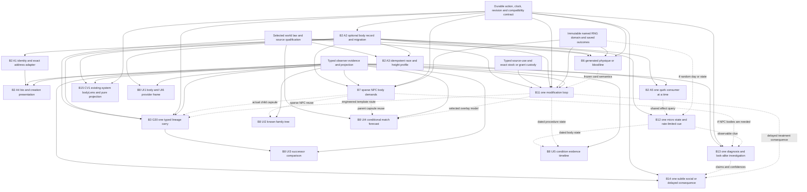

# B16 proposed dependencies

2026-10-14. All nodes are unselected proposals. Solid arrows mean a required contract for the stated slice, not a demand to implement every upstream lane. Dashed arrows mean optional reuse or content evidence. Small authored substitutes can satisfy a contract without building a general generator. [ROADMAP](ROADMAP.md) turns the graph into playable checkpoints; [CONFLICTS](CONFLICTS.md) qualifies joins.

## D1 Graph

## D2 Slice contracts and false dependencies

| Requested node | Hard prerequisites | Optional reuse / gate it does not impose |
|---|---|---|
| B2 A1 | A2 record in integrated runtime; exact legacy honorific matrix | Adapter can be prepared first. No anatomy inferred from gender; no pronoun invention. |
| B2 A2 | Real serializer/loader, validation, neutral legacy migration, host/body ownership | No genetics, reproduction or new actor enrollment. |
| B2 A3 | A2, selected world profile, replacement stat buckets and native reconstruction | No sex multipliers or race XP changes in this proposal. |
| B2 A4 | A1-A3 for full G25.1 demonstration, safe evidence projection | UI1 can ship a narrower known-body subset without enabling all stat dials. |
| B2 A5 | A2/A3 for B2's proposed profile-gated quirks, real preview/commit adapter per action | Split by consumer. No all-eight-quirk bundle or universal negative trait budget. |
| B6 | Body slot, selected law/catalog, immutable cause/RNG/revision, registered function and source binding | Does not require NPC generation, modification, full organ simulation or a new capability kind. |
| B7 | Qualified person/body ID, sparse validator, transactional materialization, known projection, fixed generation inputs | Existing authored NPC suffices. P4/P19 must be reconciled if used, but no full social-store merge is mandatory. Biological child generation additionally needs typed descent/event capsules. |
| B11 | Versioned B2 extension, actual sample custody/service/supply, capacity law, frozen pending outcome, function/reversal, own clock and action settlement | Can use one authored B6-format card; general B6 generator is not required. Somatic proof does not need offspring; heritable gameplay adds real B3/world transmission gate. |
| B12 | Real selected consumer plus pure rate/query and truthful cue publication | MI6 alone can be clock-derived without random-day engine. B12 A1 specifically combines MI6 + MG6 + MP3 and therefore requires its saved daily body seed/cursor, typed reading/sleep adapters and clock policy. Neither version needs weather, a treatment economy or all A5 consumers. MG6 would additionally need fixed day/body causes. |
| B13 | Hypothesis/claim/evidence records, actual test/provider costs, supported observations and durable story settlement | Public authored investigations can precede genetic simulation. B13 recommends LA1 + BC4 tool/work comparisons first. LA6 + BC6 additionally needs care, retained sample/custody and assay/exposure resolver. A test receipt does not automatically grant faculty or universal certainty. |
| B14 | Selected actor/relationship/motive and evidence channel, event/expiry clock, funded consequences | P19/P23/P24 provide contracts when chosen. No compulsory whole social/psychology/knowledge rollout for one cue. |
| B15 CV1 | B2 known-body data, existing status-window ownership/entitlement, provider-scoped projection | Can precede B6/B11/G30. It reveals no unknown concentration or parentage just because the field exists. B15 CV1 composes optional bodyLens state on the existing known system card, with durable enable before reveal and no independent held card. No concentration exists in B2; that field needs a separately selected typed model/provider. |
| B3 G30 | Selected single-prestige policy, stable person/body IDs, typed actual carrier, frozen offer, preserved world/estate/trial custody and commit | No biological heir required. Authored pact/lesson/relic route can precede generated genes. Never copy new parental mastery into an existing child's body. |
| B8 UI | UI1/UI6 need known projection; UI2 needs typed known kin edges (authored family can suffice); UI3 actual successor offers; UI4 selected transmission model, immutable actual contributors and known inputs; UI5 dated retained condition evidence | Six tools are not one mandatory release. Static wireframes do not close rebuilt game gates. Preserve Bio and Notebook → Practice. |

## D3 Cross-dispatch joins

P1 owns randomness integration, P7 naming, P4/D7 people, P19 typed social/kinship, P23 inner life and P24 evidence/knowledge. Their documents or worktrees are dependency leads, not proof of merged APIs. Future implementers recover actual HEAD, dirty bytes, branch integration and file ownership first. If an unmerged seam is unnecessary to the selected finite proof, use existing compatible authored content. If it is necessary, record the precise external gate rather than assuming it is available.

Content evidence runs alongside every chosen node: B1 world fit, B4 canon qualification, B5 game mechanism comparison, B9 modification catalog and B10 typed source-use/stock evidence. They constrain exact adaptation claims but do not require reading every listed world before an original finite proof.

## D4 Clinic and investigation joins

B11 A1/A2 are preparation/source units, not independently playable releases. Fold pure capacity/outcome/template/reversal planning and B2 revision2/archive migration into the selected A3 clinic checkpoint. B11 A4 is the separately gated natural descendant/development join; A5 is a separately qualified new archetype/provider. B13 reports P3 storylet content/deck now present in main at its refreshed snapshot. Reaudit live integration when selected; the old source-absence finding is superseded, but no B13 native build proof arrived with it. Delivery can reuse P3 while diagnosis protocols and separate correction records still require implementation.

UI2 does not require general lazy NPC generation if existing authored, qualified kin edges suffice. UI4 requires immutable contributors when real children are created, but a pure known-model forecast can precede the B7 materialization implementation. The dashed B7 UI edges mean reuse, not a hidden population-engine prerequisite.

B10 acquisition alternatives do not bypass delivery/recipient/function qualification. A source-use contract is hard for B11; implementing all P8 resources is not. B14 A1 SS2+MP4 can branch after a supported cue and known contact, ahead of diagnosis. A2 recovery relief reuses a real resolved condition; A3 scoped stale report depends on evidence; A4 accommodation needs actual fit/service output; A5 appointment rebooking needs an offer/clock/contact. ST1 delayed physiology is a later real resolver/settlement join, not merely an event timer.

CV1 also requires semantic lens/typed-observation validators and real-envelope commit-before-enable. The existing status panel polls at 250 ms; this can read a cached evidence projection but cannot materialize anatomy, advance timers or write observations. B15's catalogue body.cv1 payload is a reusable inert family card, while its minimum implementation extends the existing holder. Full multiple-system arbitration and active CV3/CV12 scan protocols are optional later nodes, not CV1 prerequisites.
