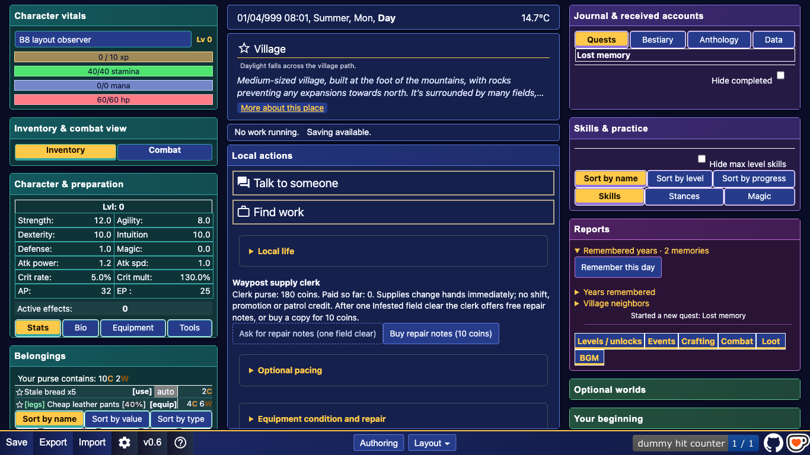
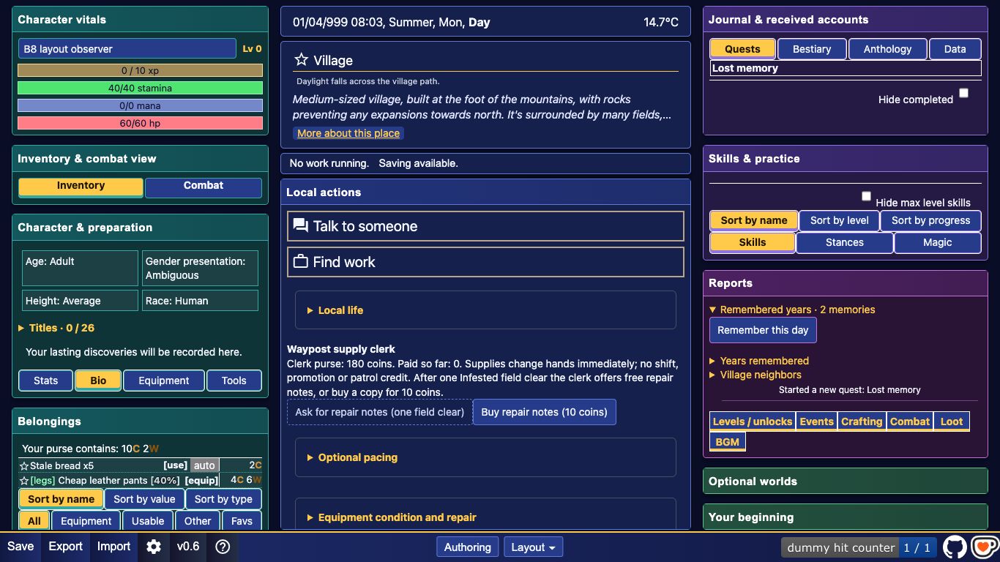
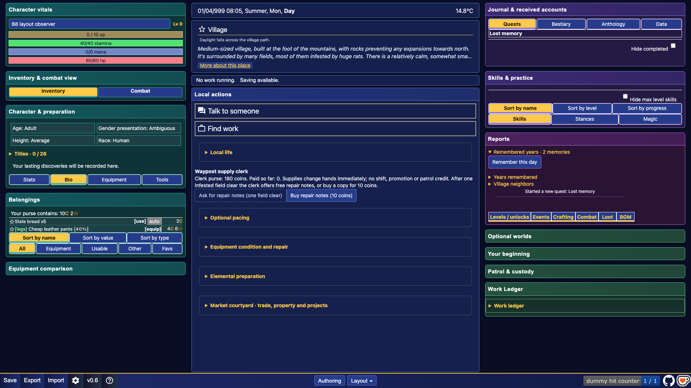
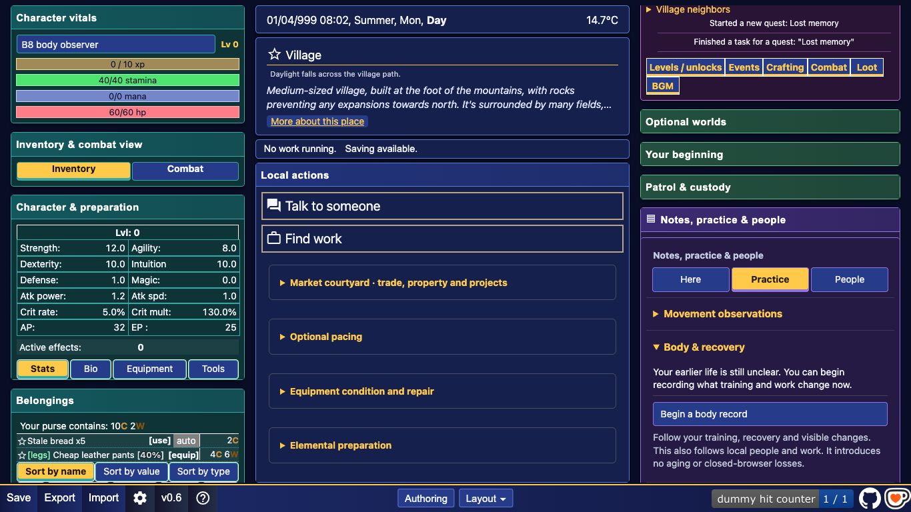

# B8 current UI audit

2026-10-14. Source inspection plus disposable Chrome observations of the existing build. These are different evidence layers. No build was run and no current-source gameplay equivalence is claimed. This checkout was already dirty, on `codex/gameplay-foundations`, with other workers active. B8 writes only in this folder.

## Evidence and capture route

Served the repository read-only with `python3 -m http.server 19480 --bind 127.0.0.1`, because the existing `index.html:17` loads `dist/bundle.js`. Used Playwright `channel: 'chrome'`, headless persistent contexts in newly generated `/private/tmp/body-b8-*` profiles. Created disposable new characters through normal creation, chose no cheat, and opened Bio through its native control. No private profile, user save, seeded save, game-module injection, main-checkout build or foreground browser was used. These profiles may autosave their disposable life; that does not touch a player's profile.

Capture scripts: [opening/Bio](evidence/capture-current.cjs), [body route](evidence/capture-body.cjs). Metadata: [current observation](evidence/current-observation.json). Source/asset fingerprint: [capture manifest](evidence/capture-manifest.json). A matching source-map entry, where recorded, establishes those two source files' identity in the prebuilt bundle only; it does not establish a fresh build or all-source equivalence.

### Fresh opening, 1366x768

### Bio selected, 1366x768

### Bio selected, 1920x1080

F1, observed: three independent docks remain readable at the laptop size. Bio occupies the left Character & preparation surface; current place/work/actions occupy the center; Journal, Skills and Reports occupy the right. The disposable fresh Bio shows age, gender presentation, height and race, Titles, and the empty lasting-discoveries message. It does not show an anatomy diagram, family tree, heir comparison or match planner. This route says nothing about a progressed game's history or long-list fit. The initial Bio capture recorded zero page errors.

F2, observed/source: the new-game screenshot does not contain Body & recovery. In addition to its elder/location gate, the notebook later reparents it into Practice. Its initial Local actions parent is not its final visible home. The body-route screenshot and its exact route outcome are recorded in REPORT.md. No body command was run and no recovery effect was measured.

### Body & recovery after elder dialogue, Notebook → Practice

The corrected native route opened the right-docked notebook, selected Practice and expanded Body & recovery. It showed “Begin a body record” and its description, with zero page errors. The panel bounds were approximately x=969, y=496, width=372, height=228; its bottom was 724, immediately above the footer. This is visibility evidence only. The begin button was not clicked and no body record or recovery effect was exercised. [Exact metadata](evidence/current-body-observation.json) and [attempt record](evidence/capture-attempts.json) preserve the limits.

## File:line audit

All locations refer to the live files read in this session. Other workers can move lines later; the named symbol and capture manifest retain the snapshot identity.

| Ref | Source location | What exists and what it means for G49 |
|---|---|---|
| A01 | `index.html:478`, `index.html:612-627` | Character host contains `character_bio_div` and a profile grid with age/gender/height/race. Optional inspection can enter through Bio; this is not a standalone body-record viewer. |
| A02 | `index.html:661-666`, `index.html:966-977` | Stats/Bio/Equipment/Tools share a native tab strip; `showCharacterBio` switches the active content. Adding every G49 tool here would overload a character tab strip and mix records with immediate preparation. |
| A03 | `src/character_bio_ui.js:5-13` | Dynamic history lives inside Bio. Five disclosure sections cover current condition, training influences, inherited traits, lasting discoveries and learned movements; a practice-notes link already exists. |
| A04 | `src/character_bio_ui.js:14-35` | Render attaches to the Bio host, hides empty sections and updates keyed rows using textContent. Influences can open a skill; detail/effect/cause stay separate. Retain stable row IDs and disclosure state when extending it. |
| A05 | `src/character_bio.js:12-27` | Existing projection inspects player capabilities and sources; excludes temporary and unawakened faculty sources, separates inherited from acquired/trained, and labels uncertain ancestry. This is an earned-effects projection, not general knowledge-qualified genetics. Do not expose a future true body record directly through it. |
| A06 | `src/character_bio.js:28-50` | Active, bio-visible conditions and observed techniques are selected; visible trained skill effects and chronicle age are projected. Expired conditions are omitted, so the current-condition section is not UI5's historical timeline. |
| A07 | `src/main.js:8462-8472` | Bio reads unlocked, visible, positive-level skills; practice opens the notebook and a skill link focuses the relevant row. Reuse these known-only navigation seams. |
| A08 | `src/display.js:5779-5798` | Native profile reads legacy Bio fields. Height and race tooltips depend on existing configuration; gender tooltip reads the old field. SG1-SG7 are not independently rendered here. Migration remains B2's owner. |
| A09 | `src/body_ui.js:4-16` | Body & recovery is a `details.expedition_panel`, command cards from registry group `body`, scene/status and cancel. This is work, not a body sheet. |
| A10 | `src/body_ui.js:17-31` | Hidden in dialogue, before `village.elderMet`, and outside Village/Shack without a body job. Initially attaches to `location_actions_div`, then notebook reparents it; preview supplies visibility, eligibility and reasons; completed once-authored commands disappear; cancellation distinguishes returned supplies from lost stamina. Those local command rules are not a universal UI-use cap. |
| A11 | `index.html:273-274`, `src/main.js:8289-8291`, `src/main.js:8405-8416` | Body initially attaches to Local actions, but `src/adventure_notebook.js:18,88-94,128-132` reparents it into Notebook → Practice; the notebook is its own right-docked records module. Bio travels with `preparation` on the left; `records` and `messages` live on the right. G49 should preserve these semantic homes. |
| A12 | `style.css:2089-2114` | Legacy Bio is 350px wide, 180px tall, scrolls vertically, and uses a profile grid plus 14px history text. This fixed legacy height cannot be treated as enough room for a tree or comparison. |
| A13 | `style.css:3063`, `style.css:3094-3101` | Shared expedition cards supply body-panel borders, description spacing, disabled styling, keyboard ring and amber requirements. These generic styles do not create a body diagram or condition timeline. |
| A14 | `styles/workspace.css:306-310`, `styles/workspace.css:323-347` | Workspace uses 27/43/30 default column weights and a viewport-height board. Docks and module bodies both scroll; Bio's own overflow is lifted inside modules. New inspection regions should avoid adding another nested scroll layer. |
| A15 | `styles/workspace.css:353-380`, `styles/component_themes.css:39-62` | Active character sections fit module width; controls wrap, and customized tables/fields inherit readable palettes. Per-world ornament must preserve these constraints and Player Appearance precedence. |
| A16 | `src/workspace_state.js:27-36`, `src/workspace_layout.js:34-44` | Workspace defaults give preparation 240px, records 140px, messages 220px; unknown modules get fallback geometry. Fresh preset order puts unlisted IDs at the end. Declaring an `after` anchor alone is not proof a new body panel appears visibly. |
| A17 | `src/panel_kit.js:7-35`, `src/workspace_layout.js:315-325` | Kit wraps registry, settings, roles and labels; F6 selects visible shells and scrolls their headers. B8 acceptance must check the useful reading/action region too. |
| A18 | `src/status_window.js:7-38`, `styles/status_window.css:1-8` | Status window is a separate character module using known card acquisition, core stat rows and density setting. It is not a genetics authority or a requirement to own a cheat before seeing one's body. |

## Cheat status dispatch reconciliation

F3: use its panel-kit and known-only row pattern, but keep its findings as evidence rather than new product authority. [GOAL.md](../../cheat-status-window-2026-10-13/GOAL.md) owns C0/CH1 intent; [CH1_REPORT.md](../../cheat-status-window-2026-10-13/CH1_REPORT.md) preserves worker and coordinator outcomes. The opening BLOCKED statement is historical: the coordinator-close section records the Appearance whitelist fix. It must not be cited as a current unresolved blocker.

The later [audit draft](../../cheat-status-window-2026-10-13/runs/audit/report-draft.md#f4-desktop-readability-is-good-but-the-default-placement-and-header-only-focus-checks-miss-useful-visibility) records that header-focused tests passed while useful status contents and a reveal cue were below the viewport. Its lines 29-33 identify preset ordering and F6's header-only scroll. This is a dated audit of its own rebuilt snapshots, not a new B8 measurement. Its lines 11-27 also caution against revealing knowledge before durable publication or treating arbitrary card JSON as a typed gameplay contract. B8 consequently proposes content bounds checks, explicit placement, and projected evidence records. It does not repair or close any cheat-runtime gate.

G49 UI1-UI6 are proposal tools in `docs/GENETICS_CONSTITUTIONS_AND_BROOD_PLAY.md:936-945`. Existing Bio and Body work are candidate homes, not implementation of those six tools.

The full parent chain matters: `src/adventure_notebook.js:88-94` moves the command panel; `:125` hides unselected notebook views; `:128-132` opens/registers the notebook in the right dock. `index.html:431-442` supplies the Journal Notebook entry and legacy host. Two attempted captures without selecting Practice timed out on a hidden summary. They did not show a broken body command; no command was attempted. The corrected route and result are retained separately.
