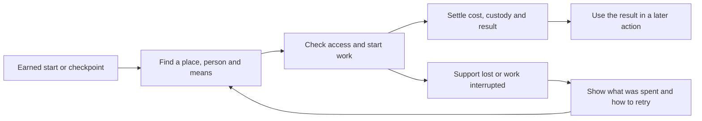

# Ordinary play and the first four story arcs

November 9, 2026. Bounded audit and proposed build order under WPR24–32, WER11/14, AD38/43/51/52. The [active checkpoint](CHECKPOINT.md#restart-after-the-95-allowance-checkpoint) owns the earned saves. Current evidence combines entry-control inspection, selected current source and focused tests, and attributed browser receipts. The proposed beats beyond the qualified windows are work contracts to check against the readings when reached. This pass covers the selected starts and their next useful loops.

## Progress recorded

| World | Lead route | What remains at the arc boundary |
|---|---|---|
| Lord of the Mysteries | Fully verified through ch111 P046. Earned browser partial at ch115 P067. KJ3AV authored through ch118 P020. | Finish and verify KJ3AV from the partial, then continue to Tingen ch213. |
| Harry Potter | The rebuilt 31-action finale reached the station and the farewell from the exact Norbert save. | The stage cites ch17 P209 but omits the last exchange. Preserve the existing ending save when adding it. |
| Reverend Insanity | Verified through ch98 P037, with Rank Two and the estate assignment earned and both held Gu recovered. | Resume at ch98 P039. Resolve the estate and source-qualified fusion sequence, then continue to Qing Mao departure in ch199. |
| Mother of Learning | Printed Arc 1 endpoint ch26 P287 verified, including terminal festival reset and persistence. Some interludes are compressed. | First-arc endpoint reached. The visitor route is a separate branch and does not inherit Zorian's loop. |

## Where an ordinary life starts

| ID and entry | What already works in the inspected scope | Gap to close alongside the arcs |
|---|---|---|
| F1 · Tingen. Four original roles are offered in the Lord of the Mysteries panel. Sampled Nighthawk probationer and civil staff. [Entry and pay tests](../../../../tests/lotm_lives.test.js) | Role-specific terms, own purse, district endorsement, weekly civil pay and a separately gated probationer dose. Clerk employment can work without initiation. | Close a small ordinary case from intake through report and follow-up. A lead-only report can carry a plot clue, while the underlying permission, witness window, evidence custody, and handoff should work for the ordinary employee. |
| F2 · Hogwarts. Beginning offers first school term and adult glass trade. Sampled school and read the separate trade definition. [Start definitions](../../../../src/world_packs/book_hp_life_data.js) | The school entry starts after guardian-arranged supplies and holds an allowance debt. Timetabled lessons and practice lead to a real material assessment via an opt-in extension. The trade start has its own wand, bench and stock. | Give an ordinary first-year a coherent first school week, starting from the existing supervised arrival. A missed class has a catch-up slot and the assessed method earns one real use outside class. Add a practical reason to go to the dormitory, library and bench. |
| F3 · Qing Mao. Beginning offers original adult Moonlight novice and Gu keeper. [Care pack](../../../../src/world_packs/book_gu_life.js) · [Keeper pack](../../../../src/world_packs/book_gu_keeper.js) | The novice starts with an opened aperture and a supervised specimen. Focused tests prove food freshness, hunger, supervised title/control transfer and use of a living Gu. The keeper has a different starting stock and stipend. | Prove a Gu stays the same individual across carrying, storage and return. Feeding should use the food lot and clock while control, holder and location determine whether the Gu can be used. Reuse the result in Fang Yuan's custody path where the source calls for it. |
| F4 · Cyoria. The independent visitor first meets the Village elder, reads the guest terms in Notebook, then chooses enrollment and enters via the Village passage. [Passage and controls](../../../../src/book_world_mol_host.js) | The visitor has guest access, a term-bound permit, supervised practice and a service route. Existing tests exercise the learned lamp's household use, finite charge, pending reload and permit expiry. The general start enumerator misses this entry because it reads Beginning, LOTM and Optional Worlds. | Show the elder and guest-terms prerequisites where a fresh player can discover them, then carry one practice skill through a local paid or household application after access changes. Preserve skill, check current fuel and custody, and show the person or permit that can reopen access. |

**Entry gaps to carry forward.** Tingen's tested crossing keeps the local purse and identity terms. The sample does not settle every role's origin/era or the launch-vs-Notebook contract. Hogwarts school and trade declare body age, means and obligations. The adult's origin, earlier supply choices and exact entry era remain open. Qing Mao adult entries declare sponsorship and the granted aperture. Native origin versus crossing, era and prior-life carry remain open. Cyoria's visitor source explicitly uses the same body and cargo with a two-way Village passage. A separate native resident start, with its own era, identity, language and obligations, is a later design choice. Each new offer should show what the chosen character starts with, owes and can access before confirmation.

## ACCOUNT FOR NOW. What the player must do

These are action chains to plan and verify. A completed beat can be compressed where it preserves its meaningful choices, time, cost and aftermath.

| Order | Story actions | Ordinary counterpart and subtle checks |
|---|---|---|
| A1 · Klein first | Resume the ch115 pay save and take the club visitor's arrival. Speak to the actual participant and distinguish their account from Klein's inference. For subsequent cases, receive a request, ask for support or obtain clearance, choose how to investigate, spend actual travel or work means, record attributed findings, hand over any evidence, file the report, and earn a follow-up or settlement. Qualify the specific Tingen climax and departure from each upcoming source window before choosing verbs or awarding outcomes. | Use the same case mechanics on one original Tingen assignment. Clerk can file or request assistance while a probationer may earn restricted access. If the witness leaves, preserve the account already learned and offer a return or referral. A borrowed item and a report copy have different custody. Pay or reimbursement settles once. |
| A2 · Harry closeout and school | From the packed school save, ride the train, cross the barrier, meet the waiting guardian, hang back to say goodbye, answer Hermione and depart. The final observation belongs to Harry and his friends. Use an idempotent follow-up or a compatible continuation so an existing station save can still see it. | The first-year route should check the timetable, travel to class, obtain permitted stock, learn, practice, show the result, then apply it to one real object. Distinguish attendance, mastery, permission to borrow, and ownership. A classmate can offer help or decline. A late arrival gets a catch-up option rather than a silent hard stop. |
| A3 · Fang Yuan | After the exact assignment save, read the source-qualified next step, present or meet the requirements, verify the adjudicator's decision, and record the precise rights it grants. For actual fusion when reached, retrieve the correct living inputs, meet the method and essence costs, reserve them, then resolve which inputs and resulting Gu exist and who controls them. At the later departure, check the sourced means and outstanding obligations, move the actual character and portable stock, and retain stored custody at origin when applicable. | An ordinary novice can feed and store a Gu, run a real work or practice interval, retrieve it and use it. Hunger and freshness continue on the correct clock. Food ownership, control rights and physical possession can differ. A preview explains a weaker reserve or unavailable specimen in the same terms as the status. Check whether each kind of failure or cancellation has already spent anything. |
| A4 · Zorian upkeep and Cyoria | Arc 1 already reaches the printed finish. For the next authored reset-and-use beat, notice an event, record what the character can infer, return at the right time, use the retained clue to ask or demonstrate something, and let the current listener decide. Check changed access after the reset. | For the separate visitor, consult the guest desk, get permission, arrange a teacher or worksite, practice, obtain a device or material, use the skill for a real task, then return or renew access. For the looped route, record what is remembered, what physical stock rewinds and what social permission must be earned again. |

## LATER / DELEGATE. Additional interactions worth tracking

| ID | Scope and effort | Observable done check |
|---|---|---|
| S1 · People have their own plans | Medium runtime slice when a selected case, lesson or assignment needs an actor. Use existing timing and support checks. | An occupied or unwilling actor gives a reason and a plausible retry, substitute or referral. Work interrupted at settlement consumes or releases precisely the declared means after reload. |
| S2 · Local institutions remember decisions | Medium design and runtime slice when an appointment, House role or claim has a real consumer. | Compare two characters with different rights and the same inventory. One is admitted; the other's screen names the missing authority and a route to obtain it. A later expiry removes access while the character still knows the method. |
| S3 · Ordinary costs compete with the plot | Small per-world content plus a focused route check. | Rent, allowance debt, spoiled stock or a closing desk changes today's best choice. Waiting, travel and pending work use the same world time. A passed deadline never pays or consumes the same thing twice. |
| S4 · Lower-cost proof and presentation | Small scenario and UI pass at 1920×1080 once a feature is selected. | Run an ordinary actor with no private lead facts, a success and a single-change failure. Show who, where, what is held, what is due and what changed. Save mid-action, reload, export and import when persistence changes. |
| S5 · Deeper world content | Larger, after each first useful loop. Cases and distinct affiliations in Tingen; school calendar, term progression and adult craft in Hogwarts; clan missions, production and clan/estate economy in Qing Mao; recurring teaching, wards, workshops and a native resident in Cyoria. | Each proposed layer adds a decision or an outcome another system reads. Select the next seam against the actual source and ordinary route. |

The suggested build order is A1's case seam alongside KJ3AV, A2's station correction and one school week, A3's custody and feeding seam alongside the estate, and A4's visitor access and skill follow-through as a bounded ordinary-play slice. Use the existing powers, jobs, holdings, inquiry and world calendars where they fit. A useful stress test is to exercise the handoff with an ordinary school supply or workshop tool before trying it with a plot-critical item.

F4 also has a [long-term power divergence proposal](../../../worlds/mother-of-learning/WORLD_BRIEF.md#f4-follow-up-surpassing-zorian-within-one-loop). It covers exceeding a source-window feat within one loop and what changes for the scene, witnesses and next reset.

## Arc side ideas

**ACT NOW.** Captured these proposals for later selection. The first-arc work stays on the earned routes in the checkpoint.

| Proposal | What makes it playable |
|---|---|
| O1 · Tingen, a false witness with a true clue | An unreliable informant gives you one detail that checks out. Spend the afternoon corroborating it, or file it as unconfirmed before the desk closes. A later investigator can act on the verified detail while keeping the witness's credibility separate. |
| O2 · Hogwarts, a repair that changes the evidence | Repair an object and someone can use it again, but a visible mark that supported an account may vanish. Sketch it, ask someone to witness it, or leave the object broken until it can be examined. Reuse the ordinary repair and observation paths. |
| O3 · Qing Mao, a Gu pledged against a debt | Pledge a living Gu and let a keeper hold and feed it while title and permission to use it follow the agreement. On late payment or missed feeding, resolve the Gu's condition separately from who owes what. First prove one ordinary custody and feeding handoff. |
| O4 · Cyoria, the safer loop that makes you less certain | Outperform a source-window feat early and prevent a small accident. The person you saved now goes somewhere else, and your memorized alibi stops matching. In the following run, the technique still works with the right means and the player must check the new account. This is a candidate for the world brief's ZP5 test. |
| O5 · Tingen, borrow a charm you cannot yet make | A colleague lends a charm during an emergency. If you use it, repay the loan with a replacement, materials or an agreed shift. The debt can open a lesson in making the charm, with the colleague's time and the recipe's actual inputs still needed. The harbor route already records a replacement owed to Old Neil. |

**ACCOUNT FOR NOW.** For any selected idea, use an action the player already
understands, show the cost and affected person or object, and give the changed
result one later consumer. Reopen the proposals after their matching ordinary
loop exists. A single paired success and failure is a small scenario check once
the needed behavior exists. New custody or witness behavior is a medium runtime
slice if a selected case needs it.

## Evidence and limits

- **ACT NOW (done):** Updated the progress owner and current summary, including the missing Harry exchange. The [cross-world interaction map](../../../CROSS_WORLD_SYSTEMS_TRANSFER.md#round-2-cross-world-build-cases-from-community-discussions-2026-11-09) owns the larger shared-system proposals.
- `node --test tests/project_md_shape.test.js tests/lotm_lives.test.js tests/hp_school_progression.test.js tests/gu_life.test.js tests/mol_learning_application.test.js tests/mol_access.test.js` passed 43/43 on the working source. These are focused tests, including prepared fixture cases.
- Fresh headless traces with seed 1, a 75-minute target and 12-action cap confirmed the Nighthawk probationer entry and started introductory Charms and supervised Moonlight refinement from their ordinary starts. Each trace ran 8 actions over 81 game minutes with zero runner errors. These are opening smoke checks.
- `node scripts/headless/trace.mjs --list-starts` found four original Tingen choices and both ordinary Hogwarts and RI choices. Cyoria uses a separate entry control confirmed in source. The scoped proofs above do not establish full ordinary campaigns, rebuilt desktop verification on this turn, or installed behavior.
- Cyoria fresh headless probe met the Village elder and opened Notebook but did not locate the guest-terms control. This leaves fresh entry unverified and makes the entry affordance the first check for A4. Separately, `node --test tests/mol_lore_traces.test.js tests/mol_regional_methods.test.js` passed 10/10, including fixture-based return, re-entry and region-dependent use of a retained method.
