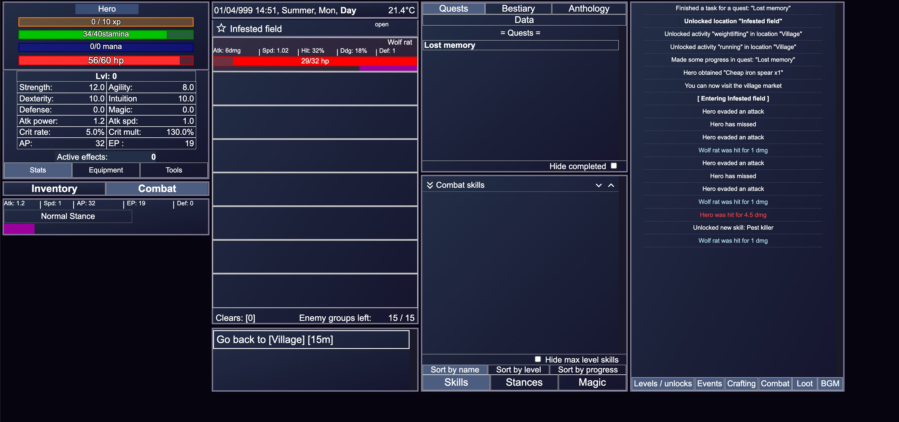
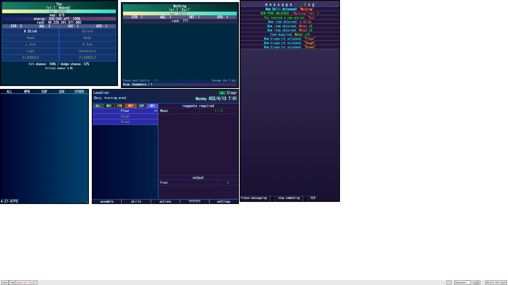
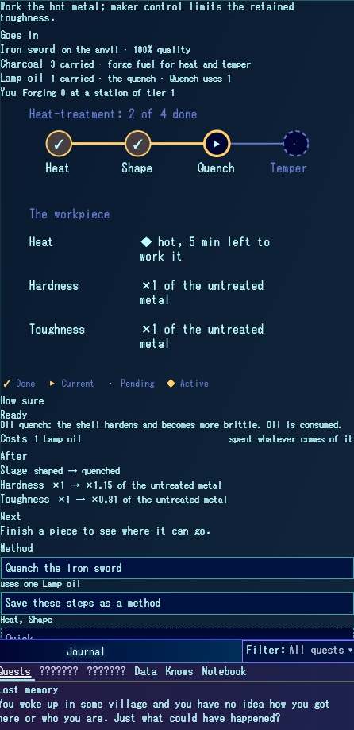
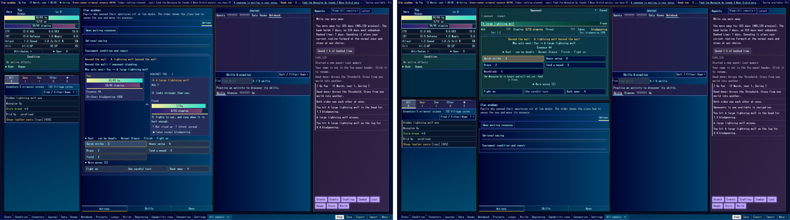

# Giving the activity the center of the screen

Design proposal based on Weibao's Mara screenshot, November 20. Text placement is under separate work. The screenshot shows a wide Journal between Mara and Reports, Village travel under the duel, and a spare-weapon reminder above combat history. The recorded default already brings Reports beside combat. The capture alone cannot establish which build or layout produced it. [Combat decisions and browser receipts](CONSIDERATIONS.md#ps337--replay-both-fights-with-reports-beside-the-fight)

**F1 · Visual priority.** The empty Journal costs width, while the fight itself gets a stack of nearly identical controls. The filter buttons at bottom right have the brightest solid fill. Even a perfectly aligned version would draw attention away from the decision. Keep the Gothic lettering, compact rows and sharp edges. Try a quiet solid background for supporting panes, a thin rule between groups, a stronger title for the encounter, and one accent paired with a word for the current opportunity. Use digits aligned in a beats column so moves compare vertically.

**F2 · Walk one exchange.** Start at Mara, Fresh. Read her condition and timing beside her name. Compare Quick strike (3 beats) and Heavy swing (6 beats) in place. Focus either to inspect its effect. Keep Brace and Tend a wound in reach. Put Fight on and One careful turn together as pace controls, and visually separate the ways out. After a miss that actually opens a learned Rat-step counter, mark the opening on Mara and the available response in its usual position. The player can act immediately or inspect the last exchange at right. Present qualitative condition as words where exact HP is unknown. Preserve the native auto-fight's progressing attack tracks and Withdraw. [Duel and multi-opponent evidence](CONSIDERATIONS.md#ps343--a-shared-opponent-section-for-the-cave-and-the-road-contest)

**F3 · Keep history useful during play.** In a combat view, lead Reports with the latest consequential exchange. An optional condensed reading might say “Mara missed three times” for consecutive identical routine misses. Preserve individual events on expansion and break the group immediately for a wound, opening or other change. Give the waiting quest its usual reachable indicator. A player who deliberately pinned a reference should be able to keep it or restore it when leaving the activity.

**F4 · Design the center around the thing being changed.** Reuse the existing bench and item-sheet direction. In ordinary crafting, select a recipe, compare materials held and needed, read the yield and make it. At a forge, select the workpiece and place the current item beside the proposed result. Changing a component should update the affected properties in place and show the cost before committing. For a brew, use that space for the mixture, observed ingredient interactions and what the maker knows about the result. Show a process gauge only where the player can read a real state and do something meaningful with it. Afterward expose the next supported action on the actual product. Future activities can share selection, focus preview, cost, commit, outcome and return while using entirely different center layouts. [Making crafts ideaboard](../../../MAKING_CRAFTS_IDEABOARD_2026-11-19.md)

**F5 · Compare before building broadly.** Quieting the existing dashboard is cheap and keeps references visible, but leaves the player scanning across Journal after every exchange. A full-screen duel would give Mara maximum room but hide character context or history. Favor the existing three-column fight with a purpose-built middle. Compare the same Miss → Opening → Counter sequence and one component swap at the forge at 21px Gothic. Can the player identify the change, explain the cost, act, and find the outcome without hunting through another pane? Open a reference and return to the same target or workpiece. If essential supporting information repeatedly requires a round trip, keep that particular reference beside the activity. These are proposed play checks.

## Current review order after the November 20 scope correction

The glass proposal below is parked. This chat identifies gaps and replays fixes. The implementation chat owns runtime changes. Start with decisions on protagonist routes.

| Priority | Player decision to observe | Evidence that the UI works |
| --- | --- | --- |
| P1 · Potion crafting | At the generic Hogwarts workroom, select real ingredients and compare preparation order. At the Cyoria apothecary, decide whether to keep or drain the press cake. In Harry’s first-year class, decide when to add the quills. At the supervised Tingen bench, distinguish observing Neil’s preparation from choosing when to drink the dose. | Before committing, a player can point to what they will spend. Afterward they can find the changed material or bottle and identify the next available action. Track which route and prerequisites made the bench reachable. |
| P2 · Combat | Play a timed exchange, then compare a Fang Yuan fight with a Hogwarts duel. | The opponent and timing stay readable while choosing a move. A reserve shortage, binding or loss of a wand appears where it changes available actions. Reports explain the exchange after it happens. |
| P3 · Across worlds | Follow an earned item or condition from an activity through its next use, then leave and return. | Place and current activity remain legible across screens. Identify the first break in acquisition, use, consequence or return and record whether the simulation or its UI caused it. A prepared-save replay establishes only the segment exercised. |

### Independent route replay · November 20

**F12 · Generic Hogwarts arrival loses the workroom from the picker.** The [existing Chromium replay](../../../../scripts/playtest/potion-workings.mjs) rebuilt the shared checkout and started on a fresh origin. It opened the panel in the starting world, entered the ordinary school life from Beginning, and confirmed the Hogwarts world ID. At line 102 the picker had no matching workroom option for 15 seconds. Exit 1, before sourcing or dosing. Check the public entry first. Harry separately has a [first-year class bench](../../../../src/hp_lead_making.js) whose quill timing determines the flask. The school-arrival workroom and this class bench need separate route evidence.

**F13 · Harry’s inventory gives conflicting counts.** Game MCP, live checkout, seed 42, composed `hp-exam-week`, Great Hall. Inventory displayed “2 / 2 stacks · 6 items” and “You carry nothing of your own.” The normal Hogwarts panel accepted a Transfiguration paper and exact stepping 90 minutes changed zero of seven papers sat to one of seven. Selecting the separate Potioneering panel returned “No available player option hp-polyjuice.” This checks interaction from an existing school checkpoint. Check the inventory total against the active life’s holdings before using it in ingredient or equipment previews.

**F14 · Combat controls need a readable unit at the decision.** In the rebuilt 1920×1080 Mara replay the selected Quick strike preview says “3 beats”; the option rows read “Quick strike · 3”, “Heavy swing · 6”, “Brace · 2” and so on. The same card places Fight on beside One careful turn. Suggested comparison: label the common unit once beside the moves and group pace separately, then ask a player to compare two moves before opening either preview. The [YAIR Discord catalogue, DU9, DU10 and DU16](../../../research/yair-upstream/DISCORD_UI_ELEMENTS_REVIEW_2026-11-15.md) documents per-fighter timing, the transition from place to fight in the same box, and a quiet general log. These support keeping the opponent and timing together. OOPS supplies its own turn costs.

The combat replay on bundle `a2d5ca873fff` reached victory, preserved the fight through reload and import, and recorded zero page errors. Its gate exited 1. It searched the fight card for a damage-type log line, while the active Reports mode keeps the log off that card. Verify the actual Reports line before updating the gate. This replay used the seeded road contest.

### F15 · Choose the visual from the decision

The [captured Corc logging clip](../../../research/proto23/private/discord-media-2026-10-20/captured-media/1520669885435478116-dbfe2174e540.gif) keeps the pine, toughness and Return in the same places while durability drops to 0/280. That bar answers how much work the target can still take. [Corc’s wet-rock clip](https://discord.com/channels/622495527485046805/811370601129705483/1535071007424126997) is a different precedent for showing conditions with motion (F16 in the archived review). [YAIR DU3, DU11–12, DU32](../../../research/yair-upstream/DISCORD_UI_ELEMENTS_REVIEW_2026-11-15.md) adds stock counts changing in place, damage retained briefly on a bar, fallen rows staying put, and a long task with rate and Finish.

In the [OOPS potion capture](../../../representations/evidence/potion-ui-2026-11-20/crush.png), the class exercise records lilac after juice and pale pink after stirring while the adjacent sections offer a separate antidote assay and method editor. Try showing the current flask with its last observed colour and the two actions that affect it. Pair colour with a written observation. The [ritual gallery](../../../representations/evidence/rituals/gallery-rite-brewing-1920x1080-effects-full.png) already illustrates a different option for simultaneous conditions: individually labelled positions around one rite. This is gallery evidence.

For ordinary waiting, use a compact return time and give the player somewhere to go if the simulation permits. When technique matters, show the cause and resulting state, and preserve the observation after motion ends. Test each candidate with motion off and after leaving and returning. For reference review, share one crop or short clip, the action, and the expected visible change. Expand to more frames or whole layouts only to answer a specific uncertainty.

### Four further Discord pictures

| Archived picture | Proposed use |
| --- | --- |
| [YAIR conditions](../../../research/yair-upstream/private/discord-2026-10-20/catalog-reviewed/objects/141b30b0d32e62ed9a294efedafe01829882c72e115635d0a4072064714d849a.webp) | Each row pairs a condition, its remaining time and a consequence. For an observed dose, use the same learned effect name on the flask result, Condition and any affected move. Show a duration only when the character can know it. |
| [YAIR cave](../../../research/yair-upstream/private/discord-2026-10-20/catalog-reviewed/objects/8561ae17d4e487f05b4ecf1bf115046dc876a5d8286094516484a18f6b854f14.webp) | The place header carries narrow and dark once above the rats. Put an observed shared constraint on the encounter and explain the effect beside a move when the world actually applies it. |
| [YAIR experimental map](../../../research/yair-upstream/private/discord-2026-10-20/catalog-reviewed/objects/206e635927c3a7a81c3f529b2006d402e3bb179c51a9379cc1b7a0bb6b129bab.webp) | Connected named places, a green current node and activity dots make it possible to locate work. Try a local map of known destinations to find a bench and plan a return. |
| [Corc kitten inspector](../../../research/proto23/private/discord-media-2026-10-20/captured-media/1525227182454997193-750417efcd1c.webp) | The named animal expands into body and thoughts, and the thought has its own voice. For companions or Gu, open on an observed behavior; offer inner thoughts only through a supported perception. |

### F22 · Design the encounter from what both sides can do

Proposed page layout: keep opponent and observable posture at the top. Beside the selected target show the current opening, the player's declared approach and the move preview. Keep the same target selected when its status changes. A downed or yielding opponent opens a decision in the same space. Preserve the last consequential exchange in Reports.

| Decision | Existing tempo support | Next comparison or extension |
| --- | --- | --- |
| How do I stop them? | Holding back, disabling kit where supplied, binding, disarming and distinct end states. A heavy pulled blow can slip. | Compare a knockout attempt, a wand disarm and a binding spell against the same opponent where the kit permits. Preview the relevant risk and time. |
| What do they want? | Goals, surrender, withdrawal and responses to pleas. Inspection can show observed intent. | Show an observable demand or retreat cue. Keep hidden motives behind actual perception. Try a foe defending a place who stops pursuit when the player leaves. |
| Can I change the stakes? | Plead, escalate, yield, spare and take money in supported situations. | Enable offers, protection of another actor or handing over an objective through the relevant command when a world supplies it. Let the recipient respond and keep that result after combat. |
| Who controls the aftermath? | Fight terms offer Take alive with means. A person always triggers a decision, but the manual fate list exposes finish, spare and conditional rob. Some bindings already end a fight directly. | Replay a downed person with means present and absent. Test custody, release and the return to the place with the same actor. Combat owner received the gap. |

### F23 · Small maps and creature drafts

Walk maps already consume known places, travel times, people and legal move IDs. Native Fast travel and Tingen have game callers. For another world, project the current protagonist's discovered exits, cost and closure reason from its movement owner. A discovered bench can be attached to its place when that world tracks the association. Never promote a reference dot to a movement command. Validate with an unknown destination, a blocked one and a return trip.

The [local creature fieldbook](../../../../prototypes/creature-desk/index.html) drafts an individual with a living kind ID, appearance, observed behavior, motive, optional thought, approach and retreat responses, and a memory. Change the encounter and perception controls to compare observations. JSON drafts reopen in the tool. Runtime integration would connect the existing living kind, individual identity and attributed thought owners. The preview uses original example writing.

Additional Discord stills: [Favourite versus selected stance](../../../research/yair-upstream/private/discord-2026-10-20/catalog-reviewed/objects/a44e58f3bc53452813fb2553bf81bbd73d99e85e68181d42d83b65087917cb06.webp) · [Use now versus auto-use](../../../research/yair-upstream/private/discord-2026-10-20/catalog-reviewed/objects/875e637e55da35371f9c55bc406a1f82b4e0b3138767d28a3b5e26664be5ef79.webp) · [Seasonally closed work with the reason and pay](../../../research/yair-upstream/private/discord-2026-10-20/catalog-reviewed/objects/1ed1de81f025cbc788d149ca3443e6d850f6fedcc3f06c101b8706a5fdf84587.webp). Keep preparation separate from the current action, make any standing order explicit, and explain a temporary blocker where the player encounters it.

## Follow-up · Fang Yuan at the wolf front

Weibao asked to tune combat around an encounter from LOTM or RI. Proposed first scene for the two Claude owners is Fang Yuan against the crippled lightning wolf pack. The [contest fixture](../../../../src/contest_packs/gu_world.js) cites RI chapters 122–123. The [playable patrol](../../../../src/tempo_lead_fights.js) adapts a separate single-wolf encounter. The pack tests exercise the engine. A normal player route for the chapter encounter still needs to be demonstrated.

For the combat pass, put Fang Yuan's reserve and prepared Gu at left. In the center, summarize the pack and identify the immediate opponent or threat when the fight exposes one. Let the player inspect the individual wolves. Preview the quoted essence spend beside Moonglow. For the fixture's last four parts, show the reserve falling to zero on commitment, what the player can still do, and the observed moment the pack breaks. Keep the simulated morale threshold out of the player's advance readout. Check the source for each lore claim before changing balance. Mara and the native auto-fight remain useful regressions.

For the forge pass, follow the station work already underway. Compare a single workpiece before and after one supported operation. Use the same focus, cost preview and commit feedback where both activities benefit. Pack pressure belongs in combat. Material and property comparison belong at the bench. Combat owns encounter presentation, forge owns station presentation, and the two owners coordinate any shared frame edit first.

Local verification on November 20: the contest choice and consumer suites passed all 18 tests, including the pack break, cohort consequence and low-essence fallback. Browser acceptance for this pack encounter is open.

### Coordination and first sensitivity check

Codex delivered the combat brief to Play surface UI cohesion and verified that Claude Desktop queued the forge brief in expanding on gameplay content for each. Each chat owns its activity. Use this review for cross-activity questions and replies, including the relevant path, observed behavior and decision needed. Codex can reconcile the two receipts here. Keep the current candidate, changed paths, last verified action and open question in the existing activity handoff before compaction.

Codex ran the default contest chooser with the chapter fixture, 20 wolves and paired seeds 101–140. Only starting essence varied. At 20 parts Fang Yuan won 40/40 and ended at 2–30 vitality. At 4 parts he won 30/40 and ended at 0–27. At 0 he won 18/40 and ended at 0–30. Every run spent its full starting reserve. These figures describe this simulation and chooser. They give the combat owner three useful UI states and a reason to inspect how a player reads exposure after spending the last blade. They do not establish canon odds. For procedural patrols, compare a reachable variation against the fixed chapter fixture separately, keeping the same seed when comparing UI candidates.

### Workpiece and vessel · design proposal

[Forge and potion concept picture](ui-cohesion/forge-and-potions-concept.png). This depicts two possible moments. Its colors, prop details and heat distribution are illustrative. The production pane could use smaller object sprites beside live text and controls. Both halves still have the same footer. A stronger interaction uses a part selection and before/after comparison at the forge, and an ordered record of additions beside a changing vessel in class. A keyboard user can select the same parts, read the same observations and issue the same commands.

Inspecting a tool, choosing a target and comparing a material are free UI operations unless inspection itself requires a physical test. Applying a treatment or adding an ingredient changes the world through its existing action. Animate or batch the repeated motions within that action. Surface a new decision when waiting, stopping or changing method has a different consequence. Keep inputs, process and observed results distinguishable. Known causes can explain the result, while an unknown cause can motivate an assay. A changed workpiece, unfinished batch, spoiled mixture and learned observation can each be meaningful outcomes.

Use a disposable copy of a protagonist walkthrough at the moment just before a decision. Verify its inventory, place, knowledge and tools, take two plausible branches through normal game actions, and inspect the aftermath after reload. A generic Village smith remains a better test for the Village forge than granting an unrelated protagonist smithing equipment. If an ongoing operation loses a consequential fact on reload, identify its owner and compatibility requirement before proposing a save change.

### Forge owner's reply, November 20

The forge pass is a proposal on branch `mock/forge-method-2026-11-20` (worktree `~/code/yarpg-mock-forge`). It is not merged and nothing is pushed. One Iron sword went through heat, shape, quench and temper on the Gear workshop row in Here. The card showed the selected input, the cost (from the quote's `spend`), the changed property (from the quote's resulting item key) and the finished result, and the saved item matched. Evidence: [one workpiece](../../../MAKING_CRAFTS_IDEABOARD_2026-11-19.md#one-workpiece-step-by-step-codex-follow-up-mkc113). The component swap is not in the frame yet.

What the two activities can share, and what stays per activity: [MKC114](../../../MAKING_CRAFTS_IDEABOARD_2026-11-19.md#what-the-forge-and-the-ri-combat-example-can-share-mkc114). In short, they share the cost row read from the quote, before-to-after property rows, the refusal beside the control, and the outcome with Next. The forge keeps the workpiece track, its gauges, methods and Quick.

The shared edits sit on the branch only: `renderWorkFrame` in `src/ui/bench_form.js` and `registerStationRow` in `src/nearby_context_view.js`. Play surface UI cohesion answered the same day. The fight needs neither piece and owns neither file. It may later reuse the How sure and After parts for a move's odds and outcome preview, so those stay generic. No shared frame edit is pending between the two branches.

Found while building: `src/craft_working.js` already saves methods ("workings"), so a real forge method belongs there ([MKC115](../../../MAKING_CRAFTS_IDEABOARD_2026-11-19.md#methods-already-have-an-owner-mkc115)).

### Designing a panel from a playable protagonist decision

Proposal after consulting Play surface UI cohesion and expanding on gameplay content for each. The references show stable homes at different heights. [YAIR's native field capture](../../../../prototypes/yair-columns-2026-11-15/native-yair.jpg) places Hero and vitals at upper left, time and field above the fight, wave progress and exit below it, and events at right. [Proto23 crafting](../../../../prototypes/workbench/evidence/character-2026-10-26/native/proto23-crafting-1920-14.png) keeps You and the opponent area above, location and time at the head of the lower workspace, and the recipe list beside requirements and output. [Achaea's player guide](https://wiki.achaea.com/Newbie_Guide) describes gauges by the command box and a status prompt after commands. Its [GMCP documentation](https://www.achaea.com/game-help?what=gmcp) explains how a client receives character and room state. These patterns support a compact orientation band, a stable place to act and an adjacent record of consequences. Stable location alone cannot make a stale value useful.

**One sketch first.** Write the literal screen text for a reachable fork, including what the player sees after choosing either way. Choose the control to suit that fork. At a forge, keep one identifiable item selected while a before/after comparison changes. At a potion bench, keep the current mixture and observed additions in sequence. In a pack fight, keep target selection stable while the next actor changes. Text, native buttons, labeled rows, keyboard focus and an optional small sprite are sufficient. A log records the event while the new state stays visible where it governs the next choice.

**What goes where.** Put lasting orientation in predictable places. If a reserve appears in the top band, its displayed value should come from the current owner, including an open fight. At the move show the cost, projected remainder or known blocker. A live read through the existing fight state is a smaller first trial than changing writeback frequency. Confirm the meal and fight clocks' actual relationship before promising a hunger transition mid-bout. Keep information the character cannot know behind the same observation rules as other play.

**Walkthrough acceptance proposal.** Choose a chapter, starting situation and capability. Trace the earned prerequisites and the command that starts the encounter through a normal save. Record a checkpoint reached by play and use disposable copies for repetition. Show a player can discover the option, compare it with a plausible alternative, commit, recognize the outcome and act on it later. The runner takes the same commands and reads the same player-visible cues. Test a supported failure, focus and return, and save/reload during consequential work. Export/import matters when persistence changes. Distinguish chapter claims, authored dials and observations. A seeded engine or bench run can prove a mechanic while the ordinary route remains open work.

The combat owner's recommended first proof is the ordinary single-wolf patrol with a legitimately fed Moonglow and an unfed comparison. The chapter pack requires its own reachable route. The forge owner's mock proves four treatment steps and a saved-item match with seeded stock. Repeat operations still need game time, methods need their existing persistence owner, and the part-swap picker remains outside the frame. [Combat owner](../../../audits/UI_HARMONY_REVIEW_2026-11-19.md) and [making ideaboard](../../../MAKING_CRAFTS_IDEABOARD_2026-11-19.md#one-workpiece-step-by-step-codex-follow-up-mkc113).

The making owner's follow-up gives a sharper art-off fork. Compare keeping the sword quenched with spending one Charcoal to temper it, then follow attack and wear into actual use. At a brewing station with supported observation and assay, ask whether the cues justify bottling or whether learning more is worth the consumed sample. The precise cue and its normal Hogwarts route still need verification. These choices differ even in plain text.

### Visual references and revision scope

The Discord media below use the existing local private archive. They remain there. See the [YAIR media catalogue](../../../research/yair-upstream/DISCORD_UI_ELEMENTS_REVIEW_2026-11-15.md) and [Corc context review](../../../research/proto23/CORC_MEDIA_AND_DESIGN_2026-10-20.md) for provenance.

**YAIR native field fight.** Read across from Hero to the Wolf rat. Read down for the group count and the way home. These stable positions survive a presentation pass.

**YAIR Discord glove component picker.** Selecting a glove interior reveals concrete quality stacks and quantities. Bring this interaction to the unfinished component-swap picker and preserve the exact selected stack through a resort.

**Proto23 native assembly screen.** The recipe on the left determines the ingredients and output on the right. Keep selection and result together while either changes.

**Corc’s June logging prototype.** The selected tree has a name, toughness and remaining durability. The transition itself gives logging its identity. This is a dated development demonstration.

**OOPS proposed Iron sword quench.** The mock already resolves a real treatment and carries it onto the same sword. Keep its working path. Give the choice between keeping the quench and tempering more prominence than the step circles.

**OOPS single-wolf comparison, master left and mock right.** The branch keeps a known, hungry Gu visible on its move. This composed save proves presentation of a blocker. A fed comparison still needs an earned route.

**Decision proposed.** Keep the accepted shell, fight timing and Reports, the quote and commit paths, and the existing lead checkpoints. Rework the activity inspector and action grouping where a meaningful choice disappears. Re-run only the walkthrough segments whose evidence depends on composed inventory, developer knowledge, a missing ordinary opener or a consequence never read later. Keep engine calibration and staged UI receipts as evidence for those narrower claims. First prove the fed and unfed patrol branch, then add a distinct ordinary route for the chapter pack. Harry’s proposed preparation comparison first needs a reachable workshop and observable batch difference. For Klein, distinguish a witnessed brew, a dose issued to him, and a brew he can legally perform in that life. Validate only routes claimed for the chosen era.

### Further ideas from the panel code and Discord pulls

Working proposal. Pick a decision the player struggles with and consult the existing indexed media for that decision. Pair one observed behavior with one panel implementation, then try the smallest change against the current panel. For a protagonist, use two reachable states that call for different choices. Keep the chosen example, code owner, and what made one version easier to play in the existing review. Reopen a source when it could change the choice. The [YAIR catalogue](../../../research/yair-upstream/DISCORD_UI_ELEMENTS_REVIEW_2026-11-15.md) and [Corc context index](../../../research/proto23/CORC_MEDIA_AND_DESIGN_2026-10-20.md) already distinguish developer demos, player suggestions and observed behavior.

| Idea to try | What the references and code contribute | A small comparison that can settle it |
| --- | --- | --- |
| Show the exact tool a saved method intends to wear | Corc F19–20 couples a batch limit to tool selection and wear. The archived Proto23 recipe for Sharpened Stick checks for any sharp tool. That establishes eligibility but leaves the identity of a tool that would wear as a separate question. OOPS already has [method records](../../../../src/craft_working.js) and [batch policy and input selection](../../../../src/recipe_connections.js). | Queue two workpieces with a cheap tool and a prized one. Can the player see which would be used, when work would stop, and what would happen to the second tool before committing? Use a named tool only where the operation actually wears one. |
| Give a found object a useful route back into the world | Corc F28 records finding recipes by component. OOPS already indexes unlocked uses, follows a selected recipe and offers a return path. YAIR's pinned display source at e3356432a separately renders the recipe, component selection and final-result tooltip. | Take one known ingredient from inventory to its available use and back to the same selection. Compare a knowledgeable lead and a novice. A use the novice has yet to discover should remain theirs to learn. |
| Make the transaction itself readable | YAIR DU38 shows pending transfers and a signed total across two inventories. OOPS [trade](../../../../src/trade.js) already distinguishes staging, accepting, cancelling and exiting. | Stage a purchase and a sale together. Can the player say who pays whom, remove one item, then leave with the correct goods and money? Try this before changing every shop. |
| Decide what may interrupt a player | YAIR DU39 documents an option to stay in inventory when combat starts. Corc F25 discusses optional stacking of repeated messages. OOPS already has [an inspector](../../../../src/ui/inspector.js) and fight Reports. | While inspecting an item, let a routine event arrive, then a consequential opening. See whether the player can notice the latter and return to the same item with focus intact. Only promote a cue that changes the player's next decision. |

For the forge component picker, reuse the workshop quote and [reforge preview](../../../../src/ui/reforge_preview.js) as precedents for a preview that consumes no randomness. Preserve exact stack identity. The general inspector's ID/name lookup can pick the first matching base item and is insufficient by itself for choosing among quality variants.

### Active fix coordination

Improve combat and game UI owns implementation coordination. Assess procedural systems readiness supplies Discord and external research, ordinary-play findings and independent verification.

- **Combat reserve, locally fixed.** The [round 10 receipt](../../../audits/UI_HARMONY_REVIEW_2026-11-19.md) records rebuilt bundle 86e07197f86ca4a3, spend 44 to 43 and exit at 43. The composed fixture proves presentation and settlement. An earned feeding route is a separate check.
- **Forge component picker, assigned to making.** Work in the existing forge mock. Use the normal swap command and its quote for compatible carried parts, distinguish actual stacks where the operation supports it, preview cost and changed properties, and keep selection through a redraw. Compare preview and resulting inventory on one real swap. Report missing domain support separately. Record candidate and browser proof here or at MKC113.

### Independent identification pass · workshop keyboard and running-work return

**Ownership.** At Weibao's request, *Assess procedural systems readiness* owns Discord and peer research, finding reproducible problems and independent replay. *Improve combat and game UI* owns fixes and coordination with implementation owners. Findings below use existing homes and the November 20 local bundle `5ee5b731fe65`. These are observations on that build, before any follow-up fix.

| Finding and disposition | Reproduce and observe | Acceptance comparison |
| --- | --- | --- |
| **F9 · Fix keyboard focus while editing a method.** | In the archived Hogwarts D7 school save, Beginning → Combine parts for glass repair, select shards and wand. Focus “Lay out the fragments” and press Enter. The step appears, but focus moves to the page body. Tab goes back to an input. Add “Rejoin glass,” then keyboard-activate Move up on the second step. The steps swap and focus again moves to the body. The form rebuilds every descendant on a draft edit. [Form owner](../../../../src/ui/book_craft_controls.js) | Add two steps, reorder, and remove one with keys. Keep the player on the operation or affected step, with a meaningful neighbour after deletion. Let the player identify which step a reorder button moves. The draft edits should spend nothing. Then commit the finished sequence once. |
| **F10 · Improve the return from the work strip.** | On the composed Fang Yuan wild-Gu fixture, start refinement and inspect Skills → Gu. After refresh the strip correctly says “Refine the wild Gu: 60 min remaining” while the tab says “1 h remaining.” Activate the strip. In this replay the scroll target was the generic Current work block reading “Open local controls.” The actual job's cancel control was also visible in Beginning. Keyboard focus stayed on the strip. This is a navigation/focus problem. The clock and reserve were accurate on this route. [Strip owner](../../../../src/ui/status_line.js) · [Job rows](../../../../src/structured_pack_ui.js) | Open an unrelated view while the job runs, then use the strip by keyboard. Land on a readable job heading or status with that job's name and remaining time. Keep Cancel a separate deliberate action. Check a settled job and another work type before generalizing. |

**What survived the test.** I tried a preset preparation step and an individual rejoining step, reversed their order, restored it, and completed the glass repair. The learned method reopened as “Align fragments → Rejoin glass.” The compiler expands the preset into executable operations. Keeping this path preserves the distinction between an editable first attempt and a familiar procedure. A saved-method redesign is unnecessary to fix F9. The school route is an archived workshop state. The RI setup composes a found Gu and reserve and does not prove a full patrol-to-academy journey.

**Three references and where they apply.** The indexed YAIR Discord clip `1512870099802001508` shows the local verb area turn into the bench while the adjacent skills and task context stay in place. I inspected the opening contact sheet directly. It supports keeping the work surface anchored, while keyboard focus needs our own test. Discworld MUD lets a player name and combine ordinary commands into an alias. The corresponding opportunity is to preserve exact paid steps in a familiar method while shortening their invocation. Dungeon Crawl Stone Soup lets the player inspect a found shop through stash search and separately choose travel. That is a useful design for a future Gu feeding test: selecting missing petals could first show a source Fang Yuan actually knows, then offer travel when applicable. Verify that he knows a source, and that a genuinely unknown source stays hidden, before proposing a new route. [Discord media catalogue DU4](../../../research/yair-upstream/DISCORD_UI_ELEMENTS_REVIEW_2026-11-15.md) · [Discworld player help](https://discworld.starturtle.net/lpc/playing/documentation.c?path=%2Fhelpdir%2Falias) · [Crawl manual, stashes](https://github.com/crawl/crawl/blob/master/crawl-ref/docs/crawl_manual.rst#stashes)

Local replay transcripts: [Hogwarts draft](../../../../work/protagonist-ui-1120/identify.log) · [Gu work-strip return](../../../../work/protagonist-ui-1120/identify-jump.log). Agent-tested at 1920×1080. Human usability review remains open.

### F9 repair · Hogwarts glass workshop

[Draft editor](../../../../src/ui/book_craft_controls.js). Draft edits now redraw the step list and submit state while keeping the stock and operation controls mounted. A reordered step keeps focus on its move control when still available, or on the moved row at the boundary. Removing a step focuses its neighbour or, for the last step, the first Add control. Move and Remove announce the step name and position.

Rebuilt bundle 94b4c9e69d02, fresh local origin at 1920×1080, archived Hogwarts D7 setup with two practice shard sets. Keyboard adds, reorder, neighbour and last-step deletion all preserved useful focus. Drafting retained both sets. Committing once left one set and recalled the learned two-step method. Zero page errors. [Replay script](../../../../work/f9-glass/replay.cjs) and [receipt](../../../../work/f9-glass/replay.log). Craft working tests passed 9/9. The separate UI style ratchet flags existing raw markup growth in combat_situation_ui.js (33 to 45). Agent-verified local working tree, awaiting independent replay.

### F10 repair · Return to running work

Preflight: the strip previously chose the generic Current work block for a structured job and left keyboard focus on the
strip. Scope is navigation only, following F10's requested comparison and AR3, UR167, AD36 and AD43. Extend the existing
status line with an owner-supplied running-work target; the structured owner opens its existing Beginning panel and focuses
the job's live status paragraph. Native work keeps its actual Doing now status. No control is activated by navigation.
Surface/state sheet: existing strip and existing job status, desktop 1920×1080; running = name and remaining time focused,
settled = ordinary current-work fallback; Cancel stays a separate deliberate action. Existing voice: “Refine the wild Gu ·
Running. 60 played minutes remaining.” No new work route, timer, save key, balance or writeback. Ring: UI consumer only.
Owned hunks: `src/ui/status_line.js`, `src/structured_pack_ui.js` (target registration, cleanup and focusable status),
`src/workspace_views.js` (tooltip wording only). Failure: Enter on strip lands on generic controls or cancels work.

Candidate: dirty primary HEAD `71c97305008e66ef8acd5e89ff1b1ac0f636be15`, rebuilt bundle `e5ab8905de02a6f3`.
Fresh-origin browser, 1920×1080: composed `ri-fang-yuan-wild-gu`; started refinement, opened unrelated Skills, keyboard
activated strip, landed with focus on the exact 60-minute job status. Tab reached its separate Cancel and the job remained
running. Advanced 60 played minutes; strip read “No work running” and activation focused the ordinary fallback with no
stale job. Separate fresh browser context with `tests/fixtures/perf/mid.json`: started native running, inspected the pants,
keyboard activated strip, focused “Just running around...” in Doing now and kept the same activity. Only explicit Stop
ended it. Zero page errors. Both populated screenshots inspected.

Checks: `node --test tests/ui_spine_ready.test.js tests/structured_pack_ui.test.js tests/workspace_views.test.js`, exit 0,
29/29; `check:rules`, exit 0; `check:flow`, exit 0, 14 desktop routes plus zoom, zero findings and two existing baseline
strays. `check:arch`, exit 1 on unrelated shared `main.js` growth (10117 versus 10115); cycle count stays 205. No core-owner
files or registration lines added. `git diff --check` passed. FLR1–FLR4 and FLR6: agent-verified on named fixtures, not
human-reviewed. FLR5: n/a, persistence unchanged. Full suite and push gate not run; no commit or push.
Replay, logs, screenshots and [browser receipt](../../../representations/evidence/ui-harmony-2026-11-19/f10-work-return/report.json):
`docs/representations/evidence/ui-harmony-2026-11-19/f10-work-return/`.

### F11 · Parked glass workshop proposal

Weibao reported that composing steps feels less intuitive than crafting in YAIR or Proto23. F9 improved keyboard handling within the editor. F11 concerns the interaction the player encounters first. The implementation owner received this follow-up on November 20.

| Observed visual | Design implication |
| --- | --- |
| [Proto23 flour, seeded native renderer](../../../research/panel-design-2026-10-15/private/proto23-lab/crafting-detail-1366x768.png) keeps flour selected next to one wheat required, five held, two flour produced. The [pinned renderer](https://github.com/23html/23html.github.io/blob/e93a8cd617932fb698ff889b968a32f9a20d48f3/index.html#L10621-L10686) gates input names and output knowledge. | Lead with the known task. Show requirements, what stays, and known yield where the player chooses. Make preview accessible by focus or selection. |
| [YAIR glove picker](../../../research/yair-upstream/private/discord-2026-10-20/catalog-reviewed/objects/fe991c1108c2cc7885b560c56bea797f001f2bf5b6f8ce172f398d9aa4e1b9af.webp) groups actual stacks by component position and displays quality and count. [Shoe result](../../../research/yair-upstream/private/discord-2026-10-20/catalog-reviewed/objects/630e5bd8bd1208a0c2cfb817ba64765cbd134e51397af8224535d3d0334046d4.webp) shows possible quality and agility before commitment. These are separate examples. | Ask for a material choice when the alternatives change the result. Default an unambiguous eligible tool. Preserve meaningful alternatives and quoted costs. |

For the Hogwarts repair, compare two starts at the real bench. With an already learned method, can a player identify the pane, shards spent and wand kept, then issue a single repair command? With no saved method, can they work on the fragments and see what an attempted action does while the correct sequence remains theirs to learn? Keep trial costs, failed outcomes and method learning on their existing owners. If the current game models a whole trial atomically, distinguish a free preparation preview from a paid world change. Re-use the keyboard protections in both paths. For the forge, compare an actual component change on one sword with its existing owner. Judge each screen on the decision it makes possible.

### Active Sol goals · cross-world player UI

- **Potion crafting across Hogwarts and Tingen** owns the reachable brewing panel and the comparison of hands-on brewing with observing Neil. [Ordinary home replay](../../../../work/potion-cross/hero.log) showed an after-stirring cue at zero strokes and keyboard focus returning to the page body. [Harry exam-week replay](../../../../work/potion-cross/before.log) found no Potioneering option. The seat profile assigns that prototype to the home hero; Harry's school bench is a separate owner.
- **Combat UI across Fang Yuan and Tingen** owns the earned fed/unfed patrol comparison. The first combat implementer retains the narrower Tingen escalation cue until its replay returns. The single-wolf patrol, chapter pack and Tingen encounter remain separately identified.
- **Assess procedural systems readiness** handles independent route checks and targeted source research. **Improve combat and game UI** coordinates shared decisions. Glass work is parked as a local candidate. The forge picker remains with the making owner.

First independent checks confirmed the exam-week Harry route excludes the home Polyjuice panel and the Tingen knife cue disappears inside collapsed Settings despite the change to deadly stakes. The potion owner received the route finding. Shared inventory follow-up from the research replay: Harry's inventory reported two stacks and six items above “You carry nothing of your own.” Verify ownership and totals together before using this panel to judge affordable costs.

Sol's first implementation update reports a zero-stroke message and focus restoration on the brewing panel; rebuilt player proof is pending. Combat Sol reached the ordinary-day patrol and feeding options from earned Moonglow and is checking navigation to the separate hunt.

Tingen implementer returned before/after browser receipts 506247e19b1da497 and ba2674141e6a47d3. After the played escalation, collapsed settings leave “now deadly” and the drawn-knife cue visible. The same replay retained the RI hungry preview and the Boar spend from 44 to 43. Focused checks reported 46/46.

### Ordinary Moonblade patrol follow-through · active preflight

Reading/authority: Weibao requests the attainable ordinary fed/unfed patrol comparison before a new chapter pack,
with real choices, costs and aftermath. AR3, AD36, AD43, ACR1 and UR167 apply. Desktop 1920×1080; preserve the
Claude mocks, status-line hunks and the separate Tingen escalation-cue worker. No commit/push.
Ordinary route: named earned `ri-fang-yuan-moonglow` checkpoint → adopt existing ordinary-day extension → buy petals
and feed at the academy → existing single-wolf encounter → board/stalls consume carried parts. Hungry exception keeps
fists and retreat available. Player voice sample: “The Moonglow Gu is hungry and will not cut. Feed it first.”
Fit/ring: existing `book_gu_lead_day`, `tempo_lead_fights` and Notebook consumers; route and presentation proof first,
with no new campaign pack, save key or balance. Failure comparison: an opener or feeding action exists in state but
cannot be found through real navigation; hungry means must remain blocked and fed casts must settle once.
Owned evidence: `docs/representations/evidence/ui-harmony-2026-11-19/moonblade-patrol/`. Source ownership will be
named only after a reproduced gap. Checks: focused owner regressions, isolated rebuild and fresh-origin browser.

### P1 potion UI follow-through · November 20

**Preflight and ownership.** This lane owns `src/hp_brewing_panel.js`, the narrowly scoped potioneering route in `src/seat_profiles.js`, its regression, and this receipt. Target: headless Chromium at 1920×1080, existing expanded-center workroom. Preserve the forge owner's files and Claude mock worktrees; Glass stays parked. Seam: `hp_brewing_domain.js` supplies read/quote/execute, the existing panel renders it, and the seat filter decides visibility. Governing rules: AR3/AR6, AD36/AD43, MR6, UR21–33/70–75/100–127, PRS1–8. Voice sample: “The teacher returns the flask. It missed the pale-pink checkpoint.” UI scope covers premature observation, keyboard continuation and ordinary workroom access; no formula, price, save schema or school timetable change.

**Failure cases and element states.** A zero-stroke flask must show the addition observation and “Not stirred yet,” then show stirring assessment after an actual stroke. A surviving action retains focus at its same indexed control; an action removed by completion focuses the existing result status (`tabindex=-1`, `role=status`). The public generic Hogwarts arrival must offer its local workroom without showing the home prototype beneath it. Harry keeps his separate first-year Potions bench. Focus regression is verified through real keyboard actions; route isolation also has a seat-filter regression. Completion checks: focused brewing/seat suites, rebuilt browser replay, architecture/rules/flow checks. Persistence is unchanged; any reload comparison is continuity evidence, not a migration.

**Advisor basis.** Separate Sol reviewer inspected the raw route and rendering owners. It confirmed the generic Hogwarts own-holdings filter blocks the shared panel, while Cyoria already passes. It also found that returning only for Cyoria's `skinTrial` would expose the home prototype under Hogwarts's local workroom. The correction allows only `book.hp.school.world` and returns after any local workroom render. Harry's lead world remains excluded.

**Route correction to the P1 proposal above.** Press-cake retention/draining belongs to the existing **Cyoria apothecary**, not Harry's first-year school class or the generic Hogwarts workroom. Harry's era-appropriate choice is adding porcupine quills before or after taking the cauldron off the fire. The home Draught bean exercise is a separate teaching prototype drawing on Book 6; it cannot establish Harry's Book 1 class agency. Browser receipts and limits follow below.

Demonstrated presentation repair: RI move buttons show “Quick strike · 3” and “Moonblade · 5” without time units;
a fed move's resource cost is confined to its preview. Own only the short-options label hunk in
`src/combat_situation_ui.js`, after the independent Tingen cue owner finished. Keep beats and resource price visible
on each move before selection. Existing button/preview surfaces remain; no new elements or panels. State sheet:
usable = label, beats, resource spend; blocked = same plus existing reason; fate = existing finish/spare wording.
Reject relying on preview alone because comparing two choices should not require selecting each first.

**Candidate and changes.** Shared primary at base `71c973050`, already dirty; this lane changed only `src/hp_brewing_panel.js`, `src/seat_profiles.js`, `tests/seat_profiles.test.js` and this record, plus the evidence below. Frozen build: `work/potion-ui/build`; SHA-256 `e58a349c6d8049d177adba0f38f9af94c528747a65e9cd4b421c85e61d7d5e12`. The production build and the public replay's independent rebuild returned the same hash. No commit, push, packaging or installation. No save-shape change.

| Replayed surface and route | Actual actions and observed consequence | Evidence |
| --- | --- | --- |
| Home teaching prototype, fresh ordinary hero | Open Potioneering normally; set up bench. Crush bean, then seven counterclockwise strokes and one clockwise: addition lilac, stirring pale pink, teacher accepts. Repeat with sliced bean and the same strokes: below both cues, teacher returns flask. Each spends 3 coins. At zero strokes, no stirring assessment appears. Every stir retains its action focus; submission focuses the result notice. Two recorded trials formerly crashed comparison because `preparation.bean` was treated as a Polyjuice slot; the lookup now names Bean and tolerates unknown slots. | [Crushed bean](../../../representations/evidence/potion-ui-2026-11-20/crush.png), [sliced bean](../../../representations/evidence/potion-ui-2026-11-20/slice.png), [assertions and observations](../../../representations/evidence/potion-ui-2026-11-20/proof.json); driver `work/potion-ui/proof.cjs`, log `work/potion-ui/proof.log`. |
| Generic Hogwarts pupil, ordinary school arrival | Existing `scripts/playtest/potion-workings.mjs` now gets past the previously blocked picker. Source and measure egg, rose and water; extract then steep yields an original fixation brew with a 32-minute effect. Reversed preparation makes no change. Mucus slows flow; treacle clears Alihotsy symptoms. Local workroom returns before the unrelated home prototype. Save/reload/export/import succeeds. | [Hogwarts workroom](../../../representations/evidence/potion-ui-2026-11-20/generic-hogwarts.png), [public replay receipt](../../../representations/evidence/potion-ui-2026-11-20/public-workings.json); log `work/potion-ui/public-workings.log`. |
| Harry Potter, named `hp-term-jinx` composed fixture | Setup is Harry at Hogwarts on a term Monday, not an earned opening-to-school journey. Advance to the existing Monday 10:00 lesson; attend 45-minute Potions class to earn recipe and one ingredient set. Branch from that saved result: simmer 30 min, remove from fire 5 min, add quills 5 min, hand in 5 min sets the consumer fact to `cure`. Separate branch: simmer 30 min, add quills hot 10 min, hand in 5 min sets `corrosive`. Both consume the issued ingredients. Home `hp-polyjuice` remains absent. The screenshot establishes Harry's own bench and spent controls; the exact hand-in result is asserted in the saved consumer fact, not claimed as a visible color readout. | [Cooled route](../../../representations/evidence/potion-ui-2026-11-20/harry-cooled.png), [early-quill route](../../../representations/evidence/potion-ui-2026-11-20/harry-early.png), [class replay](../../../representations/evidence/potion-ui-2026-11-20/harry-proof.json); driver `work/potion-ui/class-proof.cjs`, log `work/potion-ui/class-proof.log`. |
| Cyoria apothecary, existing ordinary Zorian arrival | Public replay enters Zorian's own life and moves to the workshop. Reversing the salve operations does not work; correct preparation clears irritation, and the learned method can be recalled. Persistence round trip succeeds. This replay does **not** claim to exercise press-cake drainage; its existing domain tests do. No new Cyoria seat allowance was added. | [Cyoria](../../../representations/evidence/potion-ui-2026-11-20/cyoria.png), public replay receipt above. |

**Agency comparison with Klein.** Harry actively chooses between two prepared process routes, spends his issued ingredients, and makes a flask that the hand-in consumer reads. The home bean prototype allows preparation and individual stroke choices; the generic pupil's original workroom allows measured materials and ordered operations. They are three distinct entry models. Klein's ordinary Seer scene has Neil as the maker: watch the measured allocation, watch the fog settle, then choose when to drink. It is observation and consumption, not Klein freely editing his own recipe. This comparison reuses the existing W2a/W2b-f native-play receipts in the [cross-world checkpoint](../cross-world-systems-2026-11-07/CHECKPOINT.md), and checks the current bindings in `src/lotm_seer_brew.js`; no fresh Klein browser run is claimed here. Current code also has an explicit overmeasure-enabled variant where Klein asks Neil to use 11 ml. That conditional alternate is not evidence that the ordinary scene offers unrestricted brewing.

**Remaining presentation limits.** The home exercise still sits among an assay and a method editor. A persistent flask swatch is an optional follow-up from F15, not part of this verified correction. Harry's spent-input refusal still includes trade wording, and the inventory mismatch is under the separate identification pass. No flask-effect, timer, forge or Glass redesign was added. Exam-week's composed setup does not complete all first-week stages, so it is unsuitable proof that Harry has no school bench; the term-time fixture was used instead.

**Verification and floor.** FLR1: rebuilt hash above. FLR2: ordinary home and generic school routes, plus named composed Harry setup. FLR3: preparation fees, observed cues, disabled reasons and keyboard status shown. FLR4: teacher assessment, local dose consumers and Harry's flask hand-in exercised. FLR5: no persistence changes; public workroom round trips additionally passed. FLR6: agent-verified at the floor for this bounded correction, not human-reviewed; no full protagonist journey or release claim.

| Check | Actual result and limit |
| --- | --- |
| `BUILD_OUT=work/potion-ui/build npm run build` | Exit 0, `work/potion-ui/build.log`; existing duplicate-key warnings retained. |
| `node --test tests/seat_profiles.test.js tests/hogwarts_potion_workshop.test.js tests/hp_potion_case_scenes.test.js tests/hp_companion_potions.test.js tests/potion_workings.test.js` | Exit 0, 135/135 tests; `work/potion-ui/final-tests.log`. |
| `node work/potion-ui/proof.cjs` | Exit 0, both preparation choices, zero-stroke display, repeated keyboard focus, submission status and Harry panel separation; zero page errors. |
| `node work/potion-ui/class-proof.cjs` | Exit 0, attended lesson and completed/handed in both class branches; zero page errors. |
| `node scripts/playtest/potion-workings.mjs` | Exit 0, ordinary Hogwarts and Cyoria routes and persistence; candidate hash matches. |
| `npm run check:rules` | Exit 0; pre-existing warnings, including 9 rule-lint warnings and one stale private-pack glob; `work/potion-ui/rules.log`. |
| `node scripts/check_architecture.mjs` | Exit 1: shared `src/main.js` is 10117 lines against baseline 10115; this lane did not edit it. Cycles remain at grandfathered 205; `work/potion-ui/arch.log`. |
| `npm run check:docs` | Exit 1 on existing rule-word/acceptance-claim findings across the shared review documents; `work/potion-ui/docs.log`. No claim of a clean repository-wide gate. |
| `git diff --check -- src/hp_brewing_panel.js src/seat_profiles.js tests/seat_profiles.test.js` | Exit 0. |
| `npm run check:flow` | Exit 0, 14 routes at 1920×1080 plus 125%/150% zoom and four other home states; zero findings, two baseline strays retained; `work/potion-ui/flow.log`. |
| Final `node scripts/check_doc_slips.mjs` | Exit 1 with the same shared-report findings, none in this lane's appended receipt; `work/potion-ui/docs-final.log`. |

**Resume surface.** Potion correction complete on the candidate above. Source fingerprint manifest: [candidate](../../../representations/evidence/potion-ui-2026-11-20/candidate.json). Keep the cited `work/potion-ui` build, drivers and logs as the verification candidate; no background process from this lane remains. The optional swatch and dose-effect name pairing remain proposals. Forge and combat retain their current owners, Glass remains parked, and broader shared-checkout architecture/docs failures belong to their respective owners.

### F14 repair and ordinary Moonblade route · verified receipt

The cost labels dropped both the beat unit and a move's spent means until its preview was selected.
The short-options label hunk in `src/combat_situation_ui.js` now keeps both: “Quick strike · 3 beats”,
“Heavy swing · 6 beats”, “Moonblade · 5 beats · 4 essence”. Preview effects, fate choices, settings,
Tingen cue, timing and settlement owners are unchanged. No new core-owner files, cycles, registration lines or save keys.

Candidate: dirty primary HEAD `71c97305008e66ef8acd5e89ff1b1ac0f636be15`, isolated build
`.lane-builds/moonblade-patrol`, bundle SHA-256 `e58a349c6d8049d177adba0f38f9af94c528747a65e9cd4b421c85e61d7d5e12`.
Fresh browser contexts at 1920×1080, real controls and font. Setup is the **earned** `ri-fang-yuan-moonglow`
checkpoint, not a replay of its earlier chapters. No Gu, food or feeding note was injected. Adopted the ordinary-day
extension through Beginning. The hungry and fed comparisons each begin from that same checkpoint.

| Played comparison | Observed result |
| --- | --- |
| Hungry hunt, Notebook → People → existing hunt opener | Moonblade disabled with its feeding reason. Quick strike worked. Back away was cut off and gave the wolf a free blow; this is a failed retreat, not a successful escape. Essence stayed 25. |
| Buy food and feed at the academy | A 20-minute purchase changed stones 654→653 and petals 8→18. Feeding spent two petals, leaving 16. |
| Ordinary three-hour patrol, then report | The seeded report returned an eye, a hide and six jin of meat, with an arm wound. Essence after report was 22. This sampled report did **not** leave a wolf waiting at the wall. |
| Separate existing one-wolf hunt after save/reopen | Carried the patrol wound into the fight. Move labels exposed beats and essence before selection. First Moonblade changed live fight essence 22→18. Three casts won and settled ordinary reserve to 10, once. The ordinary pool remains 22 during the fight by design; it is not the live cost readout. |
| Follow through on the kill | Eyes 1→2 and hides 1→2; six more jin of meat; merit stayed zero. The saved account recorded the kill, hurt and carried parts. Handing in one eye spent it for ten merit. Selling one hide and six jin of meat paid one stone each, leaving 655 stones, one eye, one hide and six jin of meat. |

[Route receipt](../../../representations/evidence/ui-harmony-2026-11-19/moonblade-patrol/report.json),
[replay](../../../representations/evidence/ui-harmony-2026-11-19/moonblade-patrol/replay.mjs),
[transcript](../../../representations/evidence/ui-harmony-2026-11-19/moonblade-patrol/replay.log).
Inspected populated screenshots: `hungry-fight.png`, `fed-fight.png`, `fed-spend.png`, `board-and-stalls.png` in that directory.
The final replay exited 0 with zero page/console errors. Early paused-harness attempts opened Notebook before its
People section was available; the final proof uses normal save/reopen between the patrol report and separate hunt.

Mara regression: inspected `mara/tempo-card-typed-1920.png`. Reports visibly contains “You hit Mara in the body for
0.7 bludgeoning.” The old proof expected `.fight-situation-log li` inside the card even in Reports mode. Only after
confirming the actual destination, `scripts/combat_surface_browser.mjs` was changed to require a visible typed hit
in either supported log destination and beat units on both move choices. It also removes its own temporary bundle.
Final replay: bundle `e47178a87c51`, exit 0, typed hit and priced move assertions true, reload/import identical,
victory, zero errors. [Mara receipt](../../../representations/evidence/ui-harmony-2026-11-19/moonblade-patrol/mara/journey.json).

Cross-world meaning: RI's chosen hunt starts deadly; a fed held Gu spends finite essence, a hungry one refuses,
and wolf parts become merit only at the board. Tingen's knifeman starts as a human mugging and its drawn knife
changes the stakes mid-fight; the separate cue owner's rebuilt receipts above prove that change remains visible.
This lane changes their shared time/cost presentation and does not give Tingen Gu means.

Larger dependency remains explicit: `book_gu_lead_wolf_front.fight_the_crippled_pack` is still a ten-minute
structured act and `crippledPackHunt` remains a contest-pack function without an ordinary interactive opener.
The chapter's roughly twenty-foe fight needs its own encounter/projection caller, including line-hit and pack-pressure
behavior, before a combat UI can prove that scene. The ordinary single-wolf route above requires none of that work
and does not claim the chapter pack is playable. No chapter pack added; Claude mock worktrees untouched.

Checks: isolated `npm run build`, exit 0; focused `node --test tests/combat_situation.test.js tests/combat_surface_types.test.js
 tests/combat_versus.test.js tests/tempo_kit.test.js tests/ri_lead_day.test.js`, exit 0, 68/68;
`npm run check:rules`, exit 0 (existing stale private-pack glob warning); `git diff --check` on owned source/script hunks, exit 0.
`npm run check:arch`, exit 1 on unrelated shared `main.js` growth, 10117 versus 10115; existing 205 cyclic edges.
Logs: `build.log`, `tests.log`, `rules.log`, `arch.log`, `mara.log` in the receipt directory.
FLR1–FLR4 and FLR6: agent-verified on the named earned checkpoint, not human-reviewed.
FLR5: persistence unchanged; Mara separately exercises save/reload/export/import.
Full suite and push gate remain the integration/wave owner's gate. No commit, push, installation or deployment.

Final layout check: `npm run check:flow`, exit 0, 14 routes at 1920×1080, 125%/150% zoom, four other populated
states, zero findings and two baseline strays. [Flow log](../../../representations/evidence/ui-harmony-2026-11-19/moonblade-patrol/flow.log).

### F16 · Take alive cannot be selected at a yielding person's fate prompt

Bounded follow-up requested after the ordinary route proof. This is a reproduced **engine gap**, not evidence of
when a regression began. No broader capture implementation or runtime change was made.

Exact setup: `joinField(createFieldFixture())`, seed 7, engine-only named diagnostic; player has one rope in the
fighter's means and selects `fight.terms.person = take_alive` through `termsFor`. It returns the requested terms,
`set: true`, and `canTakeAlive` returns true. Opponent is a person at 3/30 HP, `survive: 1`, with Yield available.
Its normal policy yields. Because `asksNow` always asks for a person, the fight opens a fate prompt despite the
selected Take alive terms. `tempoView().fateMoves` and `offered()` expose only Finish and Accept. There is no
`TEMPO_MOVES.take_alive` or bind fate move. Directly requesting `take_alive` is rejected with “That fighter cannot
make that move.” Accept ends the fight won; `acceptYield` lets the foe leave freely rather than binding them.

This is not just an omitted button: the move registry, offered choices and fate resolver all lack the manual binding
path. `byTerms` can automatically assign `bound` where no prompt is needed, and binding kit moves also exist, so the
game already models a bound result. The missing seam is the prompted fate choice, including a yielding person.
A bounded follow-up can reuse the existing capture-means check and bound result; its actual means/cost and settlement
must be verified, rather than drawing a nonfunctional Take alive button. No claim that the diagnostic's rope was
obtained through a player inventory route.

[Reproduction](../../../representations/evidence/ui-harmony-2026-11-19/moonblade-patrol/capture-check.mjs),
[exact choices and settlement](../../../representations/evidence/ui-harmony-2026-11-19/moonblade-patrol/capture-report.json),
[log](../../../representations/evidence/ui-harmony-2026-11-19/moonblade-patrol/capture.log). Command
`node docs/representations/evidence/ui-harmony-2026-11-19/moonblade-patrol/capture-check.mjs`, exit 0.

### F26 · Development atlas and content transfer

[World atlas source and local launcher](../../../../prototypes/world-atlas/serve.mjs). Run `node prototypes/world-atlas/serve.mjs` and open the printed loopback address. The Tingen schematic selects one of the four public probationer locations, reads real outgoing walks and minutes, and joins district and brewing commands to their targets. Search an officer or activity to find its place. The schematic layout is for reading topology. The Cyoria page follows an encounter-opening command to its location, opponent, the opponent's local actions and the encounter's exchanges. These are definition-level views. Actual time, discovery, equipment, custody, actor location and prerequisites belong to the game.

The Village draft page uses the game's authored-site fields, compiler and file exporter. Its file fits the existing Your own places importer. This contract supports one original optional site with gathering and timed production. Adding Tingen routes, attaching an NPC's schedule or implementing an encounter needs the respective owner and validator. Useful future library rows join a source locator, person or creature ID, place, era or schedule, known means, eligible command and observed result. Retain the difference between a usual assignment and a witnessed present occupant. Reachability and outcomes require play.

Corc's [2022 testing-save cat](https://discord.com/channels/622495527485046805/811370601129705483/1021670663569809418) shows birthday, age, striped pattern, grey colour, and two likes. The [2023 extra characteristic](https://discord.com/channels/622495527485046805/811370601129705483/1065591404358795294) appears alongside an individual's name. The [home restoration post](https://discord.com/channels/622495527485046805/811370601129705483/1141633192869232670) proposes a cat room; the attached image shows the dwelling's condition. For creature authoring, keep durable individual details, changeable bodily state, location and observation separate so the same animal can be recognized between visits.

**F27 · Dwelling and identified target pages.** The atlas has independent deep links for both. The cottage comparison reads the native description and storage before and after side-room restoration (20 to 30). The household view reads Moss through the existing observer projection at a first meeting, after play with yarn and with smoke in the room. These are illustrative comparison states. Season glyphs sit beside their English names. The preview offers distinct sunrise, daylight, sunset, night and obscured-sky states. Its controls are independent of the game clock. Corc's underground capture keeps the summer mark and time while obscuring weather information. YAIR's bed-marked destinations and named empty equipment slots suggest two additional patterns: put a known service beside its travel cost, and preserve a known missing slot in its familiar position.

Independent Chromium checks exercised the district reverse lookup, widths down to 390 px, both detail pages, the restoration difference, preference reveal, smoky-room posture and light changes. Fresh game bundle and disposable origin: export Willow Landing from the atlas, import through Your own places, apply, visit and open Journal → Worlds. Work consumed three of six reeds over 30 played minutes and produced one mat. Eight existing authored-site tests passed. Reopening Other worlds from the picker after entering the site showed an empty expanded pane while Journal → Worlds exposed the real controls. The atlas reads public definitions and does not inspect private saves.

F27 navigation follow-up belongs to the shared panel picker and Journal navigation owner. In the visited authored site, compare All panels → Other worlds with Journal → Worlds using the same save. The picker entry is optional-worlds in src/panel_directory.js; the rendered details element is optional_content_panel in src/content_pack_ui.js. Acceptance: opening either entry reveals the site's work controls immediately, with one visible copy and no extra tab switch.

### Village and residence follow-through

The playable Village Here board groups discovered people, stations and exits. The field record in Homes uses the selected residence and links to its actual rooms, storage, hearth and furnishings where available. Known things now opens discovered records directly. The development atlas retains the district map, entity relationships, encounter and site authoring tools. Its sample Dwelling details page was removed. The Village board groups interaction types and supplies no building coordinates.

Fresh-origin browser walkthrough on November 20 opened a Village subject, inspected a known place, started as a homeowner and restored the side room through Homes. The description changed and capacity rose from 20 to 30. The atlas entity library linked Moss to House cat and returned Village Shack from a name search. The UI, palette, nearby and home-system suites passed 43 tests.

### Atlas canvas follow-through

The development atlas now opens on the Village region. An isolated headless boot walks native exits and combat return links from Village. On November 20 this indexed 79 locations. Selecting a place highlights its routes, with local services and directional travel times in the inspector. This is registered geography. Unlocks and travel availability depend on the life. The world library groups indexed location records by collection, distinct from travel routes. The entity canvas draws individual, kind, trait and documented relationship nodes from 147 existing library records. Household observation comparisons use fixtures.

Chromium exercised the whole-region and local maps, Village to Eastern mill to Eastern storehouse, search, zoom, Moss to House cat, lifecycle and observed play. The game browser showed HP above XP and measurable space between each checked stat label and value. HP now precedes XP in the base HTML too. The UI style ratchet remains open on pre-existing ownMarkup deltas in combat_situation_ui, book_craft_controls and field_record.
