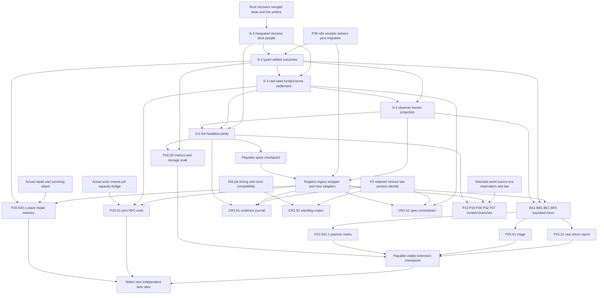

# BJ1: dependency graph and critical path

2026-10-14. Proposal only. Edge `A → B` means A's actual interface/evidence is needed before B's integrated playable claim. It does not authorize A/B, imply every sibling must run, or make a source test a runtime prerequisite. The complete current 158-row graph is [GRAPH_DETAIL.mmd](GRAPH_DETAIL.mmd), generated from [SLICE_INDEX.json](SLICE_INDEX.json). [SLICES](SLICES.md) keeps per-row native/source dependencies and gates, including prerequisites not present as slices.

## Readable shared graph

The Jobs/Place arrows into Later mean their candidates become available, not that both are required for all later work. An ordinary authored actor/repair can be used where the row permits it. Source-only lint/pack drafting can begin earlier; playable admission still needs a real useful consumer. Crafting and canon are selectable branches and keep their independent owners.

## BJ1.1: critical path to the first new playable outcome

**CP1** root-approved current integration base and exact P34/P38 compatibility → S-2 retained settled outcomes → S-3 same-person need/real funded settlement → S-4 safe recap/aftermath → S-5 reproducibility and whole-journey proof → one registry wrapper with the same outcome → BA1/BE1/BF5 known micro → P16.S1 useful return report. This is a semantic/acceptance path, not a measured calendar duration.

S-1 is already merged in main source as part of `4e13f97f`; the P34 branch separately states S-1/S-2/S-3/S-4 work. Root must integrate that branch onto the current wave1 base, preserving P2 and legacy draw continuation. P39 does not redo S-1 or infer S-4/S-5 native completion from a checkpoint. The main dist snapshot is not rebuilt evidence for that merge. P18 headless work and registry inert scaffolding can progress beside spine completion, but their shared joins wait for the owning writer.

**CP2** to actual NPC work adds a real actor/means/capacity bridge before P19.S1. P4 generated identity alone is insufficient. **CP3** to automated crafting adds explicit P2 old-job clock/timing policy and scheduler adapter before CR3.S2. These are higher join risks than a read-only report, explaining the recommended order without discarding NPC factories or orders.

**CP4** to a canon-world slice adds selected source/era/continuity qualification, reservations and its native consumer; no generic world-factory gate is imposed. P13's MoL reset, P24 nonhuman perspective, P27 estates and P31 binding laws retain their own body/temporal/custody/source gates. The broader options remain reachable in later waves.

## BJ1.2: graph interpretation and refresh

Detailed graph edges use S-1..S-5 plus explicit slice IDs from P39's dependency cells. Unranked native prerequisites are listed in the table and summarized here; the graph does not invent implementations for them. S-5's dotted edges are evidence gates. Local rank is preference, not a dependency: there is no automatic S1→S2→S3 chain merely because a REPORT ranks them that way. P16 angle/S-row aliases are folded only where they describe the same first boundary.

P29 is a crafting-label alias to CR4, not a new story lane. P34 is the spine owner, not a second ranked feature menu. P36 A1–A5 and P37 BH-S1–BH-S5 are included with their actual observation, disclosure, trade, body and source gates. Refresh final P37/P40/P38 outputs and the current P34 checkpoint before actual dispatch. If later revisions add ranked rows or change dependencies, extend the inventory and declared owner edges without renumbering existing codes; record the new snapshot separately.
