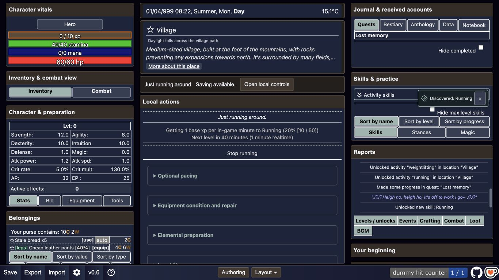

# Proto23 discovery and VFX first native slice

2026-10-13. Human-authorized connection, prompt roundtrip and implementation.
[Executable prompt](PROTO23_VFX-reconciled.md), [review response](PROTO23_VFX-response.md)
and [roundtrip provenance](PROTO23_VFX-roundtrip.json) preserve the sequence.
Ordinary signed-in ChatGPT Chat used visible default High; the prior UI roundtrip
used Medium. Model identity was not exposed or inferred. No new Codex task/agent,
commit, push or publication was performed.

## Delivered behavior

An existing native hidden-to-visible skill transition now supplies a typed
presentation event. It retains the original threshold, XP, rewards, native row
and log. One small guidance/ink cue presents the known skill name, anchored to
its visible row or category header. It does not expand a collapsed category,
switch tabs, reset a layout or grant gameplay state. The shared Stances pane
remains available. Unknown names/categories stay with the existing native
discovery projection; workspace pickers do not enumerate individual skill names.
This slice does not claim discovery-aware gating for every workspace module.

Current settings now permit skill-discovery effects overrides as well as Ledger
and crafting. Whole-profile defaults remain reduced/no sound. Effects-off hides
the decorative cue, with the native learned row/log intact. The cue's dismissal
control stays inside the overlay rather than creating another layout row.

Synchronous native XP emits only after the actual visibility transition; the
microtask resolver rechecks currently known state. It does not add per-XP durable
saving. Item/component crafts queue discoveries and publish only when the existing
transaction is durable; rollback discards the queued events. Load/restore suppress
fresh events and reset presentation session identity. Settings/cancellation retain
the already-seen skill policy, so later XP/redraw cannot replay a first event.
Hidden-tab handlers cancel pending presentation without changing native work.

The VFX owner now maps these causes to the larger menu: useful discovery,
title/tool/material signatures, legible result lines, exceptional ability-space
effects, fracture/panel effects, and fourth-wall reach or deliberate silence.
Stronger powers remain future consumers requiring actual world/ability/knowledge
authority. No god, domain, time power or fake gameplay consequence was added.

## Changes and reproduced repairs

| Area | Task change |
|---|---|
| `src/native_discovery_policy.js` | Typed known/settled event qualification, in-session deduplication and synchronous-batch coalescing; no gameplay/DOM/save access |
| `src/native_discovery_feedback.js` | Current native projection recheck, row/category anchoring, microtask/cancel lifecycle and presentation-session identity |
| `src/main.js` | Narrow UI imports/init, threshold event, craft-durable publication, restore/settings presentation cancellation; no threshold/reward/schema/serialization change |
| `src/settled_text_effects.js`, `styles/settled_text_effects.css` | Reused guidance renderer, small native cue, actual anchor geometry, decorative glyph and keyboard-accessible dismissal |
| `src/customization_profiles.js`, `src/customization_ui.js` | Supported skills effects override and truthful support text; old profile defaults remain valid |
| `tests/native_discovery_policy.test.js` | Qualification, immutable inputs, coalescing/replay/reset and saved module-mode isolation |
| `dist/`, `index.html` | Rebuilt generated output and fingerprinted bundle URL |

Native testing found a collapsed-category anchor that originally prevented the
cue, so the visible category header became the fallback. Renderer mode testing
found shared effect deduplication surviving a deliberate presentation baseline
reset; presentation-session identity now distinguishes that legitimate reset
without allowing ordinary cancellation to replay. A native dismissal control
required lifting the parent overlay's decorative-only ARIA flag for this consumer;
the glyph itself remains decorative.

## Verification and its limits

**Focused tests:** 18/18 passed across native discovery policy/settings, native
craft transaction, save files and compatibility. [Output](TESTS.txt).
The tested slice is not an all-game suite or proof of every VFX idea.

**Build and binding:** authoritative `npm run build` passed. Frozen current
source served at ports 18943/18944 isolates the evidence from other workers.
Final bundle SHA256
`2025657de8b67c59914c809cc172a6dc2b4f0151a7f5b1766d10f53d1ef4bd5e`.
[Final parity](FINAL_PARITY.json) records identical served bytes and zero drift
across the 440 source/output bindings recorded in [manifest](BUILT_BINDINGS.json).

**Native browser:** fresh origins had no saved character. Created the default
human via PLAY/Confirm and used the normal elder dialogue to open native training.
No runtime object/save edits, lowered thresholds, synthetic XP or presenter calls
were used to earn the native discoveries. Before practice there were zero native
skill rows/categories. Running appeared after its original 10-XP visibility
threshold, while still level 0. Weightlifting later appeared through its normal
training route. Full feedback was observed/dismissed on final rebuilt bytes;
default reduced feedback was separately captured at 1366×768.

[Default native result](NATIVE_REDUCED.json) records the actual caption, visibility,
known row, viewport and bundle URL. The full-mode screenshot captures an early
animation frame; its DOM observation verified the live caption/dismiss control.
Native Save/reload retained Running and showed no replayed cue. This is positive
restore evidence, not an exact serialized XP/item/currency comparison.

**Renderer contracts:** [results](RENDERER_MODES.json) and MODE screenshots cover
full/reduced/off/static, unknown-event rejection and cancel-then-replay. The fixture
quote (10 XP/12 coins) remained unchanged. These are explicitly isolated renderer
tests, not native gameplay proof. Static mode is not a real OS reduced-motion
toggle. The [harness](RENDERER_CONTRACT.html) imports the same production modules
when served at the root of the frozen candidate.

**Desktop presentation:** native populated views at 1366×768, 1440×900 and
1920×1080 had no horizontal overflow; learned entries remained and cues did not
replay on viewport changes. [Viewport record](VIEWPORTS.json) and VIEW screenshots
own those observations. 911×512 is a reduced CSS-viewport proxy corresponding
to 1366×768 at 150%; it is not verified real browser zoom or font scaling.
The shared source settings/menu were exercised through normal Authoring controls.

**Open verification:** native Export was invoked and its reward cooldown changed,
but the browser download event did not return a file. Chrome's downloads URL was
then rejected by automatic browser review under its URL security policy. No
workaround was used. Downloaded-export-byte comparison and literal-file import
are OPEN. Real OS reduced-motion toggle, hidden-tab interruption in native play,
failed-save craft plus discovery browser journey and full cue at every desktop
size remain unrun. No human taste acceptance is claimed.

## Play route and remaining acceptance

[Frozen playable slice](http://127.0.0.1:18944/). For a fresh origin: PLAY →
Confirm → Talk to someone → village elder → Hello? → Where am I? → the reply
about going to town → But I want to leave → go back → Train → run around the
village. After ten played minutes Running is disclosed. On the current disposable
proof save, Running is already known; use the grain-carrying activity for the
next Weightlifting disclosure. Both use existing native gameplay.

Effect settings: Authoring → Native module `skills` → Effects → Apply and save →
Return to play. Raising effect duration is a presentation preference only.

The remaining authoritative technical gate is the outstanding native acceptance
journey in [backlog](ACCEPTANCE_BACKLOG.md), especially literal-file import. Human
visual/taste acceptance remains separate. The source slice is implemented and
has rebuilt native positive evidence; it is not fully acceptance-closed.
