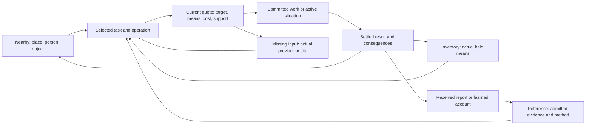

# LOTM situation → engine → UI coverage: reconciled record

**KJ3A current bounded uptake, 2026-11-01:** [B1/B2 receipt](KJ3A_IMPLEMENTATION_RECEIPT.md) records source-qualified displayed ch9, fifteen native continuation stages, food/sleep/retained-evidence consumers, current desktop/load proof and relevant persistence/failure cases. Agent-verified, not human-reviewed (AD43). This does not expand the historical all-step denominator, imply complete Tingen employment/progression, or refresh unrelated mechanism evidence.

**KJ3B bounded uptake, 2026-11-02:** [KJ3B receipt](KJ3B_IMPLEMENTATION_RECEIPT.md) adds the source-qualified ch10 visit: 18 stages including one explicit inferred custody bridge. Status: agent-verified, not human-reviewed (AD43). Multi-recipient work revalidates actual bodies; visit completion differs from memory; the current task uses its live job instead of busy-recipient re-admission messages. Existing historical denominator and unrelated UI suppliers retain their prior qualification.

**Full-journey execution:** [KJ1-KJ8 campaign plan](LOTM_KLEIN_FULL_JOURNEY_PLAN.md) now owns the opening-to-ending build order. KJ1 uses displayed chapters 1-3 and a bounded native action chain; this is a separate delivery measure from the historical all-step inventory below. [First-arc receipt](FIRST_ARC_IMPLEMENTATION_RECEIPT.md) records its actual verification state.

**Historical borrowing/projection follow-through:** [source audit and comparison](HISTORICAL_BORROWING_AND_PROJECTION_AUDIT.md) now integrates [HB-N1-HB-N5](LEAD_WORLD_ENGINE_SLICE_BRIEF.md#historical-borrowing-and-projection-uptake-2026-11-01): snapshot/agency/payer, shared allocation, nested upkeep, support loss and per-output aftermath. This bounded qualification does not revise historical all-step counts or establish play proof.

Specific-process/lore qualification (2026-11-01): [Hall of Truth, Roselle's mausoleum and persistent lore](HALL_MAUSOLEUM_AND_PERSISTENT_LORE_AUDIT.md) audits SC3/SC4 and diary interpretation across selected early/late scenes. [HM-N1-HM-N5 uptake](LEAD_WORLD_ENGINE_SLICE_BRIEF.md#hall-mausoleum-and-persistent-lore-uptake-2026-11-01) preserves disclosure recipients, contextual action channels, supported containment, documentary carriers and evolving interpretations. Source qualification does not alter historical all-step counts or establish runtime journeys.

Specific-process qualification (2026-11-01): [first gathering, Old Neil and ritual comparison](TAROT_GATHERING_AND_RITUAL_SCENE_AUDIT.md) upgrades SC1/SC2 at bounded source scope and compares sacrifice/bestowment/summoning/divination/advancement. [Live TR-N1-TR-N5 uptake](LEAD_WORLD_ENGINE_SLICE_BRIEF.md#first-gathering-and-ritual-comparison-uptake-2026-11-01) and dependency-family routing preserve actual producer/result/UI differences. These source findings do not change historical step-qualification counts or establish gameplay coverage.

Bounded later-source case (2026-11-01): [Utopia engine/UI audit](UTOPIA_ENGINE_UI_AUDIT.md) reads selected primary scenes and community counterclaims, separates five early contract pressures from later implementation, and supplies source locators, proposed UI/engine contracts and failure tests. It does not alter this report's historical qualification counts or establish runtime coverage.

2026-10-31. **One current entry point for this UI/engine/lore planning work.** Weibao requested LOTM first: map the main character's situations to engine actions, UI and connected screens, list missing work, account for later books and future player freedom, and reconcile the findings across chats. This record integrates their conclusions and routes detailed evidence to its original owner. Earlier reports remain history/evidence; this does not duplicate their authority or replace the runtime coordinator's queue.

**Baseline join result (superseded qualification counts below):** every step in the selected existing reader inventory has a row in the private situation map, an explicit family contract or unresolved bucket, and its remaining gaps. This is a reproducible planning join, **not scene-complete UI design, full protagonist coverage, or a gameplay replay**. No runtime work started. Desktop/laptop target: 1920×1080, actual 14/21 px; mobile deferred. Applied AD6–AD8/AD34/AD36/AD38/AD44–AD46, WA54–WA60 and WPR2/4/19–28. Individual interface and mechanic choices below remain proposals.

## 1. Start here: what is mapped and what is missing

| Finding | Current reconciled result | Implication |
| --- | --- | --- |
| **LC1: finite denominator** | 4,899 reader scenes, 16,679 steps, 35 existing family labels. 11,168 steps are in literal lead viewpoints, 1,165 in candidate-persona viewpoints needing review, and 4,346 in other observer viewpoints. | Keep all rows; do not relabel an observer's action as the lead's action. These are the prepared inventory's boundaries, not a claim of every publication or future possibility. |
| **LC2: actor uncertainty** | The historical reader corpus has no explicit step actors. Current reviewed sidecars qualify source roles for 39 of 16,679 steps; two further reviewed claims remain partial/contradicted. | 16,640 actor gaps remain. Scene viewpoint, inferred tags, and a rewritten reader index cannot settle a historical step actor. |
| **LC3: inherited control evidence** | Selected X4 resume-3 range files contain 11,159 rows: 1,113 labelled `clean_fold`, 10,046 labelled `gap`. Another 793 gap rows still mention a control ID. | Count the 1,113 as historical offline candidate assignments, not current playable situations. A nonempty ID in a gap is not a mapping success. Existing adapters/host offers add source-inspection evidence, not a verified scene journey. |
| **LC4: opening scope correction** | The old 1,491-row chapter-only output and later 337-row purported volume-1 output are both unsafe opening denominators. The mapper also treated bare `zh 第N章 pM` as volume 1, including later-volume material. Current strict output contains 39 independently source-qualified opening candidate steps. | A missing volume stays unresolved. Reviewed edition/volume/chapter/paragraph bindings may establish a window; folder, beat, shard or pack label alone does not. Historical outputs remain preserved. |
| **LC5: honest residue** | Current overlay: 39 source/actor/UI-qualified proposals, zero established current engine connections or new journeys; 3,516 source-volume locator gaps and 16,640 individual UI gaps remain. The 4,851 lexical mechanism-review and 1,186 no-safe-assignment flags remain conservative historical triage, not semantic qualification counts. | Counts overlap. Source inspection, source qualification, UI specification, engine connection and play proof have distinct denominators. All 16,679 historical rows remain present. |

**Use the artifacts:** [contracts and exact proposed controls](LOTM_SITUATION_UI_CONTRACTS.json) are public planning data. Private outputs, for design inspection, are under `docs/research/novels/lord-of-mysteries/private/lead-run-2026-10-27/situation-ui-reconciliation-2026-10-31/`:

| File | What it answers |
| --- | --- |
| `opening-v1-ch1-24.tsv` | Historical 337-row baseline, now superseded by strict qualification output; previously listed: source locator, exact recorded intent/inputs/expected output, actor gap, inherited candidate control, engine candidates, proposed controls, connected screen route, later pressure and future alternative. |
| `lead-and-persona-situations.tsv` | Same fields across all 12,333 lead/candidate-persona steps, all volumes. Rows sharing a family still retain their own source intent, expected result and missing bindings. |
| `situations.jsonl` | All 16,679 rows, including other observers as possible producers/witnesses; source requirements/outputs, proposed contract, exact return identity, legacy control and gap state. |
| `residue.jsonl` | Every unresolved row with overlapping missing reasons, not a reduced list that hides actor/source/proof gaps. |
| `summary.json`, `manifest.json` | Recomputed totals and hashes of exact generator inputs/outputs. A fresh hash does not authenticate an old test or source claim. |
| `reconciliation-sources.json` | Snapshot of the 24 relevant saved reports and five chat routes used in reconciliation. Source hashes bind the inspected artifacts; a final chat status check is recorded. |

Reproduce with `python3 scripts/lead_run/build_situation_ui_map.py`. Inputs are existing M4 reader scenes, existing script tags/crosswalk, the explicitly selected resume-3 mapping ranges and the new proposed contract definitions. No fresh primary-source prose was read; this is not a new whole-book interpretation or source-authenticity certificate. Scene evidence can cover several steps: individual paragraph support is still qualified where necessary. The TSV is a reviewable per-situation plan template, not 12,333 individually semantically approved designs.

## 2. What the screens do together

Use the existing LOTM panel/workspace, Nearby, Inventory, Reference/Reports, status, people and work surfaces. Names below describe task sections; they do not register new navigation routes. `createLotmPanel`, `cast*Offers`, their adapters and `observerView` are the inspected incumbents. Some sections already have offered commands; the proposed connections and advanced semantics still need their own implementation/proof.

**Connection contract:** preserve originating world/task, subject, selected method and focus while visiting a needed item, person, place or evidence. Recompute eligibility on return. Durable job/evidence/custody live with their state owners; the back stack and DOM focus are transient. A received report does not collect an item, advance time, grant physical reach or settle a debt. Aggregate counts/search/accessibility labels derive from admitted rows. A changed seat/body/controller revalidates the command and disclosure rather than merely restoring the old button.

**Shared action states:** known/unknown, unavailable with a known reason, draft, current quote, committed, interrupted/refused, completed with actual consumer, and returned/history are different states. Do not invent mechanics to explain absent implementation or put developer gap labels into the ordinary player's world. A passive perception or narrated thought may require an admitted readout/event rather than a new button; lexical tags have not settled that question for every row.

## 3. Situation-to-action and UI contracts

Every original family has one primary LS contract. LS23–LS28 are additional later/source/premise pressures, not claims that every row uses those advanced systems. Each definition includes a current engine candidate, operation, proposed controls, result consumer, route, missing producer, failure check, later pressure and future alternative. These describe a reusable task shape; the exact actor/subject/conditions in a situation still need to be bound.

| Contract / task | Required controls and result | Screen connection | Current engine seam / remaining gap |
| --- | --- | --- | --- |
| **LS01 Local movement** | Known destination, Mode/route, Elapsed local time, Current access and blocker. Result: New actual location and its admitted nearby actions. | Nearby → Route quote → Active travel → Arrival → Nearby | `book_world_lotm_cast_host.js:castWalkDefinition`; `book_world_lotm_cast_host.js:castJourneyOffers`. Resolve source origin/destination, actual actor, route and scene timing; a changed scene place is not a walk command. |
| **LS02 Paid and regional transport** | Service/provider, Departure, Fare and payer, Cargo/body terms, Missed-service outcome. Result: Fare settlement and actual new location; commitments affected by arrival time. | Map or Nearby → Service quote → Schedule/Work → Arrival report → Destination Nearby | `cast_journeys.js:defineJourneys`; `cast_journeys.js:quoteJourneys`. Qualify timetable, provider means, origin and fare; inherited guessed origins remain gaps. |
| **LS03 Waiting and appointments** | Wait until, Local elapsed time, Attendance needs, Interrupted/expired result. Result: Due event/attendance and the next real task. | Task or Nearby → Schedule → Wait preview → Due event → Origin task | `book_world_lotm_cast_host.js:castWaitOptions`; `book_world_lotm_cast_host.js:castLocalClock`. Source time bands do not supply exact minutes; bind actual scene/day/window. |
| **LS04 Conversation and social approach** | Person, Known topic, Offer/ask/refuse, Presence or channel reason. Result: Attributed response and any actual consent, service or relationship effect. | Nearby person → Conversation → Topic/terms → Response → Same person/task | `book_world_lotm_cast_host.js:castTopicOffers`; `cast_topic_talk.js:defineTopicTalks`. Greeting is not a topic-specific answer; qualify speakers, consent and result. |
| **LS05 Messages and received reports** | Recipient, Channel/provider, Message/attachment, Send, Last received receipt. Result: Recipient-specific admitted knowledge and next inquiry/task. | Person or task → Message quote → Sent/pending → Received report → Origin task | `cast_topic_talk.js:pendingTopicTalkReports`; `observer_view.js:observerView`. A report renderer is not a delivery mechanism; qualify address, reach, sender, receiver and carrier. |
| **LS06 Inspection, investigation and appraisal** | Subject, Method, Known evidence, Cost/exposure, Inspect/test/ask. Result: A sourced observation or inference used by another decision. | Nearby or Inventory → Subject inspection → Method quote → Evidence/Reference → Origin subject/task | `place_acts.js:quotePlaceActs`; `cast_inference_adapter.js:quoteInferences`. Resolve physical subject, evidence kind and downstream consumer; a description is not an assay or proof. |
| **LS07 Perception and observation** | Observed source/subject, Method where deliberate, Time and provenance, Follow-up. Result: Witnessed or reported knowledge, with physical control still evaluated separately. | Nearby/situation → Observation → Evidence/Reference → Follow-up task | `observer_view.js:observerView`; `book_world_lotm_cast_host.js:castObjectOffers`. Classify passive occurrence versus paid/deliberate observation; a verb tag alone cannot choose a button. |
| **LS08 Documents, memory and writing references** | Carrier/access, Read method, Known account, Copy/destroy only if supported. Result: Retained account and physical carrier state consumed independently. | Inventory/Nearby document → Read quote → Work/result → Reference → Original carrier/task | `book_world_lotm_cast_host.js:castMakingOffers`; `place_acts.js:quotePlaceActs`; `observer_view.js:observerView`. JR1 selected source scene/carrier still needs qualification; destruction/copying need actual effects. |
| **LS09 Reasoning and planning** | Evidence selection, Claim/confidence, Plan steps, Start actual task. Result: An attributed inference or draft consumed by the next real command. | Reference/evidence → Inference/plan → Supported next action → Quote → Return to evidence/plan | `book_world_lotm_cast_host.js:castInferenceOffers`; `cast_inference_adapter.js:defineInferences`. A thought may be narration, not a command; source result and missing evidence must be retained. |
| **LS10 Study and experimental research** | Question/source, Known method, Teacher/materials, Experiment quote, Observed result. Result: Learned method or evidence with a usable next experiment/application. | Reference or teacher → Study/research → Inputs/method → Work → Evidence → Application | `cast_inference_adapter.js:quoteInferences`; `place_acts.js:definePlaceActs`. Separate observation, interpretation, learned execution and faculty; classify each reader row before assigning an operation. |
| **LS11 Practice and ability use** | Method, Target, Source/payer, Reach/support, Use/practice, Result. Result: Actual effect and qualified practice evidence, independently. | Abilities or situation → Operation/target quote → Commit → Result → Origin situation or practice record | `book_world_lotm_cast_host.js:castAbilityOffers`; `cast_ability_adapter.js:commitCastAbility`. Source faculty, technique, target and lasting progress must have actual producers; no gain from reading a label. |
| **LS12 Divination and rituals** | Question/object, Method/participants, Inputs/conditions, Known risk, Commit, Interpreted report. Result: Method-specific response/effect with evidence and an actual downstream decision. | Question or progression task → Preparation → Quote → Work/response → Report → Origin task | `book_world_lotm_cast_host.js:castDivinationOffers`; `cast_divination_adapter.js:defineDivinations`. Separate divination, invocation, advancement and other rituals; authored fit/odds are not canon probabilities. |
| **LS13 Physical items and custody** | Item/lot, Holder/place, Quantity/condition, Allowed transfer/use quote. Result: Actual custody and usability for work, trade or evidence. | Inventory/Nearby object → Item operation → Terms/quote → Result → Item and origin task | `place_acts.js:definePlaceActs`; `simulation_effects.js:applySimulationEffects`. Resolve carrier/lot identity and current holder; an authored note does not transfer or consume stock. |
| **LS14 Trade, payment and household finance** | Counterparty, Stock/lot, Price/debt/reward meaning, Payer, Confirm. Result: Goods/funds/settled claim consumed by preparation or daily needs. | Person/shop/task → Offer comparison → Quote → Settlement → Inventory/account → Origin task | `book_world_lotm_cast_host.js:castExchangeOffers`; `cast_exchange_adapter.js:defineCastExchanges`. Bind real purse/stock/currency and consequence; paying one local act is not every payment in a book. |
| **LS15 Making, potions and written artifacts** | Process/version, Input lots and substitute role, Work stages, Costs/failure spend, Result collection. Result: Actual product/record used, equipped, taught, sold or applied by an existing consumer. | Recipe/reference or need → Preparation → Missing-input shop/tool/person → Return to preparation → Work → Product → Use | `book_world_lotm_cast_host.js:castMakingOffers`; `cast_making_adapter.js:validateCastMakingConsumers`. Distinguish handwriting, physical fabrication, potion preparation and sourced transformation; no shared recipe law by label. |
| **LS16 Daily life, rest and treatment** | Need/condition, Meal/rest/care method, Supplies/provider, Time/support, Known result. Result: Actual body/resource change and usable next activity. | Body status or home → Care/meal/rest quote → Supplies/provider → Work → Body result → Origin activity | `book_world_lotm_cast_host.js:castBodyOffers`; `cast_body_adapter.js:defineBodyCare`. Routine, harmful condition and treatment are distinct; exact gains/durations need qualified source or labelled authored dials. |
| **LS17 Agreements, access and obligations** | Parties, Instrument/terms, Offer/accept/refuse, Current access/expiry, Known consequences. Result: Actual obligation/access state consumed by a real service or action. | Conversation/institution → Terms → Commit → Obligation/access record → Service/action → Terms history | `cast_topic_talk.js:defineTopicTalks`; `simulation.js:previewSimulationCommand`. Define authority, instrument, term revision and enforcement; a button or ledger projection is not supernatural binding. |
| **LS18 Work, institutions and service performance** | Employer/provider, Task and shift, Means/attendance, Pay/review condition, Commit/decline. Result: Completed service, earned wage/credential or explicit failure and useful next access. | Person/institution → Task terms → Schedule/Work → Delivery/assessment → Account/access → Origin place | `simulation.js:previewSimulationCommand`; `simulation_effects.js:applySimulationEffects`. Require actual staff, funds, knowledge and result consumer; institution template is not a source-complete employer. |
| **LS19 Combat, evasion and aftermath** | Participants/objective, Known threats, Target/means, Commit/brace/withdraw, Live body state. Result: Actual opponent/body/aftermath state, attributed report and recovery task. | Situation → Preparation or ability reference → Return to situation → Response → Aftermath → Treatment/report → Origin place | `tempo_fight_domain.js`; `book_world_lotm_cast_host.js:castAbilityOffers`. L2b below-floor publication/persistence and L2c witness/interrupt remain; seeded card proof is not source-scene combat coverage. |
| **LS20 Change state or maintain support** | Current/target state, Method/support, Actual cost/clock, Commit/result. Result: The changed state actually used by an ability, body or service. | Current status → Transition/maintenance quote → Work → Result → Actual consuming task | `source_suppliers.js:liveSuppliers`; `simulation_effects.js:applySimulationEffects`. Class label alone does not identify progression, identity, source activation or upkeep; qualify the operation. |
| **LS21 Delegation and indirect actors** | Acting body/worker, Admitted controller or responder, Order/task, Channel/support, Last reported result. Result: Actual response and separately delivered task evidence. | Task → Actor/order → Support/terms → Pending operation → Received result → Origin task | `book_world_lotm_cast_host.js:castTopicOffers`; `observer_view.js:observerView`. Missing source-qualified actuator/controller/link/handover model; actor appearance is insufficient. |
| **LS22 Unresolved mechanism residue** | Developer-only unresolved situation record. Result: A resolved source/mechanism/UI contract later; no pretend player action. | Existing coverage record → Source/actor/operation qualification → Named contract or retained gap | No safe engine assignment. No safe semantic match from the current tags. |
| **LS23 Progression and source transitions** | Faculty/source history, Preparation evidence, Method/ritual conditions, Attempt result, Next usable ability. Result: Acquired source/control and independent usable technique. | Progress/status → Method → Inputs/people/site → Preparation → Attempt → Body/source result → Ability/use | `book_world_lotm_domain.js:configureLotm`; `source_suppliers.js:grantSource`. Probationer progression is not automatically the lead route; exact advanced methods and scarcity are not supplied by an inventory counter. |
| **LS24 Operation-specific reach and remote links** | Selected operation, Last known target, Current body/position, Established link/support, Operation-specific quote. Result: Actual control/movement effect rather than mere target discovery. | Situation/target → Method → Link/position inspection → Return to selected operation → Commit/result | `cast_ability_adapter.js:quoteCastAbilities`; `book_world_lotm_cast_host.js:castAbilityOffers`. Missing qualified per-stage link/range/position and interruption producers. |
| **LS25 Temporary, borrowed and historical means** | Supplier/method, Available allocation, Payer/clock, End condition, Dependent task. Result: Actual supported ability/product with qualified remaining carrier aftermath. | Task → Means/supplier → Quote → Use/work → Support/result → Origin task | `source_suppliers.js:grantSource`; `source_suppliers.js:removeSource`; `source_suppliers.js:liveSuppliers`. Historical selector, allocation and projected-material aftermath are missing in selected paths; generic supplier functions are not that lore. |
| **LS26 Belief, delegated instruments and benefit destination** | Known request, Held instrument, Delegated operation, Received response, Public standing separately. Result: Qualified support/benefit and attributed response. | Institution/person/request → Instrument/operation → Response → Condition/support record → Origin task | `source_suppliers.js`; `book_world_lotm_cast_host.js:castTopicOffers`. Missing belief/recipient/delegate relation and result; no numerical belief curve or automatic transfer through custody. |
| **LS27 Acquisition exposure and protective means** | Known method, Supported mediation/protection, Deliberate deeper exposure where implemented, Received account, Actual consequence. Result: Admitted knowledge and independently owned harm/condition. | Source/task → Acquisition method → Support check → Result/reference → Care if needed → Origin task | `observer_view.js:observerView`; `source_suppliers.js:liveSuppliers`. LR3-L2 hazard trigger/classification and KP protection capability remain gaps; KP1 is a recommendation, not accepted immunity. |
| **LS28 Run modes, branches and continuation** | Current supported run premise, Known available actions, Non-spoiling mode reason, Actual return/continuation. Result: Consistent branch, obligations and source-qualified alternatives. | Situation/action → Known constraint or support explanation → Supported alternative task → Return | `constraint_store.js`; `constraint_pack.js`; `observer_view.js:observerView`. Open-mode/pull behavior and many alternate-life consumers remain proposed; no nonfunctional mode selector. |

The source-host path is concretely `cast*Offers` → the selected adapter's quote/definition → the existing native command/effects → the panel/read model. For LS08/LS15, a string saying an object changed is not physical state. For LS11/LS19, a shown ability or fight card is not proof that the correct actor/body/target was charged or harmed. The selected per-row inherited control stays marked historical even when the symbol still exists.

## 4. Worked connected journeys and their exact missing joins

| Journey | Proposed visible sequence and state changes | Missing join / acceptance scenario |
| --- | --- | --- |
| **LJ1: inspect a document, keep its account, change its carrier** | Nearby or Inventory selects the exact accessible carrier → LS08 reading quote → work/result → Reference displays the admitted remembered account → return to the same carrier → supported destroy/copy operation → result shows actual custody/availability separately. | The existing selected document candidate still has JR1's exact source/scene/natural-entry/carrier gaps. Do not conflate it with L1's earned desk observation. Qualify source and operation, then test read/destroy/re-read, a different holder, interrupted work and old in-flight job revision. |
| **LJ2: earn/procure/learn/prepare/use** | LS18 actual task and terms → wage/delivery settlement → LS14 seller and real stock → LS13 inventory lot → LS10 teacher/source → LS15 preparation → LS23 particular progression method if qualified → LS11 useful supported operation. | Do not let payment grant knowledge, knowledge grant faculty, prepared ingredients grant promotion, or a status note grant an effect. Exact relevant early situation IDs and actual producers are in the private rows. Test a missing ingredient and refusal; later substitution changes the recipe role, not historical stock. |
| **LJ3: question, inquiry and a usable finding** | LS04 known person/topic → received account with provenance → LS09 question/plan → LS12 selected divination or LS06 physical investigation → LS03 scheduled support if needed → result/evidence → original case/task's next real action. | A greeting cannot substitute for the requested answer; reading a report cannot summon a responder or identify a hidden cause. Qualify method, target, witness and useful downstream action. Compare failure, misleading account and absent observer without granting omniscience. |
| **LJ4: encounter, retreat, treatment and a later report** | LS19 opposed response → actual combatant/body and opponent changes → interrupted or completed result → LS16 care with actual supplies/provider → recipient-specific aftermath/report → original place/task. | L2b native damage/healing/browser/persistence and L2c witness/interrupt remain open in the tracker. L2a's seeded interaction proof does not verify an earned whole-book fight. Test failed withdrawal, target/control change, provider departure and exact once-only consequence publication. |
| **LJ5: later remote work with temporary means** | Original task → LS24 operation-specific target/link → LS25 actual temporary supplier/payer → LS21 order/actuator → received response under LS05 → usable output/support result → original task; LS26 benefit destination stays independent of instrument custody. | LR2-L1–L3/LR3-L1 qualify distinctions, not a complete remote-control/borrowed-power/belief backend. Source stage, timing, interruption and actual means still need producers. Test supplier loss, stale command and a non-witness who learns no hidden controller. |
| **LJ6: research after protection or interpretation changes** | Source/task → LS27 actual acquisition method/support → admitted account or particular consequence → Reference review → LS09 interpretation/application → return. A deliberate deeper method belongs at the acquisition operation where implemented. | LR3-L2 exposure details and KP1–KP7 support capability remain unresolved/proposed. Read-only navigation neither grants immunity nor triggers fabricated danger. Test support loss before release, redraw/import after an already settled exposure, and old remembered evidence without retroactive harm. |
| **LJ7: a future player takes another reasonable route** | Same practical objective → compare available methods/providers/routes → each method's real quote → actual attempt → its declared consequence → useful next consumer. Known alternatives can be inspectable even when the selected canon mode cannot take them. | Exact future combinations are not enumerated. LS28 separates run premise, source-mechanism eligibility and supported implementation. Compare a non-lead fixture using equivalent means; no hidden protagonist success grant, free supplier or invented universal impossibility. No unimplemented free-play toggle. |

These are connected contract proposals, not seven newly playable routes. The source-linked rows preserve which concrete recorded situation should exercise each shape. An unexpected new mechanism returns to LS22 rather than being flattened into a convenient existing button.

## 5. Reconciled findings from the chats

This is the current synthesis of the scoped sources. Detailed original wording, primary evidence, limitations and checks stay at the linked owner. Under AD32/WPR21, saving a proposal or receiving a report does not upgrade it to an accepted world law or current proof.

| Origin / codes | Reconciled conclusion and disposition | Destination / status |
| --- | --- | --- |
| [Claude feedback](CLAUDE_UI_FEEDBACK_INDEX.md), CUI1–CUI7; [UI audit](UI_AUDIT_RECEIPT.md), UIA/UIF; [feedback receipt](UI_FEEDBACK_AUDIT_RECEIPT.md), UF1–UF7 | Use available desktop space, compare populated and sparse tasks, preserve resize/text preferences and task return, use world-appropriate forms and meaningful costs. Current interaction defects and proposed improvements are distinct. | Connection contract above, LS01–LS21. Existing L1/L2 evidence and L3/L4/L6/L7 queue remain authoritative for delivery. No new skin or navigation registry. |
| [Systems audit](SYSTEMS_RULES_AUDIT_RECEIPT.md), SRR/F/RFX; [R1 receipt](R1_RULE_OWNER_RECEIPT.md) | Separate occurrence, disclosure, social testimony, real permissions, physical carrier and actual body/effect publication. Rule-owner repairs are done at their recorded document scope; runtime work is still in its lane. | LS05–LS08, LS13, LS17, LS19 and the tracker. Old passing leaf/gallery evidence does not close host or persistence gaps. |
| MC1–MC58 | Element contracts, quote/return lifetime, knowledge/time separation, feature inventory, custody/trade/repair, research/teaching, local life/institutions, alternate travel and enabling producers. | LS01–LS18 and per-row input/return/result; [MC1–134 map](ENGINE_UI_DEPENDENCY_MAP.md) supplies detailed existing family evidence. |
| MC59–MC96 | Combat kinds, daily logistics, forging/thermal/alloys, potion dose/contamination, science/calibration, rituals, transformation/upkeep and broader source families. | LS06/LS10/LS12/LS15/LS16/LS19/LS20. Source-world palette, not required LOTM metallurgy/science laws or a single combat system. Selected row needs its world-specific causal consumer. |
| MC97–MC134 | Group controls for one operation, retain comparison context, share care/control/understanding/use boundaries while preserving each world's distinct law, deeper combinations and institutions. | Task sections and LS13/LS17/LS21/LS23–LS26. Gu-specific upkeep/refinement is not a LOTM source or potion rule. |
| MC135–MC153 | Whole-known-trajectory design, real per-element suppliers, staged per-world planning, declaration of world differences and coordinator-owned shared integration. | The contract file, private all-step map and existing WA54–WA57. No per-checkbox chat fan-out or simultaneous shared-engine writers. |
| [Joint review](LOTM_HP_LORE_AND_ENGINE_REVIEW.md), JR1–JR12; MC154–MC158 | Document slice still needs source/scene/carrier qualification; ritual conditions are not just timers; practical function, support roles and actual payer/context matter. | LS08/LS12/LS15/LS23/LS25. Exact selected-source qualification remains open; symbolic-fit numeric odds remain authored. |
| [LR2](LORE_EXCEPTION_RESEARCH_ROUND2.md), L1–L3 | Operation-specific reach, temporary/historical power and body versus decision source require distinct producers. | LS24/LS25/LS21. Missing links, allocation, aftermath and handover remain explicit. |
| LR2 H1–H3, integrated [HP plan](HP_UI_ENGINE_PLAN.md) | HP custody/allegiance, activity detection/attribution and particular binding instruments are distinct. | Portability counterexamples for LS13/LS05/LS17, not imported LOTM laws. HP's bounded ordinary repair is not a complete school/adult trajectory. |
| [LR3](LORE_EXCEPTION_RESEARCH_ROUND3.md), L1–L2 | Belief/recipient/delegation and exposure during acquisition can challenge early models. | LS26/LS27. Facts are source-stage-qualified; quantitative belief balance, universal hazard/immunity and full remote authority remain unestablished. |
| LR3 H1–H2 | HP apparent creation versus actual production/supply and knowing versus authorized propagation are qualified separately. | LS15/LS05 portability scenarios. No universal stock conservation fiction imposed on source-supported magic; no HP secret-disclosure law copied into LOTM. |
| [Protection design](LOTM_KNOWLEDGE_PROTECTION_DESIGN.md), KP1–KP7 | Recommended supported passive mediation, deliberate deeper exposure and actual support-loss handling; no-protection and immunity branches remain proposals. | LS27. User's exploration did not accept permanent immunity or a rule that ordinary menu reading kills the player. |
| MC159–MC168; [MD1–MD9](MOL_DND_LORE_EXCEPTION_REVIEW.md) | Bounded debate qualification, per-world exception tests and durable retention; no generic copy/resource/time law. | Source/definition/revision boundaries in each LS row, not new advanced systems forced into the early slice. |
| [OW1 MoL](OW1_MOL_FOLLOWUP.md) | Later sample shows an available bounded soul conduit and a contemplated more capable upgrade, narrowing MD2 without qualifying every long-distance route. | Message/receipt counterexample for LS05/LS21. MoL visitor pause remains separate from lead loop; no complete MOL plan delivered. |
| [OW2 D&D](OW2_DND_FOLLOWUP.md) | Selected SRD 5.2.1 passages separate creator's concentration, effect lifetime/function and target consequences. | Support/expiry counterexample for LS20/LS25. MD6 self-dependent suppression remains open. Selected profile/supplement, not universal D&D. |
| [OW3 RI](OW3_RI_RESEARCH.md), [OW4 Re:Zero](OW4_REZERO_RESEARCH.md) | RI's control-acquisition versus manufacture and Re:Zero actor recall versus others' recognition constrain claims of shared semantics. | Optional second-world counterexamples for LS13/LS15 and LS08/LS21. No new LOTM lore, universal erasure, complete cause, or new world build order follows. |
| MC169–MC173 | No exhaustive UI claim; aggregate disclosure, cross-owner settlement and run-mode reasons require cross-screen scenarios. | Connection contract, LS17/LS19/LS27/LS28, generator's explicit residue. Family assignment remains triage. |

**Discrepancies resolved here:** “dependency-ready LOTM document slice” is superseded by JR1's open qualification; 61% was a historical allowance stop, 75% is the currently authorized shared ceiling; planner artifacts exist even where the wave table formerly said pending/active; 10% historical control assignment is not current UI/play completeness; bare chapters 1–24 is not volume-1 opening coverage; generic export existence is not a source-canon implementation. D&D and MoL full UI plan packets remain staged despite their targeted research being delivered.

The read chat inventory and saved source list are bounded to this task's UI/engine/lore work. Other game-scouting, acquisition and unrelated chats retain their owners; this does not claim their unsaved conversation contents were exhaustively reviewed. The lore chat was active at the initial inspection and idle at the final compact snapshot. Relevant saved outputs are captured by their final inspected hashes; future edits require comparing those hashes rather than assuming the reconciliation stays current.

## 6. Missing work, in the existing queue's order

| Missing work | Exact source of the gap | Observable completion without changing priority |
| --- | --- | --- |
| **LM1: source/actor/era/target binding** | LC2/LC4/LC5; opening and all-step private residue; JR1; tracker L1/L7's 38 candidate opening-place mappings and three held actions. | Qualify selected situation actor and paragraph/edition, actual place/carrier/time/support. Restore no held action until its producer exists. Full volume-qualified residue remains visible; no guessed aliases/personas or shifting late scenes into the opening. |
| **LM2: current consequence publication and return** | Tracker L2b below floor and L2c/L3; L1's later-source portion remains below floor. | Finish the existing selected health/aftermath/knowledge/return scope on its current inputs, with the assigned AD36/AD43 checks. This report does not reset that queue or promote a document candidate ahead of it. |
| **LM3: per-situation UI specification and connected engine** | All 35 families have proposed homes/controls, but scene-level semantics, actual providers/targets, useful result and connection proof are not established by the join. | For each selected early situation, bind LS fields to actual inputs, command, outcome, failure and return. Reused family template is marked specified only after differences are checked; a descriptive event card alone is not every needed mechanic. |
| **LM4: later mechanics that can refactor early state** | LS21 and LS23–LS27, LR2/LR3 and KP gaps. | Name the pressure in the selected early contract; preserve source/definition/clock/carrier/observer degrees of freedom. Qualify an advanced mechanism when its actual consumer is selected. Do not implement all advanced laws before the early complete loop. |
| **LM5: future methods and alternative lives** | Source canon records taken events; sidecar options are incomplete, actor labels uncertain and open-mode behavior partly specified. | Preserve recorded untaken option IDs as candidates, add actual supported alternatives through world mechanisms, and use a non-lead or different-method fixture for any shared claim. Remaining combinations stay explicit; do not claim they were all enumerated or that forced canon is a world law. |

For each selected implementation, use one writer per engine/UI area and the existing coordinator tracker. No new worker/chat, runtime lane, source acquisition or recurring monitor is dispatched by this record. A named unresolved source or engine gap is not permission to fabricate a limitation, nor an automatic requirement to stop all independent planning.

## 7. Long-term maintenance and checks

**LP1:** the per-situation row is the coverage unit, with a declared source inventory/revision and population. Actor attribution, source evidence, engine assignment, UI specification and journey proof remain independent fields. Changes to totals say which input changed. A supplementary world is a counterexample to a shared assumption, not a new canon authority for LOTM.

**LP2:** contract changes update the one JSON definition and rerun the private join. A scene-specific exception stays in its source/world owner or a qualified override; do not edit thousands of generated rows manually or teach a word classifier a new magical law. Existing shared owners remain authoritative. Snapshot manifests detect drift; they do not backdate verification.

**LP3:** later-book findings retain occurrence versus disclosure, operation, actor/body, supplier/recipient, carrier and clock/revision. Change one relevant input in a distinguishing scenario. Resolve protection and other unsettled branches from user direction and actual sources when selected, rather than freezing a recommendation as accepted (AD32).

**LP4:** a useful new consideration identifies an affected operation/consumer and a differing-result scenario. Otherwise retain it as a lead. Continue mapping actual residue across the pinned source instead of repeatedly counting generic themes or launching more disconnected lore debates. This keeps the broad vision while making the remaining work reviewable.

**Verification state:** deterministic offline mapping and document/source-symbol inspection only. No new primary reading, runtime/build/browser/persistence/installation, commit or human review. Check commands and exact results are recorded below after execution. Old proof remains scoped to its original manifests/route; all-current-source hashes in this packet establish this packet's bytes only.

| Check | Result and boundary |
| --- | --- |
| `python3 scripts/lead_run/build_situation_ui_map.py` | PASS: 16,679 unique rows, 35 family labels, 28 contracts, zero dropped/unassigned steps; 12,333 lead/persona TSV rows and 337 purported volume-1/chapter-1–24 TSV rows. The later qualification found its bare-locator default unsafe; this historical count is superseded. Offline planning only. |
| Repeat generator against unchanged inputs | PASS: byte-identical JSONL, summary and TSV outputs. Input/output hashes verified; no gameplay replay. |
| Focused in-process mapper failure checks | PASS: gap with a control ID stays a gap; viewpoint does not become an explicit actor; volume-2 chapter 1 does not enter the opening window; duplicate step, unassigned family and orphan baseline are rejected. |
| Source path/export and local document/link checks | PASS: all 28 contract engine references resolve to source paths/declared symbols where specified; new report links, MC174–MC177 uniqueness, new-file whitespace and private output exclusion checked. This proves existence, not runtime semantics. |
| `node --test tests/project_md_shape.test.js` | PASS: 2 tests; current summary stays within its existing shape/cap. |
| `git diff --check` on touched tracked documentation | PASS at the recorded scoped check. Existing unrelated changes remain untouched. |
| `npm run check:docs` | NOT PASSING across the shared tree: after this round's wording fixes, three diagnostics remain at preexisting/non-round lines: LEAD_LIFE_GUIDE.md:15, gm/WRITEUP_REGISTER.md:98 and research/DOWNLOAD_SCOUT_NEXT_2026-10-31.md:169. No diagnostic remains on this round's added coverage/receipt lines. This is not a claim that whole-tree docs lint passed. |

Included usage observed at 67% before and after this finite reconciliation, within the standing 75% shared ceiling; shared-account movement is not attributed to this task. No descendants or paid/API fallback. Remaining primary gate for a selected runtime slice stays with the existing tracker and its AD43 proof, rather than this planning join.

## Whole-novel semantic qualification dispatch, 2026-11-01

Weibao explicitly requested a dedicated chat to go through LOTM in its entirety, resolve actor/source gaps, and make each situation's engine action and UI flow specific, preserving later-book pressures and future player freedom. [The full-horizon brief](../lotm-whole-life-2026-11-01/BRIEF.md) and [live checkpoint](../lotm-whole-life-2026-11-01/CHECKPOINT.md) now own that qualification work. It extends this existing coverage record rather than treating the family join as complete UI specification. Shared allowance observed70%, existing stop75%; full completion is not promised inside the remainder. No runtime dispatch. On chat creation, the receiving coordinator owns this coverage record, contract definitions, mapper and its new private review/override outputs; the dispatching chat releases those areas and records only chat identity/startup in the new checkpoint.

## Whole-life qualification result, 2026-11-01: exact partial checkpoint

**WF1, source coverage:** the finite plan pins the supplied English EPUB and existing paragraph index by SHA256, reuses paid reading and reconciled findings, and preserves Chinese alignment uncertainty. The inventory is 1,434 indexed chapter groups / 104,855 paragraphs / 2,735,628 words, plus 87 nonindexed paratext paragraphs / 2,632 words from the EPUB spine. Full-horizon plan: 295 disjoint source windows plus three reserved repairs, one visible coordinator, fresh included Luna-low readers. The current stop is the exhausted repair reserve, not whole-book completion or the 75% allowance ceiling. See the [checkpoint](../lotm-whole-life-2026-11-01/CHECKPOINT.md) for exact commands and bounds.

Thirteen indexed chapter groups are completely source-inspected, four partially inspected, and 1,417 untouched in this qualification. Inspected indexed coverage is 1,235 / 104,855 paragraphs, 31,420 / 2,735,628 words. This is source inspection, not automatic qualification of every situation within those ranges. The 87 additional paratext paragraphs remain unread. All later-book contract pressures already reconciled in section 5 remain in force; no claim of fresh later-book completion is made.

**WF2, reviewed situations:** 41 historical step overrides were reviewed: 39 have source-grounded roles and situation-specific UI proposals, two retain partial/contradicted source claims and are not promoted. Denominator remains 16,679 historical steps. Current engine-connected: 0 / 16,679 established by this run. Journey-verified: 0 / 16,679 established by this run. A further 46 source-identified candidate boundaries are saved privately with origin IDs; they require overlap/deduplication and an old-step join before changing the denominator. They are neither 46 additional proven actions nor silently discarded missing passages.

The mapper now accepts private reviewed sidecars, preserves original reader rows, rejects orphan/duplicate/incomplete overrides and invalid source spans, and keeps actor, source, UI, engine and journey states independent. Bare chapter numbers no longer imply volume 1. Review also caught a reader renumbering grouped operations: coordinator adjudications explicitly map those observations back to the original step indices. Unsupported completion remains a gap. These repairs protect meaning, not just row counts.

**WF3, connected daily life and cross-system contracts:** [DL1–DL16](../lotm-whole-life-2026-11-01/DAILY_LIFE_AND_SHARED_CONTRACTS.md) are incorporated into the private situation reviews and finite plan. Reviewed early contracts include household service/payment, care and inspection, shared provisions, errands, carrying/stock, clothing, local travel, appointments and requested-versus-completed purchases. Source-identified later inspected windows also retain context-specific reporting, provider/role discussion, employment terms and ordinary transitions. Those later candidate contracts remain source-review drafts until individually joined and checked. No generic hunger, reputation, faction benefit, automatic social penalty or universal health model was added.

The private connected edge record names actual producer, affected actor/task/term, recipient admission, proposed command/result, screen/return and differing-result check. Inputs, comparison, current quote and commit belong together for the selected operation. Provider/account/evidence inspections retain task/subject/method/draft/focus and refresh eligibility on return; active work/body and relevant clocks can remain independently visible. An interrupted service settles its actual completed portion; no universal refund rule or premature completion is imposed. A reported condition does not automatically disclose its cause to every household, employer or institution.

**WF4, reusable seams:** existing owners remain `place_acts.js`, cast body/exchange/journey/topic adapters, simulation commands/knowledge and the existing workspace return mechanisms. Sharing candidates are quote/commit/receipt/return identity, holder/payer/stock settlement, recipient-specific evidence/delivery, explicit clock/lifecycle, and actor/body/support references. DL7 and the existing HP/MoL/D&D plans preserve each world's actual law. No new shared extraction is justified by these proposals alone: the exact unimplemented second-consumer gap and a differing-input scenario are recorded privately. Read-only export inspection establishes candidates, not current situation connectivity or portability proof.

CI1–CI3 in DL15 are retained as community hypotheses with their named reopen consumers. Their primary qualification remains open where it falls outside inspected ranges; no fan roster, rank multiplier, universal secrecy flag or new source-reading wave is adopted. KP protection choices remain proposals. Canon-run restrictions stay separate from causal method eligibility and missing simulation.

### Durable lessons and integration requests

| Code / disposition | Finding and working default | Existing owner / boundary |
|---|---|---|
| **WL1, ACT NOW, done** | Bind volume and edition explicitly. A bare locator does not acquire volume from a view, folder, beat or convenient default. A rewritten review index must be reconciled semantically to the original stable step ID. | Mapper and private adjudications. No source corpus overwritten. |
| **WL2, ACT NOW, done** | Build the full source/member inventory before claiming entirety. Unindexed prose, missing prepared chapters, duplicated headings, paratext and absent scene rows retain independent dispositions. | Private source/member/Chinese-nav inventories. Chinese chapter-number anomalies are alignment work, not proof that the raw book lacks those passages. |
| **WL3, ACCOUNT FOR NOW** | Tool output truncation is a source-coverage gap. Compact labelled source pieces should be loaded separately, with no large continuity dump in the same call; a source gap between deliberately disjoint pieces is not itself truncation. Use exact prepared span counts over a return's estimate. | Existing AU10/AU11/AU14 and source playbook. Three repair slots used, no automatic renewal. |
| **WL4, ACCOUNT FOR NOW** | Shared daily-life UI should settle the actual operation and its independent consumers: request is not delivery, payment is not illumination, care is not universal healing, reported absence is not a global employment penalty. | Existing guide section 10 / WA54–WA60. The parent already saved the procedure; further exact amendments are in the private integration request, not competing guide edits. |
| **WL5, LATER** | Default to reopening shared extraction for a selected second consumer and differing-world result, because that demonstrates the useful shared behavior. Reopen community claims at the task consuming the proposed institution/knowledge edge; source uncertainty may justify an earlier targeted check within its budget. | DL7/DL15, existing world plans and runtime coordinator order. No runtime, other-world reading or shared-guide edits authorized by this result. |

Private evidence home: `docs/research/novels/lord-of-mysteries/private/lead-run-2026-10-27/whole-life-qualification-2026-11-01/`. `plan.json`, `window-manifest.json`, `source-ledger.json`, `progress.json` and `coordinator-adjudications.json` own exact boundaries. `reviewed-overrides.json`, `reviewed-situations.md`, `source-gap-candidates.jsonl`, connected daily edges and `mapped/` own reviewed proposals and residue. Reader artifacts preserve failed/partial receipts and contradictory counts. No sealed narrative detail is reproduced here.

## Identity, locality, stage and long training: steering integration

**CT1, existing qualified comparison:** DL17–DL22/GP1–GP2 extend the same finite plan. The existing early inspection chain supplies a concrete same-objective comparison under different available means: changing physical viewing conditions and an actually supplied local service changes the obtainable observation. It does not establish a progression-stage unlock. Exact source IDs, distinct actor/body/observer roles, proposed command, controls, payment/service/result edges, alternate method and return are saved privately in `identity-locality-stage-training.{json,md}`. No additional source was read and no qualification count changed.

**CT2, source gaps:** stable actor/body/controller, public persona and observer recognition remain independent. Which property, obligation, access or relationship follows which identity needs situation-specific evidence. Locality means an actual provider, stock, route, time and jurisdiction; progression changes actual faculty/method/control/source/support independently from institutional permission. A same-objective comparison across two public identities or progression stages is not yet qualified by this pass. Those cases remain in the existing later-source windows, with exact bindings required before promotion. No changed name, stronger rank or region entry supplies every service.

**CT3, progression pace:** slow useful practice is Weibao's preference. A repeat plan needs a selected real method, trainable benefit and usable result consumer, actual inputs/time, pause conditions, independent cost/gain receipts and save/resume behavior. Proposed UI keeps method, inputs, goal/repetition/time budget, current quote and commit together; clock/work/appointments remain visible and nested inspections return to the same plan with refreshed eligibility. Read-only inspection confirms `cast_ability_adapter.js` distinguishes settled episode moves from practice; the reviewed story receipts are not qualified practice methods. No arbitrary acceleration, daily cap, punitive counter or forced diminishing-return curve is introduced. A repeatable LOTM training method and its actual gain consumer remain exact source/engine gaps.

**CT4, longevity proposal:** sustained biological agelessness is the recommended interpretation for a future-player base-cheat branch, still unselected and unimplemented. It would remove a natural aging deadline; it does not itself establish invulnerability, regeneration, revival/retention, protection against other harms, paused world time or time-isolated practice. Canon lead, future player and alternate premise remain distinct under AD32. Candidate aging/chronicle exports exist, but no cheat producer or journey is proved. World calendar/appointments, subjective time, aging and routine compression retain separate contracts; a bounded routine stops at actual decisions/support changes under the selected mode. Stronger protection remains possible through its declared mechanism without invented counter-balancing costs.

The private CT contracts name concrete proposed signatures, result/return and differing-input scenarios, plus the unchosen longevity/recovery/time decisions. The three-slot repair reserve remains exhausted. Reading/invocation totals, 39 qualified historical steps and all source denominators remain unchanged; shared included allowance rechecked at71% used against75% ceiling. No runtime or shared-guide edits.

## Authorized continuation to the75% shared limit

**RC1, authority and transport:** Weibao explicitly authorized continued LOTM work to75%, added needed repair slots and fixed chunking, preserving completed ranges and prohibiting paid fallback. The [live checkpoint](../lotm-whole-life-2026-11-01/CHECKPOINT.md) and private `resume-2/plan.json` resize the same full-source horizon to765 disjoint unread execution jobs with6 additional generated repair slots. All1,235 paragraphs already inspected at resume were excluded mechanically. Each fresh included Luna-low reader gets at most3 separately returned pieces, each≤1,200 words and≤9,000 UTF8 bytes, with hash check and END marker. Same visible coordinator; max2 readers, serial from74%. No new paid/API route, reset, successor or runtime work.

**RC2, current exact progress:** 29 resumed jobs add102,675 source words/3,880 paragraphs. Overall source inspection is65 complete indexed groups,1 partial,1368 untouched;5,115/104,855 indexed paragraphs and134,095/2,735,628 indexed words.87 extra paratext paragraphs/2,632 words remain unread. This supersedes WF1's earlier partial counts. Entire-novel qualification remains incomplete. Latest allowance75% used, fixed stop75%; shared-account movement is not solely attributed to this chat.

**RC3, independent situation states:** 126 additional source situation-review drafts are saved with source spans, named roles, operation/admission, proposed command, UI controls/results/return and lifecycle/alternatives. They do not automatically enlarge or qualify the16,679-step historical denominator. Individual historical source/actor/UI-qualified steps remain39; historical reviewed overrides41, with2 partial/contradicted. Current engine-connected/journey-verified counts established by this work remain0. There are5 unresolved new citation bindings; those drafts stay pending and the exact issues remain in `resume-2/progress.json`. Source receipt validity does not bless every citation or templated UI field.

**RC4, durable evidence and recovered work:** private `resume-2/reviews/JNNNN.{json,md}`, `situations.jsonl`, exact `inspected-locators.json`, manifest hashes, dispatch ledger and progress preserve the new evidence. Two failed artifact writers were recovered from their existing notes without rereading primary source. One three-anchor receipt was expanded from its certified completed-piece manifest, preserving the original return. Some readers exceeded the instructional six-response bound after failed mechanical calls; these deviations are recorded in `transport-issues.json`, not concealed as enforced compliance. The save helper now accepts JSON stdin and derives receipts/renders Markdown, reducing writer and path failures. No per-response token-to-quota conversion is claimed.

**RC5, current steering and law boundaries:** DL23–DL40/GP3 and proposed YT1/YT2/LC1/LC2 flows are saved in `resume-2/long-routine-return-contracts.json`, under the existing daily-life supplement and standing [BHR31–BHR34](../../../DOMAIN_RULES.md). Long training can make a task easy; neither automatic enemy scaling nor an invented grind cap is introduced. Actual events/terms distinguish contacts and retained history, current staff/provider and enduring/expired rights, aging and world time. Future-player agelessness, other-person life extension, rejuvenation, renewal/replacement and time isolation remain independently chosen/source-qualified mechanisms, not an adopted canon change. Inherited faculty, acquired effects and source support differ; support loss does not by itself establish instant death, permanence or safety. Bodily expression, expertise, recall, recognition, relationship/obligation history and patient-specific care/consent/spend/result delivery retain separate carriers.

**RC6, usable future flows:** YT1 names practice quote/chunk/receipt/interruption/revalidation and return to the original practical objective; YT2 names institution return, retained rights/loans, actual current provider and changed/missing means before an alternate approach. LC1/LC2 specify actual patient/body/method/source/provider/compatibility/consent/material/clock, effect lifecycle, partial spend and application versus separately delivered evidence, with return to care/lesson/person/relationship/training. These exact APIs are proposed missing producers/consumers. No generic lifespan potion, automatic teacher death/forgotten skill, universal age penalty or all-harm immunity is inferred. Actual later-source methods remain gaps until their planned passages are qualified.

**RC7, receipt and check scope:** the checkpoint now carries the project's actual fenced planning receipt: build/route n/a, state source-spot-checked, persistence unchanged, no gameplay proof. `node scripts/check_receipts.mjs --files docs/gm/dispatch/lotm-whole-life-2026-11-01/CHECKPOINT.md` passed. Exact later checks and allowance stop are recorded in the live checkpoint/private verification; no runtime build/full suite is used to certify planning.

**RC8, same-life growth and cross-life carriers:** GP10–GP15/DL42 now map to `resume-2/growth-carryover-contracts.json` (CG1/CG2) under AD10–AD20 and the incumbent [cheat owner](../../../CHEAT_COSMOLOGY.md). Read-only inspected guarded `createContinuationHost`, particular aptitude/intent retention, item/coin baggage and authored duty issue/completion/cancellation seams. These do not prove a complete LOTM transition or living-companion carrier. A specific base-cheat practice→gain→use example remains unqualified; source potion instruction is not relabelled cheat growth. The proposed continuation review keeps growth/skills, actual companions, cargo and scoped duties as siblings returning to the same draft, with current revision/consent/body/source/clock checks before guarded commit, useful arrival task and later return recap. Continuing self learning, each body's control/faculty, local institutional rights, companion willingness/route and actual parties/instrument/clock/phase of duties are independently represented. No universal reset-count multiplier, skill-loss percentage, automatic companion cargo, erased obligation or new immortality is selected. Exact missing API/consumer and joint-arrival failure/save gaps are retained privately. No new source wave follows from this steering.

**RC9, old-life return with new skills/companions:** GP16–GP20/DL43 is saved as CG3 in the same private growth/carryover contract owner, without a competing flow. The nonmutating preview compares continuing learning against old-body injuries, conditioning, faculty/source and tools; actual companion willingness/body/carriage/support and resident introductions; unique transferred assets; and actual party/term/instrument/phase/local-or-portable clock of unfinished duties. Body/skills, companions and duties stay sibling inspectors returning to the same selected draft/focus before current guarded commit and useful task resumption. Stale self/body/snapshot/source/consent/custody/duty revisions re-quote; save/import and later return reconcile actual receipts without duplicating people/gear/gains or importing other observers' unobserved memories. AD12 former-life pause remains default. Inspected host/retention/baggage/duty exports are bounded candidates, not qualified LOTM living transport or cross-life skill execution. Exact old-body skill compatibility, living-person admission/route, observer-specific introduction delivery and unfinished-task resumption producers remain named source/API gaps.

## KJ2 source-to-situation continuation, 2026-11-01

[Agent-verified, not human-reviewed](KJ2_IMPLEMENTATION_RECEIPT.md), through earned-checkpoint continuation: eighteen ordered stages after KJ1 cover departure, bread, free reading/declined fee, market, home preparation, four placed loaves, ritual attempt, accidental remote contact, hall/persona, attributed information, aliases, pending trade, weekly arrangement, strain/dismissal and own return. Boundary is ch4–7 P083; ch8 other observers’ aftermath remains world/source evidence, not Klein’s report. Authored times and the vegetable aggregate are labelled fills. Full opening wealth and universal realm-time equivalence remain unknown. [Top-down contract uptake](LOTM_KLEIN_FULL_JOURNEY_PLAN.md#top-down-contract-review-and-kj2-reconciliation-2026-11-01) owns early/future distinctions.

## Populated general UI refinement, 2026-11-01

[Journey receipt](LOTM_POPULATED_UI_JOURNEY_RECEIPT.md) owns the newly authorized bounded presentation pass. An earned KJ2 checkpoint exercises the current destination link, native market quote/funds, goods custody, return and home preparation. The task summary now focuses the current admitted action/walk, labels existing quote terms and last settled aftermath; common Wait controls follow scene choices. Tingen purse display uses the existing native balance's pence units, without a conversion or economic-state change. This is not another arc, new source qualification, a resumed L2b combat lane or full-saga proof. Exact rebuilt browser and check results stay in the receipt. The later [five-failure repair](LOTM_TEST_GATE_REPAIR_RECEIPT.md) closes the integrated test gate at 4,914 passed (AD43); unexercised LM gaps retain their prior states.

[Saga-wide delivery advice](LOTM_KLEIN_FULL_JOURNEY_PLAN.md#saga-wide-delivery-advice-and-populated-ui-pass-2026-11-01) extends current TD/KJ sequencing with explicit coverage, source uncertainty and budget boundaries. Advice remains proposed under AD32; existing standing first-novel/lead direction and entry distinctions retain authority.

## Content reconciliation B553: map denominators and current execution scope

F1: Full261-line map reviewed: LC1–LC5, all LS01–LS28/LJ1–LJ7 cells, MC/JR/LR/OW/KP routing, LM1–LM5/LP1–LP4, WF1–WF4/WL1–WL5/CT1–CT4/RC1–RC9, KJ2/KJ3A/KJ3B uptake and UI refinement. The16679-step historical corpus,4899 scenes,35 labels,12333 lead/persona rows,11159 inherited-control rows and opening qualification have different denominators. A family join/control ID/valid symbol or byte-identical generator does not establish exact actor, source, UI semantics, current engine connection or a native journey.

F2: Preserve internal corrections:1491 chapter-only and337 purported-v1 rows are unsafe opening denominators; bare chapter does not acquire volume1.39 qualified historical steps and41 overrides with2 partial/contradicted remain separate from new source-boundary drafts. RC2 supersedes WF1 inspection counts at the finite stop:5115 indexed paragraphs/134095 words,65 complete groups/1 partial/1368 untouched, with87 paratext paragraphs still unread.126 new drafts and5 unresolved citation bindings do not enlarge/qualify the historical denominator. These are attributed source-inspection results of that run, not a fresh private-source audit here.

F3: Zero engine-connected/journey-verified established by whole-life qualification is scoped to that run and historical rows, not a current claim that LOTM has no runtime. Later KJ receipts/campaign table are a separate bounded delivery measure. Current [campaign plan](LOTM_KLEIN_FULL_JOURNEY_PLAN.md) and PROJECT own present sequence/endpoint; the top uptake stops atKJ3B and cannot serve as a complete current receipt list. Old L2b below-floor/queue order and deadline/75% labels are historical; later owner closure keeps its exact fixture scope. No new allowance/budget, reading, worker/chat or generic zero-coverage claim is inferred.

F4: LS/LJ preserve actual identity/custody, local reach, supplier/payer, phase, clock and recipient qualification. Read/report/payment/calling/source grant/practice/delivery are different; changing text or status cannot substitute for actual state. Passive thought/perception need not be a paid button. Actual strong extraordinary means can discover, create or bypass ordinary conditions under AD38 without importing another world's laws. Temporary support expiry does not erase durable aftermath, tool custody does not transfer allegiance/benefit, and technical missing implementation is not fictional impossibility. LS22 explicitly retains unassigned semantics rather than forcing a convenient label.

F5: WF/DL/CT/RC keep independent source, actor, body/controller, knowledge, world instance and current institutional access. Historical observation is not current diagnosis or permission. Training can make work easy without automatic scaling, grind caps, fabricated teacher loss or a universal age penalty. CT4 future-player agelessness and its related longevity mechanisms remain proposals rather than immortality/revival/source changes. RC8/RC9 make actual skills/old-body compatibility, companion willingness/carrier, cargo and duties separately inspectable with one guarded commit; candidate exports do not prove whole-life LOTM transport or returning skill execution. AD51 qualifies WL5's older second-consumer extraction prerequisite while preserving actual second-world validation.

F6: Keep source-transport failures, recovered returns, response-bound deviations and citation quarantine visible; receipts/hash manifests are not semantic absolution. Frozen quoted origins and actor-safe returned context survive navigation; no truth leakage through aggregate counts, labels, descriptions or exports. Current AD36/AD42/AD43 and desktop owners govern selected native proof. New/unchanged code, source reading, synthetic fixtures, native integration, UI pixels, installed state and human review remain separate. No mapper regeneration, novel/private artifact read, runtime, browser/build, save access, migration, acquisition, message/worker, commit or push occurred in this review.
