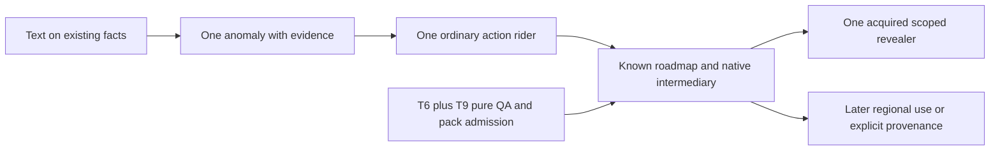

# T13 proposed build order

2026-10-14. R8 checks [round 9's illustrative order](../../../../TECHNOLOGY_AND_PROGRESSION.md:1539)
against current code. **No step is selected or dispatched.** Each playable slice
must close before the next. Target: 1366x768 CSS laptop/desktop, readable ordinary
text, routine actions visible and intentional independent scrolling. Mobile,
broad new worlds, new prestige, runtime models and global simulation are deferred.
Ownership transfer is per [OWNERSHIP](OWNERSHIP.md), not implied by this file.

## R8. Dependencies and visible checkpoints

T16 now implements the pure QA packet in its isolated worktree (see OWNERSHIP R10g2). Use its reviewed delivery; this architecture does not dispatch a second QA lane. QA/content preparation is a dependency within step 4, not another compulsory
player progression gate. An engineering checkpoint may be headless; it cannot
be reported as a completed gameplay wave. Development need not force a player to
repeat steps they already possess, and no Frontier opening is required.

| Step / code | Visible outcome at 1366x768 | Proposed touched files | Save impact | Acceptance gate |
|---|---|---|---|---|
| 1 / R8a, IM7 | One native craft detail shows a richer cue at suitable held expertise; one Village description line reflects the already witnessed `town.returned` outcome (T11 N19). Core Makes/Success/Station/XP and craft action remain visible; texture-off keeps result/cost/blocker. No new panel | New `research_texture.js`, `data/research_text_home.js`; narrow `crafting_detail.js`, `display.js` and current location reader; `display_settings.js` only if texture preference included; owning style file only if fit requires it | No gameplay field. Texture preference is browser display config, not portable game-save content | Rebuild and serve exact candidate; fresh origin novice/practiced/texture-off and unknown-truth controls; inspect craft detail and keyboard/hover at target size; actual native craft unchanged. No source tests merely duplicating strings. No persistence migration required; display-config reload if preference built |
| 2 / R8b, IM2, T1 C1/T3 Q41 | Two real Short hilt results with different outcomes open one dated question; comparison action shows actual means/costs and yields one supported finding with a useful native consumer. Notebook routing reveals only after the question; player can continue ordinary play | New `research_state.js`, `research_view.js`, `research_host.js`, `research_panel.js`, selected `research_home_content.js`; minimal `main.js`, `save_files.js`, `expansion_persistence.js`, `adventure_notebook.js`, `event_feed.js`; native craft rollback binding in main. Content consumer uses the reviewed local workshop seam | First optional schema 1 evidence owner. Exact event/sample basis, producer cursor and consumer settlement refs; no historical backfill | Reducer/validator + atomic host fault tests; natural paid craft -> question -> comparison -> real changed action. Missing means, disagreement, repeated observation, failed write and texture-off controls. R7a-d/g-i old-save + Save/reload + actual Export/literal Import; fresh rebuilt target-viewport evidence. Exact comparison cost/result must be selected before coding |
| 3 / R8c, RV4, T1 C2 | Two actual cooking outcomes prepare one shorter optional comparison; its quote names the contributing observations. Same display placement as step2, with consumer/stall visible | Existing research modules plus reviewed home content/job adapter; `main.js` native cooking producer and rollback binding, affected workshop duration reader. Feed only projects settled evidence | Receipts and frozen rider-derived duration in new accepted job terms; no global Science XP or retrospective duration rewrite | Ordinary cooking -> exact evidence -> shorter newly admitted job -> useful result. Unrelated/duplicated/out-of-order events give no bonus; old active jobs retain their original due times. Failed publication leaves stock/evidence/draw unchanged. Rebuild/fresh origin and persistence/import of prepared and active state |
| 4 / R8d, IM1/3/4, G11 | One center research panel selects soap/lamp/thermometer, shows known AND/OR roadmap, selected-node detail and a plain knowledge gap. Pin one known target; navigate from a supported shared intermediary to actual native glass-related learning/crafting and observe its useful owned output. Unbound final cleaning/light/temperature consumers stay honestly labelled planned, with no fabricated Build button | Root-reviewed T6 `invention_planner.js`, `data/invention_pack_home.js`, tests; new `research_catalog.js`, `data/research_functions.js`, `research_pack.js`, `data/research_pack_home.js`, `research_roadmap.js`; T9 QA/lint/receipt modules/tests/fixtures; research panel/host/state + main/save join. Use panel_kit registration; edit workspace_layout only if API genuinely lacks a needed hook | No save for unpinned preview. Pin adds manifest/bundle/project and explicit target intent. Pack/handler revisions retained; actual work stays in native owner | T6 focused tests rerun against exact integration; implement T9 oracle/goldens/contextual lint/limits/receipt tests, not merely copy docs. Actor view never exposes truth-level estimate/stock/pruning. Three fixture graphs stay honest and deterministic; actual known intermediary acquisition/use and target navigation at 1366x768. Pin/old-save/full-envelope import, changed/missing-pack and failed-write controls. QA checkpoint alone is not gameplay completion |
| 5 / R8e, IM8, suggested RC2 | Earn one source-qualified revealer; in the existing research panel switch between actor-known map and its permitted true roadmap for one target. Unknown requirements become visible under that means, but actual fabrication still names missing stock/access. Acquisition/awaiting-awakening/eligible views are distinct | Reviewed T14 card data in `data/research_revealer_cards.js`; new `research_reveal.js`; narrow `cheat_cards.js`, `status_window.js`, research panel/host/main acquisition adapter; no enum extension under suggested reuse | Existing schema 1 cheats acquisition/message data plus research reveal receipts only if knowledge is actually learned. No duplication of graphs in card.state | Real acquisition and appropriate awakening -> compare -> useful next action; dormant/unheld/other-card controls, scoped secrets/ARIA/error scan. Card validation does not execute hooks. Rebuild/fresh1366x768 and Save/reload/literal Import preserve card terms/stage and projection. Human fit of form/lore remains separate |
| 6 / R8f, later IM5/IM6/world packs | Select **one** later slice: actual recipient uses one transmitted method with a changed local service, or one explicitly identified specimen has legitimate provenance through use/transfer. Known region/provenance detail is readable beside selected record; other later families wait | If diffusion: research_world/host + saved stream/schedule adapters, specific world facts/recipient/history consumer. If provenance: research_provenance + exact items/native identity loader/custody and item-view hooks. New qualified world pack only when selected; generated_people actor bridge is separately required if used | Selected worldTech **or** provenance subrecords with revision/identity/ref validation. No blanket native-key migration or universal world-state enrollment | Diffusion R7k baseline/transmission/recipient/missing-means and next-draw persistence, or provenance R7j merge/split/trade/equip/consume controls. Both require actual useful outcome, old-save and native full-envelope persistence under rebuild/fresh target-viewport journey. No broader natural-course/offline or cross-life claims |

## R9. Corrections to an overly cheap reading of round 9

| Code | Code reality | Required refinement |
|---|---|---|
| R9a | Craft cue and ambient text can be cheap, but native quality does not encode a crack or regional adoption. T10 U6 and T11 qualify the texture join | Step1 describes existing observed facts only. New accidents, health changes, calibrated readings and diffusion need their own selected state/consumer |
| R9b | Notebook `familiar` excludes research today (`src/adventure_notebook.js:93`); items/components craft rollback needs explicit research binding (`src/main.js:4170`) | Step2 includes route/discovery and atomic publication; it is not a list appended from a render callback |
| R9c | T6 `estimate` is structural and `nextMissing` is epistemic; primitives are boolean. No quantity, work time, reservation or critical path implementation | Keep knowledge gap separate from known execution stall. Actual quoted host jobs supply time/cost; PM1 critical-time optimization is a later feature, not a renamed graph depth |
| R9d | Three T6 demo targets have no native final consumers; T9 QA/lint/receipt code is still proposed | Step4 needs admission and a useful real intermediary/navigation outcome. Building final soap, lamp or thermometer is separately selected connected gameplay, not granted by a witness |
| R9e | `awakenedStatusCard` matches any status-window UI (`src/cheat_cards.js:85`); renderer exposes core stats (`src/status_window.js:23`) | A research-only RC2 card must not accidentally activate unrelated core-stat powers. Add exact capability selectors and preserve old system-card behavior. T14 panel proposals are data fit, not final UX authority |

Proposed step2 consumer must genuinely read the tested finding, rather than award
an explanation badge alone. Exact content and costs are unresolved decisions in
[REPORT](REPORT.md); R8 is implementation dependency order, not accepted product
priority or a request to stop extending the palette.

Each implementation report distinguishes edited source, focused tests, rebuilt
served bytes, native changed behavior, persistence/import, human acceptance and
commit/deployment. Unexercised changed behavior remains implemented-unverified
with its specific backlog gate. T13 ran none of those gameplay gates.
