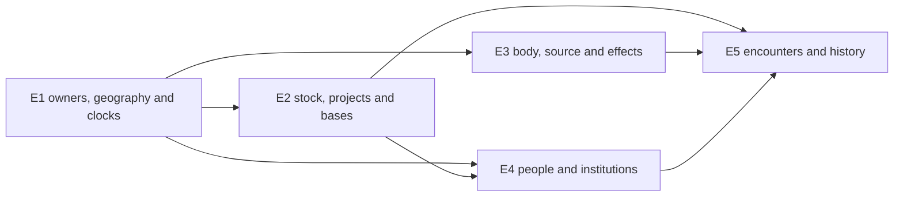

# Staged engine requirements

Planning only, 2026-10-04. This translates the [connected graph](SYSTEM_GRAPH.md) and [worked cases](WORLD_LOOP_MATRIX.md) into proposed implementation families for director review. [API_SUPPORT](workers/API_SUPPORT.md) owns the read-only export audit and fingerprints. Presence of an API is source evidence, not browser, save or new gameplay acceptance. Runtime remains held by [RUN](../../RUN.json).

## Existing support and exact seams

| Family | Actual support inspected | Missing policy/adaptation, not a claimed export |
|---|---|---|
| Place and time | [world_instances.js](../../../../../src/world_instances.js): `createWorldInstance`, `createWorldVisit`, validation/planning/views bind definitions, era/continuity, sites and joined-visitor elapsed. [realm_clock_leases.js](../../../../../src/realm_clock_leases.js) supports authorized realm activity clocks. | Region adjacency/terrain/routes, resource ecology and absence advancement. A visit records authorized arrival; it does not authorize passage. Existing lease policy is specialized, not a generic calendar or historical reset engine. |
| Jobs, typed effects and production | [simulation.js](../../../../../src/simulation.js): preview/commit commands, boundaries, encounters and campaign transitions. [site_projects.js](../../../../../src/site_projects.js): `compileSiteProject`, `projectView`. [simulation_effects.js](../../../../../src/simulation_effects.js): items/transfers, actor/body/source/faculty/power, relationships, knowledge, regional reputation and world effects. | Harvest reservation/depletion, recipe stock/tool/facility/labor validation, physical outputs, construction rights, independent maintenance/production and aggregate population transactions. A scalar resource or site fact is insufficient. |
| Body and function | [body_progression.js](../../../../../src/body_progression.js): body facts/sources/capabilities/conditions and authored commands. [energy_resources.js](../../../../../src/energy_resources.js): `learn`, `recover`, `use`, `refund`, with output/control/efficiency/capacity/reserve/strain. [power_models.js](../../../../../src/power_models.js): practice/design/investment previews. | Actual organ/component identity, donor/host provenance, installation/removal and compatibility. Passive drain, recovery-rate change, capacity change and upkeep need scheduler-supported policies. `energyCharge` calculates use cost; it is not an energy effect named `charge`. |
| People and evidence | [simulation_contracts.js](../../../../../src/simulation_contracts.js): registry/state, directed relationships, life/party/controllers and definitions. `createSimulationState` is exported here, not re-exported by simulation.js. [people_knowledge.js](../../../../../src/people_knowledge.js) projects known people; [causal_situations.js](../../../../../src/causal_situations.js) supplies situation support. | Institution membership/role/legal rights, household/kinship/consent semantics, observable disclosure and actor-to-aggregate transitions. Native regional reputation already exists; do not build another generic reputation owner. |
| Encounters and history | [simulation_resolution.js](../../../../../src/simulation_resolution.js): deterministic seed and finite legal weighted outcomes. Simulation boundaries settle jobs/events/conditions/controllers; campaign transitions preview reset/retain lists at guarded safe boundaries. | Reach/terrain/front/population budgets, persistent ecology, scoped historical restore/branch lineage, actual retention carriers and outside commitments. Existing reset lists are useful support, not proof that a source time loop can restore an entire causal world correctly. |

Generic typed records/effects/events can share settlement, scheduling, custody, predicates and projections. Dedicated policies remain necessary where they change legal outcomes: Gu diet/refinement and aperture support, an organ graft, a qualified loop reset, temporal enclosure provisioning, armor fuel/interface, domain authority or conceptual targeting. Local policies should return guarded effects through shared owners; they must not write separate bags, spawn hidden timers or publish saves independently.

## Five expansion families and dependencies

All shapes below are proposed authoring records, not existing calls. Each selected record includes stable ID/revision, source claim/cutoff or O rule, bound owners, prerequisites, actual inputs/outputs, target/reach/order, clock, failure/interrupt, portability, player-visible projection and coverage IDs. Unsupported source details remain U; choose an O prototype or retrieve the exact missing scene before registering it.

| Priority/family | Necessary for first qualifying slice | Optional until selected | Completion evidence proposed for later execution |
|---|---|---|---|
| E1 Identity/geography/time/coverage | World/instance/era/branch binding, site/route adjacency, native duration, rights and source coverage; one scheduler and explicit absence policy | Coordinates, full pathfinding, simulated weather, browser-closed growth | Enter/work/return/reenter uses the same changed instance; native Frontier journey remains its actual length; refused travel grants no visit/reward. |
| E2 Stocks/projects/bases/populations | Finite harvest/stock reservation, production inputs/output identity, facility/tool/labor, access and upkeep; aggregate budgets when repeated encounters draw population | Detailed markets, demographic births, every farm crop, autonomous industry, fort sieges | Harvest → actual stock → project → useful item/service → later supply. Competing actor reservation or paid-inspection stock change settles once or rejects without partial loss. |
| E3 Source/body/operating effects | Existing ordinary acquisition/control/fuel; specific installed support and remedies for each selected exceptional function | General physiology, every lineage, all organs, passive simulation for unselected sources | Actual positive function works with its supported host; startup/use/upkeep/recovery remain distinct; donor removal never leaves duplicate execution; sustainable operation changes predictably. |
| E4 People/institutions/households | Directed remembered choices, witness-limited knowledge, roles/permissions, finite actual collaborators and refusal outcomes | Marriage/kinship inheritance, generated families, household economy and romance unless chosen | A resident can help, decline, leave or report based on actual knowledge and means. Access, friendship, romance, employment and ownership settle separately. |
| E5 Encounters/history/cross-world composition | Fixed-strength actors, relevant ranges/cause budgets, scout/contact/pursuit/aftermath; retained state and changed later prerequisites | Large army fronts, regional absence catch-up, full reset history, higher layers and time enclosures unless chosen | Quiet/common/rare events draw valid budgets once; superior function keeps its advantage. A changed witness/source alters later events. Reset/enclosure only works when its selected scope/retention/provisions are implemented. |

The dependency graph permits disjoint feature work after shared contracts freeze. It does not require all optional families before a small campaign. Suggested qualification pair remains Original Frontier plus Gu upkeep **or** Mother of Learning control/research, both without an exceptional reset initially. Fallout production is a useful next cross-check. Naruto's acquired-eye slice waits for precise Micro/body/source requirements; ordinary Naruto service/control/craft can proceed independently after approval. These are sequencing proposals, not dispatch authority or a new world-count limit.

## Save and owner compatibility

Current world-instance/clock contracts have strict schema1 shapes; simulation versions and realm envelopes have their own owners. Add separately versioned optional families or explicitly migrate the owning schema instead of inserting fields into a strict record. Definition IDs/revisions bind the saved operation to its supported rule. Missing optional data means dormant legacy behavior, with no enrolled actor, source, title, stock, land or historical reward. Unknown definitions must receive a declared recoverable treatment; silent reinterpretation is unacceptable.

Native actors, bags/chest, skills/XP, body, equipment, claims and saved world facts remain authoritative. Derived views can cache with owner revision guards, but cannot become competing save state. Plan and validate in a cloned candidate, reserve real owners, resolve deterministic outcomes, durably publish, then expose the UI result. Failed publication or stale input leaves actual owners unchanged. Do not migrate private saves during this planning task. Later acceptance needs generated old/new/partial/mid-job fixtures and real save/reload behavior, subject to the user's active check policy.

A continuously supported function integrates over scheduled boundaries with declared funding and stop rules; it cannot subtract a full duration on every reload. Recovery-rate reduction, maximum-capacity reduction, startup cost, active consumption, idle drain, strain, suppression and incompatible host are separate dimensions. Their remedies undo only corresponding effects. Specific infinite/superior functions remain valid if demonstrated, without an invented generic tax to balance them.

For loop/history state, define the carrier of each retained field: memory/person/source/body/physical item/record and its actual boundary. Restore only selected history, keep outside commitments where appropriate, and give the new pass a causal branch identity. Derived predictions are evidence with prerequisites, not forced appointments. Existing campaign reset/retain support can be reused where its semantics fit; restoration and participant policies still need dedicated planning.

## Manageable authoring and sole writers

A world package should reference shared functions and author region/site/route records, ordinary resource/use chains, career arcs, cast/institutions, exceptional policies and required coverage. Reuse complete patterns such as survey → lawful harvest → preserve → craft → deliver → revisit, with local materials/permissions/clock and alternative paths. Trope templates bind actual causes, witnesses and costs; they do not overwrite actors or guarantee a source ending. Show only meaningful actions, costs, duration, support and consequences in the player action menu, with notebook evidence for known leads. Keep engine schema names out of game dialogue.

| Writer/GM | Exclusive responsibility and handoff |
|---|---|
| Engine integrator | Shared state contracts, native owners, scheduler/publication/migration, registry/UI bindings and final integration. One owner for each shared file/interface; source presence is not acceptance. |
| Macro and World GMs | Macro region/population/loop requirements here; local World GM owns region/career/arc/cast implementation records and selected coverage. Do not edit another world's source ledger or global save owner. |
| Micro/Ability/Body and Item/Craft | Atomic identity/source/target/order/effect rules versus item/process/assembly transactions, in explicitly disjoint files. Share requirements before installing a graft or continuous policy. |
| People/Institution and Causality/Dialogue | Actor rights/ties/refusal/evidence versus time branch/occurrence/reveal and dialogue projections. Content writers cannot bypass legal command settlement. |
| Source and Review | Retrieve precise qualified claims/cutoffs; review actual changed code and deferred gates. Source reading runs independently; complete book reading does not implement a world. |

## Proposed later acceptance matrix

These are descriptions, **not tests run or new tests created**. A selecting milestone must name required IDs from the campaign and mechanic ledgers. Further gameplay checks remain held/deferred as applicable; source/build/import results alone cannot close these behavioral gates.

| Join/cases | Positive case | Counterexample and later evidence |
|---|---|---|
| `AC-01` stock/work/base: Frontier + Fallout | Harvest/salvage real yield; fund a tool/repair; repeat meeting shows delivered support and remaining stock | Same material reserved by another actor, absent facility or stale paid inspection rejects; no duplicate output/refund. Later route/utility service uses the actual repaired object. |
| `AC-02` ordinary/superior source: Gu + Naruto | Ordinary livelihood remains viable; maintained Gu or qualified acquired organ performs its actual positive function | Wrong diet/host/method/fuel fails the corresponding operation. Exact transfer provenance and continuous effect removal restore only actual dimensions; no automatic lineage or donor-method grant. |
| `AC-03` populations/encounters: all five | Scout a known warning, avoid or contact the same fixed-strength actor, then preserve retreat/front/aftermath | Reopen does not reroll, defeated group does not refill, long sensing is not long attack. Quiet intervals yield useful ordinary work; legal extraordinary bypass retains its effect. |
| `AC-04` people/time: Frontier + MoL | Refuse/delay a job or warning; another resident makes an independent later choice from witnessed evidence | Private knowledge is not global; a discarded-pass relationship is not remembered by an unqualified counterpart. Correct local/subjective/outside scope precedes any temporal effect. |
| `AC-05` world/hub/compatibility: Paradise + selected destination | Live/work in hub; accept a bounded trip; return actual allowed cargo; reenter changed destination | Declined offer gives no debt; extraction initiation is not arrival; blocked export remains blocked. Generated legacy/new/partial/mid-operation/failure fixtures retain authoritative owners and one settlement across save/reload. |

Unknowns needing director/master resolution: first different-book qualification partner; selected ordinary versus exceptional mechanic IDs; authored absence/return/reset policy; source cutoffs versus O choices; later behavioral release gate. Macro does not decide those by expanding the plan or waiting for a timer.
