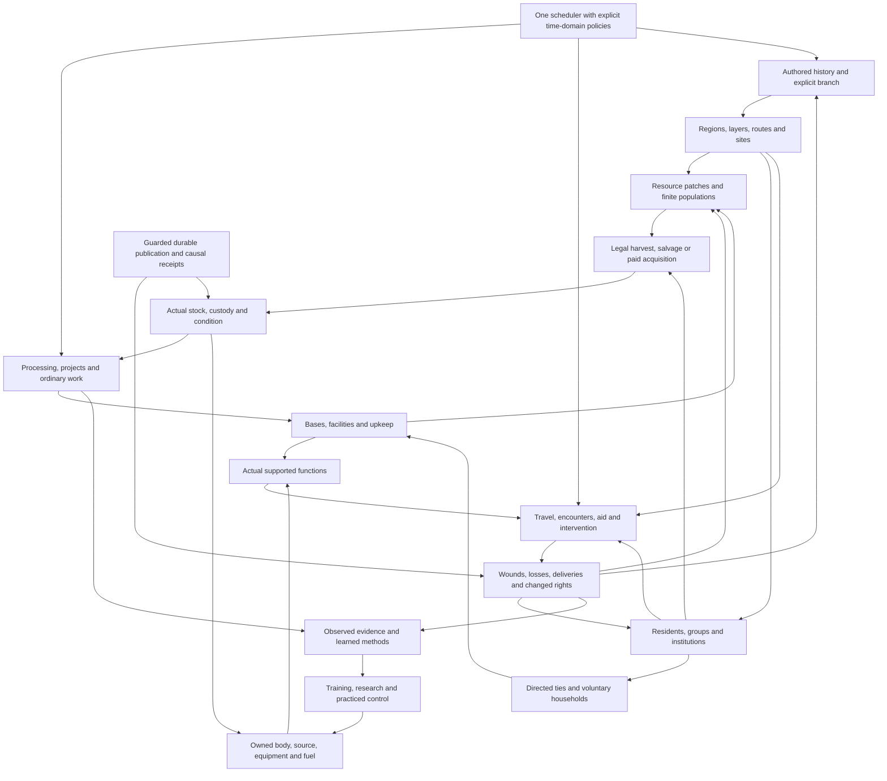

# Connected world foundation

Planning proposal, 2026-10-04. [Assignment](ASSIGNMENT.md) and [review plan](../../IMPLEMENTATION_PLAN.md) govern this report. Engine/Ability/Original runtime remains held. All new records, behaviors and numbers below are **O**, not existing APIs or approved gameplay. Existing owners and source limits are distinguished in [ENGINE_REQUIREMENTS](ENGINE_REQUIREMENTS.md) and [worked worlds](WORLD_LOOP_MATRIX.md).

## One connected graph

The central feedback is concrete: gather permitted fiber, make a rope, deliver useful work, earn instruction, practice a new function, reach a different site, and change its later supply or people. The same owners also allow buying the rope, refusing the offer, losing the cargo, or solving the problem through another function. Neither a quest completion flag nor a relationship score substitutes for these changes.

| Join | Required state and observable result | Illegal shortcut |
|---|---|---|
| Resource → stock | Patch/owner revision, method, tool, amount, time, yield condition and receiver; settle depletion and cargo together | Infinite deposit from an item label; award stock before reserving the patch |
| Stock → project | Known design, actual inputs, permitted facility, competent labor, committed duration and one output identity | Blueprint creates a finished machine; borrowed tools become owned |
| Project → function | Installed compatible support, actual operator, control, fuel and target | Facility ownership grants every technique or doubles every power |
| Function → aftermath | Supported reach/contact/order, costs, affected actors/materials and cause receipt | A nonlethal defeat creates death, extracted organs and duplicate loot |
| Aftermath → later history | Changed prerequisites and observer-specific evidence; independent residents decide from their means | Original source event fires after its necessary actor/source was removed |

## Regions and authoring resolution

A proposed **region record** binds world/instance/branch/era, layer, sites, route adjacency, terrain pockets, travel duration, access predicates, population/resource IDs, seasonal modifiers and evidence cutoff. A **zone profile** defines legal activities, exposure, services, encounter families and escalation causes. A **route** has departure/arrival, occupied actors, transport/cargo, timing, rights and interruption/return policy. These are definition references plus versioned state, not duplicated native location or inventory records.

Start with adjacency and a few terrain pockets. Coordinate maps, continuous pathfinding, detailed weather and town-by-town demographic models are optional. Distinguish distance from danger: a safe distant market can take longer than a lethal nearby ruin. Existing Frontier travel times remain authoritative; a newly written job cannot teleport the player's body.

| Zone family | Resources and inhabitants | Characteristic encounter and consequence |
|---|---|---|
| City/market/residential | Finite merchant stock, workshops, workers, families, officials | Theft inquiry, bargain, care, competing claim; witnesses and law matter after the exchange |
| Managed fields/river/gathering grounds | Renewable yield, leased plots, growers, fish or herds | Harvest rights, migration, flood or shortage; methods change future yield/access |
| Wilderness/frontier | Species populations, territory, food, cover and scattered camps | Tracks → sighting → contact or detour; escape retains the same pursuer and spent supplies |
| Battlefield/front | Actual groups, stores, routes, wounded, civilian refuges | Scouts, screens, ranged fire, breakthrough or withdrawal; ammunition, morale, losses and changing supply move the front |
| Ruins/abandoned works | Finite caches, damaged machines, traps, dormant actors | Survey, careful salvage, collapse or awakened defender; opening a cache consumes its claim once |
| Restricted institution | Archives, clinics, training grounds and controlled facilities | Credential check, supervised work, exposure or expulsion; copied knowledge does not grant legal access |
| Layer/pocket/other domain | Local ecology, resident authority and declared entry support | Domain hazard, barrier, contested anchor or exit; sensing across a boundary differs from entering or striking |
| Farm/workshop/fort/base | Owned stock, hired or voluntary residents, upkeep and rights | Repair, production, guest conflict, raid or abandonment; land, stored goods and resident consent have distinct owners |

## Encounter ecology and unequal strength

A proposed encounter family declares **population budget**, **cause budget**, **strength profile**, **spatial reach** and **knowledge policy** separately. Population budgets track available individuals/groups and births, arrivals, deaths or departures under authored rules. Cause budgets track funded patrols, active warrants, migrations or crises. A quiet interval is legal. A rare boss cannot respawn because the player reopens the menu; an explicitly inexhaustible source can operate as its actual exception.

Density is relevant available population across traversed terrain pockets and exposure time, with a declared opportunity/contact distribution. It differs from threat strength and from the chance to notice an existing hidden actor. A crowded market, sparse predator territory and active battle front need different population, cause and contact policies. Weather, noise or longer exposure may alter supported opportunities; they cannot conjure extra bodies outside the budget.

Strength is authored body, sources, equipment, control, fuel, readiness and coordination. A zone can have common residents, uncommon experts and a source-fixed exceptional presence with distinct probabilities/causes. These are local descriptions, not player-level multipliers. Spatial reach records movement, sensing, attack/projectile/effect range and access boundaries separately. A long-range sensor need not have long-range damage. Terrain, visibility, weather and time affect only supported functions; a genuine heavenly locator may bypass ordinary cover.

| Phase | Macro contract |
|---|---|
| Scout/plan | Allocate actual time, observer/tool, route and exposure. Record a dated signal or estimate, not the hidden actor's full build. Use a committed legal distribution when uncertainty is needed. |
| Evasion/contact | Detour, conceal, negotiate or meet according to actual locator/reach/access. Changing a plan never rerolls an already committed event. Failed sensing and successful concealment differ. |
| Pursuit/front | Preserve actor/group IDs, leads, supplies, route, roles and current contact. A scout reports, a screen delays, a medic treats and a supplier moves stock; one abstract strength score cannot perform every role. |
| Resolution | Use ordinary native combat, authored encounter responses or a dedicated supported function as appropriate. Overwhelming power can defeat weaker opposition directly. Separate simultaneous objectives only where an actual situation warrants them. |
| Aftermath | Persist injury/death/escape, losses, recoverable bodies/parts, civilian movement, depleted stocks and witness beliefs. Derive later offers and fronts from those facts. Failure can leave a productive alternate career. |

Do not run every distant NPC each tick. Resolve irrelevant ordinary activity as bounded aggregate flows at meaningful scheduler boundaries. **Promote before personal interaction**: create a durable actor/group identity and subtract its stock/population from the aggregate in one commit. Demotion preserves identity, debts, wounds, claims and witness records; it cannot replenish the budget. Named source actors remain durable with fixed authored capabilities. Process only due regions/commitments and cap work per boundary with continuation state, without changing elapsed history or paying an event twice.

## Local lives, bases and chronology

Directed relationships retain specific help, grievance, trust, intimacy or dependency only as authored axes and memories. Friendship, instruction, service, co-residence and romance are different outcomes. Optional romance/household content needs clearly eligible adults, reciprocal interest, current consent, individual knowledge and refusal. A partner may decline relocation or work; household membership never grants automatic labor, inventory custody or institutional power. Canon ages not inspected remain unknown, so use explicitly adult original residents for such branches.

A base grows through functions: rented shelter/storage → reliable worksite → staffed project or community asset. Land rights, guest permission, stock ownership, facility access, resident obligations and defenses are separate. Construction and upkeep use the existing job/project owners plus missing rights/production adapters. Farms replenish only their actual population rule; forts change patrol/supply logistics; pockets additionally need boundary and clock support. One shared base family avoids five independent storage engines.

Use one scheduler with mappings for **local calendar**, **traveler subjective duration**, **outside elapsed**, **occurrence** and **reveal**. Current world instances freeze without joined visitors; funded absence simulation or a chapter snapshot is a later explicit policy. A reset declares scope/anchor/eligible participants, retained carriers, restored stocks/bodies/ties, deleted causes, ongoing outside commitments and branch identity. Each selected rule states separately which carriers survive or restore; memory, body, source, injury, item, record, tie and outside commitment never inherit one another's policy. Changing a cause makes predicted history conditional. A return visit to the same instance restores its changed state; a distinct earlier history gets a distinct causal instance.

The hub is also a world. Its home, services, people, projects and calendar use these owners; its institution issues travel contracts rather than owning every destination's civil history. Bounded visits reduce initial **represented area**, while dossiers keep room for later residence and expansion. Their persistence still needs the same join contracts. See the Paradise sixth example in [WORLD_LOOP_MATRIX](WORLD_LOOP_MATRIX.md#paradise-hub-a-lived-world-and-a-travel-structure).

## Inputs and limits

This graph extends the existing [gathering chains](../../../../GATHERING_AND_RESOURCE_USES.md), [wandering/insight](../../../../WANDERING_ZONES_AND_INSIGHT.md), [assembly/progression](../../../../worlds/PROGRESSION_AND_ASSEMBLY.md), [origins/timelines](../../../../worlds/ORIGINS_AND_WORLD_TIMELINES.md) and [campaign framework](../../../../worlds/CAMPAIGN_FRAMEWORK.md). It is not a shipped ecological, organ, household, war or reset engine. Source-qualified exceptions remain local; shared types do not imply universal power conversion or equalization. [Evidence](EVIDENCE.json) records inspection fingerprints and document-only checks.
