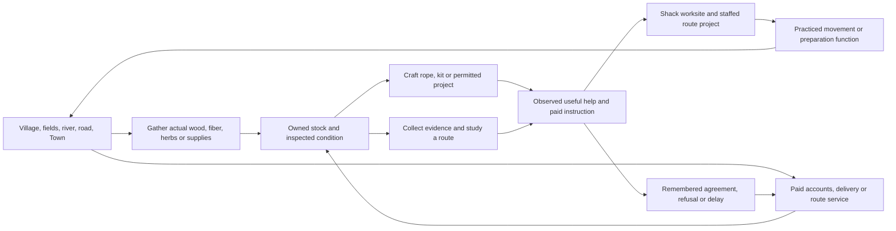
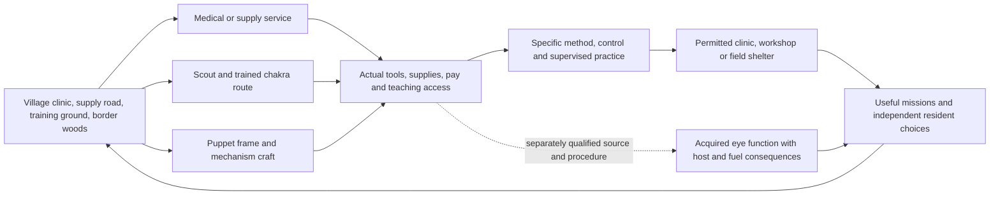
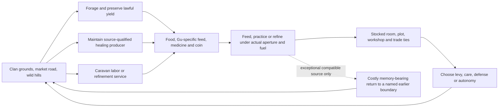
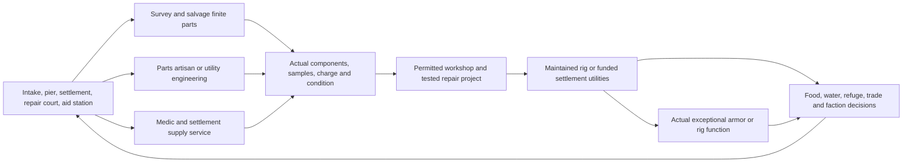
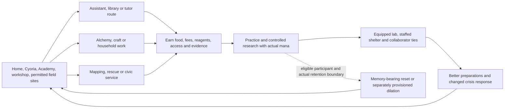
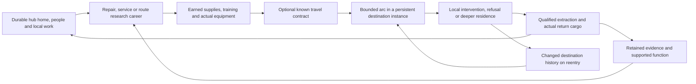

# Worked world loops

Planning only, 2026-10-04. Five required worked cases plus a Paradise hub case connect the [system graph](SYSTEM_GRAPH.md) to distinct local play. **C** is bounded direct evidence in the owning ledger/edition, **A** official adaptation evidence, **I** interpretation, **O** original proposal, **U** unresolved; primary-canon/authenticity status is specified separately per source. Supplied-edition findings remain qualified to that edition and its reviewed range; they are not automatically original primary canon. All player careers, starting access, new people, projects and branches below are O unless explicitly attributed.

Three routes are worked examples per case, not a ceiling or a claim that the complete campaign is implemented. Campaign and mechanic coverage remain separate ledgers in the [canonical plan](../../IMPLEMENTATION_PLAN.md#outcome-distinct-complete-campaigns-with-shared-working-systems).

## Original Frontier

Native geography/materials and current work are documented in [CAMPAIGN](../../../../worlds/original-frontier/CAMPAIGN.md) and [PROJECT](../../../../../PROJECT.md). Preserve the existing mill quest, familiar opening and one field-renewal prestige. Shack is a native ten-minute connection; Eastern mill is thirty; Forest road's Village/Town-outskirts main legs are 240 minutes and Town square adds forty. A Short Measure NPC errand cannot replace those player journeys. The held campaign still needs physical stock reservation/recheck for paid inspection and proper native travel timing.

| Route | Early → established → mature | Costs, people and changed later history |
|---|---|---|
| Material craft | Gather common useful yield → make/sell real kit or rope → maintain a route worksite | Tools, stock, native travel, facility and labor. Decline a commission and keep saleable stock; delayed delivery can leave the route crew using another supplier. |
| Accounts/dispatch | Inspect a permitted record → reconcile actual delivered stock → coordinate a continuing supply route | Evidence, paid service and actual custody. Report a discrepancy or refuse to endorse it; later prices, trust and access follow the recipient's witnessed information. |
| Inquiry/stewardship | Scout/read a guide → practice a supported field method → organize agreed escort or teaching | Time, exposure, owned provisions and consenting helpers. Abstain from dangerous escort, retaining the guide/study route; the group chooses its later departure independently. |

Common ordinary route: work/gather → useful sale or repair → instruction → reliable livelihood, with no rare acquisition required. Current Load-bearing Step supplies a narrower trained function with measured reserves/control. The current **original exceptional function** is the earned Frame listener/owned paired device's paid Folded Glasshouse viewing: supported distant observation and a narrow notice without transporting the player's body or cargo, as recorded in PROJECT. Its current built behavior remains browser/save-unverified. The proposed inquiry career can use that specific evidence function when the scene permits; it does not reveal Town, copy another source, grant physical contact or generate permits. Other foreign locator/movement acquisitions remain later qualification-bound options.

Base/social loop: temporary work → Shack storage/rack/bench → agreed staffed survey or maintenance, with finite hired help. Optional clearly adult original household ties affect housing/care choices, not free crafting throughput. Local played time advances committed work; absent-instance policy remains freeze unless changed explicitly. IDs `MW-FR-01..06`: native geography; stock-to-craft; three careers; remembered people/rights; base/upkeep; delayed delivery/alternate later route.

## Naruto

Selected boundary: original manga volumes 1–72/ch.1–700, excluding Boruto/filler and the later Minato one-shot. [SOURCE_LEDGER](../../../../worlds/naruto/SOURCE_LEDGER.md) and [ABILITY_VARIANTS](../../../../worlds/naruto/ABILITY_VARIANTS.md) own exact qualifications. N1/N2/N6 support bounded training/control and medical development; N7 supports actual puppet assemblies. N3 supports teaching and substantial Mangekyo/Kamui backlash, while N4's eye-gift evidence is official anime **A** pending original-manga transfer cross-check. Exact organ costs/lineage/body exceptions remain NU2/U. A reduced-regeneration formula is O, not verified Naruto canon.

| Route | Early → established → mature | Costs, people and changed later history |
|---|---|---|
| Medical/logistics | Paid supply/assistance → supervised specific treatment/control → reliable clinic support | Actual supplies, training and permissions. Refuse an unsafe procedure and continue ordinary clinic work; delay affects which patient/mission receives available support. |
| Scout/trained chakra | Observe terrain → learn/practice one supported control method → coordinated reconnaissance/escort | Travel, fuel, injury risk and disclosed orders. Decline a faction assignment and preserve autonomy; later patrol information and access change. Copying a gesture does not grant ancestry or every method. |
| Puppet/artifact craft | Obtain parts/design guidance → build/repair a real mechanism → trained field support and workshop | Stock, tools, mechanisms, control and condition. Decline lethal or disputed parts and retain an ordinary assembly career; a rival or institution can use another supplier. |

Ordinary durable route is learned control plus practical service, tools and lasting teaching relationships. Exceptional acquired-eye use is a **qualified architecture case**, not a starting grant: actual organ/provenance, donor loss, procedure, recipient body, active faculty, learned method and fuel stay separate. N5's weak official locator describes Kakashi copying Zabuza's signs/jutsu, providing a bounded positive function to qualify, not a complete copying/acquisition law. It can retain genuinely superior supported perception/copying. It neither changes ancestry by default nor grants all donor techniques. Failure/removal/suppression must affect only their actual source/condition. A nonlethal win supplies no organ.

Base/social loop: rented adult-local lodging → permitted worksite → clinic or field refuge. Source canon ages/locations not verified cannot be filled by convenient romance/cast assumptions. Optional adult original relationships may remain friendship, refuse co-residence or form a household independently of mission rank. Era and availability follow actual source cutoff/branch; preventing an injury or moving a donor invalidates dependent later scenes. IDs `MW-NA-01..06`: era/region; ordinary supply/control/craft; actual assembly; institutional/relationship aftermath; acquired-organ positive function and host constraints; changed prerequisite history. 05 is deferred until Micro/body/source qualification, not required for ordinary first play.

## Reverend Insanity

This worked case preserves the worker's **integrated ch.1–390 read-time snapshot**. During final review, six live source owners advanced to ch.400; their drift is recorded in EVIDENCE. Targeted readback confirmed the earlier producer and ch.193–200 return passages remain; new ch.391–400 claims are outside this case. Later reader coverage is not automatically accepted canon. [Worker note](workers/GU_TIME_LOOPS.md#case-a-reverend-insanity-gu-ecology-and-the-cost-of-a-changed-pass) contains the full worked graph, paths, claim IDs, clocks and read-time fingerprints. [Synthesis](../../../../research/novels/full-book/reverend-insanity/SYNTHESIS.md), [institution owner](../../../../research/novels/full-book/reverend-insanity/INSTITUTIONS_AND_LIFE.md) and [timeline](../../../../research/novels/full-book/reverend-insanity/TIMELINE.md) separate aperture/aptitude/fuel, living Gu diet/control and permanent bodily gains. RI-c0102-01/02/03 records healing-leaf production costing essence and a one-hour repeat-target healing restriction. This is one species/function, not a universal Gu diet.

| Route | Early → established → mature | Refusal/delay and later state |
|---|---|---|
| Forager/trader | Useful common yield → dependable preservation/trade → supply a route or settlement | Reject exclusive clan harvest; preserve independence but lose protected access/buyer. Population movement and another claimant alter the next outing. |
| Producer/healer | Legally obtain/control the specific producer → funded feeding/essence/storage → maintain clinic or household supply | Decline requisition; protect chosen patients while changing office access/standing. A missed window leaves a later patient without those actual leaves. |
| Caravan/craft service | Earn wages/tuition → practice with real inputs and supplier ties → protected workshop/caravan livelihood | Reject a bargain and retain ordinary trade; the caravan may depart without the player, changing who brings stock and hears the news. |

Ordinary development needs no rare rewind. Exceptional source history ch.194–196 returns to the ch.193 restraint scene with later-body/means sacrifice and memory; it is not a safe universal reset or all-history rewind. Earlier shared events remain. Player access is O and separately qualified; no Fang Yuan identity/portfolio is granted. A high-rank Gu can be superior and unsustainable for a weaker host. A staffed homestead/clinic links output, land, clan authority and optional adult consent; none replaces upkeep. Local flow and outside-time conversion can differ; the inspected King Quan conversion conflict remains U. Adopt `GUTL-RI-01..08` from the worker; 08 is optional for an ordinary milestone.

## Fallout 4

[Campaign](../../../../worlds/fallout/CAMPAIGN.md) and [ledger](../../../../worlds/fallout/SOURCE_LEDGER.md) select base-game Commonwealth 2287, no chosen ending/DLC/76/TV expansion. The player is not the Sole Survivor. F2 supports maintained/modifiable Power Armor; F3 supplies bounded logistics/radiation references, not a chosen Survival difficulty. Water Line residents, sites, rig and engineering values are O. Exact frame/core/refill/radiation therapy/implant rules remain FU1–FU7/U.

| Route | Early → established → mature | Refusal/delay and later state |
|---|---|---|
| Survivor/scout | Safe route and recoverable parts → dependable salvage/supply → linked refuge route | Travel, hazards and carry capacity; decline a hostile escort while continuing trade. Delayed deliveries change who can leave the settlement. |
| Utility/parts artisan | Paid inspection/repair → calibrated actual assembly → maintained water/production service | Stock, tools, labor and land/service rights; refuse an exclusive buyer, retaining the machine but changing downstream access and bargaining. |
| Medic/institution support | Supply ordinary care → source-qualified diagnosis/therapy → funded aid station and trusted network | Actual patients, consumables, facility and knowledge; refuse an unsupported cure. Delay consumes time without falsely clearing radiation/injury. |

Ordinary progress is useful repair/service → pay/stock → training/facility → sustained community output. An actual maintained Power Armor function can overpower appropriate lesser opposition; no artificial enemy scaling cancels it. Suit possession does not create operator skill, fuel, sample certification or food. Salvaging an actual component for export reduces the local assembly's support; blueprint knowledge remains. A base grows shelter → workshop → staffed utilities/refuge, with factions and residents retaining independent choices. Optional adult original household members can reject hazardous relocation. Local played-time work, actual supply arrivals and ending prerequisites define later history. IDs `MW-FO-01..06`: region; finite parts/custody; three careers; maintained positive rig/armor function; settlement rights/people/base; changed supply/faction aftermath. No invented core manufacturing recipe is needed.

## Mother of Learning

The [integrated supplied-edition synthesis](../../../../research/novels/full-book/mother-of-learning/SYNTHESIS.md) covers 106 numbered chapters plus epilogue, not every publication's authenticity. The [worker's detailed case](workers/GU_TIME_LOOPS.md#case-b-mother-of-learning-repeated-month-and-research-economy) identifies `MOL-C` locators and qualified reports. Ordinary shaping/formula/tool/mana/execution differ. Black Rooms are provisioned, isolated temporal enclosures, distinct from loop reset; the later five-month/one-outside-day chamber is a specific construction. Counterparts do not automatically remember relationships from other passes.

| Route | Early → established → mature | Refusal/delay and later state |
|---|---|---|
| Academy/library | Work/fees → specific lessons and proven methods → sustained research collaboration | Refuse coercive patronage, keep ordinary instruction; the lost facility changes who can help before the crisis. |
| Alchemy/workshop | Obtain tools/reagents → safely test a bounded product → funded lab and clients | Reject an unsafe shortcut; health/stock survive but an urgent client may choose another provider. A failed item can leave learned knowledge; across a reset, state which eligible participant retains it and whether physical notes return. |
| Field/civic service | Observe/maps/permits → coordinate rescue or repair → staffed shelter/ward project | Refuse a dangerous delve and remain useful locally; independent residents may reject/delay evacuation, changing later property and casualties. |

Ordinary paths provide wages, reliable methods and useful social connections without granting every actor loop eligibility. The extraordinary reset and extreme dilation retain their positive research advantage under actual source/identity/retention/provision rules. Early characters do not know the full cause/count/participants; player UI uses discovered evidence. Separate local, subjective, outside and reset domains; body death, injuries, soul/source features, copied notes and exported materials each need an explicit rule. A refusal recorded in a discarded pass is not silently remembered by nonparticipants, while the qualified participant may use that memory to choose differently. Student-era content has family/peer ties; any adult household is a separate O later-life branch. Adopt `GUTL-MOL-01..08`; 05–08 enter required coverage when temporal enclosure/reset is selected.

## Paradise hub: a lived world and a travel structure

The [current MTL dossier](../../../../research/novels/trailblaze-reading/paradise-depth/FULL_SYNTHESIS.md) is complete for its supplied snapshot. It explicitly marks new findings **U for original primary canon**. PR04 records attributed paid guidance, employees/shops, personal concerns and facilities; PR02 separates initiated extraction, interference, repair and arrival; PR05 scopes a later paid real-item storage exception. The earlier [hub brief](../../../../worlds/paradise-hub/WORLD_BRIEF.md) predates this completed dossier and remains the owner of **O Wayfarer Exchange**, not proof that the new source research is unrun. Do not update that other owner's document from this scope.

Three O careers: craft/service supports residence and workshop access; traveler supports expeditions with actual equipment; researcher/broker supports maps, tested cross-world interfaces and paid guidance. Each has early livelihood, established useful capability and mature institutional/base choice. Refuse a mission before acceptance and incur no invented debt; accept then abort under its disclosed exit/settlement terms. Issuer success, extraction success and local welfare are separate outcomes. A destination may remain unresolved or become a home. Only represented regions need current simulation, with declarations for reachable unsupported areas.

This structure is easier to **author incrementally** than many fully represented worlds, but it does not remove persistence, source/host/fuel or time boundaries. Preserve genuinely superior acquired functions wherever their actual support works; PR05 cautions against universal item/power export. Future direct Paradise adaptation needs scene-level choices from this qualified dossier and an explicit edition boundary. IDs `MW-PA-01..06`: lived hub; three local careers; known contract; persistent destination; scoped cargo/function retention; separate issuer/local/return outcomes.

## Nineteen-world coverage routing

The [nineteen-row roster](../../IMPLEMENTATION_PLAN.md#proposed-world-roster-and-local-identity) owns each source/campaign reference. This routing reuses that roster without claiming nineteen finished campaigns or rereading all books.

| Shared seams | Roster entries routed here | Local specialization still required |
|---|---|---|
| Native geography, craft, service and assemblies | Original Frontier; Skyrim; Fallout 4; Elden Ring; The Legendary Mechanic | Actual item/recipe/operator/fuel/material and native combat rules |
| Institutions, secrecy, source-qualified acquisition | Reincarnation Paradise; Fated Villain; Lord of the Mysteries; Circle of Inevitability; Harry Potter | Status/permission/ritual/education differ; related eras retain distinct histories |
| Body/source/control and layered survival | Reverend Insanity; Shadow Slave; Labyrinth of the Mad God; Naruto; Bleach | Gu/organ/Memory/soul/puppet/boundary functions need actual local handlers; Labyrinth's two volumes share one world |
| Coordinated scenarios, research and changed history | Regressor's Tale; Omniscient Reader; Mother of Learning; Worm | Reset/contract/precognition/coordination/identity are not interchangeable |

The routing groups are nonexclusive. Every selected campaign still names required context, career, arc/aftermath IDs and mechanic IDs. Qualification examples exercise joins; they do not substitute for complete campaign coverage.
