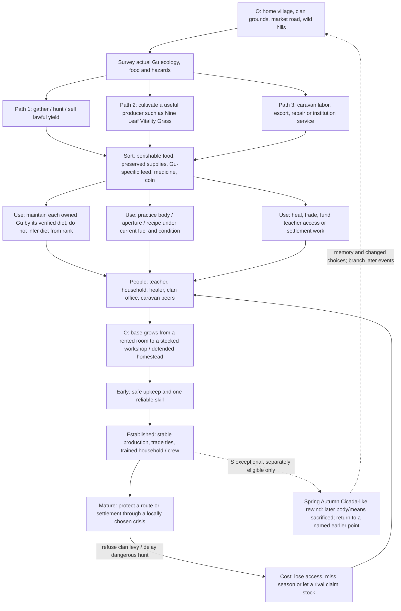
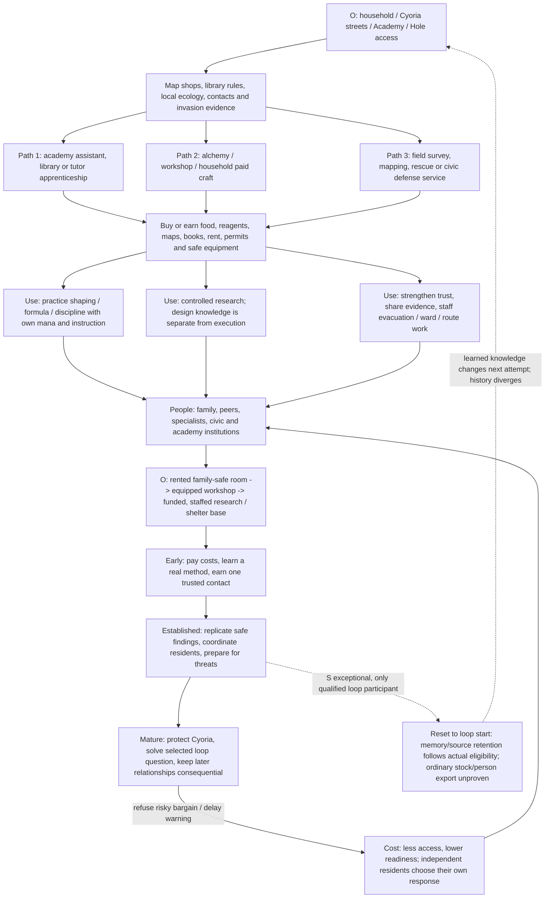

# Macro worked loops: Gu ecology and repeated time

Planning note for the macro assignment, 2026-10-04. All mechanics and named player goals below are **O: original proposals** unless explicitly marked **S: source-supported pattern**. This note is not an accepted world roster, a runtime contract, or evidence of implemented gameplay. Runtime remains held for human review under [IMPLEMENTATION_PLAN revision 2](../../../IMPLEMENTATION_PLAN.md) and [RUN](../../../RUN.json).

## Case A: Reverend Insanity, Gu ecology and the cost of a changed pass

**S evidence boundary.** The reviewed dossier covers chapters 1–390, not the complete supplied novel or ending. It documents Gu as living, individually fed and controlled means; cultivation, body, fuel, aptitude, recipes, knowledge and custody remain separate. Gu diets and effects vary by individual Gu: do not create one food recipe, capacity cap, rank formula, or universal “feed all Gu” action. The reviewed timeline's sole demonstrated memory-bearing local rewind returns from the chapter 194–196 prior pass to the chapter 193 restraint point. That reversal consumes the later body and means; the returned earlier inventory is present again, but later-pass deaths/events do not become guaranteed facts in the new pass. The narrator explicitly limits the witnessed event: it establishes a memory-bearing return and altered outcomes, not a universal safe reset. (Owners: [SYNTHESIS, “Central mechanical distinction…” and “Gu cultivation combines…”](../../../../../research/novels/full-book/reverend-insanity/SYNTHESIS.md); [INSTITUTIONS_AND_LIFE, “Village market/inn” and “Reviewed continuation101–200”](../../../../../research/novels/full-book/reverend-insanity/INSTITUTIONS_AND_LIFE.md), claims RI-c0011-02, RI-c0012-01/02, RI-c0102-01/02/03 and RI-c0146-01/02; [TIMELINE, “Reviewed continuation and the first local rewind”](../../../../../research/novels/full-book/reverend-insanity/TIMELINE.md), claims RI-c0194-01/03 through RI-c0199-01/03; [COVERAGE](../../../../../research/novels/full-book/reverend-insanity/COVERAGE.md); [CHECKPOINT](../../../../../research/novels/full-book/reverend-insanity/CHECKPOINT.md).)

| Viable route | Zone and harvest / supplies | Actual use and social connection | O cost and refusal consequence | Durable / exceptional distinction |
|---|---|---|---|---|
| 1. Forager-hunter | Wild edge, river, managed hunting ground; gather only identified plants, meat, or recoverable materials. Preserve and carry them with real capacity and spoilage. | Sell or cook a portion; feed only owned Gu with a verified species-specific food; practice with remaining fuel. Household and local healer gain useful stock; relationship credit comes from actual delivery/care. | Time, injury and depletion risk; refuse a clan's exclusive hunt and retain independence, but lose protected access or a buyer. Delay can let a dangerous population migrate into farms. | Ordinary route lasts through skill, trade and renewable ecology; no rare Gu drop is required.
| 2. Producer / healer | A protected plot for a source-verified producer. **S:** Nine Leaf Vitality Grass can produce saleable healing leaves; repeat healing has a one-hour restriction. | Maintain plot and stored leaves; sell to clinic/clan or support a household. Reinvest coin into housing, tools and instruction. A healer's demand and medicine access change with supply. | Land, labor and protection compete with training time. Decline a requisition and preserve stock for residents, risking clan standing or a lost contract. Delay misses a sale window or leaves a later injury untreated. | This particular producer has its documented function; it does not imply every plant heals or every Gu eats its yield.
| 3. Caravan / institution craft | Roadside market, caravan camp, workshop or academy yard; earn food, coin and access through paid labor, escort, repair, refinement or service. | Use acquired payment on actual necessities and tuition/access. Route knowledge and trust unlock different future jobs; a token, title or recipe access is not source ownership. Base can become a workshop with a reliable supplier. | Travel, hazard, obligations, watched recipes and limited market stock. Refuse a faction bargain and keep legal autonomy, while forfeiting protection/information. A late departure can strand the group across a seasonal hazard. | Ordinary durable career. Strength or rank alone cannot replace scarce stock, permission or expertise.

**Optional adult household (O).** A stable household may be a mature base outcome, with resident consent, eligibility and actual shared obligations. Any romance is limited to clearly eligible adults with reciprocal interest; neither service nor source-story marriage pressure buys consent. The student-era Mother of Learning case itself does not open romance: an adult household would be a separately authored later-life branch.

**Domains and reset gate.** The ordinary route runs on the local region's calendar and the player's lived time; the source does not support exact global synchronization or an exhaustive off-screen calendar at this cutoff. A blessed-land visit can use a separate **local-flow domain**: King Quan is described as flowing/recovering at 3× in chapters 346–360, but one conversion statement conflicts. Keep the disputed outside-time conversion unknown; never silently equate local time, the actor's subjective elapsed time and outside elapsed time. The **reset domain** is a different, exceptional event at 193–200, not the normal clock or a reusable seasonal loop. If a proposed player can trigger an analogous reset, mark it O and require the actual compatible source, body, trigger, cost, returned state and eligible boundary. Do not hand the player Fang Yuan's identity, rank, Gu portfolio or memory. No physical stock, person or harvested item crosses a discarded pass unless the selected operation explicitly proves it.

| Path comparison | Main investment | People / institution effect | Changed-history result if refused or delayed |
|---|---|---|---|
| Forager-hunter | Time, tools, food preservation, route knowledge | Supplies household and healer; can reduce competition or displace another claimant | Withheld hunt can preserve local beasts, but migration or a rival harvest alters the next season's availability |
| Producer / healer | Protected land, seed/source, labor, storage and buyer | Medicine supply creates clinic/clan reliance and bargaining power | Refusing requisition protects chosen patients but changes status, future access and who receives care |
| Caravan / craft | Wages, travel risk, permissions, practiced trade skill | Links settlement to an outside market; hired residents acquire obligations | Declining contract preserves independence; cargo, route protection and later arrival change who reaches the market |
| Exceptional rewind | Actual rare compatible means plus the source event's destructive later-body cost; exact game treatment unresolved | Memory may inform a returned actor; other residents do not automatically share it | One named earlier branch changes because of specific intervention. It is not free retry, item duplication or a reset-all history button. |

**Required coverage IDs proposed for the master matrix:** `GUTL-RI-01` zone ecology and seasonal harvest; `GUTL-RI-02` item custody/preservation and distinct Gu diets; `GUTL-RI-03` training with body, cultivation, aptitude and finite fuel separated; `GUTL-RI-04` producer economy and one-hour healing gate; `GUTL-RI-05` household, teacher, clinic and clan choices with refusal aftermath; `GUTL-RI-06` base stages funded by actual stock/labor; `GUTL-RI-07` local/subjective/outside flow domains and declared uncertainty; `GUTL-RI-08` exceptional reset eligibility, sacrifice, return boundary, retention and non-duplication. Keep 08 out of an ordinary first milestone unless a separate source-compatible function is selected.

## Case B: Mother of Learning, repeated month and research economy

**S evidence boundary.** The source dossier semantically covers the exact supplied WebToEpub edition: 106 numbered chapters plus epilogue, reviewed through assigned readers and source checks. It does not certify every edition or primary authenticity. The loop is an authored condition tied to actual participants/retention mechanisms. Zorian's memory, Zach's memory and nonparticipants' knowledge differ; copying a record, keeping a soul/source feature, retaining bodily injury, and carrying physical material across a reset are separate state questions. The exact start/reset mechanism is unknown to characters early and must be discovered in play. Ordinary body death is not harmless simply because a qualified person later wakes earlier. Conventional Black Rooms are a separate sealed local-time dilation: a costly enclosure, prepared supplies, no messages/entry/exit while active, and starvation/infestation/social strain if provisioned badly. A late engineered chamber reaches a stated five subjective months per one outside day; this is a specific construction, not a universal spell. (Owners: [SYNTHESIS, “Reconciled source rules” and “Honest remaining boundaries”](../../../../../research/novels/full-book/mother-of-learning/SYNTHESIS.md); [WORLD, “Craft / alchemy / resources” and “Black Rooms…”](../../../../../research/novels/full-book/mother-of-learning/WORLD.md), claims MOL-C061-12, MOL-C062-01/05 and MOL-C091-07; [POWERS](../../../../../research/novels/full-book/mother-of-learning/POWERS.md); [TIMELINE, “Reviewed chapters 81–95: last loop and return” and “Ending chronology and staged perspectives”](../../../../../research/novels/full-book/mother-of-learning/TIMELINE.md), claims MOL-C005-08, MOL-C007-02/03 and MOL-C010-07; [COVERAGE](../../../../../research/novels/full-book/mother-of-learning/COVERAGE.md); [CHECKPOINT](../../../../../research/novels/full-book/mother-of-learning/CHECKPOINT.md).)

| Viable route | Zone and harvest / supplies | Actual use and social connection | O cost and refusal consequence | Durable / exceptional distinction |
|---|---|---|---|---|
| 1. Academy / library | Academy desk, public library, mentor session, student job; acquire credentials, books, fees and legal access through work or instruction. | Practice a specific invocation or formula with actual mana/control; pass useful information to a peer or instructor. Household ties and professional references make access durable. | Tuition, job time, restricted materials and authority. Refuse a patron's coercive shortcut and keep autonomy, but lose privileged staff/equipment; delaying a report can cost preparation time and trust. | Ordinary development route. A formula or copied description does not grant mastery, unlimited mana, or the writer's ability.
| 2. Alchemy / workshop / domestic craft | Household cellar, licensed shop, market, Academy workshop; buy or gather a named reagent, tools, food, rent and cleanup capacity. | Prepare a tested remedy/tool, document failure, and use its bounded function. Sell work or care for a family member; reinvest earnings into better equipment or a safe lab. | Cost, hazardous handling, reagent availability and time away from people. Decline to use a hazardous plant without supervision and avoid injury, but miss the urgent job and may lose a client's confidence. | Ordinary durable craft. Incomplete ingredients or a design note do not conjure finished stock.
| 3. Field mapping / civic service | Streets, station, sewers/Hole edge, map course, evacuation route or ward site; collect observations, safe route knowledge and authorized supplies. | Turn evidence into a repair/escort/rescue plan; coordinate with police, teachers, families or civic workers. Base matures into a staffed shelter/workroom. | Exposure, permits, travel time and possible casualty. Refuse to enter a dangerous site and preserve life, while another actor's choice may leave the hazard active; delay can close an evacuation window and alter the next meeting. | Durable ordinary contribution. It can outperform a stronger duelist for a route objective without erasing actual combat inequality.
| Exceptional loop / accelerated study | **S:** qualified loop participant with actual marker/retention conditions; **S:** Black Room requires costly enclosure, isolation and preload; special engineered dilation has its own large infrastructure. | Repeat selected research with knowledge retention; log hypotheses separately from witnessed facts. Residents outside a relevant reset retain their own knowledge/history unless the actual rule says otherwise. | Reset exposure, injury, memory limits, soul/identity risk and isolation; provision/maintenance burden for dilation. Decline an experiment or alliance and preserve consent/relationships, but lose a powerful source of evidence or a narrow preparation window. | The reset and extreme dilation are exceptional source functions with distinct mechanics; neither is a universal research bonus. Do not carry physical goods or companions across by genre assumption. |

**Optional adult household (O).** The source campaign slice centers students and family ties, so no student romance is implied. A separate later-life branch may let eligible adults choose a shared home, with each person's consent, obligations and knowledge retained independently. Household services can connect a research base to local residents without making them loop participants.

**Domains and reset gate.** Distinguish at least four clocks/state domains: (1) **local ordinary time** in home, streets, Academy and travel; (2) **subjective time** experienced by a qualified participant during each loop and inside a temporal enclosure; (3) **outside elapsed time** reported relative to an enclosure or continuing events beyond its boundary; and (4) **reset scope**: the particular region/history restored at its trigger plus the explicitly retained participant/source/memory state. A single numeric “time multiplier” cannot model all four. Early Zorian does not know the cause, reset count or every participant; Zach's claims are partial; reset occurrence/reveal order matters. Preserve those knowledge limits. Black Room stop conditions, people inside, supplies and shell boundaries are separate from the larger loop. The five-month/one-outside-day late chamber is a sourced exceptional construction; ordinary Black Rooms' ~one external day/month description comes from an attributed expert report. They have different requirements. Don't infer exact world-wide elapsed history, perfect repeated-state identity, automatic memories for all actors, or physical export.

| Path comparison | Main investment | People / institution effect | Changed-history result if refused or delayed |
|---|---|---|---|
| Academy / library | Work time, fees, credentials, mentor and approved access | Research staff and peers can become collaborators; their access and opinions remain independent | Refusing patronage preserves agency; later access narrows, changing who can assist before a crisis |
| Alchemy / workshop | Coin, reagents, tools, cleanup, supervision and practice | Household care and client confidence improve; unsafe work can consume funds and damage trust | Refuse an unsafe shortcut, saving health but delaying treatment/research; later another route/user must cover the need |
| Field / civic service | Travel, permits, reliable observation, protection and coordination | Residents receive route/ward/evacuation help; organizations receive partial and possibly delayed evidence | Abstention avoids imposed danger; independent residents can stay, leave or reject the plan, changing casualties/property and later trust |
| Reset / accelerated study | Actual eligibility plus marker/source conditions; separate chamber materials, energy, staff and supplies | Evidence and relationships can be revised by participant knowledge; counterpart memory is not silently copied | Declining reset preserves the current lived branch but forfeits replay opportunity; delaying action consumes the same bounded loop or outside crisis window. No free infinite retries. |

**Required coverage IDs proposed for the master matrix:** `GUTL-MOL-01` everyday zone network, transport and authorized access; `GUTL-MOL-02` food/reagents/fees/custody and workshop production; `GUTL-MOL-03` distinct skill, formula, research and control states; `GUTL-MOL-04` real family/peer/institution knowledge and refusal; `GUTL-MOL-05` staffed base and safely provisioned temporal enclosure; `GUTL-MOL-06` local/subjective/outside/reset domains; `GUTL-MOL-07` reset eligibility, memory/source/identity/body retention, boundary and uncertainty; `GUTL-MOL-08` later-world consequence for a refusal/delay and non-looping residents. Require 01–04 for an ordinary campaign slice; 05–08 only when that optional loop/temporal family is selected.

## Shared implementation seam and source gates

These graphs need shared typed zone, actor, item/custody, storage, institution, project, knowledge, relationship, body/source/fuel and clock records, with each world's local rules deciding what the fields mean. A generic project/effect/event can settle a harvest, recipe, lesson, trip, meeting or refusal once; it cannot stand in for Gu-specific diet/refinement, aperture/body compatibility, a time-reset retention boundary, participant eligibility, or a Black Room's sealed clock and provision failure. Those need dedicated world functions/adapters and explicit owner tests later, after review. In this planning task no call is claimed to exist and no runtime API or save change is proposed.

Source gates before implementation:

- Reverend Insanity: cite chapter-range claim IDs from reviewed note/index owners for each selected Gu, diet, production method, body/source/fuel interaction and institution; check the current book coverage/checkpoint before lifting evidence. Chapters after 390 remain outside this packet's reviewed cutoff. Resolve no conflicting calendar or end-state from title-level search.
- Mother of Learning: use `MOL-C` IDs and paragraph locators in the integrated claim/reader owners for exact loop trigger/retention, device boundary, chamber provisioning and each selected institution. Coverage is the exact supplied edition, not universal publication authentication. Preserve attributed reports, character models and actual reveals as different evidence types.
- For both worlds: a source snapshot/unknown field is a gate or declared absence, not canon. Player names, starting stock, costs, adult household/romance eligibility, local events, reset access and numbers here are O proposals pending the world owner and human review.

## Inspected files and fingerprints

The project instructions and live scope read were `AGENTS.md`, `PROJECT.md`, `docs/GAME_MASTER_PROMPT.md` (“Context pressure and refresh”), `docs/gm/world-implementation/depth/macro/ASSIGNMENT.md`, `docs/gm/world-implementation/IMPLEMENTATION_PLAN.md` (revision 2), `docs/gm/world-implementation/RUN.json`, `docs/gm/world-implementation/depth/macro/CHECKPOINT.md`, and `docs/gm/world-implementation/engine/CHECKPOINT.md` (held engine status). SHA-256 at read time:

| File | SHA-256 |
|---|---|
| `AGENTS.md` | `c04b7d937f1dbd753fd07e7ce441f59a851dc5652d94d42e230df2cb7bb5c957` |
| `PROJECT.md` | `5f2cdab47c320548d49be6eed6f31ddb538cbf4da277099ea9b62702e05e393c` |
| `docs/GAME_MASTER_PROMPT.md` | `1e4ce5fbcdae4210e877c8a9b51b2c7356457db496d6c52aa2475780637e5b16` |
| `docs/gm/world-implementation/depth/macro/ASSIGNMENT.md` | `69de908dd04b3267fb50c3a585cc44d7ca9846f332ec4da307945b6e8a281645` |
| `docs/gm/world-implementation/IMPLEMENTATION_PLAN.md` | `63ec2d23066ad13f0eeab7dcf4d1c84c1492a1624324faebb4b80ae61d7aea68` |
| `docs/gm/world-implementation/RUN.json` | `cd2f4309eadad53dceb9f3daa92a24c6b4500038a1b786afbc49ea96ee8aa4ff` |
| `docs/gm/world-implementation/depth/macro/CHECKPOINT.md` | `0e1a27aab44ea2c693f0679fdcad73c49f1f07b83a90adc436beba819422c92a` |
| `docs/gm/world-implementation/engine/CHECKPOINT.md` | `c6c535a7bfb9d0c64d90fe016f28ef46f23c05d2766a5cedd5eb58dffab68181` |

Research dossier files read: Reverend Insanity `SYNTHESIS.md`, `CHECKPOINT.md`, `COVERAGE.md`, `TIMELINE.md`, `INSTITUTIONS_AND_LIFE.md`, `POWER_INDEX.md`; Mother of Learning `SYNTHESIS.md`, `CHECKPOINT.md`, `COVERAGE.md`, `TIMELINE.md`, `WORLD.md`, `POWERS.md`; additionally targeted structured entries from Mother of Learning `CLAIM_INDEX.json` only to verify reset/temporal locators. SHA-256:

| File | SHA-256 |
|---|---|
| `docs/research/novels/full-book/reverend-insanity/SYNTHESIS.md` | `3daed76247b84ce0ad568e56f5f5f6863c90295cc03658f31c66822446558bf7` |
| `docs/research/novels/full-book/reverend-insanity/CHECKPOINT.md` | `ca2d978a1c0b7bcc5852c85a35dd14890aa8f53421ab2104cbff1e74c0492488` |
| `docs/research/novels/full-book/reverend-insanity/COVERAGE.md` | `c261db76aed703c82fda0d134cb102cc6a19085fe4d39d80ae0e86cb1b7ff7c0` |
| `docs/research/novels/full-book/reverend-insanity/TIMELINE.md` | `abd7567d68f7c3ee5d2c76e7b734e6447de8b6afe100f55675a806540e31af91` |
| `docs/research/novels/full-book/reverend-insanity/INSTITUTIONS_AND_LIFE.md` | `961a8ad3593743858232dbfcc605a0aa8cfd0039ef4793997d942bd3465244e6` |
| `docs/research/novels/full-book/reverend-insanity/POWER_INDEX.md` | `70ddb3d0f5dbf4963202854e8bb4d2ef6e4db672ccaafd3b8a0d7eb5ae778ae1` |
| `docs/research/novels/full-book/mother-of-learning/SYNTHESIS.md` | `20e802bbbf82f090b05f20d8064f627e719bc4c2489fa485420c808232633b68` |
| `docs/research/novels/full-book/mother-of-learning/CHECKPOINT.md` | `b9104bfeb67d5330c52307dde0d4e89c15177c4f6d3f6ceca891a1d912ac52cb` |
| `docs/research/novels/full-book/mother-of-learning/COVERAGE.md` | `0a9d59cfaf9abe303a8cf56f6924bb6f50f353c7748bfdd0afa368dd411828c9` |
| `docs/research/novels/full-book/mother-of-learning/TIMELINE.md` | `5a441deab922cf3737ebf0a6f4d0eaa60707f7dcf8d6e17436586e7c4896a97d` |
| `docs/research/novels/full-book/mother-of-learning/WORLD.md` | `77f6027e60afc3df982b3a5b179ec549c903839a23e88db89fbfab4f17f4c008` |
| `docs/research/novels/full-book/mother-of-learning/POWERS.md` | `3fd7d9f8f41fe00c361e11632843643c620a5cef2d65c1bef9b1fdfeff4b7a79` |
| `docs/research/novels/full-book/mother-of-learning/CLAIM_INDEX.json` | `a33bc88c855a4afadd709b5375b5a6a184922def0c9dfa9c188267bb01f2c8f1` |

No raw novel/source corpus, original source library, private save or game runtime was read or changed. Only this worker note is written. The two Mermaid diagrams are planning aids; no tests/build/browser/gameplay validation was requested or run. Parent review is the remaining acceptance gate.
