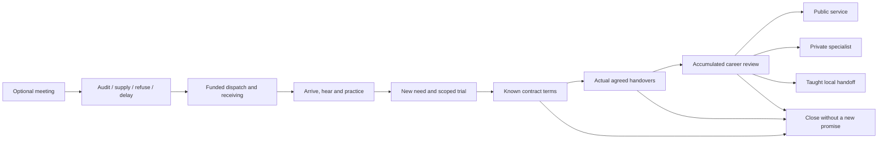
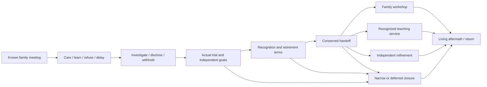

# Social choices over careers and endings

2026-10-05. All graphs are proposed authoring cases, not registered commands/save schemas. [CASES](CASES.json) is the structured graph/state counterpart. Existing [society](../REPORT.md) and [family/history](../FAMILY_GENEALOGY_HISTORY.md) findings are reused rather than repeated. Dates, wages and later fixture quantities below are original reversible numbers. Current skills/discovery work continues independently; neither whole campaign is implemented here.

## SB01: Open Counter persistent career

Use Frontier's existing proposed Mira/Wen five-arc campaign. F0-F3 bind the actual held Short Measure definitions, which remain detached/unrepaired. F4-F7 extend the actual proposed return-lot, standards, closed-counter and handoff arcs. This recommends an **open persistent chronicle with milestone reviews**: opportunity clocks can close offers, but the world retains people and ordinary work after an arc resolves.

| Node | Means, commitment and actual change | Who can know it / time |
|---|---|---|
| F0-F1 | Mira has three logs, ten coins and twelve stamina; Wen has four coins/eight stamina and his own Town inventory. Audit costs one player stamina/four minutes, pays two Mira coins and revises shipment to two. Underwrite transfers one real player log plus two stamina/two minutes, pays four coins and ships three. Refusal/defer owes nothing | Player sees stack/hears terms, not hidden cause or private purses. Only an opted-in meeting opens the twelve **played-minute** reply window |
| F2 | Mira pays real travel effort; fallback additionally costs her one coin/one stamina. Wen receives two or three logs and pays one coin/one stamina for acceptance. Mira retains one actual log | Player absent from handover receives no automatic revelation. Held NPC 4/4/1 timings conflict with native 240/240/40 geography and require repair or supported speed. Player travel remains native |
| F3 | Hear Wen, then practice tally for one stamina/two minutes. Earlier refusal does not block this later learning. The held paid checks each have one actual employer-funded order | Shipment occurrence, player's arrival and reveal differ. An expired initial reply window does not cancel later accepted travel. Mira's nominal Village reserve is with its actual holder/location; it cannot be spent in Village while she is away |
| F4 | Worked readiness fixture requires five kits already legitimately acquired with their real costs. Permissioned trial consumes one kit; Iven pays one own coin/one stamina/three minutes. Four player kits remain | Iven's suspicion is not a culprit verdict. Participant sees the scoped test; another person needs an offered/heard report. Failed paid trial spends its sample and changes what use can be honestly promised |
| F5-F6 | Public contract reserves four Mira coins and transfers four player kits to Mira for four coins. Private fixture reserves eight of Halden's twelve coins in one appointment and transfers four kits to him. Four distinct units, each two minutes/one player stamina, reserve next unit only | Heard terms disclose exclusivity/withdrawal/recipient. Public standing needs an actual witnessed public act and issuer; private bargaining alone changes directed history. Halden cannot bind unrelated producers or already committed goods |
| F7 | A willing resident can learn one narrow audit procedure: one own coin/stamina, one player stamina, three minutes. Its subsequent two-minute/one-stamina audit produces a real matched-order result; four kits remain four | Current body/tool/source/contact and real caller required. No copied player inventory, compulsory escort or unearned NPC mastery. Unsupported absence freezes; only authorized local intervals/paid jobs operate |

On the worked path with no optional earlier checks, Mira retains **four coins after audit/public wages**, **two after underwrite/public wages**, or **five after her own correction/public wages**. Optional checks spend their actual employer's coin and must be subtracted. Initial help changes Wen's received material, each witness's report, payer budgets and the player's opportunity cost; it is not a universal moral score. Handoff affordability is checked from current balances rather than a stored favor threshold.

The review may produce public service, private specialist livelihood, taught local handoff or deliberate closure. They are not arbitrary buttons unlocked by one happy greeting. Public service needs its actual agreement, qualified known result, chosen units fulfilled and willing funded participants. A smaller public counter requires no donation or full four-unit charter; the four-unit totals above are only the full worked fixture. A resilient variant additionally requires its actual useful preparation/process/site/control function. Private work pays more in this prototype but can leave a smaller voluntary public service; it does not erase native shops. Handoff needs a genuinely trained willing operator and actual performed audit consumer, after its own accepted scope is settled, without a universal four-unit gate. Partial termination retains delivered kits/payments and lists any outstanding accepted duty; mere refusal has none. A powerful qualified method can improve a compatible operation without manufacturing goods or rewriting a contract.

Post-arc ordinary work remains useful. A later greeting preserves whether the player audited, supplied, refused or failed to reply, whether Iven's result was actually heard, and who accepted which terms. A lawful new charter can reopen work; it cannot replay the old wage or pretend the initial shipment contained another log. The content must deliver alternatives and aftermath within Frontier's complete-world IDs even though a player follows only one coherent path.

## SB02: chaptered family-school career

This is the **original alternative** requested by the dispatch, not a source-world adaptation. Reuse Ena/Soren/Hale/Pera from the prior family audit: Soren is a biological child, Hale adopted kin, Pera an unrelated apprentice. All are original adults with separately declared current bodies/means; they are not enrolled NPCs. Recommend chapter labels for prologue, developed work, retirement terms and later vocation. Labels organize causal milestones; no invisible years, age changes, stock or mastery are awarded.

| Chapter | Paid/accepted cause | Later difference |
|---|---|---|
| H0-H1, first meeting | Ena's O fixture has one unique unborrowed tool, six logs/six coins/eight stamina, one bench right and actual declared ordinary packing competence. Each of at most two lessons costs her one log/one coin/two stamina, a learner two stamina and four minutes, producing one real kit held by Ena plus legitimate practice. Care shares the same occupied bench/time | Keeping a care agreement can make Ena offer a private archive introduction. Refusal or delay does not erase kinship or all learning: Pera can still offer a paid specific inspection. Nobody gains skill by birth, household wealth or gift |
| H2, disputed past | Player pays Pera one coin; both spend one stamina/three minutes for permitted inspection. Pera knows a counter-receipt; Rell, a local guild contact, initially heard only an allegation about an ancestor's fund | Disclosure changes actual recipients' beliefs. Withholding leaves Rell uncertain or mistaken while the private method can still work. Neither hearing a claim nor a final ceremony grants global acquittal/inherited guilt |
| H3, developed work | Two completed lessons leave Ena four logs/four coins/four stamina/two kits. A missed lesson is replaced only by actual new paid instruction. A learner demonstrates or refines what they truly learned | Soren may leave the trade, Hale may choose stewardship, Pera may pursue refinement. Independent goals/means can block a preferred handoff; alternative teachers or a narrower role remain possible |
| H4-H5, retirement | Separate willing recipients accept actual tool, bench-use and teaching roles. Ena grants only her actual holdings; Rell grants only declared institutional recognition after appropriate evidence. Outstanding tool loans and work are resolved | Family workshop, recognized school, independent refined vocation or limited/deferred bequest. One tool has one holder; a right is not another building; methods require genuine transmission. Ena remains alive/competent |
| H6, later return | Only authorized elapsed intervals and funded plans occurred. A new personal meeting/optional adult invitation has current eligibility, independent choice and actual shared costs | No romance is an ending prerequisite or inheritance grant. Past kinship, practiced lineage, property, public recognition and private feelings remain different histories |

A household outcome needs a competent willing steward and real rights. A school outcome needs an actual teacher, permitted bench and issuer-qualified evidence/disclosure. A stronger refined method can support an independent vocation before public recognition and without compulsory hostility toward Ena. A narrow bequest can transfer the tool only, or decline broad succession while ordinary care/friendship/work continues. These are accumulated-state outcomes, not four mutually identical ceremonies.

Unlike a dynasty/lifespan mode, these career chapters need no automatic birth, death, childhood or historical rewind. If a reviewed world selects life-stage/time-jump origins, it must additionally reconcile outstanding work, body/source development, local/subjective/outside clocks, retention and evidence. That remains optional for present-era Frontier, while a selected complete household-origin world must deliver its own finite required functions rather than call this one family scene complete.

## Common later acceptance

Compare positive, refusal, explicit delay, no reply, paid failed trial, interruption and partial termination. Revalidate stale body/source/contact/stock/terms at irreversible steps, preserve earlier durable phases on failed publication and settle every material/social receipt once, including clock zero. Pruning display memories preserves critical fulfilled/withdrawn/right/unique state. Speaker/reason/search/tooltip/recap use only actual learned evidence. These behavioral/native/save/keyboard gates are **unrun** under current deferral. This report checks only graphs, arithmetic, references and document consistency.

## Reconciliation with the current Frontier ending owner

The local GM completed [TIMELINE_AND_ENDINGS](../../../../../../docs/worlds/original-frontier/TIMELINE_AND_ENDINGS.md) and [COMPLETION_LEDGER](../../../../../../docs/worlds/original-frontier/COMPLETION_LEDGER.json) during this pass. Their revision2 freezes33 parent IDs,15 strand steps and7 ending cases, still proposed/runtime held. [CASES](CASES.json) maps all seven to the relevant social variants and existing field/mastery work. Our four Frontier outcome groups do not replace that checklist.

Small public service can resolve after a real smaller agreement. Resilience needs an actual useful prepared function, beyond a batch count. The lawful private agreement is not the independent mature specialist ending; the latter still needs its real inquiry/craft/control/mastery feat and useful output. Early refusal is an offer closure, not a paid failed charter or proof of mature world completion. Departure additionally needs actual known exit/native travel. These distinctions preserve prior choice history while allowing compatible local/career/exit outcomes to compose.
