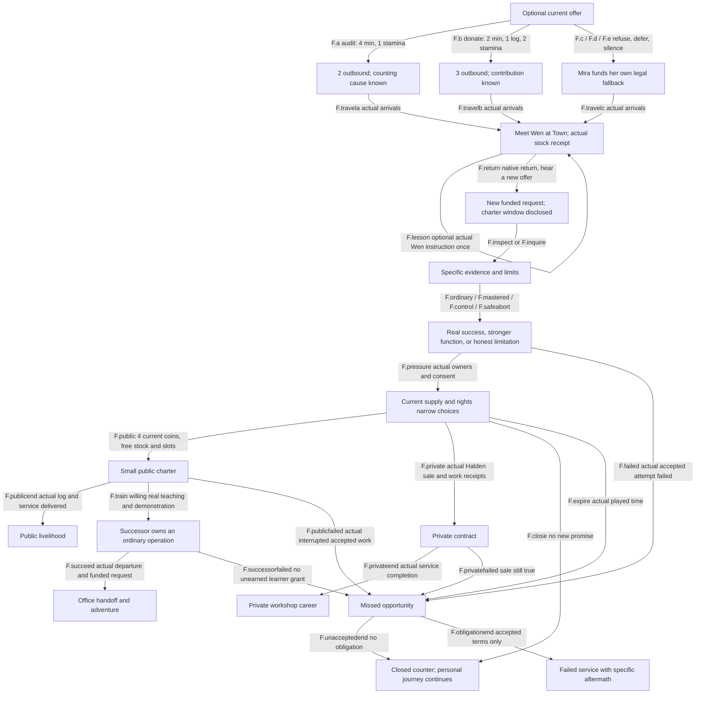
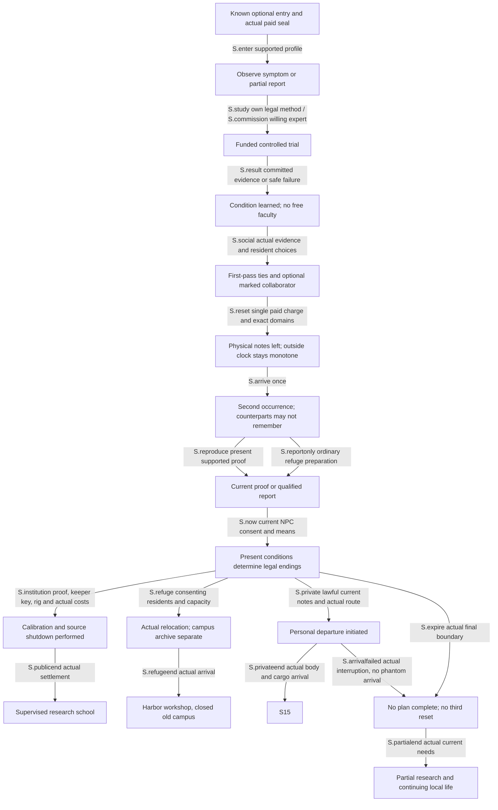

# Worked choices, endings and return cases

2026-10-05. Author-facing original scenarios. [CHOICE_GRAPH](CHOICE_GRAPH.json) is the exact illustrative graph/means/guards/ending/trace owner; these diagrams compress it for review and are not a runtime schema or a new world registration. The director can change original names, quantities and pacing before a selected packet is implemented. Existing native choices/skill owners remain authoritative.

## Frontier: an open chronicle with cumulative local closure

The graph links existing held Short Measure inputs with the moving campaign's field/control/mastery, service pressure and succession proposals. It spans several connected arcs; it neither replaces the opening nor claims delivery of every Frontier completion ID.

The first reconvergence does not flatten the earlier choice. Wen owns two or three logs; a donated log is no longer the player's; underwriting alone never proves the counting error. Refusal, deferral and unanswered offer are separately remembered, with no debt or wage. A later player can join fresh terms after refusing the first offer.

Native Village–Town square is 520 base minutes one way before actual modifiers, not a short NPC job. The repaired proposed Mira itinerary uses the same 240+240+40 route, pays her own three stamina/one coin per direction and carries at most three actual logs subject to the real native weight/access/body quote. Both arrivals and the cargo transfer must happen before F04. Overlapping journeys do not double-count elapsed time. The held module's 4+4+1 itinerary remains an unresolved integration repair; this graph does not silently fix it.

The new optional charter window begins when its current proposal is actually heard after return, not before the first 1,040-base-minute round trip. Its original 2,160-played-minute comparison term affects only the current cooperative request; the completed Frontier owner instead proposes 1,440, which is reconciled in [the variant map](FRONTIER_RECONCILIATION.md), not overwritten. A further 480-base-minute Forest-road comparison plus a later Town visit can fit, subject to real modifiers, current work and costs. Going elsewhere may still miss it. Browser closure advances none of this unsupported time.

Ordinary smaller support uses one actual owned kit, two stamina and a one-coin player-to-Mira staging lease with a genuinely bound static fixture, not unnamed free supporters. Mastered Load-bearing Step, accepted native control work and safe limitation tests lead to the same question while preserving their actual outputs/costs. Rat-step remains own-body footing, not loaded-cargo capacity. Stronger mastery can really be faster/stronger; an institution still needs a willing owner, real stock and permission. A past Mara/Lio win or old zone clear does not count as a newly paid workparty result.

| Ending ID | Cumulative cause and actual outcome | Useful stay/return |
|---|---|---|
| F.PUBLIC | Honest specification/competence, current free stock/slots and willing members; player funds one four-coin service, one actual Wen log reaches Vela. Small public service operates with separate member ownership. | New finite funded lots, teaching and native adventures; revisit the same queue/people/stock. No old wage repeated. |
| F.PRIVATE | A consenting exclusive sale pays four Halden coins and transfers one log once; a separate two-coin actual service can pay the player. Private priority cannot be undone by selecting public dialogue later. | Paid private work/practice; a later public agreement needs fresh lawful supply/rights and leaves the old sale true. |
| F.SUCCESSION | Actual ordinary success plus an honest limitation, willing learner/tools, paid teaching and real demonstration. Player retires one office, not their life. | Explore from earned access; return as teacher/customer. The successor may be busy/refuse, and unsupported absence does not produce hidden income. |
| F.CLOSED | No continuing charter or a missed unaccepted offer; existing obligations are settled and unused reservations returned once. Learned field/technique/native progress remains. | Personal investigation, craft, combat practice, native quests or a new institution; reopening is a new agreement with present means. |
| F.FAILED | Newly accepted funded task actually fails/withdraws, with consumed kit, native costs and original terms. Only that specific obligation exists. | Recovery, honest report, a consensual narrower repair or unrelated work; later repair adds history rather than deleting failure. |

FW1–FW5 specify the ordinary public, private mastered, refusal-then-succession, silence-then-closed and paid-failure traces. FW3 names the player as teacher after Wen's actual offered two-minute/one-stamina Load tally lesson, Mira as consenting learner/successor, and a two-coin player-to-Mira learning request after prior public work settles. Their budgets are exact hypothetical fixtures, not new-save grants or verified game balance. Future Engine/Frontier delivery must bind the actual native stock, travel, new encounter baseline and offered teaching procedure.

## Stillwater: retained research changes a second occurrence

All setting, characters, source eligibility, time/reset recipe and outcomes are original proposals. Mother of Learning's qualified supplied dossier informs retained injury, unequal memory and useful aftermath; it does not establish this two-pass fixture as canon. Its source-specific extreme dilation remains powerful in its own context. Stillwater uses a 1:1 outside/experienced clock and one repeated twelve-hour local interval, which is a different original mechanism. Early restart retains only actual experienced time; two full passes can total 24 hours but unfinished hours grant nothing.

The reset restores only named local anchor stock/bodies/ordinary unmarked memories and the declared ordinary player body. It retains eligible learned/research memory, supported soul/source injury, the externally spent seal charge, outside obligations and claims. It does not retain ordinary physical notes, current-pass welfare or every NPC's friendship. A marked collaborator remembers only under their actual source support and voluntary terms. This restores genuinely usable local reagents for another experiment; it does not force all local supplies to remain depleted just to suppress the loop's advantage.

Current proof still needs current means. SW1's repaired second-pass ledger starts with two ink lots, three player coins and two Rhea coils. Reproduction consumes one ink/one coin, loans and returns one intact coil. Institution work consumes the remaining ink and both coils. An actually damaged coil blocks that original route until an actual replacement/repair quote exists. Retained memory cannot generate the absent part.

Neris can withhold the key/manuscript; Rhea can refuse work or lack focus; Sol's four-place refuge and six meals cannot move unlimited residents, and each resident can refuse. A recalled successful plan is invalidated when its present prerequisite is absent. Helping them in a discarded pass does not entitle the player to current consent.

| Ending ID | Cumulative cause and actual outcome | Useful stay/return |
|---|---|---|
| S.INSTITUTION | Retained method becomes current reproducible proof; present researcher/keeper consent, tools, coils and ink support actual shutdown/calibration. A supervised institution retains its people/rights. | Funded research, paid craft, teaching and unresolved history. Next visit uses surviving stock and current students, not another entry gift. |
| S.REFUGE | Useful warning/route preparation, consenting residents and real food/capacity enable relocation; keeper can remain with the closed campus archive. | Harbor support/craft, negotiate later access, repair route or institution; refusers are not automatically dead or rescued. |
| S.PRIVATE | Present lawful notes, actual compatible departure and settlement/termination of duties permit arrival abroad. Personal knowledge survives; local welfare is unfinished. | Test/instruct with real host support; return only through an actually available route/permission, with earlier promises still relevant. |
| S.PARTIAL | Current evidence/support/consent or time was insufficient. The source expires after the permitted repeat, retaining spent costs and useful partial learning. | Ordinary recovery, study, funded repair or truthful reports. No guaranteed full cure, third loop, world destruction or automatic death. |

SW1–SW4 are the four conditional traces; none predicts an inevitable ending from source chronology. Current local/iteration/outside/reveal times remain separate. Local no-cargo-before-shutdown is an original fixture policy, not a universal rule for imported powers. If a later adaptation permits exports during reset, actual exported identities/claims need external conservation before any snapshot recreates them.

## Required later proof

BG01–BG05 in CHOICE_GRAPH are future behavior gates, not checks executed here: cumulative eligibility, retained reconvergence/aftermath, distinct response/ending domains, real travel/occupied-time opportunities and source-specific carrier/export conservation. A path a player completes differs from all alternative content an implementer must deliver. Current skill/discovery wave remains its own finite authorized packet; this broader campaign/temporal material awaits review and canonical integration.
