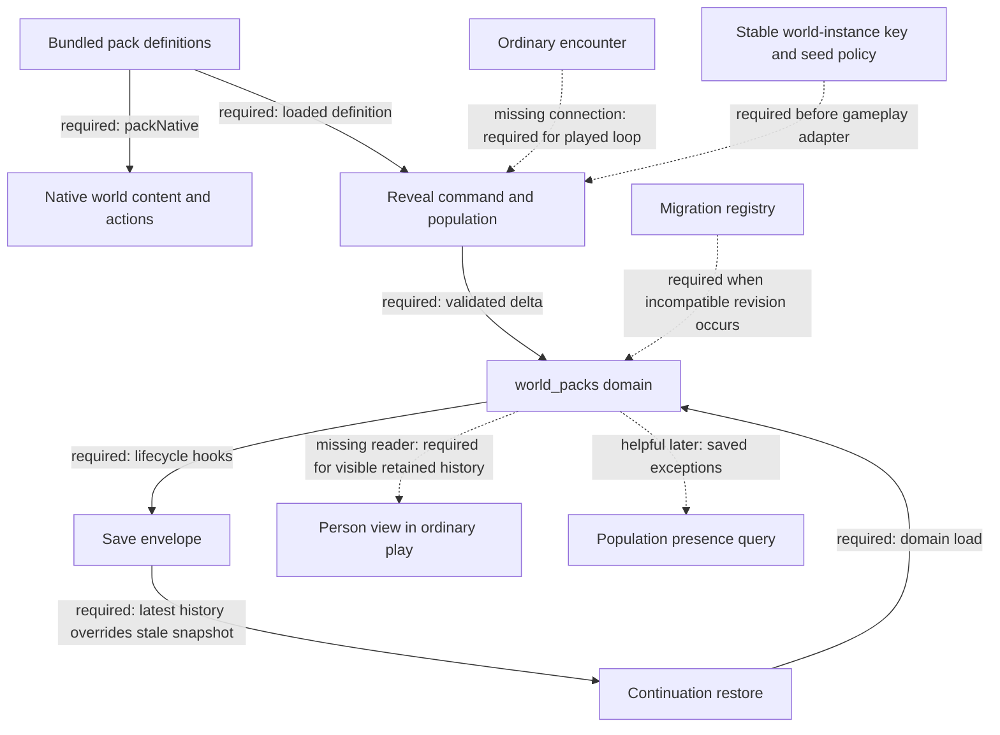

# World-pack persistence and crossing progress atlas

Assessment snapshot, 2026-11-04. **F1: the save mechanism is connected; a natural gameplay history loop remains missing.** This report changes no priorities or product behavior. LOTM-first, Harry alongside, and mechanism-led book windows remain the current direction ([PROJECT](../../PROJECT.md), [digest](../VISION_DIGEST.md)). Recommendations below are proposals within that order.

## Boundary and evidence

Inspected universe: bundled-pack registration, person reveal state, section reconciliation, domain save/load and continuation carry; selected native-definition consumers and the focused/browser test harnesses. This is not whole-world coverage. No private saves, sealed content, runtime execution, builds, browser sessions, installs, commits or pushes were used. Source inspection is current; successful test/browser claims below are attributed to [SAVES §6d](../SAVES.md#6d-world-pack-state-slice-2026-11-04-compatibility-decision), not reproduced here.

HEAD at capture: `aef3cb1f81008e1eb815e57a703974d2447079eb`, 2026-11-04T18:55:40Z. The shared checkout is extensively dirty. Of the initial ten hashed inputs, PROJECT and the digest were tracked modifications; core persistence source/tests were clean at that observation. HEAD alone does not identify this snapshot. No build hash was independently inspected, so these inputs cannot be equated with the installed or served app.

## Capability and consequence

| ID / capability | Producer and state owner → consumer → result | Evidence actually available | Remaining gap |
|---|---|---|---|
| C1 Definitions installed | `world_pack_registry.js:13-30` loads Mol/HP plus a separate HP lead registry → `packNative` → content/actions/brewing adapters | Current source and import search establish definition connections; owner says used in play | This is definition reuse, not proof these consumers use saved pack deltas |
| C2 Person history | `revealWorldPackPerson` (`registry:41-48`) → population with caller instance ID, root 0 → validated section | Current source; four focused tests and a browser route reported by SAVES | No ordinary gameplay caller found; `personView` has no source consumer found. No played display loop established (G1) |
| C3 Save lifecycle | `world_packs` domain (`registry:50-55`) → `domainRegistry.save/load` (`domain_registry:39-41`) → main save/load call sites (`main:6334,6677`) | Hooks inspected; focused test and browser harness read | Current runtime gates and delivery not rerun; cannot claim a complete gameplay slice |
| C4 Cross-life preservation | Running save → `continuation_state.restore:121-137` overrides stale snapshot history → resumed/fresh/restarted life | Source trace: fresh `:224`, resume `:232`, restart `:174`, challenge `:188,195`; focused branch/resume fixture and fresh/resume browser harness | Source coverage exceeds exercised routes. Restart/challenge pack-history persistence not established by the selected tests (G2) |
| C5 Revision safety | `reconcileWorldPackSaves` → migrate, retire unknown IDs, or carry original section dormant → domain load and command view | `world_pack_save:68-130` read | Runtime caller supplies no migration registry. First required incompatible revision needs a real chain (G3) |
| C6 Richer history | `freezeEdge`, `addException`, `savedExceptions`, cluster validation → potential relation/presence/parent consumers | Pure source exists (`save:133-151,175-192`); population presence accepts extra exceptions | Runtime writers/readers not connected in inspected seam. Adjacent capability, not evidence of a delivered relationship/world-event system (G4) |

C3 preserves an absent key: an unplayed slice saves `undefined`; load without it gives null. C5 distinguishes **dormant** from lost: missing packs and invalid/unmigratable sections are retained; unsupported top-level schema is refused. The compatibility owner explicitly records a lossy downgrade when an older build saves. Missing current evidence does not show these behaviors failed.

## Selected dependency path

Solid edges were source-inspected. Dotted edges are missing connections or conditional dependencies. The seed/key policy is a consumer cost inferred from the explicit `root:0` and caller-owned `instanceId`, not a new mandatory platform redesign. Main save/load connections were located by bounded search rather than a full main-loader audit.

## Gaps and useful next slices

| ID / class | Locator and existing owner | Consequence / distinguishing next check |
|---|---|---|
| G1 Connection, highest useful next slice | [SAVES G2/6d](../SAVES.md#6-open-gaps); `registry:40-55`, `save:169-173` | Choose one encounter already needed by the active book campaign. Resolve its world-instance identity/seed policy, call reveal on meeting, and make a player-facing reader consume the retained view. Prove unseen → met → crossing/return → same remembered person through ordinary actions, then Save/reload/Export/Import at 1920×1080. Do not add a Mol detour solely because the fixture uses it. |
| G2 Verification, conditional | `continuation_state:160-195,213-245`; OD5 / SAVES 6d | All restore callers inherit carry in source, but selected fixtures cover only branch/resume and browser fresh/resume. When restart or challenge becomes a relevant consumer, test latest history against a deliberately stale snapshot, plus absent-state behavior. Not evidence of a known defect. |
| G3 Connection/verification, revision-triggered | `registry:39`; `save:54-84`; SAVES 6d | Pure migration API exists, runtime passes none. At first incompatible revision, supply one chain and check frozen values, retired references and dormant fallback through actual load/import. Cosmetic compatibility and schema/profile changes have different paths. No speculative migration work is needed now. |
| G4 Implementation/connection, adjacent | `save:133-151,175-190`; S8 in [system owner](../systems/PROGRESSION_WORLD_STATE.md#s8-world-packs) | Add an edge, exception or parent event writer only when a world action and actual consumer need it. A relationship label alone does not prove consequence; a saved exception should change a queried presence result. |
| G5 Documentation inconsistency | `save:1-2`, `registry:3-4,31`; system map S8 summary; SAVES `:52,139,218` | Some summaries still say no save or unwired, while executable hooks and detailed owners say wired. “Per-life” also conflicts with history carried across lives, and §6d calls its decision both A and proposal. Reconcile wording in a separately authorized owner-maintenance task; do not treat this report as changing acceptance or ownership. |

Budget follow-up belongs with a growing gameplay writer: `sectionBytes` is not called by this writer; no growth stress result was inspected. Broader cross-pack travel authoring, rule-profile execution, baggage semantics and arbitrary world resets were not audited. No failure was reproduced in this assessment.

## Capture ledger and limits

Read now: mandatory startup owners; SAVES 186-231 plus targeted matches; SYSTEMS_REGISTER 1-47; registry 1-55; save 1-192; domain registry 1-62; population 1-105; continuation 121-249 (some tool output truncated, so only displayed routes support claims); focused state tests 1-58; browser harness 1-58; system owner 374-399 plus bounded heading/gap matches. Loader 156-200 was partially displayed and does not support an exhaustive loader assessment. Definition consumers, main and crossing UI were inspected only via targeted matches. MULTIVERSE_STRUCTURES was located by OD5 heading/matches, not read in full. The existing progress-evidence map supplied navigation and corroboration only; its older import claim was not reused as current fact. No receipt artifact or bundled browser result JSON was opened.

Six consolidated tool rounds including closure. Selected source output stayed below the 12,000-word bound; broad status output was truncated and did not establish a complete worktree inventory. No tests were run. The only authored file is this report. Skill ambiguity: none prevented execution; the skill leaves evidence depth to judgment, so inspection, attributed results, unreviewed residue and closure identity are explicit here. No comparative uplift claim is made.

Closure UTC: 2026-11-04T18:57:21.595116+00:00. Rechecked SHA-256 for all selected hashed inputs. Drift: none detected. Hashes identify bytes, not correctness.

| Input | SHA-256 at capture and closure |
|---|---|
| `PROJECT.md` | `ed02c2f75c4659aeb85202ae206cfdc4f6e564dfbd9d1394a62fe9102c6fbed2` |
| `docs/VISION_DIGEST.md` | `ccacf91b67792fbfa302179feab91e9a5e6045aa1ef5f432638bc5ce1b67f909` |
| `docs/SAVES.md` | `eee926dc8e469c100c47d29b0586253ce9febb1655f9a55180aff1724caf2d2d` |
| `docs/SYSTEMS_REGISTER.md` | `62a0c103312e71c6b9399bd3fc74fa6ec35398aff0a8df1ba242176ea0891262` |
| `src/world_pack_registry.js` | `ae8d400f7bd83793100b65ec8fd6daa3ef25ae27292a502c665d82aa0ef1c875` |
| `src/world_pack_save.js` | `a4a0b721a16f954cfb72de961bc5e30b94d93be185e4297122d34ee93471fdf9` |
| `src/continuation_state.js` | `62c7d6abe7380a6dfd4d2d887038f50a54052e3bfd4b0bd38491892def48bf19` |
| `tests/world_pack_state.test.js` | `780eae0b21c3b57ea4d5b7bd47b69ea66e0e5e8a3971ce338c03fd3ffca60d9b` |
| `tests/world_pack_state_browser.mjs` | `674b3df8fc092492ec41249be035f7cf5e7adb26749f55e78671e4b322ddd46c` |
| `docs/systems/PROGRESSION_WORLD_STATE.md` | `d67e51642846f9753eb3dfd38d1942751d75a319ba5b5e63fdacffc9558d3869` |
| `src/domain_registry.js` | `966ccacca0715831af877e9af32dc8d699354bb17f524e94b78a3a380227b71c` |
| `src/world_pack_population.js` | `65dc539d1a95866029bde64724f538246c48ca16615b8a69fee4f132fdc20c15` |
| `src/world_pack_loader.js` | `ab570bb9fe3458eea63073e6643e5d55d5b1b811746ddc017214feb920b484d2` |
| `src/book_world_mol_actions.js` | `99ef7768dc6f6446d3f008e8dbf8d2183a51f162d59f3288ef981f46b6e308bd` |
| `src/book_world_mol_content.js` | `fdba1820dd6c4dc90e7945afd3809a276ad95e3395332b92b0ae3dc69cd82cd5` |
| `src/hp_brewing_state.js` | `fd5efe1e22190163172c1dfc42625b50a863c26e8316f1d7dfd72753ee466dc0` |
| `docs/worlds/MULTIVERSE_STRUCTURES.md` | `cc4574a38494bb7471cf04e40064005ca2d89063017d1728c520769c37043214` |
