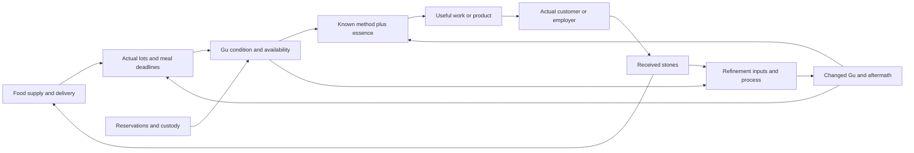

# Reverend Insanity: mechanics from other games and mods

Completed desk research, 2026-10-31. This file owns a separate cross-game comparison requested by the delegated research brief. The same-day [fan-mod scout](REVEREND_INSANITY_MOD_SCOUT_2026-10-31.md) belongs to another chat and was read-only here. No implementation, installation, priority change, commit or push is authorized by this report.

Round 1 pass: Reverend Insanity, living abilities/upkeep, cultivation, refinement/combinations, resource economies and world simulation. Mode: reuse and check plus bounded primary-document/source inspection. Route: local owners and direct web research; no browser foreground, agents or paid/API generation. Target maximum: ten external candidates, four bounded novel chapter windows, and source inspection of three public mod repositories. Stop when each requested topic has a supported comparison, integration cost and observable acceptance example. Applicable direction: AD5, AD32, AD35, AD38, AD43, AD45; WPR1–WPR5, WPR7–WPR8, WPR19–WPR23, WPR27–WPR31; WA1–WA5, WA8–WA12. LOTM-first implementation remains current direction in PROJECT.md.

**Current synthesis:** [Round 2](#round-2-the-gu-portfolio-and-the-world-economy-2026-10-31) adds X1–X12 interactions, G10–G14 references and a connected refinement of P1. The report now has fourteen selected external references. Round 1's five proposals and estimates remain narrower candidates; the round 2 P1 scope/estimate is the current recommendation. Findings and proposed trials remain separate from accepted direction.

Evidence legend: **code-inspected** means source was read, not executed; **documented** means a first-party description or technical manual was read; **novel spot-check** means a bounded window in the local English compilation was reopened; **relayed** means a prior source ledger, not fresh source reading; **proposed** means an OOPS recommendation, not an accepted decision. No external game or mod has been played by this pass.

## Findings that change the recommendation

**F1. Extend the living portfolio OOPS already has.** The October 23 [gate catalogue](../worlds/progression-gates-2026-10-23/REVEREND_INSANITY.md#7-engine-coverage-what-i-checked) correctly described its own older inputs, but its RIE7/RIA10 absence claims no longer describe this checkout. Current source registers two original RI beginnings, a native Gu care loop and a multi-Gu keeper loop. Their focused tests pass. This is not Fang Yuan's lead run, a full cultivation world, rebuilt-browser evidence or installed-app verification.

**F2. Gu sets need three different mechanisms.** The reopened chapter 275 passage distinguishes shared food logistics, abilities covering one another's weaknesses, and refinement advantages. A generic percentage bonus would lose the useful part. Path of Exile supplies a clear reference for modifying an ability; Botania supplies input/output logistics; TerraFirmaCraft supplies meaningful process state. These references inform different seams, rather than one universal combination system.

**F3. The strongest next research-to-build candidate is a supply decision.** When an RI lane is selected, a known mixed diet competing for finite merchant stock can connect current feeding, money, time and knowledge with less new machinery than a full rank ladder or faction simulator. Combination execution and staged refinement are the next strongest references. These rankings are proposed integration order within RI, not a change to the standing LOTM-first implementation priority.

## Current OOPS baseline, checked against source

| Code | Actual owner inspected | What exists | Boundary that matters |
| --- | --- | --- | --- |
| B1 | [Novice pack](../../src/world_packs/book_gu_life.js), [registration](../../src/book_world_beginning_registration.js), [structured runtime](../../src/structured_pack_runtime.js) | Paid supervised control transfer of the same Gu; a learned Moonblade method, actual essence and target; food freshness and meal biology. | Original adult novice with granted opening means. No assertion that this reproduces the lead's start. The test slice includes hunger, death, cancellation and serialized continuity. |
| B2 | [Keeper pack](../../src/world_packs/book_gu_keeper.js), [upkeep](../../src/living_upkeep.js), [projection/validator](../../src/book_world_gu_keeper_domain.js) | Three named Gu with separate bodies, titles/controllers and larders; individual meal schedules, poorer food, standing orders, work, one risky refinement, 52 stipend payments, aptitude-limited essence. | Authored first-rank dials. Keeper hunger stops at condition 1; novice hunger can kill. Keeper food purchases grant goods without a finite steward stock deduction. A sustainability forecast is not an acquisition limit or the actual feeding scheduler. |
| B3 | [Cultivation source profile](../../src/feature_expansion_book_cultivation.js), RI section | Source-linked control/use/feed distinctions and confirmed interactions; chapter 39 mixed feed recorded in `feedVariants`; recipe custody and market windows recorded separately. | The profile remains `unactivated-source-profile`. A recorded variant does not make the current keeper's dried-petal alternative the chapter 39 recipe. Root-reviewed extent is 1–590; later reader material is pending review in that owner's current declaration. |
| B4 | [Energy policies](../../src/energy_resources.js), [ascension descriptors](../../src/ascension_paths.js) | Capacity, reserve, output, control, efficiency and strain are distinct energy dimensions; paths can describe several crossing kinds and observer-limited stage names. | A descriptor does not execute a breakthrough. Current energy effects have learn/recover/use/refund, no rank-policy upgrade operation. Keeper validation pins its authored capacity. Rank growth needs an explicit policy/revision transition and reserve/in-flight compatibility decision. |
| B5 | [Simulation](../../src/simulation.js), [crafting domain](../../src/crafting_domain.js), [market saturation](../../src/market_saturation.js), [market-life contract](../../src/absorb_p23/market_life/HOST_CONTRACT.md) | Shared commands, timed jobs/cancellation, event schedules, native crafting transactions and an existing native market model. | Existing mechanisms are incumbents to inspect and extend. Native market saturation is not proof of an RI merchant supply chain. The market-life contract itself qualifies its native verification state. Do not create a second stock owner or infer a world economy from a UI label. |

The same-day [engine/UI dependency map](../gm/dispatch/refinement-audits-2026-10-31/ENGINE_UI_DEPENDENCY_MAP.md) already maps living-carrier identity, control and supplier revisions (MC90, MC120, MC124, MC126). It is a planning crosswalk, not a new rule or evidence that every mapped consumer is complete. Proposed slices below should reconcile with that owner before shared runtime writes.

## Novel comparison: bounded primary-source checks

Edition: existing local English compilation, Calibre 15, 2,334 chapters per [library index](LIBRARY_INDEX.md). Its normalized hundred-chapter EPUB blocks are storage partitions, not the author's volume divisions. This pass acquired no books. Chapter text was keyword-windowed, not read consecutively or exhaustively. Translation wording remains edition-qualified.

| Code | Reopened locator | Mechanism supported by the window | Implication and limit |
| --- | --- | --- | --- |
| N1 | Chapter 23, `ri1.epub`, `ri1_split_022.html` | Gu need distinct diets; the Moonlight example takes two petals at each of two daily meals; the Liquor Worm example uses a jar over four days. Refining, using and raising require different work. | Food is a recurring biological obligation, not an activation fee. Keeper spirit lees every two days is an authored prototype dial, not this source rate. Do not apply one diet to every Gu. |
| N2 | Chapter 39, `ri1_split_038.html` | Intimate Grass supplements the Moonlight meal: one blade with one petal replaces that example's two-petal meal. | A cheaper mixed diet is source-supported. Grass alone, a conversion between a blade and a catty, its shelf life, exact savings and universal plant substitution are not established. Any numeric stock/restock policy is authored until sourced. |
| N3 | Chapter 98, `ri1_split_097.html` | Fusion uses a recipe and sustained coordination; a failed demonstration visibly weakens/injures inputs, and repeated failure can destroy them. | There is meaningful process and a persistent failure aftermath. The keeper's safe, diet-improving lees refinement is authored and need not be silently overwritten. No universal success percentage or complete recipe graph follows from this window. |
| N4 | Chapter 275, `ri3.epub`, `ri3_split_074.html` | Sets can share food logistics, combine functions or compensate for a use weakness, and affect refinement expense/chance. Roles include investigation, storage, healing and movement as well as attack. | Composition should have a mechanism and a real consumer, including ordinary work. This passage does not specify a universal support-slot count, tag law, multiplier or executable killer-move sequence. |

Primary snapshots: `ri1.epub` SHA-256 `bb27766e61f651546386e5ae4ccaee41ec64ea148a771d156f0a55532906d6f5`; `ri3.epub` SHA-256 `bcd882d7ff563a48f7b98f9b327ad3e6a7243b65873b2cbaa2a0bc4e645b2157`. Bounded source windows and member/hash receipts are private in `ri-cross-game-2026-10-31/private/novel-ch*.json`. No plot outcomes or project-sealed truths are needed here.

Broader cultivation and institutional comparisons below are **relayed**, specifically RIG1–RIG9, RIG17–RIG19 and RIG31 in the [gate catalogue](../worlds/progression-gates-2026-10-23/REVEREND_INSANITY.md), and the [institutions owner](../worlds/REVEREND_INSANITY_INSTITUTIONS_ROLES_AND_SUBTLE_DETAILS_2026-10-23.md). Their numbers and unresolved gaps were not reverified. This report does not qualify later-rank mechanics from franchise memory.

## External references and availability

Availability means the named public page, release listing or source revision was accessible on October 31, 2026. It does not mean owned, installed, runnable on this Mac, dependency-compatible or gameplay-verified. Costs below concern a small OOPS adaptation, not installing or porting these games.

| Code / reference | Observed implementation or first-party description | Fit against N/B owners and disposition | Availability / evidence boundary |
| --- | --- | --- | --- |
| G1: [Botania](https://botaniamod.net/), Minecraft mod | **Code-inspected:** Endoflame consumes an eligible nearby fuel item, keeps burn time, generates mana and serializes burn time. Gourmaryllis tracks food history and digestion; food repetition affects its conversion, with history/cooldown serialized. Sources pinned below. | **Adapt** input-specific logistics and saved intermediate state, medium cost. B2 already schedules meals; useful new work is competing sources, transport/storage and a productive consumer. N2 supports a particular mixed diet. Botania's food-variety incentive is not evidence that RI Gu demand varied meals. Its mana generation also differs from food sustaining a Gu. | [Release listing](https://www.curseforge.com/minecraft/mc-mods/botania/files/8901969): `1.20.1-456-FORGE`, September 17, 2026. Inspected `1.20.x` source SHA is not proven identical to that binary. The online lexicon warns that it can lead releases. No mod run. |
| G2: [TerraFirmaCraft anvil working](https://terrafirmacraft.github.io/Documentation/1.21.x/recipes/#anvil-working), Minecraft mod | **Documented and code-inspected:** starting a recipe checks input/anvil tier; completion checks work target and forging rules. An item component encodes steps, work, target and recipe identity. | **Adapt** persistent process state, medium cost. N3 supports coordination and injury; MR16–MR18 require meaningful actions and quick/guided/deep access through the same resolver. Borrow process representation, not the particular hammer puzzle or metal rules. B2 currently resolves one immediate random refinement. | [Public release catalogue](https://www.curseforge.com/minecraft/mc-mods/terrafirmacraft) lists 1.20.1 and 1.21.1 families; main file observed was `1.20.1-3.2.28`, October 20, 2026. Code/manual inspected from `1.21.x`, so behavior is qualified to that source family rather than every release. No run. |
| G3: [Path of Exile 1](https://www.pathofexile.com/game) | **Documented:** itemized skills; supports can alter a fireball into chaining or multiple projectiles; gems grow separately and trade. Currency orbs are also item-modification consumables. | **Adapt** ability ownership versus method knowledge and behavior-changing combinations, medium cost; currency opportunity-cost display is lower cost. B1/B2 already distinguish a Gu's title/control from use. N4 supports cooperation, not PoE's fixed socket budget or gem XP. Primeval stones spending on food versus training is an RI design opportunity, not proof stones behave like every PoE orb. | Official game page accessible and offers account entry, including Mac. This comparison is PoE 1 as described there, not PoE 2 or a patch-specific build guide. No online access, account or installed copy checked. |
| G4: [RimWorld: Biotech](https://ludeon.com/blog/2022/10/biotech-preview-4-xenotypes-world-factions-and-the-dark-blood-drinkers/) | **Documented:** sanguophages need a recurring blood-derived resource, spend it on powers and require deathrest; supporting facilities change the latter. | **Adapt** the visible relationship between capability, supply and downtime, low-to-medium cost at B2. N1 requires separate feeding and activation even though Biotech couples its resource to powers. Copying a single hemogen meter would merge facts RI keeps distinct. The social supply problem is a useful reference, not a requirement to add its particular feeding arrangements. | [Released DLC listing](https://store.steampowered.com/app/1826140/RimWorld__Biotech/) accessible; requires base RimWorld. Developer description read; current tuning and code uninspected. No purchase or run. |
| G5: [Amazing Cultivation Simulator](https://store.steampowered.com/app/955900/Amazing_Cultivation_Simulator/) | **Documented:** sect/disciple management, a knowledge library, commerce and political alliances; updates describe physically distinct cultivation and spiritual-creature routes. | **Adapt later** cultivation supported by actual people, knowledge and supply, high cost. Compare relayed academy/clan access and B4, rather than importing one generic realm ladder. Its sect-management viewpoint is different from OOPS's current lead-life direction. Store evidence is insufficient to recommend its detailed breakthrough mathematics, room formulas or AI. | Released Steam listing accessible, English supported; store description read. No ownership check or local install examined; no recommendation to buy for this report. |
| G6: [Noita](https://noitagame.com/) | **Documented:** crafted spells interact with simulated materials; burning, freezing, melting and other physical transformations have environmental effects. | **Adapt** consequence-bearing ability composition, medium-to-high cost. A Gu method can change a target or environment through a declared mechanism with later consumers. N4 does not establish arbitrary spell composition. Full pixel physics offers little value for OOPS's present text/simulation architecture relative to cost. | Official site lists released 1.0 and Steam, GOG, itch.io and Humble routes. No installed copy, wand interpreter or specific spell-order behavior inspected. Such details are not implementation findings here. |
| G7: [Nexerelin](https://github.com/Histidine91/Nexerelin), Starsector mod | **Code-inspected:** `StrategicAI` keeps faction AI in persistent sector data, advances economic/military/diplomatic/executive modules at intervals, updates/finds concerns and dispatches executive action. `DiplomacyManager` contains war-weariness state and configuration hooks. | **Trial later**, high cost. A bounded clan with one supply concern and one action can create competition for the player's resources. Existing OOPS simulation/jobs are the execution seam. This source inspection does not establish conserved commodity shipment simulation or successful offline AI. Avoid treating a faction label or random hostility tick as world simulation. | Source accessible at pinned SHA; inspected `mod_info.json` declares Nexerelin `0.12.2d`, Starsector `0.98a-RC8`, LazyLib and MagicLib. This is source metadata, not a verified compatible binary or latest-version claim. No release installed. |
| G8: [Gu Craft](https://www.curseforge.com/minecraft/mc-mods/gu-craft), Minecraft RI mod | **Documented:** aperture awakening, cultivation controls, refinement GUI, essence-powered Gu and recipe access; author says spirit springs/inheritances require manual setup. Release notes specify long rank-2/rank-3 cultivation times and Gu healing via primeval piles. | **Inspect selectively**, low cost for interface ideas, high if recreating its world. B1/B2 already have more explicitly inspected upkeep and continuity here. Manual world setup is useful negative evidence: a listed dimension is not autonomous economic/world play. Cultivation hours and canon-character recipe vendors are mod choices, not novel facts. | [Actual file page](https://www.curseforge.com/minecraft/mc-mods/gu-craft/files/7658910) accessible: `gu_craft-1.1.3-neoforge-1.21.8.jar`, February 21, 2026, file 7658910. All Rights Reserved. Listing/file notes read, no source, download or run. No documented feeding implementation established by those pages. |
| G9: [The Matchless Kungfu](https://store.steampowered.com/app/1696440/The_Matchless_Kungfu/) | **Documented:** composable land blocks with resources/creatures/clans; meridians support inner methods and bodily problems; functional structures, disciples/taxes and utility animals. | **Adapt selected ordinary-life consumers**, medium cost; **park** importing its body topology, high cost without RI source need. N4's storage/healing/investigation roles could support work and travel rather than every Gu paying the same generic chore reward. A useful unusual comparison, but wuxia meridians are not a substitute for RI apertures. | Released Steam listing and demo listing accessible. Windows requirements shown. Its store also warns that the 1.0 save structure changed; that is a reminder to inspect migrations, not a suggestion to delete OOPS saves. No gameplay or simulation depth verified. |

### Source anchors for the three inspected mods

| Source snapshot | Files / behavior actually inspected | Reuse boundary |
| --- | --- | --- |
| Botania `9015d171021210fb2803556a8df71a0a36427721` | [Endoflame](https://github.com/VazkiiMods/Botania/blob/9015d171021210fb2803556a8df71a0a36427721/Xplat/src/main/java/vazkii/botania/common/block/flower/generating/EndoflameBlockEntity.java): `tickFlower`, fuel eligibility, NBT read/write. [Gourmaryllis](https://github.com/VazkiiMods/Botania/blob/9015d171021210fb2803556a8df71a0a36427721/Xplat/src/main/java/vazkii/botania/common/block/flower/generating/GourmaryllisBlockEntity.java): `processFood`, repetition multiplier, digestion and NBT fields. | Botania-specific license indicated in file headers. Design reference here; no code or assets copied into runtime. |
| TerraFirmaCraft `72750e42f3e0e8b337400ff1b8468a7ff7bc786d` | [ForgingComponent](https://github.com/TerraFirmaCraft/TerraFirmaCraft/blob/72750e42f3e0e8b337400ff1b8468a7ff7bc786d/src/main/java/net/dries007/tfc/common/component/forge/ForgingComponent.java): codecs, recipe/work/target/step state. [AnvilRecipe](https://github.com/TerraFirmaCraft/TerraFirmaCraft/blob/72750e42f3e0e8b337400ff1b8468a7ff7bc786d/src/main/java/net/dries007/tfc/common/recipes/AnvilRecipe.java): `matches`, `checkComplete`, seeded target, output assembly. | Inspected Java files carry EUPL-1.2 headers. No port undertaken. A codec declaration is not a demonstrated reload test. |
| Nexerelin `9b0ddac90729a7da62e684bea9d443da0b999c64` | [StrategicAI](https://github.com/Histidine91/Nexerelin/blob/9b0ddac90729a7da62e684bea9d443da0b999c64/jars/sources/ExerelinCore/exerelin/campaign/ai/StrategicAI.java): initialization, persistent map, interval advance and update/action dispatch. [DiplomacyManager](https://github.com/Histidine91/Nexerelin/blob/9b0ddac90729a7da62e684bea9d443da0b999c64/jars/sources/ExerelinCore/exerelin/campaign/DiplomacyManager.java): selected state/configuration fields and symbol search, not whole-class review. [Mod metadata](https://github.com/Histidine91/Nexerelin/blob/9b0ddac90729a7da62e684bea9d443da0b999c64/mod_info.json). | README specifies MIT for most code, with exceptions including Prism Freeport code/art. Inspect the actual file and dependencies before copying. No Starsector engine code was inspected. |

Raw code snapshots and URL receipts remain in ignored `ri-cross-game-2026-10-31/private/`. This preserves repeatability without adding third-party source to public research. Recommendations require clean implementation against OOPS's own owners; this report does not propose adding any of these software dependencies.

## Five ranked adaptation proposals, round 1

Estimates are judgment, not measured delivery promises: one experienced developer, one bounded slice, existing command/save/UI infrastructure reused, with focused regression, required completion gates and rebuilt desktop proof included. They exclude acquisition, broad balance work and full-world content. Shared-engine coordination or missing source procedures can increase them. Target for any later UI slice: 1920×1080 desktop; mobile work remains deferred. Nothing below dispatches a lane.

| Priority / disposition | Proposed player-facing result and source fit | Reuse and actual new work | Estimated cost / observable check |
| --- | --- | --- | --- |
| P1: **Adapt next within an authorized RI lane** | Choose a learned Moonlight meal plan using petals alone or the specific petal/Intimate Grass mix; a merchant's remaining stock and arrival time matter. N1/N2, G1/G4. | Reuse B1 freshness, B2 larders/orders and B3 knowledge. Add a mixed-input meal resolver, one merchant stock owner and knowledge-qualified quote. Preserve acquisition custody; do not reuse the keeper's unlimited food grants as proof of stock. Forecast from actual lots, not daily cost alone. | **3–6 working days.** Buy the last relevant batch, choose a mixture, wait across a meal and spoilage boundary, then save/reload/import. The mix consumes both inputs; no grass-only feed or negative stock. An expired ingredient or exhausted merchant causes a visible shortage with a usable ordinary recovery route. Quantities/restock/shelf life need sourced or explicitly authored rows. |
| P2: **Trial a coordinated use** | Two specific living Gu perform one learned method that changes a real task, such as a source-qualified use-cost weakness. Ordinary use returns the participants where that method says it does. N4, G3/G6; compare sibling scout F5/F6. | Reuse title/control/life checks and simulation job participants, energy and cancellation. Add known method roles, exact Gu bindings, a world-local execution rule and actual task consumer. Simultaneous support need not be a sequence; sequence is modeled when the method needs it. Distinguish temporary cooperation from refinement consumption. | **4–8 working days after an executable method is qualified.** Start with two distinguishable Gu; interrupt, transfer/block a participant, run short of essence and reload. Verify correct reservation/release, aftermath and no hidden recipe disclosure. Same Gu remain on ordinary successful use; exceptions come from the authored/sourced method. |
| P3: **Adapt one staged refinement** | Inspect a known process, reserve actual ingredients/Gu, make a meaningful preparation/control decision, see injury or product and use the result. N3, G2; sibling scout F1/F6 already cover ingredient matching and rollback ideas. | Keep control-refinement, transformation and combined use as distinct operations even if they share transaction infrastructure. Extend the existing making owner with one conserved-identity/product resolver, process revision, injury state and a consumer. Respect MR11, MR16–MR19, MR29–MR33. Existing safe keeper refinement remains its own authored exercise. | **5–10 working days after procedure qualification.** Cancel before commitment; fail after commitment; interrupt/reload mid-process; check exact material consumption, surviving Gu condition and output use. Quick/guided/deep should resolve the same known method. A new minigame with decorative steps would not meet the proposal. |
| P4: **Design then trial early cultivation** | Training, aptitude-limited reserve, essence quality/efficiency and a structural breakthrough produce different choices; advancing the master does not silently rank up every Gu. Relayed gate catalogue; G5/G8 as interface comparisons. | Reuse B4 crossing descriptors and energy, shared clock/jobs and actual stones. New work: early cultivation state/transition, a source-qualified wall-healing or other failure rule, revisioned energy-policy change and compatibility for pending jobs/refunds. Source recheck is needed for the selected rank transition; current report qualifies no exact breakthrough thresholds. | **1–3 working weeks for one early crossing.** Show a successful and failed earned attempt, actual costs and unchanged Gu identity/rank; save/load/import before and after transition. Old products/policies retain their revision and pending costs cannot be revalued silently. A full nine-rank progression is outside this estimate. |
| P5: **Park the general simulator; trial one local concern when useful** | A clan agent competes for a real supply, requests a delivery or changes a duty for a visible reason; the player can alter the result. Relayed institutions, G7/G9. | Reuse shared simulation and stock/custody. Model one actor concern, actual means, limited knowledge, a chosen action and persistent aftermath. A default budget might be three active local concerns and one due action per settlement; those numbers are proposed performance dials, not world laws. Far-away detail can remain coarse while committed causes keep identity. | **2–4 working weeks for one local economy/agent loop**, substantially more for regional trade or autonomous wars. Give an NPC and player competing access to the last batch; verify one conserved stock, a paid alternative, observer-safe information and identical committed causes after interruption. Reopen wider simulation after a playable local choice exposes a missing dependency, not merely to make the world seem busy. |

P1's default is a known meal plan under an ordinary merchant window; the dial is stock, price and supply timing; the reason is a living diet plus actual supply. P2's default is temporary cooperation; the dial is method-specific consumption, injury and timing; the reason is how those Gu produce the effect. P3's default preserves the first slice's declared safety policy; a harsher process needs a source-qualified or labelled authored reason and disclosed cost. These are proposed defaults, not restrictions on other reasonable methods or worlds.

An alternative emphasis is to make Gu useful outside combat before expanding ranks: a healer's supplies, an investigator's evidence or a carrier's load can turn a set into a livelihood. N4 and G9 make that promising. It is accounted for in P2's real consumer rather than added as a sixth build obligation.

## Reconciliation and unresolved evidence

| Code | Finding / boundary | What would resolve it |
| --- | --- | --- |
| U1 | The present keeper's prices, diets, starvation safety and refinement are authored. Source-backed mixed feed must not overwrite existing saved identities or retcon those choices into novel facts. | An authorized slice chooses its pack/era and migration or coexistence policy. |
| U2 | A candidate's accessible source or storefront does not establish correct gameplay, enjoyment, save recovery or fidelity. No external mod/game was run here. | A selected, bounded native observation with its own input/version record; no need to install all nine references. |
| U3 | Later-rank requirements, regional economies and exact killer-move procedures remain insufficiently qualified by this pass. | Open the existing ledger at the selected procedure/era, then the needed source paragraph. Existing owner gaps remain gaps. |
| U4 | Generalized free-form composition, per-tick regional AI, mandatory food variety, universal meridians and competitive socket limits have weak fit or large costs here. | Reconsider a specific mechanism when an RI player task and source law call for it. These references remain available; they do not become new standing gates. |
| U5 | The separate fan-mod scout already covers two STS2 mods, including participant binding, recipe selection and rollback. | Reuse its F1/F5/F6 findings if P2/P3 is selected. This report neither repeats their source inspection nor claims those implementations passed runtime tests. |

Accepted direction preserved: AD32 proposals remain proposals; AD38 mechanisms govern outcomes; WA12/MR31 keep knowledge distinct from truth; AD43 applies if a slice is later implemented. LOTM-first and the broader multi-world vision remain unchanged. No new rulebook, accepted decision or universal crafting/economy framework was introduced.

## Verification receipt

- **V1: Local source baseline.** Inspected the owning files named in B1–B5, current direction, rule router, relevant WA/WPR/making guidance and the sibling scout. Recorded HEAD `43466ba23505c9f751317b4bd9e3ee161158105f`; checkout was already dirty. Hashes of inspected local implementation inputs are in private `local-inputs.json`.
- **V2: Focused incumbent check.** `node --test tests/gu_upkeep.test.js tests/gu_life.test.js`: **19 passed, 0 failed**. Covers their authored fixture routes, including feeding/control/use, cancellation, starvation, serialized continuity and clock partitioning. No build, full suite, browser, export/import UI, packaging or installed-app check was performed. This is baseline evidence, not proof of a new feature or the full RI world.
- **V3: External evidence.** Nine selected candidates; first-party public pages plus bounded source inspection of three mod repositories. Seven source files captured, only selected methods/fields inspected in the large Nexerelin classes. No generated agents, paid/API model generation, external game download or executable launch. Base Starsector economy-page fetch failed, so no claim relies on it; the comparison uses accessible Nexerelin source instead. A Botania lexicon follow-up timed out, so its relevant mechanism claims use pinned code instead. <!-- slip-ok: Bounded research/tool execution receipt, not a universal design constraint (AD36). -->
- **V4: Novel scope.** Four keyword-windowed chapters, **2,106 displayed source words**, with some contextual overlap; machine heading scans of the first and third normalized EPUB blocks were locator recovery, not a full reading. No whole-book read or new later-plot research. The wider system comparison relays explicitly named existing owners.
- **V5: Delivery.** Separate report and one index link; private reproducibility receipts are ignored. Document links, public-doc diff whitespace and spoiler/default wording reviewed. Highest state: **source-spot-checked and rules-reconciled research; proposed adaptations, not implemented or human-reviewed**. No commit or push.

## Round 2: the Gu portfolio and the world economy (2026-10-31)

Weibao requested: "More to consider, especially how Gu upkeep, combinations, refinement and the world economy interact? Expand the report without implementing anything yet. Record into relevant docs accordinly/reconcile everythign together?" and "Other games that could be used like this?"

Scope/budget: one coordinator, five additional selected game references, focused current-code arithmetic and existing source-ledger reuse; no new agents, game installation, book acquisition or novel chapter reading. Stop at a connected interaction model, discriminating examples, reconciled owner pointers and a finite research backlog. More-to-consider dispositions below mean document corrections completed, constraints accounted for, or later work proposed. They do not dispatch implementation. Additional applicable owners: [economy rules](../DOMAIN_RULES.md#economy-rules) ECR2–ECR9, ECR12–ECR18, ECR20–ECR23, ECR26/ECR30; [making rules](../MAKING_RULES.md) MR11/MR16–MR23/MR29–MR33.

### ACT NOW: corrections to the research framing, completed

**F4. Stipend coverage, profitability and solvency are different questions.** `keeperHouseView` calls `sustainable(held, stipendStones / stipendDays)`. That is a stipend-only food budget in acquisition order. It does not include wages from Gu work, chores, purchases already held, care services, injury downtime or incoming payments. The actual larders and meal events decide hunger. A future overall forecast should show these separate quantities rather than promote this gauge into a general portfolio limit.

**F5. The keeper is not a closed, fully finite economy.** The stipend has 52 payments, but food purchases currently grant stock, and chores/Gu work grant authored stone rewards without deducting a finite employer purse. The pack labels stones as money and fuel, but inspection found no stone-to-essence refill command in this keeper pack. Rank changes and market-funded work are also absent here. These are source boundaries, not a request to remove profitable play or rewrite the pack in this pass.

**F6. A profitable set may still fail before payday.** A future sale is not cash in hand; future-grown feed is not a meal now; knowledge that a recipe exists is not possession of its instructions. Likewise, an item reserved for refinement may remain biologically hungry. Round 1 P1 needs a productive consumer and a due-date example to demonstrate this interaction, not just a cheaper-food purchase.

The old October 23 gate catalogue remains a historical source-ledger pass. A current-status pointer now qualifies its engine-absence statements without erasing its dated evidence. The RI institutions owner, economy palette, IDEA_INDEX and writeup register route to this round rather than acquiring duplicate specifications. The sibling fan-mod scout remains read-only and supplies its own source claims.

### ACCOUNT FOR NOW: one connected model, twelve interactions

The useful unit is a **working portfolio of living Gu**: bodies under control, a known way to use them, the food and essence they need, and the actual people/resources that let them keep working. This is a proposed design lens, not a new saved object or universal economic law.

| Code | Interaction and evidence | Proposed consequence, default / dial / reason | Discriminating example |
| --- | --- | --- | --- |
| X1 | **The same stock has several uses.** B2 consumes lees for refinement and feeds the worm from the same item key. Source-profile `ri.wine.shared-stock` C24, ch213, relays feed/refinement/sale alternatives. | Default: reserve actual units for a committed operation. Dial: explicit reservation priorities and lawful substitutes. Reason: the same jars cannot be simultaneously fed, sold and spent refining. Money, recipe knowledge and a Gu's ownership are separate facts. | Reserve the last jars for refinement, then inspect an order that needs them. It reports the shortage; cancelling releases the correct units, while already-consumed units stay consumed. |
| X2 | **Composition changes both output and demand.** N4 and source-profile C18/C19 separate functional support and use-cost assistance from shared food logistics. | Default: derive the effect of an actual supported method and its participating Gu. Dial: supported operation, support cost, timing and practitioner understanding. Reason: a helper can reduce one bottleneck while itself adding a meal or occupying a role. Same-path labels do not settle every compatibility question. | A fuel-saving support is useful for an essence-limited job and less valuable for a job bottlenecked by missing feed or an absent buyer. No hidden universal set bonus supplies the difference. |
| X3 | **Food compatibility can concentrate risk.** N4 supports simpler shared logistics; concentration risk is an inference, not another canon rule. | Default: related diets can share a purchasing route. Dial: alternate suppliers, storage life, local growing conditions and actual substitute recipes. Reason: one interrupted route can affect the whole set; diverse diets can require more logistics. Neither strategy needs a forced balance penalty. | Interrupt one known delivery and see which meals depend on it. A second vendor or existing lawful substitute changes the outcome through actual stock. |
| X4 | **Refinement is an investment with transition costs.** N3 establishes failure injury; B2 changes feed cost on success. Source-profile C21 relays a particular advancement changing its diet, without a general rule for every refinement. | Default: preview known post-process upkeep, use, recovery and lost availability. Dial: injury, destroyed inputs, changed species/rank/diet and time. Reason: a stronger result can require supplies the owner cannot yet obtain, while a cheap result can pay for itself. | An affordable attempt produces a Gu needing an unavailable diet. Old feed remains owned and potentially usable/tradable elsewhere; it is not silently converted or deleted. |
| X5 | **Production, reproduction and upkeep are different flows.** Source-profile C14, ch106, relays a living producer with cheap upkeep, essence-spending leaf production and finite mature stock; C15, ch102, relays a recipient-specific treatment restriction. | Default: track producer, actual harvestable output, consumed essence and recipient response. Dial: source-qualified growth and treatment laws. Reason: keeping the producer alive does not create infinite ready products or infinite patient demand. Breeding remains a separate source question. | A well-fed producer lacking essence cannot instantly refill sold stock. A second provider does not bypass a recipient's existing treatment restriction. No numerical demand cap is invented from that fact. |
| X6 | **Refinement can remove the tools that earn the food money.** N3/N4 and B2 support the components; the combined business effect is proposed. | Default: expose which Gu are unavailable and which work contracts rely on them. Dial: spare equipment, assistants, a delayed delivery or a different technique. Reason: sacrificing or reserving the current working set may stop the income intended to fund its replacement. | A player starts refinement with the Gu required for a pending job. The job waits, substitutes lawfully or fails under its actual terms; its forecast reward is not prepaid by the UI. |
| X7 | **Cash timing is distinct from expected return.** B2 stipend/work timing; relayed source-profile C13/C28 records a requested future wine order and a separate staged recipe settlement. C13 does not prove a paid or fulfilled contract. | Default: use known received and contractually due amounts in a deadline forecast; show speculative earnings as a scenario. Dial: explicit credit, deposits, collateral and enforcement. Reason: wealth or a profitable month may not pay tonight's meal. | Two portfolios have equal projected monthly net income. Only one has food or liquid funds before the next meal. A real advance or care arrangement can close the gap without inventing a blanket credit service. |
| X8 | **Care and refinement are separate services with custody consequences.** Source-profile C12/C17, ch265/ch269, relays excess-Gu caretaking and commissioned refinement, with terms unresolved. | Default: distinguish title, controller, location, care responsibility and service work. Dial: actual provider terms, food inclusion, liability, refusal and retrieval. Reason: handing over custody need not sell the Gu or reveal its method, and the source does not supply a universal service contract. | A Gu stays titled to its owner while a provider holds it; an attempt to use or sell it respects actual custody and commitments. Do not assume the quoted care fee includes healing or all food. |
| X9 | **Markets have physical stock, money and beliefs.** N2, B5, and ECR4/ECR9/ECR15/ECR17. | Default: one stock and money owner per transaction and one reconciled quote. Dial: merchant appraisal, negotiating power, access, stock curve and known event. Reason: cash alone cannot reserve sold-out stock; a quote reflects the trader's belief and terms, not authoritative hidden quality. | Player and NPC buy the last batch. One transaction wins by the chosen chronology; the other receives a real alternative. Unknown properties do not leak through exact prices or sorted listings. |
| X10 | **Knowledge is economically useful without owning every Gu.** N4, source-profile recipe-custody C3 and catalogue-access evidence RI-c0261-02. | Default: learned methods, institutional recipe access, leased services and bodily practice remain distinct from the carried set. Dial: confidentiality, access duration, teacher, appraisal and copying conditions. Reason: a workshop can sell expertise; selling a Gu need not erase learning, while buying one need not grant mastery. | A character hires a specialist for a known service but cannot reproduce the undisclosed method. Another owns its Gu but lacks the learned coordination to deliver the same performance. |
| X11 | **Time and reservation semantics cross every panel.** B1 tests already cover feeding biology during a refinement reservation; B2 uses shared meal boundaries. | Default: operate on the existing played clock and exact identities. Dial: the selected world's pause/absence behavior, migration and provider responsibility. Reason: a reserved living Gu still has the biology its rules specify; switching panels does not create another carrier or food lot. This research adds no wall-clock/offline ticking. | Save immediately before a meal and a job completion share a boundary. Reload/import and compare one food deduction, one outcome, correct release and the same condition. A future handler defines the boundary order explicitly. |
| X12 | **A local supply loop can matter before a regional simulator.** B2/B5 and ECR2/ECR26/ECR30; G7's concern/action dispatch is a reference. | Default: one supplier, employer/customer and player-visible shortage. Dial: transit, production, competition and richer actors when the player's choices use them. Reason: the world needs causes, not a universal price simulator. Profitable engines, real arbitrage and strong specializations remain possible; a richer sink or motivated actor is different from an invisible corrective tax. | The customer cannot obtain the healing output because the grower missed a real input delivery. The player can supply it, substitute an earned method or do other work. A global scarcity multiplier alone is insufficient evidence. |

These rows describe **design considerations**. Exact food eligibility, activation cost, control replacement, rank transition and commercial terms remain world/era-qualified rules from their own source or explicitly authored decisions. No abstract tag, diversity score or average price becomes permission for an unsupported mechanism.

### Current prototype arithmetic: what the interactions already imply

Calculated by importing the current pack's exported dials without starting a life or writing a save. All figures below are **authored keeper mechanics**, not novel prices, real-world values, a measured economy or a pacing recommendation. Long-run work rates assume the Gu stays sound and each authored work window is used; they ignore missed windows, injuries, buying costs and player time.

| Gu | Main-feed cost, stones/day | Authored work rewards, stones/day | Net before acquisition, essence opportunity cost and downtime |
| --- | ---: | ---: | ---: |
| Moonlight | 0.500 | 1.000 | 0.500 |
| Liquor Worm | 0.125 | 0.500 | 0.375 |
| White Jade | 0.333 | 0.667 | 0.333 |
| Total | 0.958 | 2.167 | 1.208 |

The stipend averages `6/7 ≈ 0.857` stones/day while its first-year agreement runs. Thus the stipend-only gauge cannot sustain all three at their main-feed rates, yet their authored work can cover those rates under the assumptions above. Repeated two-hour chores have a theoretical all-day reward ceiling of 12 stones/day, before other activities. This is evidence that the gauge answers a narrower question, not evidence of a balanced economy, a recommended grind or a defect requiring a nerf.

The current refinement consumes two lees jars priced at one stone per four jars: **0.5 stone of direct food cost per attempt**. Its authored success weight is `3/(3+2) = 0.6`. Repeating that unchanged chance until success gives an expected direct food spend of `0.5/0.6 ≈ 0.833` stones. Success saves one petal/day, worth `1/8 = 0.125` stone/day at the authored shop price. The simplified expenditure has a **6.67-day payback after success**, excluding essence, recovery food, missed work, affordability and the chance of delayed success. It does not promise success by a date or endorse the recipe as canon. A support Gu or risky process should be assessed with the same distinction between immediate affordability and conditional future benefit.

For a later forecast, the useful question at each known due time is: **What food is actually usable here, what units are already committed, what received/due funds are available, and which Gu can still do the planned work?** Optional expected sales belong beside that forecast as assumptions. A ledger records what happened, not the projection's hypothetical sales. Failed techniques and market mistakes may still happen because of what the character believes; a hidden true optimizer should not silently prevent them.

### Other games that add a genuinely different lens

These five references extend G1–G9 rather than replace them. Each was checked through an accessible public developer/support page or an identified manual; none was installed, played or source-inspected in this round. Availability was checked October 31, 2026. Source availability does not establish ownership or Mac compatibility.

| Code | Documented mechanism and source version | Useful RI comparison, cost and next discriminating observation |
| --- | --- | --- |
| G10: **Factorio: Space Age** | Wube's [FFF 414](https://factorio.com/blog/post/fff-414), June 7, 2024, describes nutrient-fed processing, spoilage, inherited freshness, competing seed uses and freshness-prioritized handling. This is a historical development account. The accessible [ItemPrototype documentation](https://lua-api.factorio.com/latest/prototypes/ItemPrototype.html), showing version 2.1.24 at inspection, still documents `spoil_ticks`/`spoil_result`; its new quality fields are not generalized to earlier releases. [Released expansion listing](https://store.steampowered.com/app/645390/Factorio_Space_Age/) requires Factorio. | **Adapt freshness-sensitive throughput**, especially X1/X5/X11. A full warehouse is not useful if the feed expires before it is eaten or an intermediate stalls before the result is ready. An RI preservation method can change that when its own mechanism qualifies; Factorio's historical spoilage restriction is not an RI law. **Medium, roughly 4–8 days** for one existing-lot chain with a reserve rule and visible stop reason. Observe a processing interruption and whether it preserves input age and exposes the failure cause. No blueprint-scale factory port proposed. |
| G11: **EVE Online industry** | Official support distinguishes [manufacturing](https://support.eveonline.com/hc/en-us/articles/203210292-Manufacturing), [original versus limited-run blueprints](https://support.eveonline.com/hc/en-us/articles/203269951-Blueprints), and [invention](https://support.eveonline.com/hc/en-us/articles/203210642-Invention). The opened articles are dated August 29, 2024. Invention can fail while consuming datacores and a licensed blueprint-copy run; manufacturing requires materials at the actual input location and facility cost. The [official entry page](https://www.eveonline.com/eve-academy/careers/industrialist) offered download/play routes, although its detailed guide body was not rendered. | **Adapt information custody versus execution and capital tied up in a job**, X4/X6/X8/X10. RI recipe knowledge is not automatically a consumable license; that part needs its own source law. A commissioned refiner can require the actual inputs and service means without granting the customer the formula. **Medium to high, 1–2 weeks** for one existing transaction/service seam with recovery, excluding a general industry market. Observe who owns each reserved input and what failure actually spends. EVE player-market scale is not assumed for a sole-player world. |
| G12: **X4: Foundations** | The [Egosoft-hosted, community-edited station manual](https://wiki.egosoft.com/X4%20Foundations%20Wiki/Manual%20and%20Guides/X4%3A%20Foundations%20Manual/Station%20Building%20And%20Management/?language=en), marked updated for 5.10, documents resource/product/intermediate stock, production-cycle shortages and a visual flow overview. It also describes storage-sensitive offers. Treat its precise behavior as version-qualified documentation. The [developer store listing](https://store.steampowered.com/app/392160/X4_Foundations/) confirms released availability; it does not validate every simulation claim. | **Adapt the reason a productive chain has stopped**, X7/X9/X12: missing food, unavailable Gu, no essence, inaccessible stock, no buyer or insufficient working cash are different states. Start with that explanation rather than regional price simulation. **Low to medium, 2–5 days** for a projection over an already working loop; **high, several weeks or more** if the underlying merchant/production loop is missing. Observe a full stockroom with an unaffordable or physically absent input and check the UI does not call both “not enough money.” |
| G13: **Oxygen Not Included** | Klei's [Ranching Mark II release notice](https://store.steampowered.com/news/posts/?appids=457140&enddate=1552945942), May 3, 2018 section, documents diet/environment-conditioned morphs with different requirements/byproducts, maturing young, shearing and a feeder that needs stocked supplies. This older release notice establishes the design, not current rates. The [released base-game listing](https://store.steampowered.com/app/457140/Oxygen_Not_Included/) is accessible. A separate historical forum link failed; no conclusion depends on it. | **Adapt living production assets and environmental inputs**, X5/X6, where a qualified RI source calls for them. A cheap-to-feed producer may need essence or suitable land to produce; offspring, refinement and harvesting are distinct mechanisms. Do not infer that Gu transform by ONI-style breeding. **High, 1–3 weeks** for one qualified living-producer loop; a local ecosystem would cost more. Observe one missing environmental input and distinguish survival, production and reproduction outcomes. |
| G14: **Cultist Simulator** | Weather Factory's [official modding guide](https://weatherfactory.biz/modding/), December 10, 2021, says native content and mods share data formats for elements, recipes, decks and verbs, with IDs and inheritance. Its page explicitly qualifies possible version drift. The [developer game page](https://weatherfactory.biz/cultist-simulator/) lists released store routes. This pass did not inspect a recipe interpreter, native aspect matching or timer semantics. | **Trial method discovery and role-filled experiments**, X2/X10, as a different presentation lens. One known procedure can accept a practitioner, living means, materials and target according to actual rules. A guessed procedure remains a belief with consequences. Do not import a complete card table, leak recipes or claim the guide proves correct participant reservation. **Medium, 4–8 days** for one projection/selection route on an existing resolver; a new resolver is extra. Observe whether an unknown method can be attempted without the UI revealing the hidden correct combination. |

The most useful additions for this question are G10 for living supply chains, G11 for refinement/service economics, and G12 for making the connections readable. G13 adds the producer/ecology lens; G14 adds an experimental-knowledge lens. This ranks adaptations by their present gap, not whole games by quality. Botania, PoE and the sibling STS2 source remain useful for their narrower mechanisms.

### Reconciled scope of P1–P5 and later work

**P1 revision:** propose a **connected care-and-work trial**: one existing Gu livelihood, one known meal alternative, real merchant stock, an actual due meal and a real work/payment consumer. The same food units can be useful in a later refinement, but implementing refinement is not necessary to prove P1. Reuse present Gu work only with its authored wage-faucet label; a finite employer/customer balance is additional scope. The key choice is whether to spend the available stock/money on present survival, productive work or a future investment. Expected sale proceeds are not already-owned money.

Allow **4–8 working days** if current reward work and existing lot/stock seams suffice; **1–2 weeks** if the slice includes a finite employer purse, customer demand and a new supply process. These estimates supersede the narrower round 1 P1 estimate for this expanded scope. They are conditional engineering judgments, not researched timing or authorization. P2/P3 can later consume the same identity, stock and task semantics; avoid implementing each as a separate economy. P4/P5 remain distinct optional expansions. There is no requirement to implement all five together or finish a regional simulator before ordinary trade works (ECR2).

| Disposition / existing code | Recorded outcome or proposed next question | Suggested level / effort / done check and reopen trigger |
| --- | --- | --- |
| **ACT NOW, F4–F6** | Correct the report's forecast, wage/stock and fuel-wiring boundaries; qualify historical engine-absence statements and route the related docs. | Coordinator synthesis; small documentation change. Done: one live current-status route, historical rows retained, no new rules and no runtime diff from this pass. Completed here. |
| **ACCOUNT FOR NOW, X1–X12** | Preserve stock/custody, actual support costs, due dates, productive consumers, knowledge and transition aftermath when selecting a future RI slice. | Judgment-heavy design, suggested Sol/high or host equivalent if delegated later. Done: one chosen case names producer, owner, command, consumer, failure and saved identity. Accounted for in this report and owner pointers; no worker spawned. |
| **LATER / DELEGATE, P1 revised** | Specify the connected care-and-work trial above, with the actor's actual supply and payment means. | Balanced implementation, suggested Sol/medium; 4–8 days or 1–2 weeks depending on the stated scope. Done: a fresh earned route plus a shortage case, rebuilt 1920×1080 browser and save/reload/export/import when persistence changes. Reopen when an RI implementation lane is explicitly selected. |
| **LATER / DELEGATE, P2/P3** | Qualify one exact coordinated use or refinement, then trace the temporary/permanent participant changes through P1's supply and work. | Suggested Sol/high for process/continuity; bounded source lookup can use Luna/low. Round 1 cost ranges remain contingent on procedure readiness. Done: actual post-operation Gu and stock, including injury/interruption, feed the next real task. Reopen on selection of that method, not merely a mod feature list. |
| **LATER / DELEGATE, P4/P5 and G13** | Add the selected progression crossing, living producer or local NPC supply concern when it changes a playable choice. | Suggested Sol/high; estimates remain per chosen slice, not additive. Done: a caused and recoverable shortage/transition with observer-safe explanation. Reopen when the existing chosen task cannot express the source-supported dependency. |

### Round 2 reconciliation receipt

**R2V1. Evidence reuse:** SHA-256 comparison found **no drift in all fourteen** round 1 local implementation/test inputs. Its 19/19 focused result therefore remains the recorded incumbent evidence for those unchanged inputs. No equivalent test rerun was added to a documentation-only pass. The numeric derivation imported current pack exports; receipt: ignored `private/round2-arithmetic.json`. It demonstrates arithmetic, not a played route or market forecast.

**R2V2. New research:** five additional selected games, developer/support documentation and one explicitly versioned community-edited manual. No new third-party source-code inspection, private account access, external game execution or novel source words. Source-ledger C12–C28 references are **relayed** from the current cultivation profile; round 1 N1–N4 retains its original primary-source scope. Availability and precise implementation remain separate claims.

**R2V3. Documentation ownership:** this report owns X1–X12, G10–G14 and the revised P1 recommendation. The RI institutions owner routes services/economy, the progression catalogue routes current coverage, the economy palette routes general applications, and IDEA_INDEX/writeup register route discovery and status. USER_VISION records the research-only request. No rulebook or PROJECT priority changed. Earlier report text and dated catalogue rows remain historical evidence; a pointer supplies the qualified current answer.

**R2V4. Checks:** `npm run check:docs` passed. Changed-section local links/fragments, whitespace, reference-code uniqueness and zero-loss checks against pre-edit snapshots passed, with the report's two round labels and its index summary as the intentional replacements; implementation/test input hashes remained unchanged. No implementation, build, packaging, installation, commit or push. Highest state remains source-spot-checked/rules-reconciled **research**, with new external comparisons documented and all adaptations proposed.
