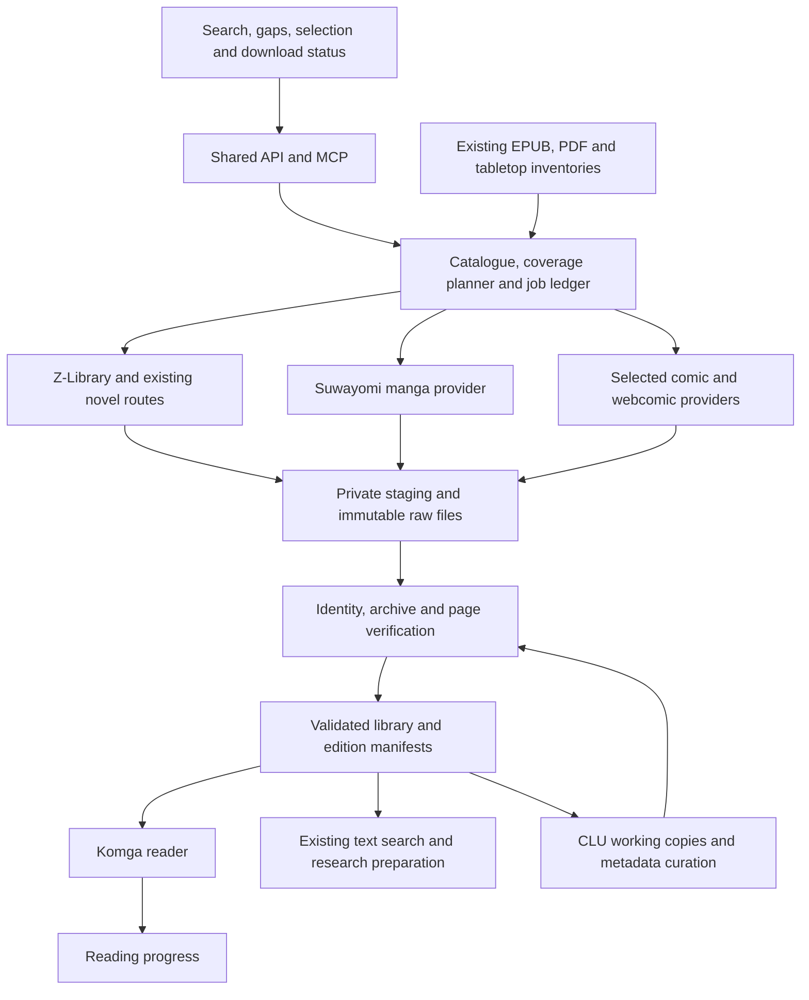

# Unified source library: books, rulebooks, manga and comics

2026-10-22 follow-up: Weibao authorized implementation. The selected
existing-books/Suwayomi/Komga/CLU platform is now installed and tested; its
[current implementation owner](/Users/weiwei/code/zlibrary-research/docs/SOURCE_LIBRARY_0_5_0.md)
supersedes this scout's uninstalled status for that selected stack. Remaining
tool comparisons and prospective lanes below keep their original research scope.

Type: RESEARCH / PROPOSAL. Audience: developer reference. 2026-10-21,
America/New_York. Prepared by Codex. Applicable rules: AD32, AD35, source
acquisition routing, and source deep dive SM1–SM12.

## Outcome and evidence boundary

Weibao asked to broaden YAIR's sources beyond novels and combine the named
comic downloaders, managers and readers into a single platform. P1: recommend
one catalogue, acquisition planner and MCP/API entry point over independently
maintained provider services. Keep upstream applications separate and use their
APIs or bounded CLI adapters. A common interface can support all of them while
only enabling providers needed for a selected source.

This pass inspected primary documentation and selected source code. It did not
install these services, configure extensions, execute their downloaders or
verify a live comic transfer. The existing Z-Library route has its own runtime
evidence in the [acquisition report](ZLIBRARY_YAIR_ACQUISITION_WAVE_2026-10-21.md).
The architecture here is a recommendation, not an accepted implementation or a
new gameplay system. Source collection, extraction, reading and adaptation
remain separate states.

## ACT NOW: comparison completed

| Code / component | Actual role and relevant mechanism | Recommended disposition |
|---|---|---|
| T1 [Suwayomi Server](https://github.com/Suwayomi/Suwayomi-Server) | Extension-based manga search, chapter metadata, library and download queue; GraphQL mutations include chapter enqueueing. Also has its own reader/library. | First manga provider to trial. Wrap its API; keep its internal queue subordinate to the shared planner. Do not fork its engine or turn on every extension. |
| T2 [Komga](https://komga.org/) | Reading and serving CBZ/CBR/PDF/EPUB libraries. Documented REST API covers book listing/details, pages, metadata and progress. | Preferred reading layer for the combined collection. It consumes validated library files; it does not replace source acquisition. |
| T3 [Comic Library Utilities](https://clucomics.org/why-clu/) | Collection management, metadata, file/CBZ editing and acquisition features. Broader than a batch utility. | Trial as the comic curation layer. Restrict initial writes to a working copy; do not let several tools rename the same library. |
| T4 [Mylar3](https://github.com/mylar3/mylar3) | Series watchlists, upcoming issues, story arcs and acquisition through NZB/torrent clients; sorting and renaming overlap CLU. | Optional issue-monitoring provider when those sources are useful and configured. Assign watchlist ownership to either CLU or Mylar for a given series. |
| T5 [Girbons Comics Downloader](https://github.com/Girbons/comics-downloader) | Go CLI/GUI with explicit URL, issue range, image output and PDF/EPUB/CBR/CBZ formats. Its README marks several listed sites with warnings. | Bounded CLI adapter candidate for an actual source gap. Listed support is not live access proof. Disable daemon/all-issue defaults in a shared job. |
| T6 [yoink](https://github.com/Rigil-Kent/yoink-go) | CLI/web app for ReadAllComics and Batcave, plus local image-folder packaging into CBZ. Its README describes concurrent downloads and a challenge-bypass mechanism. | Narrow provider candidate, not a second platform UI. Review network, retry and concurrency behavior before enabling collection. Local packaging can be evaluated separately. |
| T7 [Webcomix](https://github.com/J-CPelletier/webcomix) | Predefined webcomics or custom first-page/next-page/image XPath traversal, with optional CBZ and JavaScript rendering. Its search discovers selectors rather than a universal title catalogue. | Useful for author-hosted webcomics where its traversal fits. Needs explicit page bounds, loop detection and the applicable transport policy. |
| T8 [moistfella comic-book-downloader](https://github.com/moistfella/comic-book-downloader) | Interactive Python GetComics downloader with request/browser resolution and filename-based duplicate heuristics. Distinct from Girbons' project. | Park as a specialist adapter until a needed source justifies hardening. Direct final-file writes and limited identity checks are inadequate for the shared intake contract. |
| T9 [gallery-dl](https://github.com/mikf/gallery-dl) | Headless extractor ecosystem with download archives and configurable pacing/retries. Archives track extractor identities, not universal edition equivalence. | Lightweight alternative for a compatible selected source. Prefer this to another permanent server when it meets the job. |
| T10 [manga-downloader](https://github.com/elboletaire/manga-downloader) | Cross-platform CLI/GUI, chapter selection and image/CBZ outputs. Documented chapter/page parallelism needs provider-specific tuning. | Alternative trial if Suwayomi lacks a needed route. Do not use a second client to evade a stopped source. |

F14: CLU already documents a Komga progress integration. It is **one way,
Komga to CLU**, uses relative-path mapping and a shared account connection.
It is not a cross-service identity resolver or multi-user two-way sync.
CLU also documents per-user reader API tokens, so an integration does not have
to depend on its browser UI. [Upstream connection and API documentation](https://clucomics.org/features/app-settings/download-settings/).

F15: CLU's acquisition overlaps both Mylar and the GetComics downloader. Its
documentation warns that automatically satisfying individual gaps with packs
can repeatedly retrieve a large pack. The platform must reserve a pack once and
map all its contained issues before proposing another job. This directly affects
the request for comprehensive sources without duplicates. The same
[settings documentation](https://clucomics.org/features/app-settings/download-settings/)
describes wanted-issue simulation for inspecting matches before transfers.

## ACCOUNT FOR NOW: one platform, explicit ownership

P2: The useful combination is a federated application with a shared catalogue
and job ledger, rather than a source-code merger. A first implementation should
reuse the current research MCP and private intake where practical. The orchestration
ledger stores provider references and acquisition state; it does not duplicate
the upstream readers' entire databases or YAIR's source-reading evidence owners.

P3: Give each responsibility one writer. The planner owns the requested job and
reserves it before dispatch; the provider owns execution inside its service;
the intake owns raw hashes and final promotion; Komga owns reading progress.
The planner reconciles provider job IDs after restart instead of blindly
enqueueing again. Suwayomi may retain a temporary cache, but it should not
silently create a second permanent copy of every final file. Curation operates
on derived copies with a recorded parent hash. Keep existing book originals and
Calibre libraries in place, using references before proposing moves.

The first shared API should expose local inventory, bounded provider search,
edition comparison, a missing-coverage plan, explicit enqueue, job status and
source locators. Network metadata fetches are distinct from local reads: a
Suwayomi metadata mutation may fetch pages or update its cache. Avoid an
unrestricted GraphQL proxy or arbitrary executable/URL tool. Keep credentials
outside Git and receipts; bind the pilot services to loopback with authentication.
Use Komga's supported API, not direct database writes; its currently documented
book listing is `POST /api/v1/books/list` and the old GET route is deprecated.
[Komga book API](https://komga.org/docs/openapi/books/),
[authentication](https://komga.org/fr/docs/openapi/komga-api/).

P4: Identity needs work, continuity/version, language, translator or scanlator,
edition, volume/issue/chapter and ordered page membership. Preserve fractional
chapters, specials, annuals, extras and reprints. LN, WN, manga and anime are
related versions, not interchangeable duplicates. Record omnibus membership
before buying or fetching individual volumes. Exact archive SHA-256 and ordered
page hashes can identify byte matches and repackaging; perceptual similarity
only suggests a review. Never discard a different translation, colour edition,
extra page or different resolution merely because the title matches.

P5: A recommendation should explain its marginal value for a YAIR question:
new rule system, institution, ecology, daily life, visual setting or an actual
coverage gap. Show overlap, missing content, source quality, language, expected
bytes and quota cost. Prefer the smallest verified set that covers the selected
question. A larger file or the word “complete” is not evidence of full coverage.
Keep reader progress separate from “read and source-verified for research.”

## Limits and preservation

L1: Budget by provider **and account**, not by program. Two adapters using the
same host/account share throttles, cooldowns and allowance. Independent comic
providers do not use Z-Library's book allowance, but their own limits are not
known until checked. Maintain separately observable requests, pages, chapters,
bytes, concurrency, retries and daily account allowances. Cache hits should not
cause another transfer. Reserve queued jobs so simultaneous requests cannot
spend the same remaining budget twice.

L2: Suwayomi's source-parallelism setting is not requests per second or a daily
quota. Source inspection found generic download retries, so a wrapper alone
cannot promise immediate stop-on-429 for every extension. Review the chosen
extension and internal downloader before making that guarantee. Similarly,
gallery-dl's archive and sleep options are useful mechanisms, not proof of a
shared policy across programs. A challenge, auth failure or persisted source
closure must remain visible to every adapter. Existing
[novel transport rules](SOURCE_ACQUISITION_TOOLS.md) retain their owner.

L3: Preserve raw CBZ/CBR/images/PDF/EPUB unchanged. Validate archive members,
CRC, image decoding, dimensions, order and placeholders before promotion.
Use atomic staging, bounded disk/byte budgets and per-file receipts. Record
expected catalogue coverage and observed coverage independently; unknown page
counts remain unknown. Never treat an HTTP 200 response as a valid book.

L4: OCR and local vision are derived research aids. Retain volume/chapter/page,
panel or bounding box, original asset hash, language, transform mapping and
confidence. Right-to-left pages, double spreads and tall webtoons need different
coordinates. OCR does not recover all visual information. Retain uncertain
readings for human review and keep private artwork out of the public game repo.
These extend existing [SM/LM source methods](SOURCE_DEEP_DIVE_PLAYBOOK.md),
rather than introducing a second reading workflow.

## Broader source selection and existing holdings

F16: Rulebooks are already a substantial local source. The bounded manifest
recheck found 72 records, 71 present paths and 69 PDFs with valid PDF headers.
This is a presence/header check, not a full hash audit or full reading. GURPS
Basic Characters and Campaigns are present, so do not reacquire them from an old
missing list. Use the refreshed [tabletop catalogue](tabletop-library-2026-10-14/CATALOG.md)
and its search script before a new download. Of seven previously troublesome
PDFs, `pdfinfo` now reports metadata successfully for Imperium Maledictum,
Path of the Planebreaker and Soulbound; this does not prove text extraction was
repaired. Detailed check: private
`novels/zlibrary/acquisition-wave-2026-10-21/TABLETOP_METADATA_RECHECK.json`.

| Code / priority | Candidate and concrete reason | Acquisition boundary |
|---|---|---|
| B1 | Existing Ars Magica/Covenants, WWN/SWN, Godbound, GURPS Basics and The Strange: start with actual rules, institutions and economy material already held. | Search and read local sections first. Power Profiles is present; Mutants & Masterminds 3e's core handbook is an unverified dependency gap. Torg Eternity, Mythras and full Blades cores are later bounded candidates. |
| B2 | [Bookworm fanbooks](https://j-novel.club/series/ascendance-of-a-bookworm-fanbook?buy=volume-4): official supplementary stories, designs and author Q&A complement acquired novels. | Candidate, not acquired in this pass. Record fanbook volume and novel spoiler range. |
| B3 | [Delicious in Dungeon, Adventurer's Bible Complete Edition](https://yenpress.com/titles/9798855416558-delicious-in-dungeon-world-guide-the-adventurer-s-bible-complete-edition): concentrated setting, character and creature reference. | Official complete guide edition differs from the earlier guide. Candidate, not a claim that the manga or guide has been read. |
| B4 | [Log Horizon LN](https://yenpress.com/titles/9781975309848-log-horizon-vol-1-light-novel) and [Overlord LN](https://yenpress.com/titles/9780316272247-overlord-vol-1-light-novel): candidate comparisons for game-derived societies and institutions. | Verify holdings, edition and the selected research question first. The Log Horizon manga is an adaptation of the LN. |
| B5 | Primary manga, sourcebooks, databooks, games/VNs and side stories for worlds already being studied. | Follow SM5–SM7 high priority and SM9 next in the live owner. A manga-origin work does not need an invented LN substitute. Full anime ingestion remains separately deferred. |

The bounded CBZ/CBR scan found no such archives under Downloads, Calibre Library
or YAIR research. That does not establish an empty comic collection across all
PDFs, image folders, devices or app databases. No Suwayomi installation was found
at the scoped application/data locations inspected. Inventory access remains an
early integration task, not a reason to download blindly.

## LATER: bounded implementation sequence

| Code | Work and effort | Observable done check |
|---|---|---|
| I1 | Moderate: local catalogue facade over existing book/tabletop receipts, plus a synthetic CBZ fixture and persisted acquisition ledger. | One search finds local formats; an omnibus covers its members; rerun/restart creates no duplicate job or original-file mutation. |
| I2 | Moderate: pinned Suwayomi provider and Komga reader, API-first, isolated private data. | Search → selected chapter metadata → bounded transfer → decoded page verification → Komga search/details/page retrieval works for one accessible selected chapter; auth and API version recorded. |
| I3 | Moderate: shared provider/account budget, cancellation, resume and cross-adapter intake. | A rate-limited/challenged fixture stops appropriately; missing pages fail intake; wrong edition is rejected; duplicate submissions reserve one job; cached work causes no new transfer. |
| I4 | Moderate to large: add CLU and one necessary comic/webcomic adapter, then missing-issue planning. | Derived edits preserve original hashes; progress mapping is verified; a multi-issue pack is acquired once; one selected source works end to end. |
| I5 | Later, scope-dependent: Mylar, additional niche adapters, image/OCR research locators and a unified dashboard. | Each addition closes an observed source gap and passes its own real-source check. No all-provider rollout is needed for the first useful platform. |

## Source inspection and checks

Read-only shallow clones inspected, no downloaded code executed:

| Repository | Revision | Mechanism inspected |
|---|---|---|
| Suwayomi/Suwayomi-Server | `6b481e8b62938b9c060eb210b934e0fbfdfa466b` | README, GraphQL setup/mutations, ServerConfig, DownloadManager and Downloader; Java 21, extension configuration, source concurrency and retry behavior. |
| moistfella/comic-book-downloader | `546904d1bc012c9224dde62adbe1075d77b29d56` | README, downloader.py and main.py; GetComics scope, resolution, file writes and duplicate identity. |

The other candidates were evaluated from upstream documentation, not pinned
runtime trials. Suwayomi is MPL-2.0; the inspected GetComics tool and Girbons
project declare MIT; Mylar3 declares GPL-3.0. Check the exact dependency and
extension licenses before copying or distributing code. API composition avoids
an unnecessary monolithic fork, but does not itself establish all license terms.

Additional primary references: [Mylar API reference](https://raw.githubusercontent.com/mylar3/mylar3/master/API_REFERENCE)
(contains inherited descriptions, so verify response schemas against the deployed
version), [gallery-dl configuration](https://gdl-org.github.io/docs/configuration.html),
[existing acquisition queue](FUTURE_ACQUISITION_QUEUE_2026-10-13.md).

Documentation-only verification: compared recommendations with current source
owners, checked the two pinned revisions and local links, and ran scoped
whitespace checks. No game build is relevant to these documentation changes.

Changelog: 2026-10-21, Codex: recorded the requested combined-platform proposal,
all named tool roles, source/account limits, current holdings and pilot gates.
