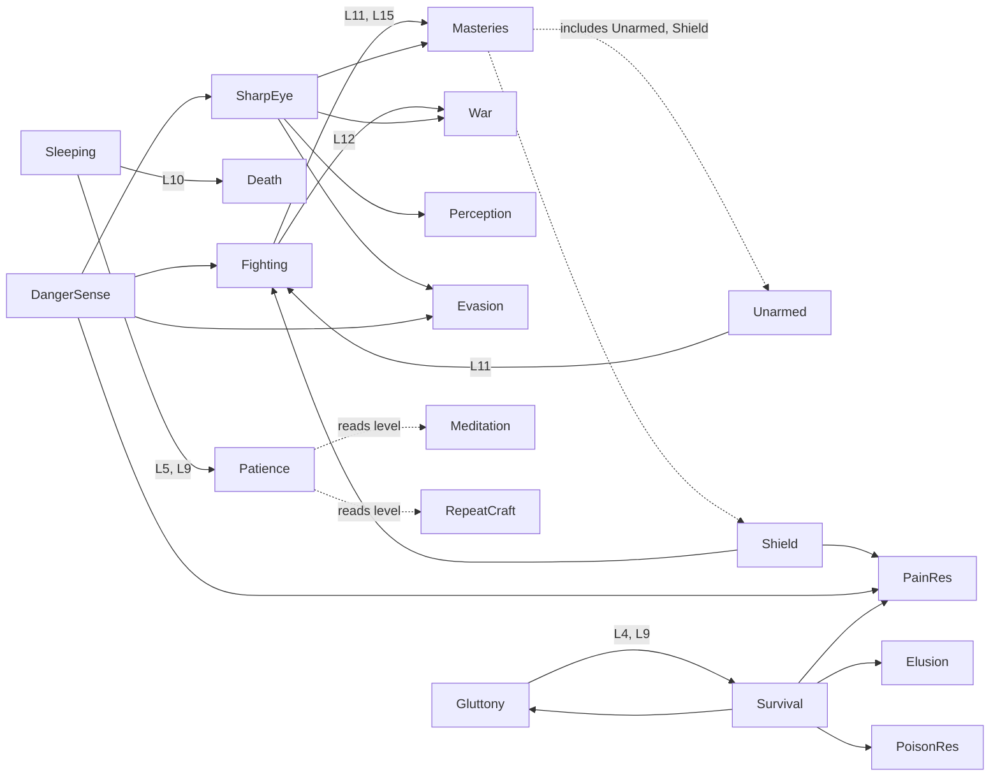

# Source-game skill catalogue (SLC119), 2026-11-03

Status: research extract and proposal notes. Nothing here is a decision or a content change (AD32). Built from saved repo material only; no download, no source execution, nothing read under a `private` folder.

**Number rule (SLC111).** Every figure in the source columns is a source observation (Proto23 rev e93a8cd, as recorded by the saved readers). None is a YAIRPG value or a proposal. A YAIRPG ladder sets its own sizes per world (AD46: the ladder is one world's form, not the template).

**Labels.** SHOWN = a reader recorded it from code at the cited lines. INFERRED = the reader or this note reasoned it. BRIEF = stated in the SLC119 task brief from Weibao's Sleeping-panel screenshot, which is not saved in the repo (see Gaps). UNKNOWN = not evidenced.

Short cites used below (all under `docs/research/proto23/` unless a full path is given):
- **R2** = `readers-2026-10-10/R2_skills_items.md` (skill table 1.2, sections 1.1, 2.2, 4.1)
- **R1** = `readers-2026-10-10/R1_core_time_titles_effects_furniture.md` (section 3, titles)
- **R4** = `readers-2026-10-10/R4_crafting_vendors_actions_combat.md`
- **R5** = `readers-2026-10-10/R5_map_dialogue_time_save.md`
- **N2** = `xeus24-mod-2026-10-10/readers/N2_notes_2049-4128.md` (a mod's notes; used only for facts about the original)
- **SMA** = `SOURCE_MECHANISMS_AND_ADOPTION_2026-10-13.md`; **PRB** = `SOURCE_MECHANISM_PROBES_2026-10-13.json`
- **DL** = `DESIGN_LESSONS_FOR_OOPS_2026-10-20.md`; **WGA** = `docs/research/skill-growth-2026-10-10/WORLD_GROWTH_AUDIT.md`
- **R6** = "Round 6 (2026-11-03)" in `docs/SKILLS_AND_LEARNING_CONSIDERATIONS_2026-10-18.md`

How the source works (so the rows read right): a skill gains XP from doing the thing; `p` is a per-skill XP multiplier that milestones and books bump in 0.05-style steps; a milestone is `{lv, f, g, p:text}` with a free closure, so rewards are arbitrary (flat stat, global EXP, another skill's `p`, a title, a recipe, an action). Titles are mostly a flavour log; the stat reward sits on the skill perk that grants the title (R1 sec. 3; R2 sec. 1.1).

---

## 1. Catalogue

### 1a. Ladder rows (level, effect)

Row id = `L<n>`. "Effect" is the source observation. Skills whose milestone count is known but per-level effects are not are listed as one grouped row (partial; see Gaps).

| Id | Skill | Level | Effect (source observation) | Label | Cites |
|---|---|---|---|---|---|
| L1 | Fighting | 2 | Character EXP +2% | SHOWN | R2 1.2 row 101 |
| L2 | Fighting | 5 | STR +1; title | SHOWN | R2 1.2 row 101 |
| L3 | Fighting | 8 | Character EXP +2% | SHOWN | R2 1.2 row 101 |
| L4 | Fighting | 10 | Character EXP +5%; Energy Effectiveness +1%; title | SHOWN | R2 1.2 row 101 |
| L5 | Fighting | 11 | All mastery skills' `p` +10% | SHOWN | R2 1.2, 1.3 |
| L6 | Fighting | 12 | STR +1; War `p` +5%; title | SHOWN | R2 1.2 row 101 |
| L7 | Fighting | 13 | AGL +2 | SHOWN | R2 1.2 row 101 |
| L8 | Fighting | 14 | Character EXP +6% | SHOWN | R2 1.2 row 101 |
| L9 | Fighting | 15 | Character EXP +8%; all masteries' `p` +10%; title | SHOWN | R2 1.2, 1.3 |
| L10 | Fighting | per level | Per-level use effect: damage bonus = STR x level x 2% | SHOWN | R2 1.2 row 101 |
| L11 | Sleeping | 2 to 12 (10 rows) | Mostly flat HP, +2 up to +50 per level; exact per-level values not saved | SHOWN (shape), UNKNOWN (per level) | R2 1.2 row 110; BRIEF (HP +2/+5/+10 examples) |
| L12 | Sleeping | 5 | Patience `p` bump; New Title | SHOWN (edge, title), BRIEF (title level) | R2 row 110; R6 trigger |
| L13 | Sleeping | 9 | Patience `p` bump | SHOWN | R2 row 110 |
| L14 | Sleeping | 10 | Death `p` bump; New Title | SHOWN (edge), BRIEF (title level) | R2 row 110; R6 trigger |
| L15 | Sleeping | per level | Per-level use effect: sleep heal = 5 x level x bed quality | SHOWN | R2 row 110; R1 sec. on beds |
| L16 | Unarmed M | 11 | Fighting `p` +3% | SHOWN | R2 row 102 |
| L17 | Unarmed M | 5 rows, levels not listed | STR/AGL adds, character EXP, Energy Effectiveness +2% | SHOWN (set), UNKNOWN (levels) | R2 row 102 |
| L18 | Unarmed M | per level | +6% STR per level while unarmed | SHOWN | R2 row 102 |
| L19 | Sword M | 1, 3, 5, 8, 10, 11 | 6 rows, effects not saved | UNKNOWN | R2 row 103 |
| L20 | Knife M | 10 | Crit damage +10%; 6 rows in all | SHOWN (L10) | R2 row 104 |
| L21 | Axe M | 5 | HP +30; blunt DEF +1 | SHOWN | R2 row 105 |
| L22 | Axe M | 10 | STR training potential +5% | SHOWN | R2 row 105 |
| L23 | Polearm M | 5 | Pierce DEF +1 | SHOWN | R2 row 106 |
| L24 | Polearm M | 10 | Physical resist +1% | SHOWN | R2 row 106 |
| L25 | Hammer M | 10 | STR +3; character EXP +3% | SHOWN | R2 row 107 |
| L26 | Shield M | 2, 4, 5, 8, 10, 11 | HP +12, HP +30, Pain Resistance `p`, Fighting `p` +8% (set of four effects across six rows; mapping to levels not saved) | SHOWN (set), UNKNOWN (mapping) | R2 row 109 |
| L27 | Staff M, Two Handed M, Ranged M | none | No milestone table; per-level effects only (INT +5%, damage +1.25% STR, STR +5% per level) | SHOWN | R2 rows 108, 122, 147 |
| L28 | Sharp Eye | 1 to 8 (7 rows) | Crit damage; Perception `p`; Evasion `p`; War `p`; all masteries' `p` +5%; physical ATK +5 at L8 | SHOWN (set), UNKNOWN (mapping) | R2 row 111 |
| L29 | Sharp Eye | per level | Crit chance +0.3% per level | SHOWN | R2 row 111 |
| L30 | Patting | 8 rows | Luck +1; HP +33; Beast-class DEF +3; character EXP +10%; INT +3 | SHOWN (set), UNKNOWN (levels) | R2 row 112 |
| L31 | Walking | 1 | Unlocks an action (R2 names "demo"; SMA names Run) | SHOWN, names differ | R2 row 113; SMA line 37; R4 Run entry |
| L32 | Walking | 1 to 10 | HP and energy cap every level; character EXP +3%, +3%, +6%; SPD +1 at L10; titles | SHOWN (shape), UNKNOWN (per level) | R2 row 113 |
| L33 | Gambling | 2 rows | Luck +1; AGL +2 | SHOWN | R2 row 114 |
| L34 | Gluttony | 1 to 13 | Every level: energy cap +5 to +25 and HP +5 to +70 | SHOWN (range) | R2 row 115 |
| L35 | Gluttony | 4, 9 | Survival `p` bump | SHOWN | R2 row 115 |
| L36 | Gluttony | 10 | Text promises "EXP +13%"; code writes `eqp_t`, so the reward is silently missing | SHOWN (typo INFERRED) | R2 1.3; WGA W18 F11 |
| L37 | Literacy | 4 rows | INT +1; character EXP +2%, +2%, +3%; titles | SHOWN | R2 row 116 |
| L38 | Literacy | per level | Reading time divisor 1/(1 + level/10) | SHOWN | R2 sec. 3.1 |
| L39 | Cooking | 1 | Recipes (roasted meat, scrambled eggs); INT +1; AGL +1 | SHOWN | R2 row 117 |
| L40 | Cooking | 2 | Recipes (boiled carrot, bone cracker); STR +1; character EXP +5% | SHOWN | R2 row 117 |
| L41 | Alchemy | 1 | INT +1; recipe lesser healing potion | SHOWN | R2 row 120 |
| L42 | Danger Sense | 5 rows | Character EXP; Pain Resistance `p`; Fighting `p` +10%; Evasion `p` +10%; Sharp Eye `p`; titles | SHOWN (set), UNKNOWN (levels) | R2 row 126 |
| L43 | Pain Resistance | 4 rows | Not saved | UNKNOWN | R2 row 127 |
| L44 | Survival | 1 to 8 (7 rows) | STR add; text promises HP +100 at L6 but code adds STR +2 and a `p` boost; Elusion `p` +15% | SHOWN (set), text/code drift INFERRED | R2 row 129, 1.3 |
| L45 | Death | 1, 3, 5, 7, 9, 10 | 6 rows; L5 text promises EXP gain but writes `eqp_t` (reward missing); others not saved | SHOWN (L5 typo INFERRED), UNKNOWN (rest) | R2 row 132, 1.3 |
| L46 | Famine | 1 to 10 | 6 rows not saved; per-level effect raises the low-energy efficiency floor 1% per level (cap 60%) | SHOWN (use), UNKNOWN (rows) | R2 row 134, 2.2 |
| L47 | Patience | none | No milestone table; level is read by other systems (section 1b, E20 and E21) | SHOWN | R2 row 154 |
| L48 | Meditation | none | No milestone table; trains at 0.0065 per idle tick, scaled by 1 + Patience level x 0.15 | SHOWN | R2 row 118 |
| L49 | Trading | per level | Shop prices shift 0.5% per level | SHOWN | R2 row 148 |
| L50 | Absorption x6 (Water, Fire, Air, Earth, Light, Dark) | per level | `onLevel` raises element defence by ceil(level/3 + 1); also accumulates Ki through `onGive` | SHOWN | R2 rows 135-140, 1.2 |
| L51 | Toughness | per level | `onLevel` raises physical defence by ceil(level/3 + 1) | SHOWN | R2 row 151 |
| L52 | Resistances (Bleeding, Poison, Corruption, Cold) | per level | Bleed damage -1%, avoid-poison +1%, corruption damage -5%, less cold energy loss; no milestone tables | SHOWN | R2 rows 128, 146, 158, 160 |
| L53 | Skills with no milestone table and no saved per-level effect | n/a | Throwing, Nightsight, Evasion, Greed, War, Stealing, Elusion, Foraging, Geology, Mining, Maintenance, Temperance, Swimming, Disassembly, Tailoring, Harvesting, Crafting, Drinking, Topography, Perception, Judgement (effects as in R2 rows) | SHOWN | R2 1.2 |

Counts of what R2 states for milestone tables: 60 skills, 22 with milestone tables, 8 with `onLevel` hooks (R2 1.2 counts line).

### 1b. Cross-skill edges (source skill, target, size)

An edge here is a milestone or book that raises another skill's `p` (XP multiplier), unless marked "reads level". Sizes are source observations. A size of "unlisted" means the saved readers name the edge but not the amount.

| Id | Source skill (level) | Target | Size (source observation) | Label | Cites |
|---|---|---|---|---|---|
| E1 | Sleeping (5) | Patience | Patience EXP gain +5% (BRIEF; which of L5 or L9 carries +5% vs +10% is not saved) | SHOWN (edge), BRIEF (size) | R2 row 110; R6 trigger |
| E2 | Sleeping (9) | Patience | Patience EXP gain +10% (BRIEF; see E1) | SHOWN (edge), BRIEF (size) | R2 row 110 |
| E3 | Sleeping (10) | Death | Death EXP gain +10% | SHOWN (edge), BRIEF (size) | R2 row 110 |
| E4 | Fighting (11) | Every mastery skill | `p` +10% | SHOWN | R2 1.2, 1.3 |
| E5 | Fighting (15) | Every mastery skill | `p` +10% | SHOWN | R2 1.2, 1.3 |
| E6 | Fighting (12) | War | `p` +5% | SHOWN | R2 row 101 |
| E7 | Unarmed M (11) | Fighting | `p` +3% | SHOWN | R2 row 102 |
| E8 | Shield M (level unlisted) | Fighting | `p` +8% | SHOWN (edge), UNKNOWN (level) | R2 row 109 |
| E9 | Shield M (level unlisted) | Pain Resistance | `p` bump, unlisted | SHOWN (edge) | R2 row 109 |
| E10 | Sharp Eye (level unlisted) | Perception | `p` bump, unlisted | SHOWN (edge) | R2 row 111 |
| E11 | Sharp Eye | Evasion | `p` bump, unlisted | SHOWN (edge) | R2 row 111 |
| E12 | Sharp Eye | War | `p` bump, unlisted | SHOWN (edge) | R2 row 111 |
| E13 | Sharp Eye | Every mastery skill | `p` +5% | SHOWN | R2 row 111 |
| E14 | Danger Sense | Pain Resistance | `p` bump, unlisted | SHOWN (edge) | R2 row 126 |
| E15 | Danger Sense | Fighting | `p` +10% | SHOWN | R2 row 126 |
| E16 | Danger Sense | Evasion | `p` +10% | SHOWN | R2 row 126 |
| E17 | Danger Sense | Sharp Eye | `p` bump, unlisted | SHOWN (edge) | R2 row 126 |
| E18 | Gluttony (4, 9) | Survival | `p` bump, unlisted | SHOWN | R2 row 115 |
| E19 | Survival (level unlisted) | Elusion | `p` +15% | SHOWN | R2 row 129 |
| E20 | Survival | Pain Resistance, Poison Resistance, Gluttony | `p` boosts, unlisted | SHOWN (narrative); not in the row 129 table | R2 sec. 2.2 "stomach-ache loop" (lines 1993-2000) |
| E21 | Patience (reads level) | Meditation XP rate | Rate x (1 + Patience level x 0.15) per idle tick | SHOWN | R2 row 118; R4 line 161 |
| E22 | Patience (reads level) | Repeat-craft timer | 5000 ms minus 350 ms per Crafting level minus 150 ms per Patience level, floor 300 ms | SHOWN | R4 line 20 |
| E23 | Crafting repeat, gate-guard job | Patience (trains it) | 0.05 XP per repeat; 0.08 XP per second on guard duty | SHOWN | R4 lines 20, 161; R5 line 144 |
| E24 | Books: skillbooks / manuals / Street Fighting | Mastery skills / Fighting | Skillbook mastery `p` +5%; manual +15%; Street Fighting Fighting `p` +15% | SHOWN | R2 sec. 3.2 |

### 1c. Titles and their triggers

Source totals: 108 title slots, ids 0-107, about 80 with real content, the rest stubs (R1 sec. 3). Only five carry a real mechanical talent in the range read: Walker, Jogger, Iron Stomach, Quartermaster, plus silent "rars" ones.

| Id | Title or family | Trigger | Effect (source observation) | Label | Cites |
|---|---|---|---|---|---|
| T1 | Sleeping title (name not saved) | Sleeping level 5 | Recognition; reward sits on the perk row | BRIEF; R2 says "titles" | R2 row 110; R6 trigger |
| T2 | Sleeping title (name not saved) | Sleeping level 10 | Recognition | BRIEF | R6 trigger |
| T3 | Fighting titles, four perks | Fighting levels 5, 10, 12, 15 | Recognition | SHOWN | R2 row 101 |
| T4 | Civilian, Trained Civilian, Fighter, Rookie | Granted by Fighting milestone closures (mapping to levels not saved) | Flavour | SHOWN (group, via the mod's scan of base code) | N2 TITLES section |
| T5 | Walker | Walking perk (level not saved) | Running drains 5% less energy | SHOWN | R1 sec. 3; R4 line 158 |
| T6 | Jogger | Walking perk (level not saved) | Running drains 15% less energy | SHOWN | R1 sec. 3; R4 line 158 |
| T7 | Literacy titles | Literacy milestones | Recognition | SHOWN (existence) | R2 row 116 |
| T8 | Danger Sense titles | Danger Sense milestones | Recognition | SHOWN (existence) | R2 row 126 |
| T9 | Iron Stomach | Food-poison / rot skill perk (skill not saved) | Flag to guess rot time | SHOWN | R1 sec. 3; DL line 796 |
| T10 | Quartermaster | Return 300 items to the dojo | Training dummies may drop something special | SHOWN | R1 sec. 3; DL CRL44 (via `docs/SKILLS_AND_TALENTS.md`) |
| T11 | Kill titles, 5 tiers (Pest Control to Sentinel) | Lifetime kills 10k, 50k, 200k, 1M, 5M | Recognition | SHOWN | R1 sec. 3; N2 families |
| T12 | Lifetime gold title | Hold 1 gold; later tiers at 10 and 100 gold (mod's finish of commented code) | Recognition | SHOWN | R1 sec. 3; N2 |
| T13 | Titles collected, 3 tiers | 10, 25, 50 titles | Recognition | SHOWN | R1 sec. 3 |
| T14 | Shopper tiers | 500 items bought (later tiers 5,000 and 10,000 are the mod's) | Recognition | SHOWN | R1 sec. 3; N2 |
| T15 | Cat-pat title | 9999 pats | Recognition | SHOWN | R1 sec. 3 |
| T16 | Hand-strength tiers | Punch tests at 100, 250, 500 kg | Recognition | SHOWN | R1 sec. 3 |
| T17 | Hikikomori to Hermit (3 tiers) | Continuous time at home 1, 5, 10 years; resets on leaving | Recognition | SHOWN | R1 sec. 3; N2 `neet` family |
| T18 | Dojo titles (tutorial, Apprentice, Initiate) | Area completion | Recognition | SHOWN | R1 sec. 3 |
| T19 | Safehouse | Reach level 20 with zero deaths | Recognition | SHOWN | R1 sec. 3 |
| T20 | Glass Bones | Lose to the weakest enemy at level 1 | Recognition | SHOWN | R1 sec. 3 |
| T21 | Unearnable stubs (about 30) | None (granted by nothing): Scarred, Thickskinned, Brute (Toughness), Carcass (Death), Coward (Elusion), `axc3`, `hmr3`, `srd3/srd4`, others | Intended future tiers | SHOWN | N2 TITLES section; R1 sec. 3 |

### 1d. Locked and hidden rows

| Id | Locked row | Reveal route | Label | Cites |
|---|---|---|---|---|
| K1 | Sleeping level 11 shows `??????????` | Reached by raising Sleeping; content not saved | BRIEF | R6 trigger; R2 says the table runs to L12 |
| K2 | Skills tab label `???????` | First XP to any skill adds it to the list at level 1 and flips the tab label | SHOWN, reproduced | PRB `skillReveal`; SMA |
| K3 | Crafting "assemble" tab `???????` | First recipe unlock flips it to a button | SHOWN | R4 line 15 |
| K4 | Ingredient names `?????????` | Item discovered; result names hidden unless allowed | SHOWN | R4 line 21 |
| K5 | Monster danger grade `???` (grades run `???` to `SSS++`) | Not saved | SHOWN (existence) | N2 line 69 |

Row counts: ladder rows L1-L53 (53 table rows; about half give a level-by-level effect, the rest give sets or per-level formulas), edges E1-E24 (24), titles T1-T21 (21), locked rows K1-K5 (5).

---

## 2. Edge graph

Skill-to-skill `p` edges only (E1-E20, E24 omitted as an item edge). "Reads level" edges are drawn dashed. An arrow means "raises the target's XP gain".

Cycles flagged:
- **C1, Gluttony <-> Survival.** Gluttony L4/L9 raises Survival (E18); Survival raises Gluttony (E20). Evidence is the R2 row 115 edge plus the R2 sec. 2.2 narrative; the Survival row 129 table does not list the Gluttony edge, so the return half is narrative only. R2 names this the "stomach-ache loop" and calls bad food a deliberate training route.
- **C2, Fighting <-> Unarmed M** and **C3, Fighting <-> Shield M.** Unarmed L11 (E7) and Shield (E8) raise Fighting, and Fighting L11 and L15 (E4, E5) raise "all masteries". Both are type 1 masteries in R2, so the return half is INFERRED. Whether "all masteries" includes them is not recorded.
- **No cycle found** through Sharp Eye or Danger Sense: Sharp Eye raises masteries (E13) and Danger Sense raises Sharp Eye (E17), but no edge returns to either.
- Sleeping -> Patience and Sleeping -> Death have no return edge in the saved reads. Death and Patience are trained by dying (100 XP, R2 sec. 1.2) and idle or guard work (E23), so they sit at the end of chains.

Why it matters (SLC113): a feeding loop is a growth loop. The source lets `p` accumulate additively with no cap seen (R2 1.1).

---

## 3. YAIRPG consumer per skill

"Reader" is the file or rule code that would read the source skill's rows if a world adopted them. Where the repo has no reader, the cell says "none" and names the nearest proposal home in brackets. Defaults, dials and reasons are proposals under AD32; they do not carry source numbers.

Existing runtime facts (R6 "Runtime facts"): `src/titles.js` saves a held title as `{at}` and derives `xp_multipliers` through `titleBonuses`; `src/skill_records.js` derives rust without lowering the peak; `src/skill_expansion_content.js` milestones are `{at, label}` rows tied to real consumers; no numbered perk ladder or cross-skill edge table exists yet.

| Skill (source) | YAIRPG consumer | Default, dial, reason |
|---|---|---|
| Sleeping | Native Sleeping skill: `src/main.js` lines 831, 3925, 8842 (sleeping level, recovery, XP per tick); `src/home_content.js` furnishing XP multipliers; ladder perks: SLC112 and SLC118 (`src/skill_inspector.js`), rust SLR42/SLR43 | Default: flat and XP perks read the current (rusted) level through the existing bonus bucket. Dial: a world may read the peak for a lasting bodily change. Reason: `skill_records.js` already derives rust. |
| Patience | none as a skill. Nearest: R6 "Patience / waiting" candidate (queue and away-bank rate, SLC107, SLC108) | Default: add it where a rate or rash-action check reads it. Dial: world by world. Reason: a flavour label with no reader is a trait or title (CRL44). |
| Death | `src/titles.js` counters `deaths`, `level_without_death` (titles `back_again`, `stubborn`, `unbroken`); carryover rule SLR20 (R6 "Death and reset") | Default: dying trains it only through a carrier the world really has. Dial: world. Reason: SLR20. |
| Fighting | Native Combat skill and title `hunter`/`slayer` XP paths in `src/titles.js`; mastery parents in `src/data/skills.js` per R2 4.1 | Default: reuse the native parent/child `xp_multipliers` path. Dial: size and chain depth. Reason: one summing path (AR3, SLC113). |
| Weapon masteries (Sword, Knife, Axe, Polearm, Hammer, Unarmed, Shield, Staff, Two Handed, Ranged) | Native weapon-mastery skills under the Weapon mastery parent (R2 4.1) | Default: edges become rows over the existing parent link. Dial: per world. Reason: avoid a second edge engine (FND5). |
| Sharp Eye, Danger Sense, Perception, Nightsight | Native Perception / Night vision skills; `src/titles.js` `naturalist` (Perception XP) | Default: one table row per edge. Dial: per world. Reason: SLC113. |
| Gluttony, Survival, Famine | Native Gluttony skill (R2 4.1); food-poison and Survival have none; need/hunger thresholds are the "Enduring" candidate in R6 | Default: Survival and Famine appear where a need threshold reads them. Reason: SLR8 consumer test. |
| Walking | Native Running skill; Run action gate (SMA line 37); titles Walker/Jogger map to the running-energy cost owner (DL CRL43) | Default: recognition and the energy modifier have separate causes (SLR42). |
| Literacy | Native Literacy skill (max 10 in R2 4.1); `src/titles.js` `bookworm`; reading-rate owner in `src/main.js` line 831 (`readProgressPerMinute`) | Default: reading speed is derived from level. Dial: curve per world. |
| Meditation | Native Meditation skill (R2 4.1) | Default: Patience-style level reads wait for the Patience candidate. |
| Cooking, Alchemy, Crafting, Tailoring | Native Cooking, Alchemy, Crafting skills; `src/titles.js` `artisan`, `master_hand`; Tailoring has none | Default: recipe grants stay on the existing recipe owner. |
| Toughness, Pain / Poison / Bleeding / Cold / Corruption resistance, Absorption x6 | Native Fortitude, Iron skin, Cold and Poison resistance (R2 4.1); Bleeding, Corruption, Absorption: none | Default: add in worlds whose mechanism supplies the cause (elements, cultivation). |
| Trading | Native Haggling skill; `src/titles.js` `well_off` (Haggling XP) | Default: price shift stays in the trade owner. |
| Patting, Gambling, Greed, Judgement, Topography, Drinking, Temperance, Maintenance, War, Stealing, Elusion, Foraging, Geology, Mining, Harvesting, Swimming, Disassembly, Throwing | Mostly none (R2 4.1 marks Patting, Gambling, Drinking, Greed, Temperance, Judgement, Topography, Patience, War, Stealing, Throwing, Disassembly, Maintenance as source-only); Foraging, Mining, Swimming, Elusion map to native Herbalism, Mining, Swimming, Scrambling | Default: none until a world has a reader. |
| Titles (T1-T21) | `src/titles.js` (counter grants, saved `{at}`), `src/titles_ui.js`; rules SLC112, SLC115, SLR42, SLR43 | Default: a ladder title is a saved grant; a perk is derived. Dial: world may name its own. Reason: reload must not replay a grant. |
| Locked rows (K1-K5) | SLC116; sealed-secret rule in `AGENTS.md`; `src/skill_discovery.js` for the first-XP reveal | Default: `??????` appears only where a real grant exists. Dial: decoys with an in-world reason. |

---

## 4. Gaps (skills only partly evidenced)

1. **Screenshot not saved.** The Sleeping panel numbers (HP +2/+5/+10, Patience +5%/+10%, Death +10%, titles at 5 and 10, locked row at 11) reach this catalogue only through the SLC119 brief. R2 confirms the shape (10 rows over L2-12; Patience p at L5 and L9; Death p at L10; titles) but not the per-level numbers. Which Patience size sits at which level is not recorded.
2. **Per-level effects missing** for Sword M (6 rows), Shield M (6 rows, set only), Sharp Eye (7 rows, set only), Patting (8), Walking (10), Gluttony (13), Literacy (4), Danger Sense (5), Pain Resistance (4), Death (6), Famine (6), Survival (7), Unarmed M (5). Only the totals and effect sets are saved.
3. **Titles:** the names and levels of both Sleeping titles are not saved; Fighting title-to-level mapping is not saved; Walker/Jogger trigger skill and level are not saved (R1 gives only the effect and line numbers); Iron Stomach's trigger skill is not saved.
4. **Text/code drift:** Gluttony L10 and Death L5 write `eqp_t` while the text promises EXP gain; Survival L6 text promises HP +100 but code adds STR and `p`. The catalogue records both the promise and the code reading (R2 1.3). Walking L1 is named "demo" by R2 and Run by SMA and R4; not reconciled.
5. **"All masteries" membership** is not recorded, so cycles C2 and C3 are inferred.
6. **Survival -> Gluttony / Pain / Poison** exists only in R2's narrative, not its table row.
7. **Training triggers UNKNOWN** for about 25 skills (R2 1.2 "UNKNOWN" cells), and 38 of 60 skills have no milestone table.
8. **Source revision.** All rows are Proto23 rev e93a8cd from R2. A later recovered snapshot (`23delta`) changes title and talent handling (DL Round 6) but no skill ladder was re-read from it.
9. **Locked-row content** for K1 is by design unseen; if K1 is sealed in the source it stays outside this file.
10. **Mod material** (`xeus24-mod`) was used only for facts about the original titles; its 595-title ladder and ten-rank scheme are mod content and are not catalogued.

---

## 5. Proposal notes (labelled, not decided)

- **Ladder form.** Default: one milestone table per skill, perks derived from level, titles saved as dated grants (SLC112, SLC114). Dial: depth and number of rows per world. Reason: the lead and non-lead seats read the same table.
- **Edges.** Default: each edge is one owned row shown on both ends and routed through the existing `xp_multipliers` path (SLC113). Dial: size, and whether a world allows chains. Reason: loops such as C1 need one summing path and a visible inspector line (SLC118).
- **Source-world intake.** Default: a world adopts the mechanism (a sleep ladder that feeds a waiting skill) and sets its own sizes. Dial: how many rows the world uses. Reason: SLC111 and AD46.
- **Next check.** SLC121 (Sleeping and Patience ladder, one edge, one locked row, one deed title) can reuse E1-E3, T1-T2 and K1; it stays below the floor until SLC112-SLC118 pass.
