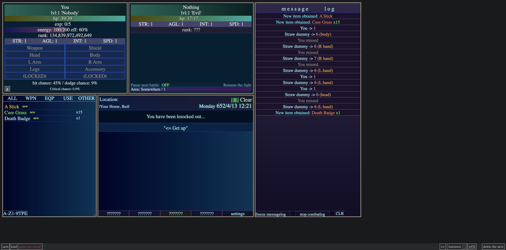

# Proto23 UI and full-source absorption

2026-10-13. Requested direction: inspect beyond difficulty selection and absorb
useful mechanisms across the entire source, including discovery gates, coloring,
VFX and spacing. Specific implementation choices below are proposals.
Desktop/laptop play is primary under PROJECT.md's standing priorities.
No runtime code, bundle or personal save was changed in this pass.

[Deeper source mechanisms](SOURCE_MECHANISMS_AND_ADOPTION_2026-10-13.md)
adds exact-function probes, acquisition-to-capability chains and current source
counterparts. It corrects the old R2 first-XP claim: native Proto23 skill reveal
occurs on its first level-up. Later current source also contains a Vivid option;
the proposed palette work below is not a claim that no vivid palette exists.

## Evidence and correction

The earlier UI comparison stopped at difficulty selection. That missed the enemy
panel and combat controls. In a new Chrome research tab, the introduction was
clicked through and Normal selected. The DOM then showed Straw dummy, enemy
stats, Pause next battle, Resume the fight and Training Grounds / 50.
The game continued during source inspection; the saved screenshot shows the
later knockout/home state with the revealed enemy panel still present.

Sources: [live game](https://23html.github.io/) and
[repository](https://github.com/23html/23html.github.io).
Downloaded to `/private/tmp/proto23-ui-source.html`; SHA256
`a43e55e2eeb455f1c1ae589e3fc074a588813fe6cd57cfba827dcf923f3755d5`.
This matches the snapshot in the existing
[full-source audit](PROTO23_VS_YAIRPG_2026-10-10.md), which records revision
`e93a8cd617932fb698ff889b968a32f9a20d48f3` and five readers covering all
14,768 lines. This pass rechecked UI mechanisms against the downloaded file;
it does not claim another full line-by-line read or full-game playthrough.

## F1: Meaningful events reveal the interface

| Trigger | UI consequence | Source lines | Evidence |
|---|---|---|---|
| First introduction response | Time/weather header appears | 11532-11538 | Browser and source |
| Next response | Player stats/equipment panel appears | 11538-11540 | Browser and source |
| Next response | Inventory and location appear | 11540-11543 | Browser and source |
| Initial equipment; enter difficulty screen | Bottom navigation and log appear | 11543-11556 | Browser and source |
| Select training difficulty | Enemy panel fades in; selected battle starts | 11557-11571 | Browser and source |
| First recipe | Assemble replaces unknown tab label | 10892-10899 | Source only |
| First learned skill | Skills replaces unknown tab label | 13752 | Source only |
| First learned action | Actions replaces unknown tab label | 9054-9059 | Source only |
| Finish the journal-unlocking book | Journal replaces unknown tab label | 5584 | Source only |
| Discover currency / bestiary | Further controls become available | 4944; 5354 | Source only |

**P1 Adapt:** introduce panels through real supported events. Reuse current
discovery/knowledge owners. Basic character views remain available under the
accepted opening policy; world-specific openings may stage additional panels.
Keep settings, save recovery and readable action costs reachable throughout.
Unknown worlds/powers stay absent by default. An unexplained silhouette is an
optional deliberate mystery, not a universal placeholder convention.

Discovery, current usability and the player's hidden/collapsed layout preference
are separate facts. Discovered records stay readable when their actor is
elsewhere. Restore should respect exact discovery: Proto23's broad `aw_u`
restore at line 390 shows the enemy panel with other panels, whereas the initial
reveal checks `dm1ap`. Do not copy that mismatch into our saves.

## F2: Colors, VFX, spacing and detailed states

| Code | Mechanism and source | Proposed adoption |
|---|---|---|
| P2 | Per-region teal/navy/purple gradients; resource bars; colored quantities and events. CSS 7-91; `msg`/`msg_add` 10296-10332; acquisition 10916 onward. | Adapt through current component themes/native semantic styles. Keep meanings consistent across inventory, actions, tooltips and log; distinguish item category from rarity before assigning colors. |
| P3 | `appear` opacity ramp, 10338-10347; `dumb` pointer particles, 10532-10556; `mf` floating money text, 10558-10573; new-item blinking, 10928-10932. | Adapt through settled effects/native display. Anchor to actual DOM geometry, bound/cancel animations, respect reduced motion, and present each event once. Gameplay settlement must not depend on animation timers. |
| P4 | Tight data rows, thin separators, approximately 30 px action rows, compact two-line place header and dedicated list/log scrollers. CSS 17-18, 26, 40-43, 72-92, 105-108. | Adapt tight rows with breathing room between groups, useful panel heights and a tall log. Flexible tracks reclaim space before discovery and reflow on reveal. Follow the current one-scroll-owner-per-region policy. |
| P5 | Unknown recipe ingredients/output, 10651-10674; colored requirements, 10689-10690; settings/log controls and restored labels, 395, 9745-9865. | Adapt disclosure and feedback across acquisition, first use, repeated use, failure, trading, crafting and records. Check Classic/Workspace and layout pickers as well as panel bodies. |

The snow canvas/particle block at 14281-14298 is commented out. Weather
icons/colors at 13599-13600 and 13835-13840 are active source. The rare
`laugh6.wav` event at 13875 is source-only and not a selected behavior here.
These are not browser-verified working VFX merely because code exists.

## F3: Full-source coverage and integration

The existing audit and its five reader reports cover core time/titles/effects/
home, skills/items, equipment/creatures/areas, crafting/vendors/actions/combat,
and map/dialogue/time/save. This report adds the missing post-difficulty browser
observation and a cross-cutting UI adoption plan. Existing gameplay findings
still need their own adoption decisions and acceptance checks.

For each candidate retain: exact mechanism, current equivalent, adopt/adapt/park
choice, owning system, failure case and acceptance route. Reuse existing
character, inventory, simulation, save and workspace owners. Importing the
single-file engine wholesale would duplicate these and carry fixed coordinates
and restore assumptions with it. Full-source absorption should account for
every family, while implementing connected playable slices in order.

No license notice was found in the downloaded HTML or visible repository file
listing. YAIRPG's MIT license does not establish Proto23's license. Preserve
reference attribution; direct redistributed code/assets need resolved license
or permission provenance. Independent implementation of observed behavior is
the proposed route while that provenance remains unresolved.

## First playable slice and remaining gate

Proposed slice: one discovery-aware reveal in an existing route, a vivid
semantic palette and short reveal feedback. `registerWorkspaceModule` already
accepts `eligible()` (`src/workspace_layout.js:7`), but its picker creates named
disabled entries for ineligible modules (87, 116-117). Hiding a panel alone
therefore does not establish spoiler-safe gating. Inspect the actual discovery
owner of each registered module before changing predicates.

Acceptance: rebuild; exercise a fresh-origin opening and populated desktop state
at 1366×768, 1440×900 and 1920×1080, plus larger text/150% zoom. Confirm a
supported event reveals once, no unknown names leak through pickers, costs and
recovery remain usable, and routine controls stay comfortably reachable.
Export, reload and literal-file import must preserve disclosure independently
from saved layout; older saves retain learned systems. Check Classic/Workspace
and reduced motion. Mobile optimization is deferred under standing direction.

**Status:** introduction and post-difficulty reveal browser-observed; later gates
and VFX source-only; runtime implementation and full gameplay adoption remain
open. No commit, push or publication performed.
