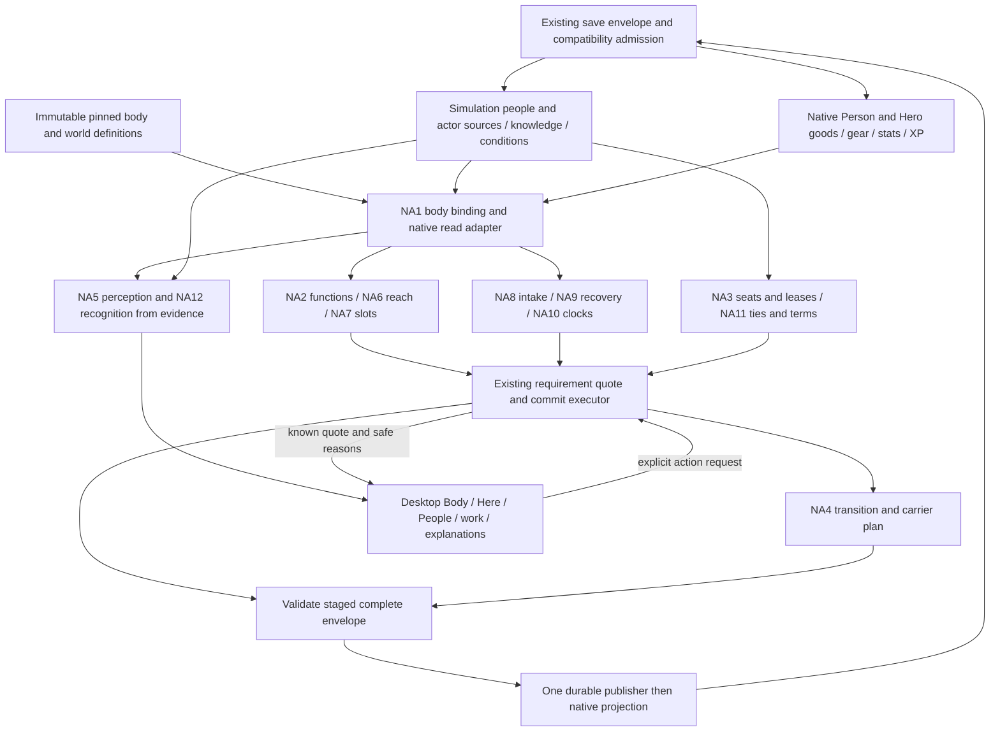

# Nonhuman abstractions needed, 2026-10-14

Status: **INFERRED proposals and SHOWN source inspection**, NONHUMAN ABSTRACTION lane. Nothing here is an accepted decision, runtime change or gameplay proof. [Requirements](NONHUMAN_STARTS_ENGINE_REQUIREMENTS_2026-10-14.md) remains the design owner; [checkpoint](../gm/dispatch/nonhuman-starts-2026-10-14/abstraction/CHECKPOINT.md) records this lane's work.

The missing joint is a body-qualified read and execution contract over current owners. Most names already exist in the broader abstraction palettes. NA1–NA13 below specify only the nonhuman additions and integration boundaries, rather than another general framework.

**Evidence:** SHOWN means read in source, not executed; STATED names the user or document owner; INFERRED covers every proposed interface, bridge, default and suggestion below; UNKNOWN marks unresolved behavior. No outside-memory lore claims, raw books, sealed files or personal saves were used. Source baseline inspected: `codex/gameplay-foundations`, HEAD `94960804`, with unrelated live edits. Other lanes can extend their documents after this snapshot.

**STATED (Weibao, COMMON and live PROJECT/USER_VISION):** one realm and one prestige layer; positive useful verbs; meals help and hunger never kills; no universal penalty for an unusual body. Default: world-specific bodies and consequences. Dial: sourced exceptions or selected AU. Reasonably: every selected body needs useful play, without making return to human its required goal. This lane authorizes no implementation or priority change.

## 1. Existing abstractions in source

All rows in this inventory are **SHOWN source**; limitations distinguish local implementation from a general contract. Paths are repo-relative. The requested eleven files were inspected for the relevant definitions, consumers and boundaries.

| Existing seam | Direct locator | Overlap and limit |
|---|---|---|
| Capability definitions and providers | `src/capabilities.js:4-35` | Nine source kinds; positive grants; max/sum stacking; provider/grant requirements cannot depend recursively on capability facts. No distinct anatomical function registry here. |
| Pure capability query | `src/capabilities.js:41-68` | Returns value, contributions, source receipt and missing reasons. Excludes expired sources and dormant/inactive/suppressed faculties. Queries one actor, with supplied facts; a body ID/channel/reach needs binding, not a new parallel capability score. |
| Simulation owners | `src/simulation_contracts.js:217-218`, `:237-254` | People, goods, equipment, custody, knowledge, directed relationships, claims, faculties, powers, conditions and controllers have separate stores. People own one optional body, vitals and life policy. Body data gets JSON validation but no full anatomy schema in this validator. |
| Enrollment and native/simulation split | `src/simulation.js:49-74` | Player begins without body; NPC definitions can copy body/vitals/life policy. Inventory stays native or simulation-owned. Existing simulation enrollment is not body-only initialization. |
| Actual body/vital facts | `src/simulation_effects.js:93-123`, `:131-158` | Projects body properties, supplied native vitals or saved vitals, conditions and knowledge. Internal target facts include actual private means; this function is not an observer-safe perception view. |
| Body and vital operations | `src/simulation_contracts.js:59-60`; `src/simulation_effects.js:232-242` | Body operation writes one scalar property. Vitals use actual native adapter or simulation person; only health/stamina and their maxima are admitted. A nested template or optional ghost pool cannot be installed via scalar body effects. |
| Existing nonhuman source and intake example | `src/backlog_expansion_body.js:29-60`, `:222-238` | Reedling carries actual body flags, two sap units and an inherited source; source query checks photosynthesis and hands. This is finite weaving content, not general metabolism or a full plant template. |
| Existing control transfer | `src/backlog_expansion_body.js:334-389` | Tern gives specific consent, home body/vitals park, host body/vitals move to player, host becomes incapacitated, return restores same records with spent clay stamina retained. Local transaction with special guards; no generic lease/executor API. |
| Traveler functions and modes | `src/realm_traveler_profiles.js:1-5`, `:55-112`, `:282-315`, `:422-440` | Physical/projection/alternate/shared modes, body functions, independent condition/pool references, source-qualified support and termination intents. Explicitly detached; `nativeExecutable:false` at `:247`. Multiple-body capacity comes from support, not a universal seven-body law. |
| Traveler observer view | `src/realm_traveler_profiles.js:450-460` | Other viewers receive supplied attributed evidence only. Self view includes supplied private snapshots; neither view collects observations or qualifies every body sense. |
| Structured pack compiler | `src/structured_pack_definitions.js:7-9`, `:32-39`, `:70-73`, `:101-117`, `:150-155` | JSON definitions, schema2, collision checks, frozen combined-registry validation, explicit merge. No body-template family in its family lists. `source-function` is a supported pack feature label, not arbitrary anatomical function execution. |
| Typed start admission and initialization | `src/structured_pack_runtime.js:14-19`, `:28-45`, `:62-81` | Scalar body fields, player owner/controller, form/life-stage admission, durable selection and lifetime/body-instance IDs. The precheck compares every start form with the current body. Mixed-form selection and nested body packs need explicit versioned admission changes. |
| Faculties and acquired sources | `src/simulation_effects.js:321-334`; `src/simulation_contracts.js:253` | Actor source stores acquisition/revision/origin/receipt; faculty stores awakening, activation, suppression and development. Body use is not source ownership, and source ownership is not trained execution. |
| Knowledge and directed bonds | `src/simulation_effects.js:281-293`; `src/simulation_contracts.js:249-250` | Knowledge stage/time/cause/basis; directed axes and cause-deduplicated memories capped at32. Useful basis for recognition and regard, not structural kin or contractual authority. |
| Custody and exact goods | `src/simulation_effects.js:265-279`; `src/simulation_contracts.js:248` | Actual inventory transfer plus owner/holder/key/count/cause loan record. Loans can protect goods from disposition. A living body is not automatically an item loan, nor does holder imply controller. |
| Unique claims | `src/simulation_effects.js:294-300`; `src/simulation_contracts.js:251` | Acquire/transfer/settle/release with actual owner, status and cause. Claim protects unique outcomes; it is not a broad legal-property, affection or recognition model. |
| Conditions, life and common boundaries | `src/simulation_effects.js:302-320`; `src/simulation.js:459-499` | Conditions have stacking, immunity, expiry and periodic effects; life has authored lethal/resurrection permission. Jobs settle before expiry/lifespan cleanup. No general body defeat/recovery policy follows merely from zero health. |
| Ordinary controllers and bounded programs | `src/simulation.js:527-556`; `src/simulation_contracts.js:310-311` | Priority NPC choices through command/response gates; programs repeat up to10,000. These are behavior schedulers, not embodiment control leases or permission to drive a second body. |
| Campaign transitions | `src/simulation.js:564-617` | Safe-boundary preview, stale-sequence check, scoped resets, party carry, native envelope projection, causes and bounded32 transition history. Resetting body deletes it; replacement, cargo and failed return still need an actual adapter. |
| Requirement/effect vocabulary and registry | `src/simulation_contracts.js:44-87`; `src/expansion_engine.js:303-361` | 33 supported operation names in the inspected set, with typed effect validation and immutable registrations. No need for a nonhuman-only rule/effect interpreter. |
| Native Person and Hero | `src/models/person.js:47-72`, `:82-89`, `:105-140`, `:464-531`; `src/models/hero.js:15-44`, `:288-329` | Native components own biography, stats, goods and gear; damage returns fainted; equip uses item slot. Hero registers native components and invokes display updates. This runs alongside simulation people, with humanoid assumptions. |
| Existing derived native effect reader | `src/models/hero.js:16-24`, `:105-110` | Pure injected simulation reader is an established bridge seam; avoid saving projected effects again as a second condition owner. It is not yet a general body projection. |
| Expansion state and migration | `src/expansion_engine.js:73-79`, `:258-270` | One clock/sequence, actor domains, optional simulation; older expansion1–4 migrate to base schema with missing sources/techniques supplied. This is not a general body migration chain. |

**INFERRED reconciliation:** scorecard U01's “no control transfer or possession” is too broad for this source snapshot. Tern is a concrete local transfer, while general leases remain missing. Keep the scorecard's split-state finding F1/F2 and read-side-first M5; do not turn a local mechanism into broad runtime proof. Historical test-absence statements in ENGINE_SPEC B20 remain STATED by that audit; this lane did not refresh the test inventory or run tests.

## 2. Nonhuman additions mapped to existing rows

Namespace key: **AX** means [world core kit round6 AX1–AX19](WORLD_CORE_KIT_2026-10-14.md#round-6-comic-worlds-cheats-that-show-the-kit-overarching-shape-abstractions-2026-10-14); **intro AB** means [intro round22 AB1–AB9](../INTRO_FLOW_CONSIDERATIONS_2026-10-13.md); **CA** means [comic medium section CA and reconciliation](../COMIC_WORLDS_AND_MEDIUM_CONSIDERATIONS_2026-10-14.md). Requirements round10 also used AB1–AB8 for different nonhuman sketches; those are referenced by meaning and reconciled here as NA, never treated as intro AB. These maps express overlap, not accepted runtime APIs.

Every contract below is **INFERRED**. Minimal interfaces are illustrative pure views/planners returning data, not existing callable functions or approved save schemas. Default: one focused body and explicit owners. Dial: additional channels, bodies or policies only where an actual source/world supports them. Reasonably: missing anatomy, training, permission and contact have different reasons; alternatives stay useful.

### NA1 Body template and instance

**Map:** AX4 Actor, intro AB1 Record/AB8 Revision; requirements E1/E9/E14; [engine spec](NONHUMAN_STARTS_ENGINE_SPEC_2026-10-14.md) section2 and [body authoring](NONHUMAN_BODY_AUTHORING_2026-10-14.md) BA6/BA7.

**Purpose/addition:** immutable anatomy defaults plus actual body identity, configuration revision, owner/control references and independently bound vitals. Distinguish person, body and life epoch without creating six mandatory metaphysical objects.

**Minimal:** `resolveBody(personRef, bodyRef, templateRef) -> {id, revision, templateRevision, form, functions, policyRefs, ownerRefs}`. Save the current instance in `simulation.people[id].body`; reference immutable template defaults and actual condition/pool owners. Template resolution alone grants no source, memory, goods or XP.

**Extend/replace:** extend simulation people and definition compilation; replace ad hoc human fallback reads with one effective body view after migration. Handle body-only initialization explicitly: current enrolledAt requirements prevent simply inserting an unenrolled simulation record.

**YAGNI:** no ECS conversion, tissue physics, universal soul schema or parallel mutable body database. A future N-body owner needs a selected migration before aliases can become authority.

**First consumers:** human/reedling compatibility reads, then Village hound start, native action/gear adapters. A borrowed body later tests retention of motor applicability separately from person-owned knowledge; do not copy the native XP ledger merely to make skills fit.

### NA2 Function query

**Map:** AX3 PowerCore/AX4 Actor/AX15 Explain; intro AB2 Requirement and Effect/AB3 Resolver; E2/E3, spec query API, BA3/BA9.

**Purpose/addition:** ask for actual manipulation, movement or sensing, with capacity, channel, source and current support. A wolf's mouth can retrieve a parcel without supplying two human hands or fine assembly.

**Minimal:** `queryFunction(actorRef, bodyRef, functionId, useContext) -> {capacity, channel, eligible, contributions, reasons}`; `can`/`explain` are thin wrappers. Reuse capability provenance and requirements. Explicitly adapt traveler `hands.grip` and `travel.physical` to spec vocabulary; physical passage remains mode/route qualified.

**Extend/replace:** extend `queryCapabilities` with a body-qualified facts/view adapter; replace scattered hands/form checks consumer by consumer. Keep method mastery, language and permission independent from anatomy. A helper contributes a named task role, not pooled “party hands”.

**YAGNI:** no second capability engine, wildcard grant semantics, recursive provider dependencies or hundred-function ontology. Introduce only functions read by named actions.

**First consumers:** reed weaving/Tern pressing and human/hound retrieval; later native travel and making MK13. Old intentional world form exclusions remain admission policy, not automatically deleted as anatomy checks.

### NA3 Seat, controller and control lease

**Map:** AX4 Actor/AX2 Law; intro AB1/AB2/AB7 Provenance; E8, C8/C9, transformation TF9/TX, bonds BP1–BP6.

**Purpose/addition:** distinguish selected viewpoint, executive control, helper orders, body title and independent person. Seat selection itself changes neither ownership nor knowledge.

**Minimal:** `resolveSeat(viewer, seatRef) -> {personRef, bodyRef|null, permittedChannels}`; `previewControl(leaseRef, request, expectedSequence) -> {allowed, reasons, plan}`. Lease binds grantor/controller/body, permitted verbs/channels, duration/clock, source or consent revision, reserve use, revocation and return/failure policy. A bodyless guide can advise through a channel without a fabricated Hero.

**Extend/replace:** generalize Tern's exact staged swap and guards; bind native calls to current controlled body incrementally. Preserve `simulation.controllers` for NPC schedules. Control lease is a separate optional contract under the existing simulation owner, with persistence admission decided before shipping.

**YAGNI:** no simultaneous seven-seat executor, arbitrary NPC takeover, consent inferred from affection, or generic autonomy AI. A default consenting lease and a selected hostile/contested premise need distinct admission.

**First consumers:** Tern entry/return plus one real second lease route. Paradise mission vessel is a proposal candidate, not presently an executable second consumer or universal canon service.

### NA4 Carrier and transition record

**Map:** AX12 Carrier/AX9 CausedEffect/AX15 Receipt; intro AB4 Projection/AB7 Provenance; U12, E13, TF1–TF12/TX3/TX4, Paradise missions N18/DM8.

**Purpose/addition:** separate changing configuration, acquiring another body and changing control; retain each domain through an actual carrier with exactly one result.

**Minimal:** `previewBodyTransition(request, refs, expectedSequence) -> {from, to, kind, carryRows, controlPlan, returnRef, reasons}`. Each carry row names domain/entity, current owner/bearer, disposition, destination, conversion and cause. Commit stages the complete native/simulation envelope; return resolves current live references, not the old preview.

**Extend/replace:** extend campaign transition planning and Tern transaction; retain travel/cargo owner references. AX12's information carrier and a physical holder are related transport contracts with different payload rules, not one interchangeable record.

**YAGNI:** no universal rollback/event-sourced save rewrite, automatic revival, cargo teleport or generic source conversion. An active lease/return pointer must survive rolling history eviction; the capped transition log cannot be its sole authority.

**First consumers:** existing Tern return and one reversible two-form transition; later Paradise vessel extraction. Unique body-item identity must not appear again as newly granted inventory.

### NA5 Perception filter

**Map:** AX5 PerceptionProfile/AX6 Observation/AX18 Lens; intro AB6 Knowledge and Lens; N1/N36, senses SU/SS, minds MN-E1/MN13.

**Purpose/addition:** distinguish a current scent/echo/contact reading from learned identity, private truth and remembered evidence.

**Minimal:** `perceptionView(viewerRef, focusedPresenceRef, evidenceRefs, context) -> {perceivedEntities, observations, knownActions, unknowns, explanations}`. Channels qualify detection and meaning; a paid scan is a command producing evidence before this pure read. UI and NPC knowledge projection share the observer contract; execution legality may separately read protected actual means.

**Extend/replace:** extend knowledge views and traveler evidence view; never expose raw `simulationFacts` as player/NPC perception. Reuse common lens/observation work rather than create a nonhuman sight store.

**YAGNI:** no ray tracer, mandatory modality UI, global soul identification or one fidelity for every sense. Shared code does not mean all observers receive the same evidence.

**First consumers:** one human/hound parcel scene with different legitimate clues and one witnessing NPC. Rebuilt desktop proof later at1366x768 and1920x1080 should show Body, useful actions and known local cues together; mobile deferred.

### NA6 Reach and presence

**Map:** AX4 Actor/AX11 Place/AX2 Law/AX12 Carrier; intro AB2/AB3; E7, X09, senses scale routes, bonds BR2.

**Purpose/addition:** located, rooted, carried, anchored and distributed presence can reach different targets without acquiring walking or ownership of a territory.

**Minimal:** `queryReach(presenceRef, targetRef, verbChannel, routeContext) -> {contact, pathRef, carrierRef, capacity, reasons}`. Presence binds endpoint/anchor, actual carrier body and scoped reach. Sensory contact does not supply cargo or attack contact.

**Extend/replace:** extend location/co-location predicates and traveler endpoint/carrier views. A carried blade references one physical body/item and one actual holder; no duplicated positions or new location per root.

**YAGNI:** no continuous coordinates, full world navigation or all-members reach tick. Default coarse local/route classes; dial finer measurements only for a selected route mechanic.

**First consumers:** stationary Tern plus one sapling/blade action requiring bounded reach; rooted growth is not inter-location travel. Distributed brood presence waits for real member readers and costs.

### NA7 Slot provider

**Map:** AX4/AX3; intro AB2/AB4; E4, BA8/BA9, making method slots.

**Purpose/addition:** anatomical gear fit and task manipulators come from the effective body, independently of inventory ownership and training.

**Minimal:** `slotsFor(bodyRef) -> [{id,count,requires,fit}]`; `quoteFit(itemRef, slotRef, bodyRef) -> {eligible,reasons}`. Template supplies slots, item supplies fit. Empty slot list is valid; method roles use NA2 rather than turning every craft participant into an equipment slot.

**Extend/replace:** extend existing equipment adapters/operations; insert the same fit gate before native equip and simulation equip. Retain exact item keys and native/simulation stock semantics.

**YAGNI:** no simulated attachment graph, universal prosthetic surgery or separate nonhuman inventory. Body change explicitly unequips/stores incompatible goods under NA4, rather than deleting them.

**First consumers:** human gear and hound collar/harness; later blade wrap/sheath. A template slot without item/gear/UI reader is authored-unconsumed.

### NA8 Intake and upkeep

**Map:** AX3/AX9/AX7; intro AB2/AB5 Clock; E5, C5, play NP6, BA8, making MK14.

**Purpose/addition:** food benefits, light, fuel, mana and source maintenance have different real means and shortage policies.

**Minimal:** `quoteIntake(bodyRef, inputRef, context) -> {costs, effects, ownerRefs, reasons}`; upkeep definition names supported interval, actual pool, stop policy and scheduler boundary. A template policy ID executes only through a registered consumer.

**Extend/replace:** extend resource/energy/item/condition effects and common jobs. Preserve reedling's finite sap rather than inventing passive replenishment. Default meals help and hunger never kills; dial source-specific fuel exhaustion stops the supported operation, with any non-hunger danger requiring its own authored cause.

**YAGNI:** no complete metabolism, calorie economy or universal vital renamed for every body. Empty intake is valid and grants no resource-generation loop.

**First consumers:** human compatible meal and reedling light/sap route once authored; installed brass lung's real fuel transaction is another existing maintenance seam. Absorption powers keep acquisition/analysis/output stages TM1–TM7, not generic “eat grants everything”.

### NA9 Defeat and recovery policy

**Map:** AX2/AX9/AX4; intro AB2/AB4; E6, C4, TF11/TF12, play NP7, comic CA1 law dials.

**Purpose/addition:** zero physical health, scattered presence, broken vessel, death of person and end of run resolve independently.

**Minimal:** `previewDefeat(bodyRef, cause, policyRef) -> {bodyOutcome, personOutcome, dependencies, recoveryRoutes}`; `quoteRecovery(routeRef, actualMeans) -> {costs,effects,reasons}`. Anchor availability, parts/care and controller consequences are named.

**Extend/replace:** wrap native faint/rest routing and simulation life/condition effects through per-body policy. Preserve old human result; death permission and resurrection remain explicit. Loss cleanup checks reserved participants and leases, not only job actorId.

**YAGNI:** no universal soul afterlife, permanent-death tax or generic resurrection machine. Do not claim a repaired copy restores the same person unless a carrier supports continuity (N39).

**First consumers:** human faint and Tern/reedling-specific recovery, then hound supported rest. Brood replacement and ghost banishment need their own second policy consumer before generalized handling.

### NA10 Clock and lifespan

**Map:** AX7 Clock; intro AB5; E12, clocks CK1/CK2/CK10/CK16/CK18.

**Purpose/addition:** world date, biological exposure/maturity, mortality and experienced duration are different readings. A new lease does not reset a partner's age.

**Minimal:** `bodyClockView(bodyRef, clockProfileRef, exposureCursor) -> {stage, exposure, nextBoundary}`; mortality and felt-time views read separate policy references. Cursor advances only through the existing scheduler's supported intervals, with pinned units/revisions and explicit absence policy.

**Extend/replace:** extend people lifePolicy and joined boundary selection; bridge native biography/chronicle readers rather than add a timer per species. Enrollment bornAt is not automatically biological birth. Default preserve existing offline terms; dial selected bounded catch-up, never implicit century credit.

**YAGNI:** no calendar reform, full ecology/era simulation or mandatory senescence. Grain affects summaries, not world speed; chapters need explicit consequences for named people and obligations.

**First consumers:** existing human mortality and one hound stage view; long-lived sapling/short-life stage actually consuming distinct exposure is the gate for a richer profile. A lease deadline alone is not biological aging.

### NA11 Kin and bond records

**Map:** AX4 Actor/AX10 Standing only for institutional responses; intro AB1/AB7; no direct AX kin row. Reuse [kin NK-E1–NK-E9](NONHUMAN_KIN_AND_RELATIONSHIPS_2026-10-14.md) and [bonds BS/BD](NONHUMAN_BONDS_AND_PARTIES_2026-10-14.md).

**Purpose/addition:** sparse structural origin/care ties coexist with directed regard, household membership, agreements and control. Kinship, friendship and legal ownership answer different questions.

**Minimal:** kin tie `{id,from,to,kind,basis,originCause,status,visibilityRef}` and optional origin/group refs; `bondView(a,b,context)` joins existing axes/memories with separately owned support terms. Reader names an actual care/aid/refusal or known family display.

**Extend/replace:** extend simulation relationship read view, retaining native/chronicle relationship adapter until migration selected. New structural ties are optional typed extension data under one nominated owner, not an all-purpose relationship score or another affection store.

**YAGNI:** no complete pedigree/genetic solver, all-pairs hive graph, species-default romance or offspring control grants. Derive hatchmates from shared origin; retain meaningful causal facts outside rolling memories.

**First consumers:** hound/caretaker aid and one foster/sibling interaction once authored; same tie machinery can later describe an NPC family. Brood births and multi-heir estates wait for real allocation consumers.

### NA12 Recognition and evidence

**Map:** AX6 Observation/AX17 Persona/AX10 Standing/AX15 Receipt; intro AB6/AB7; comic CA7, requirements M4/N37, society SL and minds MN13.

**Purpose/addition:** identify this person in this body to this observer from particular evidence; a witnessed change may update one belief while documents stay stale.

**Minimal:** `recognitionView(observerRef, subjectRef, evidenceRefs, personaRef) -> {claimedIdentity, believedIdentity, basis, confidenceGrade, knownStatus}`. Institutional recognition consumes the relevant evidence/office policy separately. Unknown remains a valid result.

**Extend/replace:** extend actor-local knowledge/basis and persona view. Actual identity claims are not simulation unique claims by default. Correcting belief does not change private truth, prior event history or everyone else's knowledge.

**YAGNI:** no global true-name switch, universal trust/confidence math, retcon engine or automatic soul/kin detection. CA5/versioned truth is wider work, not required to show one observer's mistaken identification.

**First consumers:** hound signal and two NPCs with differing evidence; later stale borrowed-body credential. NA5 decides what was perceived; NA12 decides what that supports about identity.

### NA13 Body pack and authoring format

**Map:** AX1 WorldDefinition/AX4 Actor; intro AB1/AB8/AB9 Gate; E15/OT11/N32–N34, body authoring BA1–BA12.

**Purpose/addition:** author templates and origins once while making unsupported fields/handlers fail visibly. World admission, anatomy, source choice and start script stay separate.

**Minimal:** compile JSON `{id,revision,templates,statProfiles,starts,compatibility}` into pinned definitions and admitted bindings. Validate reference closure, function/policy consumers, costs, body/gear fit, positive opening verbs, useful routine and known-view boundaries. This is an authoring envelope, not a selected production schema number.

**Extend/replace:** extend structured compiler/registry explicitly with body definitions or a reviewed body manifest adapter. Current nested body examples do not pass scalar start validators. Version selected-start admission and body initialization; keep old packs' behavior and unsupported saves exportable/dormant.

**YAGNI:** no second pack loader, executable JSON expressions, visual species editor, full procedural-species generator or conversion of all enemies. Enemy stat constants can be reviewed inputs; loot, hostility and rank are not player anatomy.

**First consumers:** shared human/reedling/Tern fixtures plus one complete Village hound record. HP/Paradise candidates reuse the authoring contract only after actual world/body admission exists.

## 3. Consolidation and bridge plan

All decisions in this section are **INFERRED recommendations**, not edits to sibling owners. The [synthesis duplicate register](NONHUMAN_SYNTHESIS_AND_ROADMAP_2026-10-14.md) retains the broader roadmap; this table narrows names and owners.

| Names that overlap | Reconciled boundary | Consumer-facing contract |
|---|---|---|
| E1/spec body schema, body-authoring template/instance, start-spec body block, AX4 Actor | Engine spec owns runtime semantics; body authoring owns serialization/examples; start specs supply content. Do not ship three schemas. | NA1 resolves one effective instance. NA13 compiles approved data into it. |
| E2 functions, traveler functions, capability providers, ability kernel verbs/tags | Function is usable means; method is learned execution; grant/source has provenance. Kernel proposal does not already implement every body verb. | NA2 adapts existing facts/capabilities without another rule interpreter. |
| Tern possession, transformation control record, Paradise mission-session, bonds seat switch | Same lease/carry references; mission settlement and independent pair focus remain different events. | NA3 authority; NA4 body/control transition. A focus switch cannot silently possess a partner. |
| Senses truthful view, AX5/AX6/AX18, intro AB6, minds channel/comprehension, society recognition | Perception, learned interpretation and identity belief share evidence references but have different outputs. | NA5 detection/view; NA12 identity/institution reading. No omniscient shared fact dump. |
| Spec presence, senses scale, bonds carrier support, AX11 Place/AX12 Carrier | Reach is actual supported contact. Custody is actual holding. Information transport is a distinct payload. | NA6 reach and NA4 conserved transfer; no claim that land title supplies root reach. |
| Play rest/defeat, spec E6, transformation repair, kin continuation, CA1 revival dial | Body loss, person continuity and estate transfer stay distinct. | NA9 selects recovery; NA4 preserves carriers; NA11 names heirs/kin without copied relationships. |
| Clocks exposure, intro away ledger, AX7, Paradise lease/mission deadline | One scheduler/exposure mapping; biological age and mission expiry are separate policy readers. | NA10 reads body time; NA3 consumes lease expiry, with no new wall timer. |
| Kin graph, bonds terms, social standing, native/chronicle regard | Structure, affection, local recognition, authority and goods have separate owners. | NA11 joins read views; NA12 reads local evidence; existing custody/claims keep their own meanings. |

### Two live models need a bridge, not a wholesale replacement

**SHOWN:** native Person/Hero component ownership and simulation people are parallel (inventory rows above). Native vitals/equipment are supplied through plan contexts, whereas simulation people own theirs directly. Tern temporarily relocates body/vitals between person records. Traveler profiles are read snapshots and cannot become a third durable model.

**INFERRED staged bridge:**

1. **NA-B1 Read binding.** Resolve actual person/current body/native component refs once. Route new body queries through it; legacy human compatibility view preserves existing numerical behavior. Missing modern data is unknown, except an explicitly migrated legacy human record. No render/enrollment provisioning.
2. **NA-B2 Execution binding.** Quote/commit binds body configuration, source, equipment, contact, permission and expected sequence; completion rechecks supported means under the existing frozen-job policy. Native goods/XP remain native. Simulation actor goods remain their owner. Bind who learns and which body supplies execution before body switching can reuse skills.
3. **NA-B3 Durable publication.** Stage body change, fit dispositions, source access, leases and actual native vital offsets in one envelope. Preserve actual native health ownership; do not turn its read snapshot into independently mutable saved HP. Explicit persistence version/migration handles body-only enrollment and nested templates. Failure publishes none of the staged change.
4. **NA-B4 Incremental replacement.** Move one native action/gear/travel/defeat caller at a time to shared views. General N-body reservations and pool ownership arrive only with a real second-body consumer and migration; never instantiate a second Hero merely to simulate another seat.

Useful proof targets, **not run**: legacy human unchanged; reedling sap/source retained; Tern spends and returns the same vitals; hound performs useful retrieval and fits gear; missing template blocks safely; repeated reload/import cannot duplicate body, stock, source, XP or settlement. Current local source claims do not establish those whole-envelope results.

## 4. Proposed layering from save to UI

**INFERRED target layering**, not a diagram of fully connected current code. A command uses protected actual means; a viewer receives legitimate evidence. Both share identity/body references, not unrestricted facts.

NA13 compiles PACK and admission bindings; it grants nothing by rendering or loading. Known action reasons also require observer filtering so an invisible private requirement does not become a secret-revealing tooltip. AX16 attention budget remains the shared UI owner, not a new nonhuman panel manager.

## 5. Risks and abstraction threshold

All rows are **INFERRED risks**, with source anchors where available; performance costs are **UNKNOWN until measured**.

| Code | Risk | Smallest guard |
|---|---|---|
| NA-R1 | Over-generalizing before a second consumer: a giant ontology or universal soul model can freeze one world's assumptions into every body. | Human plus actually consumed hound functions can justify shared fit/query reads. A catalog row, unused field or detached planner is not a second executable consumer. Keep one-off source exceptions authored locally. |
| NA-R2 | Expensive queries: facts compose many world functions (`simulation_effects.js:89`); full-state clones happen in eligible previews (`simulation.js:132-143`). More bodies and actions can multiply both. | Measure selected scene preview/boundary and save bytes. Resolve body once per evaluation; cache pure definitions or correctly invalidated views only. Sequence alone is insufficient if native gear/vitals change outside that sequence. No invented performance ceiling or measured claim. |
| NA-R3 | Save churn: each species/field bumps schema, snapshots copy whole templates, or a read initializes bodies/kin. | Immutable revision pins, sparse optional instance deltas and explicit compatibility admission. No per-species schema bump. Missing pack retains/exportable state and suspends affected actions; no silent human replacement. |
| NA-R4 | Brood cost and history loss: all-pairs ties and per-minute member work grow; relationship memories and transitions are capped at32. | Shared origin cohorts, named active members and bounded scheduler work; durable live return/kin/custody references outside rolling text histories. Summaries conserve counts and unique identities. |
| NA-R5 | Duplicate authority: body owner confused with controller, native HP copied into simulation, held blade also granted as loot, regard interpreted as consent. | Name every writer and first reader; NA3/NA4 check actual conserved owner refs. Distinguish retained XP from present applicability; use existing facts/effects instead of a second state mirror. |

**Rule of thumb:** abstract after a **second real consumer** exercises the same stable mechanism and ownership boundary. Before that, share vocabulary and fixtures, keep a narrow adapter and record the seam. This is a minimum evidence rule, not a command to refactor at two examples. Ability-authoring ASR2 asks for three cases before expanding the kernel's verbs; that stricter test still applies to a new primitive operation. Two body callers can justify a read adapter without adding any kernel verb. Safety-critical ownership checks belong in the first transaction even before a reusable abstraction is justified.

## 6. Suggestions, smallest first

These are **INFERRED proposals**, at most five. They add no gate to the current foundation delivery and require the owning coordinator's implementation reservation before shared source writes.

1. **NA-S1 Lock the vocabulary and readers.** Use NA-to-AX/intro-AB crosswalk and spec aliases; name the actual first reader for each template field. Keep distinct namespaces and existing kernel/effect grammar.
2. **NA-S2 Add a narrow body read/function bridge.** Human, reedling and Tern source fixtures first; preserve optional enrollment and native owners. Human versus one hound action is the proposed next reuse proof. Include explicit migration/compatibility, not fallback anatomy in render.
3. **NA-S3 Prove one useful hound task and gear fit.** Reuse NA2/NA5/NA7 with one witness, owned collar and funded routine. Do not make kin, centuries, brood or Paradise a prerequisite. Rebuild for desktop behavior, then save/reload/export/literal import when persistence changes.
4. **NA-S4 Generalize one lease only with its second route.** Use Tern plus a selected reversible borrowed-vessel consumer; show no duplicate stock/XP, spent reserve retained and failed return/revocation handled. Paradise N18 remains source-specific proposal; a role label alone grants no body.
5. **NA-S5 Add deferred policy adapters on demand.** Sapling reach/intake, blade carrier/recovery, clock stages and kin aid each earn their abstraction through useful play. Measure preview, boundary and save growth before promoting cohorts or N-body support.

## Coverage and open evidence

Delivered: 13 NA contracts covering every requested topic, 23 source inventory rows, 8 consolidation rows, 4 bridge steps, one Mermaid layering diagram, 5 risk rows and 5 suggestions. Referenced corpus codes retain their owners and source qualifications; this report does not independently reverify canon claims. Inspected corpus sections include engine/play/canon/mechanics, transformation/senses, society/bonds/progression/monster side, majority/clocks/kin, authoring/micro/minds/making, synthesis/start specs and the four Paradise reports. In-progress sibling drafts and future returns may need coordinator reconciliation.

Documentation checks only: local links, source locator bounds and named interface coverage. No source/test/build/runtime change, no commit/push, no browser or gameplay check, no private save/import. **UNKNOWN/open:** exact production schema/migration, chosen second lease consumer, measured performance, rebuilt desktop behavior, persistence conservation and human acceptance. These are future implementation proofs, not blockers to completing this research lane.
