# Nonhuman starts: synthesis and roadmap, 2026-10-14

Status: **INFERRED synthesis and proposals only**. This report selects no accepted design, assigns no runtime work and proves no gameplay. It reads the available corpus together and proposes one order for bounded implementation. [Checkpoint](../gm/dispatch/nonhuman-starts-2026-10-14/synthesis/CHECKPOINT.md) owns this lane's coverage and pending work.

**STATED (Weibao, live authority):** [USER_VISION](../USER_VISION.md) and [PROJECT](../../PROJECT.md#standing-priorities-and-document-authority) retain desktop/laptop first, mobile deferred, useful meals and no hunger death, canon-first priorities including Paradise, and one realm/one prestige layer for the first milestone. [AGENTS](../../AGENTS.md) requires one playable slice before another and rebuilt browser proof. The [requirements owner](NONHUMAN_STARTS_ENGINE_REQUIREMENTS_2026-10-14.md), rounds 1-8 as assigned, with live rounds 9-10 refreshed before closure, owns E1-E15 and the N/C/OT/NR/MM/SB considerations. Sibling recommendations and this ordering remain proposals. Priority changes order, not milestone scope.

Evidence convention throughout: **SHOWN** is document content inspected by this lane; **STATED (lane/code)** attributes a sibling's source finding without claiming a fresh source-code or primary-text read; **INFERRED** marks conclusions, defaults, dependencies, size and proposed resolutions; **UNKNOWN** marks unavailable evidence. No outside-text MEMORY claim establishes a fact. No raw novel prose, sealed files or private user saves were read. Source labels, editions, MTL uncertainty and locators stay with the cited lanes. This report makes no new franchise claim.

## 1. One-page answer: what nonhuman starts need

**INFERRED, from E1-E15 and C1-C16:** the game needs to believe the body it gives you. A hound should smell a useful trail, carry a fitting load and bite with its own body. A tree should grow and signal within its reach. A sword should have useful choices while someone carries it. Changing the race label while leaving human hands, boots, sleep and combat underneath does not deliver that life.

The first repair is one saved body record that creation, actions, equipment, travel, combat and text all read. Systems ask what functions are available, with what means, rather than whether the form says human. Anatomy supplies a channel; knowledge, tools, permission and local rules still determine what it can accomplish. A body with no mouth can signal. A body with no hands can ask a real helper, whose time, skill and consent matter. A world can still have a genuine species restriction without using it as an anatomy shortcut.

Every offered start needs a small complete life: a distinctive action with a useful result, a meaningful choice, a supported idle routine, one way to interact and earn, something useful to spend on, and a clear recovery or continuation route. Meals help; being unfed does not kill. Fuel can limit a powered job without secretly creating lethal hunger. Staying a beast, object or spirit can be a complete arc. Human form, combat rank and evolution remain options, not compulsory endings.

Keep the person, body, controller, holder, legal claimant and partner separate. A collar does not prove obedience. A friendly caretaker does not grant the hound human hands. A blade's wielder does not own its memories. An observer learns through actual signals and witnessed acts, so recognition can differ between the guard and trader. A retained memory is also different from what the current senses detect. These distinctions support ordinary household play as well as possession and monster politics.

Idle work runs on the selected game clock with actual inputs, workers and stopping rules. Default browser-closed time remains frozen. Offline progress, aging, seasonal exposure and team autonomy are later explicit contracts. Changing form must settle equipment, reserves, practice, jobs and custody once; returning cannot heal or mint goods merely by swapping focus. Old human, reedling and Tern saves need explicit compatibility before a new start ships.

Build the foundation using the existing lives, then a bounded Village hound. Add its caretaker/payment proof as a separate extension if necessary. Use those working seams for one canon start at a time and a lived Paradise hub, then household and pet play, then a qualified mission and body lease. Do not launch the whole catalog or build a full monster ecology first. At 1366x768, show the current body, useful actions, routine and relevant partner or claim together at readable size. Rebuild and play from a fresh origin; save, reload, export and literal-file import must preserve the actual changed state. Tests and documentation cannot replace that journey or Weibao's later play acceptance.

## 2. Corpus and pointer key

**SHOWN:** 20 requested corpus documents were present and reviewed by the final pass: the requirements owner, fifteen nonhuman siblings and four Paradise siblings. Three round-8 supplements were also inspected for relevant joins; START_SPECS was still being extended at the inspected boundary; its three drafted records were inspected without claiming lane closure. Tables were skimmed; prose, engine contracts, suggestions and risks were read. Short names below always qualify local codes, since S1, BS1, F1 and other identifiers recur across documents.

| Short name | Owner link | Pointers used here |
|---|---|---|
| REQ | [Requirements, rounds 1-8](NONHUMAN_STARTS_ENGINE_REQUIREMENTS_2026-10-14.md) | E1-E15; C1-C16; N1-N42; OT1-OT25; NR/MM/SB |
| ENG | [Engine spec](NONHUMAN_STARTS_ENGINE_SPEC_2026-10-14.md) | Corrected F/B; T1-T10; S1-S12 save sites; P1-P9; R1-R6/Q1-Q4 |
| PLAY | [Play per kind](NONHUMAN_STARTS_PLAY_2026-10-14.md) | BK1-BK15; NP/NT/NU/ND; NS1-NS5 |
| WORLD | [Canon starts by world](NONHUMAN_STARTS_BY_WORLD_2026-10-14.md) | W01-W16; NC1-NC14; NX1-NX10; S1-S5 |
| MECH | [Protagonist mechanics](NONHUMAN_PROTAGONIST_MECHANICS_2026-10-14.md) | TM1-TM7; TG1-TG6; NM1-NM12; S1-S5 |
| CHANGE | [Transformation](NONHUMAN_TRANSFORMATION_AND_BODY_CHANGE_2026-10-14.md) | TF1-TF12; TX1-TX16; S1-S5 |
| UI | [Senses, scale and UI](NONHUMAN_SENSES_SCALE_AND_UI_2026-10-14.md) | SU1-SU17; SS1-SS5 |
| LAW | [Society, law and economy](NONHUMAN_SOCIETY_LAW_AND_ECONOMY_2026-10-14.md) | LP/OW/RC/RF; SL1-SL16; S1-S5 |
| BOND | [Bonds and parties](NONHUMAN_BONDS_AND_PARTIES_2026-10-14.md) | BKD/BS/BP/BR/BI; BF1-BF10; BD1-BD18; BDS1-BDS5 |
| GROW | [Progression and balance](NONHUMAN_PROGRESSION_AND_BALANCE_2026-10-14.md) | PS1-PS10; PM1-PM12; PG1-PG15; PSG1-PSG5 |
| MON | [Monster side](NONHUMAN_MONSTER_SIDE_2026-10-14.md) | MF/MD/ME/ML/MB/MC; MS1-MS24; MSS1-MSS5 |
| PC | [Paradise canon plan](paradise-hub/CANON_PRIORITY_PLAN_2026-10-14.md) | SRP/ARP; CRP1-CRP12; D04; VRP1-VRP8; A1-A5 |
| PB | [Paradise beings and bodies](paradise-hub/BEINGS_PETS_AND_BODIES_2026-10-14.md) | BC/BR/BI; BS1-BS5; PL1-PL5; PB1-PB5; BA1-BA5 |
| PM | [Paradise missions](paradise-hub/DERIVED_WORLDS_AND_MISSIONS_2026-10-14.md) | V01-V60; C1-C7; DM1-DM12; S1-S5 |
| PH | [Paradise hub life](paradise-hub/HUB_LIFE_ECONOMY_AND_PEOPLE_2026-10-14.md) | F1-F8; HL1-HL14; S1-S5 |

The five optional reports arrived during drafting and were read before closure. They add actual proposals below; earlier absence notes were retired in this report only. The owner advanced through rounds 8-10 during this pass. Rounds 9-10 keep later cheat/frame/comic/abstraction work as proposals and do not authorize this lane to edit runtime or commit. Their IM1 coordination with the foundation owner and second-real-consumer abstraction rule apply to future packets. No sibling or owner was edited.

| Short name | Late-arriving owner | Actual pointers |
|---|---|---|
| KIN | [Kin and relationships](NONHUMAN_KIN_AND_RELATIONSHIPS_2026-10-14.md) | NK1-NK18; NK-E1-NK-E9; NK-I/NK-V/NK-Q; NK-S1-NK-S5 |
| MICRO | [Subtle micro details](NONHUMAN_SUBTLE_MICRO_DETAILS_2026-10-14.md) | MD-BK/MD-S/MD-B/MD-E/MD-L/MD-C; MD-N1-MD-N10; MD-P1-MD-P5 |
| MAJ | [Majority worlds](NONHUMAN_MAJORITY_WORLDS_2026-10-14.md) | MW01-MW08; IM01-IM06; CW01-CW06; MJ1-MJ18; MJS1-MJS5 |
| CLOCK | [Clocks, lifespans and seasons](NONHUMAN_CLOCKS_LIFESPANS_AND_SEASONS_2026-10-14.md) | Locally scoped CF1-CF10 source findings, distinct from this report's CF register; CK1-CK18; CS1-CS5 |
| AUTHOR | [Body authoring](NONHUMAN_BODY_AUTHORING_2026-10-14.md) | BA-E1-BA-E4; BA-C/BA-L/BA-F/BA-G; BA1-BA12; BA-S1-BA-S5 |
| MIND | [Minds and cognition, supplement](NONHUMAN_MINDS_AND_COGNITION_2026-10-14.md) | MN1-MN18; MN-S1-MN-S32; MN-P1-MN-P5 |
| MAKE | [Making and building, supplement](NONHUMAN_MAKING_AND_BUILDING_2026-10-14.md) | MK1-MK15; G1-G5 locally; MH/MT/MV/MK-C; MK-A1-MK-A5 |
| START | [Start specs, evolving supplement](NONHUMAN_START_SPECS_2026-10-14.md) | SS0/SS-A/SS-B/SS-C and A/B/C first-hour drafts as present when read; no final lane closure or accepted numbers asserted |

**UNKNOWN:** later revisions and final closure of START's hound/HP/Paradise records. The roadmap points to its hound recipe as a drafting aid, without promoting its numbers, optional hunter join, template predicate spelling or promised recovery references to accepted implementation. Re-read the live record before selecting it.

## 3. Dependency graph and start unlocks

**INFERRED:** an arrow means the selected consumer needs that earlier contract, not that every feature of an E piece must be implemented. E1/E2/E14 are co-designed in Slice 1. For graph ordering, E14 is the version/validation boundary and E1 its admitted body instance; this is not a second body store. E14 must be exercised again whenever a later piece adds durable data. E15 is delivered per selected start/world, not as a catalog-wide gate.

| Piece | Depends on at the selected route | What it unlocks, beyond a skin |
|---|---|---|
| E1 Body truth | E14 admitted schema; templates and instance identity | Every body kind; human/reedling/Tern continuity first |
| E2 Function queries | E1; actual source/condition provenance | Positive anatomy-specific methods for all kinds |
| E3 Action requirements | E2; actual method, stock and executor | Hound scent, slime processing, plant growth, dependent and guide actions |
| E4 Body slots | E1/E2; custody/fit transaction | Beast harness, object sheath, construct parts, compatible human gear |
| E5 Intake/upkeep | E1/E2/E3; declared benefit and shortage policy | Plants, constructs, undead, spirits and no-intake objects |
| E6 Rest/defeat | E1/E2; declared pools, anchor and continuation | Den recovery, dormant plant, cracked blade, dispersed spirit, core repair |
| E7 Presence/reach | E1/E2; endpoint/route/cargo facts | Rooted plants/places, carried objects, tiny/huge routes, remote presence |
| E8 Control separate from body | E1/E7; real acting bindings, leases and reserves | Possession, host/guest, linked seats, brood, bodyless advisor |
| E9 Stats/skill mapping | E1/E2; actual knower/body/source recipients | Natural body practice, retained knowledge, change without lost or copied XP |
| E10 Communication/recognition | E2/E7; observer evidence | Beasts, ghosts, objects and native nonhuman communities with social play |
| E11 Combat by body | E2/E3/E4/E6/E7/E9; E8 when actors/focus multiply | Natural attacks, construct/spirit contests, blade contribution, later brood combat |
| E12 Stages/lifespans | E1/E2; one clock policy and care where needed | Infants, hatchlings, growth/molting and long-lived lives; no forced offline aging |
| E13 Body transitions | E1/E3/E4/E6/E7/E9; E8 for control/body replacement; E12 for growth | Reversible forms, evolution, repair/return, incarnation, reincarnation |
| E14 Saves/migration | Complete-envelope validation before publication; old-content retention | Every shipped slice; stable pending/active/returned states without replay |
| E15 Creation/admission | E1/E2/E3/E7/E10 as consumed; E14 binding | Only starts with real first verbs, support, body effects and a qualified world/era |

Lane additions below use **LA1-LA14 as local graph names only**. Canonical design pointers remain in the cited lanes. These are scoped joins into existing owners, not new E codes, new universal stores or accepted requirements.

| Local node / canonical pointer | Depends on | Starts or behaviors unlocked |
|---|---|---|
| LA1 Qualified perception, UI SU1-SU5/SU15 | E2/E7/E10; knowledge/view owner | Scent beast, blind/contact slime, spirit, received brood reports; accessible equivalent facts |
| LA2 Support offer, BOND BS5/BD4 | E3/E7/E10; provider reservations; E8 only for actual control | Caretaker hound, tree/agent, blade/wielder, familiar, child; helpers execute rather than lend fictional anatomy |
| LA3 Claims and paid service, LAW SL2/SL9/SL10 | E4/E10; real stock/payment owners | Nonhuman earning/spending, object custody dispute, rentals and body-fit shelter |
| LA4 Clock/batch boundary, CLOCK CK1/CK2/CK18 + GROW PG6/PG7 | E3/E12 where aging applies; E14 cursors | Idle practice now; later molt/chapter/season, opted-in elapsed work, leases and mission expiry |
| LA5 Persistent encounter actor, MON MSS2 | E6/E9/E10/E11; stable person and aftermath owners | Same beast as neighbor/foe/ally; monster resident/hunter contact rather than recycled named enemy |
| LA6 Pinned content/start profile, AUTHOR BA-C1-BA-C12/BA-S1 + ENG R4 | E1/E14/E15; source/era/revision evidence | One authored species/start per world; template/instance/start split, fixture and handler closure, no procedural body promise |
| LA7 Mission lifecycle, PM engine shape/DM1 + PC CRP3 | LA4/LA6; E7/E10; task/extraction/settlement owners | Contractor, employee/visitor terms, persistent destination and once-only return settlement |
| LA8 Mission-body session, PM DM8 + PB PL1 | E8/E9/E13/E14; LA7; selected lease and source contract | Temporary local body or retained local life with actual anchor and carryback |
| LA9 Attention and role reservation, ENG B16/R5 + BOND BP2-BP4 | E8/E3/E7/E9/E14; LA2 for independent partners | Two playable seats, remote executor, bounded brood and guide/host work without double-spending |
| LA10 Durable kin and remembrance, KIN NK-E2/NK-E4/NK-E7 | E10/E12 as used; LA2; stable person/life and origin refs | Pack/foster/created family, later succession; genealogy/care facts survive chatter eviction without becoming control |
| LA11 Event-qualified texture, MICRO MD-N4/MD-N7 | LA1 and actual settled event; E14 only for substantive saved facts | Cheap comfort, habit and greeting detail on any admitted body; no caption-driven clues, XP or gameplay RNG |
| LA12 Habitat and credential joins, MAJ MJ10/MJ11/CW | E7/E10/E15; LA3/LA6; actual provider/capacity and issuer | Human minority, aquatic guest, body revision/license and cross-world nonhuman residence |
| LA13 Making roles and facilities, MAKE G1-G5/MK-C3/MK-C7 | E2/E3/E4/E7/E9/E14; LA2 for helpers; real stock/site owners | Mouth-made lining, silk/resin output, grown structures and core-room services without free hand tools |
| LA14 Mind and signal provenance, MIND MN1/MN5/MN7 | E9/E10/E14; LA1/LA2 as used; actual knower/history | Native, emerging and remembered-human alternatives; intention, signal, interpretation and response differ |

```mermaid
flowchart TD
  E14["E14 Save and migration boundary"] --> E1["E1 Body truth"]
  E1 --> E2["E2 Function queries"]
  E2 --> E3["E3 Actions"]
  E2 --> E4["E4 Slots and fit"]
  E2 --> E5["E5 Intake and upkeep"]
  E2 --> E6["E6 Rest and defeat"]
  E2 --> E7["E7 Presence and reach"]
  E2 --> E9["E9 Stats and skills"]
  E2 --> E12["E12 Stages and lifespans"]
  E7 --> E8["E8 Control and bodies"]
  E7 --> E10["E10 Communication and recognition"]
  E3 --> E11["E11 Body combat"]
  E4 --> E11
  E6 --> E11
  E7 --> E11
  E9 --> E11
  E3 --> E13["E13 Transitions"]
  E4 --> E13
  E6 --> E13
  E7 --> E13
  E8 --> E13
  E9 --> E13
  E12 --> E13
  E3 --> E15["E15 Selected start admission"]
  E7 --> E15
  E10 --> E15
  E14 --> E15
  E7 --> LA1["LA1 Qualified perception"]
  E10 --> LA1
  E3 --> LA2["LA2 Support offers"]
  E7 --> LA2
  E10 --> LA2
  E4 --> LA3["LA3 Claims and services"]
  E10 --> LA3
  E3 --> LA4["LA4 Clock and batch boundaries"]
  E12 --> LA4
  E11 --> LA5["LA5 Persistent encounter actor"]
  E10 --> LA5
  E15 --> LA6["LA6 Pinned content profile"]
  E10 --> LA10["LA10 Kin and remembrance"]
  LA2 --> LA10
  LA1 --> LA11["LA11 Event-qualified texture"]
  E7 --> LA12["LA12 Habitat and credentials"]
  E10 --> LA12
  LA3 --> LA12
  LA6 --> LA12
  E3 --> LA13["LA13 Making roles and facilities"]
  E4 --> LA13
  E9 --> LA13
  LA2 --> LA13
  E9 --> LA14["LA14 Mind and signal provenance"]
  E10 --> LA14
  LA6 --> LA7["LA7 Mission lifecycle"]
  LA4 --> LA7
  E7 --> LA7
  E10 --> LA7
  LA7 --> LA8["LA8 Mission body session"]
  E13 --> LA8
  E8 --> LA9["LA9 Attention and role reservations"]
  E9 --> LA9
  LA2 --> LA9
  E11 --> BEAST["Beast or construct, with selected admission"]
  LA1 --> BEAST
  E5 --> ROOT["Plant or anchored place, with selected admission"]
  E7 --> ROOT
  LA2 --> ROOT
  E6 --> SPIRIT["Spirit or undead, with selected admission"]
  LA1 --> SPIRIT
  LA2 --> OBJECT["Carried object or familiar, with selected admission"]
  E7 --> OBJECT
  E12 --> CHILD["Child or hatchling, with selected admission"]
  LA2 --> CHILD
  E13 --> SHIFT["Shifter or evolving body, with selected admission"]
  LA9 --> MANY["Linked seats, brood or advisor, with selected admission"]
  LA8 --> MISSION["Paradise mission vessel"]
  LA10 --> FAMILY["Nonhuman family life"]
  LA13 --> MAKER["Native nonhuman maker"]
  LA12 --> NATIVE["Majority resident or human guest"]
  LA14 --> MINDSTART["Native or remembered mind preset"]
  LA11 --> TEXTURE["Body-specific lived detail"]
```

The table is the exact dependency crosswalk; the graph displays the main chains. Unlock leaves describe engine reach, not released starts. Brood, place and advisor leaves still need their own positive loops and admission. LA4's early delivery can retain frozen absence and the existing clock; full E12 aging is needed only when that consumer is selected.

## 4. One ordered roadmap of playable slices

**INFERRED proposed order, not a new world-priority decision.** Finish each selected slice at a playable checkpoint. Slices 1-3 are bounded work in the existing Village. Later rows are separate future packets, not a combined first-milestone release or a demand to open multiple realms now. A runtime owner should recover live write ownership and source constants before implementation. Do not adopt ENG's proposed version numbers without checking current allocations.

Default: this order. Dial: a ready canon packet can be scheduled sooner without changing its dependencies; a harsher, stronger or creative-open start has explicit terms. Reasonably per world: A Soldier's Life/TTKS and other prioritized book worlds keep their standing place by coverage; this report does not rank them lower because their proposed nonhuman records need qualification. WORLD's effort shortlist is not authority to put MoL/JJK ahead of D&D. The hound is a small engine proof, not a competing long original-world campaign.

Size is an **unverified scope estimate**: S = a bounded content/reader addition on a passing seam; M = one new local consumer or content loop; L = coupled engine/schema work that should be split into internal steps. It is not a schedule promise. ENG P1-P5 and P6-P9 each sum several M/L steps, so calling the whole foundation or beast slice a single M would understate it.

**G0 applies to every roadmap row:** appropriate focused source/contract checks; rebuild and record candidate/served bytes; exercise public controls at a **fresh disposable origin at 1366x768**; check the row's useful positive result and relevant missing-means/refusal/interruption case; **Save → reload → Export → literal-file Import through the real file input** at the named states, compare actual identities, custody, stock, reserves, XP, knowledge, clocks, jobs and receipts; no award replay or new random resolution. Use generated lives and files, never private saves. UI-affecting rows also follow UI SS1-SS5's relevant populated/keyboard/effects-off and 1920x1080 checks; PC's hub row includes its wider corroboration. These are future gates, all OPEN here. Unexercised behavior stays implemented-unverified. Human play/taste acceptance remains separate.

| Slice | Visible playable outcome and owning suggestions | Depends on | Size | G0 state checkpoints and additional observable gates |
|---|---|---|---|---|
| 1 Foundation | Human/reedling/Tern show one consistent physical identity; stationary travel is blocked while supported return remains usable. ENG P1-P5, REQ suggestion 1/N25, AUTHOR BA-S1/BA-S2 | E1/E2/E14 co-designed; LA6 compatibility templates only | L, five internal steps | Legacy-human, partial-body and typed-start migration; fresh reedling finite route; Tern offered/active/depleted/returned. Migration twice identical, no service enrollment or joined-clock change; failed preflight/write mutates nothing. Detached traveler is a fixture/adapter question, not native play proof. |
| 2 Hound body and scent life | One original adult Village hound tracks a useful trace, learns a guard signal, queues safe practice, gets usable collar/harness, bites and recovers at shelter. PLAY NS1, ENG P6-P9, UI SS1/SS2/SS5, GROW PSG1, MIND MN-P1, MICRO MD-P1/MD-P2 | Slice 1; selected E3/E4/E5/E6/E7/E9/E10/E11/E15; LA1 and one finite payment/service path | L, four internal steps | Opening, active scent routine, purchase/equipment, post-fight/recovery. Bite has no fists/shield bonuses; missing grip has a real alternative. Gait practice and actual retained Literacy are separate; retained Literacy is tested in an explicitly declared memory variant/fixture, not gifted to a native dog. Guard evidence differs from uninformed trader. Two derived comfort/rest lines read real state; captions grant nothing and do not consume gameplay RNG. MIND's native/human-memory contrast uses the same facts with different actual methods. |
| 3 Hound and caretaker extension | Same new pair completes one joint paid retrieval; helper handles grip/speech, both can decline; a kept agreement opens scoped help. BOND BDS1/BDS2, LAW S1/S3, GROW PSG2 | Slice 2; LA2/LA3, real participant reservations; no ensemble control required | M | Accepted/pending/completed/withdrawn offer, wages and useful purchase. One output and named earnings recipients; unavailable helper pauses only dependent work. Generated release/loss case checks dependency cleanup BDS5. Preserve existing Rill's ID, finite pins and party exclusion BOND BF7. |
| 4 HP free house-elf worker | An original freed elf chooses a household/kitchen commission, delivers useful work and spends its own earnings. WORLD S1/HP-P1 | Slice 1; E3-E7/E9/E10/E15 as selected; LA2/LA3/LA6; hound adapters reusable, no beast combat dependency | M-L | Frozen source/era and freedom history, opening, accepted service, delivery and purchase. Teacher/client/observer know only delivered evidence. Positive elf means matter; no forced Hogwarts enrollment or protagonist property. Qualify selected magical work, needs and recovery terms before advertising CF. |
| 5 D&D sentient practice blade | One identified blade senses/communicates, supports a willing bearer drill, returns to rack and commissions a fitting; holder change retains a prior claim. WORLD S4/DN-P2, PLAY NS4, LAW S2, MECH S4 | Slice 1; E4/E6/E7/E8 bounded acting contribution/E9/E10/E11/E15; LA1-LA3/LA6 | L | Selected edition/setting card, drill pending/completed, rack return, changed holder and repair/custody settlement. One blade body/item, one strike rather than two free attacks, separate learner/XP and retained title. Original practice-blade fixture may prove the consumer; it does not certify D&D lore. |
| 6 MoL aranea apprentice | One spider-bodied apprentice makes silk, trades it and sends one bounded mind packet across negotiated access. WORLD S2/ML-P1 | Slice 1; E3-E7/E9/E10/E15; LA1-LA3/LA6 | M-L | Opening, reserved silk work, delivered product/message and passage response. No hive mind or full-memory sharing from telepathy. Verify one useful nonhuman institutional route and one uninformed observer; source-qualified rights stay local. |
| 7 Paradise hub return | A distinct ordinary contractor returns to a source-era room, buys or declines guidance, performs one useful allocation/practice/preparation and retains home/contact changes. PC A1/D04, PH S1/S3 | LA3/LA4/LA6; bounded LA7 settlement; E9/E10/E14/E15 for admitted human. Full nonhuman E8 is unnecessary | L, bounded CRP1-5/6/7/9 | Start receipt, reserved paid preparation, completed preparation and useful return. PC VRP1-VRP6; room/guide/source cutoff rechecked, exact own starting assets, fees/points separate. Preserve original Exchange/independent-Goa saves and their funds/clocks. No new destination or pet is a gate. |
| 8 Paradise household creature | Original sapient hub creature uses scent to sort/deliver a parcel, earns wages and chooses household work or quiet local life. PB BS5/PB3/PB5 | Slices 2-3 consumers + Slice 7 profile; E15 nonhuman admission; LA1-LA3/LA6 | M | Opening, parcel custody, pending errand, wage receipt and own purchase/rest. Authored creature admission and household are labeled; no universal citizenship, automatic speech or Contractor ladder. Current human host restriction needs a compatible versioned adapter. |
| 9 Paradise pet or summon seat | One durable created scouting partner performs an agreed paired delivery beside an independently acting contractor; repair/release remains playable. PB BS1; BOND first pet contract, PC A5 | Slice 8; E7/E8 scoped actor binding/E9/E10; LA2; defined core/expiry policy | M-L | Bond/offer, accepted route, disagreement/absence, damage and repair/release. Separate purse, knowledge, partner time and reward recipients. No automatic owner-seat switching or universal resurrection. Named canon companion variants wait for their exact actor/source rules. |
| 10 Paradise qualified mission | Frozen contract leads to one actual existing-region arrival, useful local work, distinct aftermath, extraction/arrival, settlement, refit and changed revisit. PM S1/S2/S3/S5, PC CRP11 | Slice 7; LA7 full selected lifecycle; E7/E10/E14; profile/role/clock adapter over Goa or another qualified existing region | L | Offered/issued terms, accepted/pending local work, objective result, extraction interference/arrival, settled and revisit. Separate main/side/Hunter/local obligations and issuer grade versus welfare. Refusal/partial/failure use this contract's terms. Retain independent survey's original payout and history; no full V catalog gate. |
| 11 Exact control lease | Generalized Tern-style lease spends the occupied body's reserve, returns to the actual parked body, and handles one failed-return/recovery case. CHANGE S2, REQ C8 | Slice 1; E7/E8/E9/E13/E14; LA2 where consent/support applies | L | Offered/revoked, active/depleted, failed-return and returned. No duplicate parked record, cargo teleportation, installed-part bypass, host skill theft or restored spent stamina. Inspect unreachable/injured former body and actual safe fallback. No Paradise dependency for this original engine proof. |
| 12 Paradise mission vessel | One qualified or explicitly original/AU assignment uses a useful local body and once-only return; retained local life remains a supported choice where authored. PM S4/DM8, PB PL1/PL5, LAW S5 | Slices 10-11; LA8; E6/E9/E13/E14 and exact anchor/vessel contract | L | Before dispatch, active/expiring vessel, injury/lease interruption, failed return, retained-local choice and settled anchor return. Separate body training, carried knowledge, licensed sample, fees and local obligations. Source-specific precedent or labeled AU; N18 is no universal canon body rental. |
| 13 Reversible two-form life | One continuing person uses a useful human action and hound action, stores incompatible gear, returns with witnessed history and spends reserves correctly. CHANGE S1, PLAY BK14 | Slices 2 and 11 transition contracts; E9/E13/E14; no new realm | M-L | Preview/pending/active/returned; stale/double commit, incompatible queued work, size-safe return, one witness and one uninformed observer. Real injury/fuel carry rule; no swap heal or strongest-stat union. |
| 14 Slime production and one evolution | Contact sense → eligible scrap/sample → tested processing → useful delivery; then one real material-backed change opens a new queued job. MECH S1/S2/S3, CHANGE S3, GROW PSG3 | Slice 1 and Slice 13 transition consumer; E3-E7/E9/E10/E13/E15; LA1/LA3 | L, two sequential internal checkpoints | Opening, reserved input/analysis, processed output, pending/completed selected evolution. Acquisition, analysis, expression and mastery distinct unless the chosen cheat joins them. Preserve old useful route; no Rimuru kit, automatic prey supply or extra evolution after import. |
| 15 Wolf-rat resident and claimant | One persistent resident keeps a mana patch, chooses avoidance/service or defensible contact with a named funded hunter, and closes a crop claim. MON MSS1/MSS2 | Slices 2-3 consumers; LA5; LA1/LA3/LA4; authored monster opening | M-L | Incident/report, accepted hunt/contact, settled claim and returning neighbor. Actual locating means and pursuit funding; no retroactive blame, free repeated hunter or cloned neighbor. Check target-aware attack callbacks if reused; anonymous legacy combat stays compatible. |
| 16 Small rat and nest | Rat-sized route retrieves one owned fitting, establishes a signal and queues safe nest/messenger work. PLAY NS2, UI SS3 scale half | Slices 2-3 consumers; E7 size/load/route checks; LA1-LA3 | M | Known route, load-change rejection, retrieval custody, active nest work and settled payment. No mill unlock shortcut, global fragility scalar or assumption all enemy rats share allegiance. |
| 17 Rooted sapling and agent | Plant signals a caretaker, grows toward one reachable target, makes one supported output and authorizes a purchase. PLAY NS3, LAW S4, MECH S4, UI SS3 reach half | Slice 1; E3/E5/E6/E7/E10/E15; LA1-LA4; existing support contracts | M-L | Reach choice, tending offer, pending/completed growth, agent purchase/returned funds. Sensing farther does not grant effect reach; immobility cannot be bypassed by fast travel. No infinite reed sap, free caretaker or whole grove. |
| 18 JJK independent cursed corpse | Source-qualified original corpse learns one useful core/body method with a mentor and performs work/training as a recognized local actor. WORLD S3/JK-P1 | Slice 1; E3-E7/E9/E10/E15; E11 if selected contest; LA6 and sourced core/mind profile | M-L | Source qualification, core/support state, accepted lesson, practiced method and recovery. Independent mind versus ordinary puppet is explicit; public visibility, credentials and source autonomy remain separate. |
| 19 FMA armor-bound soul | Original armor soul studies/works and repairs its carrier while protecting the selected binding. WORLD S5/FM-P1 | Slice 1; E3/E4/E6/E7/E9/E10/E15; LA2/LA3/LA6 | M-L | Frozen continuity/history, supported work, damaged carrier, paid repair and unchanged binding/person. No human meals/sleep bonuses or promise that replacing armor restores a lost soul. Exact source recovery limits qualified. |
| 20 Child and chapter preview | One ordinary child signal changes a caregiver response, supervised learning runs and a reviewed chapter preview explains later changes. PLAY NS5 | Slice 1; E3/E7/E9/E10/E12/E14/E15; LA2/LA4; care and calendar owner | M-L | Care reserved/withdrawn, learning pending/completed, chapter preview and selected advance. Ordinary child is a stage, no mandatory magic; no years of real-time waiting, adult mastery gift, free care or surprise offline aging. KIN/CLOCK contracts must be consumed before deeper family/generation scope; their presence is design coverage, not proof. |
| 21 Linked seats on the proved pair | Choose pet or caretaker focus at a safe boundary; old seat continues one saved bounded routine and sends only actual observations. BOND BDS3, UI SS4, CHANGE S4 minimal executor | Slices 3/9 and 11; LA9; E8/E9/E14 | L | Either opening seat, active jobs before switch, switched focus, report/link loss, reunion and saved continuation. No inventory/XP/RNG reroll; distinct knowledge predicates and actual body effort. This proves two seats, not N-body brood. |
| 22 Hound kin and return | Same proved household gains one named sibling or foster relation, a shared den/care lesson and a return greeting that reads real history. KIN NK-S1/NK-S2 | Slice 3; LA10; LA2; no offspring or mortality system needed | M | G0 at established relation, pending care, completed lesson, departure/return. Caregiver differs from progenitor; durable tie survives more than 32 recent memories; no copied stores, automatic authority or undiscovered parentage leak. |
| 23 Body-clock projection and one phase | Selected body maturity, mortality policy and experienced duration display separately; one bounded phase opens useful work. CLOCK CS1; CS2 seasonal extension on sapling only after this proof | Slice 1; E12/LA4, actual clock anchors; Slice 17 for seasonal plant variant | M-L | G0 for old open/mortal human, ageless shell and short-lived generated fixtures; stage/phase pending and completed. No enrollment-as-birth, universal youth bonus, JSON Infinity or extra world time from pair focus. Seasonal output/gear/care boundaries settle once. A date projection alone needs no new lethal lifespan content. |
| 24 Hound native making | Hound carries and arranges actually owned lining into a fitted resting spot; compare helper-assisted fitting with its own native method. MAKE MK-A1 | Slice 3; LA13; E6; actual site/stock and one used rest/comfort consumer | M | G0 at reserved lining, interrupted positioning, completed fitted spot and actual rest benefit. No universal comfort meter, free shovel/hands or duplicated helper XP. Missing material/partner role preserves the supported solo route. |
| 25 Majority workshop, two starts | One original MW06 workshop commission is playable as a native slime and an invited human, with fitting cooperation, useful purchase and persistent outcome. MAJ MJS1 | Slice 14; LA12/LA13/LA6; dual selected-start admission; independent people and world instance | M-L | G0 on separate starts over the same pinned facts, job reserved/settled, useful purchase and return. Native institution changes actual access/work, not just names. No species intelligence tax, automatically shared mind, national simulation or implicit crossing. A later real connection rechecks berth/license revisions per MJS3/MJS4. |

Rows 11 onward retain useful candidates without making their position a product commitment. In particular, Slice 11 is a dependency of 12, but neither is a dependency of 7-10. Earlier engine proofs can be reused by later canon packets; the order does not require unrelated realm completion or all 25 rows before releasing one life.

### Reconciliation of every available lane's first-slice suggestion

**SHOWN suggestions; INFERRED placement.** This crosswalk prevents fourteen “first” recommendations from becoming fourteen simultaneous release gates.

| Lane | Its first recommendation | Roadmap disposition |
|---|---|---|
| ENG | Slice 1 P1-P5; then Village wolf P6-P9 | Slices 1-2; existing bodies prove foundation before new body |
| PLAY | NS1 hound; then NS2-NS5 | Slice 2; rat/sapling/blade/child stay later rows 16/17/5/20 |
| WORLD | S1 HP free elf; then MoL/JJK/D&D/FMA shortlist | Slice 4; D&D at 5 honors standing priority; shortlist's effort rank does not reorder worlds |
| MECH | S1 ordinary slime production | Slice 14 after hound; different seam, reachable, not discarded or full Tensura adaptation |
| CHANGE | S1 two-form change; S2 Tern lease | Slice 13; lease 11 comes first for its exact control/return contract, not because every shift must possess a host |
| UI | SS1 qualified rendering with first beast | Slice 2; relevant SS2/SS5 checks there, SS3/SS4 only when their consumers exist |
| LAW | S1 beast recognition/payment | Slice 2 minimum payment route; Slice 3 richer agent/support proof |
| BOND | BDS1 hound/caretaker joint retrieval | Slice 3, using Slice 2 body; no Rill fixture mutation or native ensemble prerequisite |
| GROW | PSG1 gait versus retained Literacy | Slice 2 mapping with declared knowledge premise; PSG2 useful-output comparison at 3 |
| MON | MSS1 wolf-rat/patch/claimant/hunter | Slice 15; hound does not imply persecution, ecology or persistent foe projection |
| PC | A1/D04 source-era hub return before destination | Slice 7 before 10; human hub proof independent of pets and mission vessels |
| PB | Smallest taste: BS5 parcel errand then BS1 paired delivery | Slices 8-9; owner round-5 BS1 shortlist is refined by this later bounded recommendation |
| PM | S1 frozen source/era/contract card | Slice 10 begins with this qualification, then delivers actual mission; a card alone is preparation, not playable completion |
| PH | S1 room/neighborhood routine | Slice 7's bounded lived-home proof; deeper market, appointments and auctions remain later scopes |
| KIN | NK-S1 hound family | Slice 22 reuses the pair without adding offspring, full dynasty or forced loss to Slice 2 |
| MICRO | MD-P1 two derived lines on an admitted body | Slice 2's small text proof; MD-P2 four-texture expansion and MD-P3 controls are separate choices, not four new mechanics |
| MAJ | MJS1 MW06 native slime/invited-human commission | Slice 25 after working body/processing contracts, not eight new worlds or a canon-priority override |
| CLOCK | CS1 separate clock meanings | Slice 23; foundation preserves existing clock semantics but need not add lifespan content or chapter simulation |
| AUTHOR | BA-S1 template/instance split and registered handlers | Slice 1 core, Slice 2 selected admission/content consumer; whole lint/generator palette is deferred |
| MIND, supplement | MN-P1 two knowledge presets in one hound encounter | Slice 2 declared native/human-memory comparison, no narrator knowledge or mandatory cognition simulator |
| MAKE, supplement | MK-A1 one native beast making action | Slice 24; independent proof keeps native making useful without inflating the first scent slice |

## 5. Conflicts and contradictions register

**INFERRED resolutions from existing authority.** “Scope tension” is not a factual contradiction. Source contradictions remain attributed to the lane that observed them; this synthesis does not authenticate either side. No entry presently requires Weibao to repeat an established preference. A route that deliberately changes his accepted direction needs his later instruction; proposals below preserve that direction.

| Code / kind | Evidence on each side | Proposed resolution / disposition |
|---|---|---|
| CF1 First new body, scope tension | ENG Slice 2 wolf; PLAY NS1 hound; MECH S1 slime; REQ C1/C12 converge on scent beast, N24 keeps both | One original Village hound with ENG's beast consumers. Hound and wolf use revisioned body/content definitions, not unqualified synonyms. Slime tests processing later. Both reachable, no accepted species pick claimed. |
| CF2 Combat in the first taste, scope tension | ENG P8/P9 requires bite fight/recovery; PLAY NS1 permits noncombat recovery and delays locked V4 combat | Slice 2 technical contract includes one legitimate native bite/recovery proof, with a safe noncombat main life. Do not unlock Infested field by fiat or report full ENG acceptance from scent only. Split internal checkpoints if combat expands effort. |
| CF3 Foundation described as invisible versus playable | REQ suggestion 1 calls it invisible; ENG P5 requires reedling/Tern/human browser journeys | Infrastructure changes deliver visible identity/immobility/return consistency in existing lives. Slice 1 has no new start kind but still ends in playable regression proof. Setup alone is insufficient under AGENTS. |
| CF4 Hard form checks versus functional access | REQ E2/B8 suggests replacing human checks; ENG corrected B8/F6/R3 says some are authored admission/material contracts | Replace anatomy shortcuts on selected consumers; retain actual world rules, source/owner guards and explicit unsupported messages. “Can grip” never grants citizenship, soul compatibility or a new host contract. |
| CF5 One body store versus N-body registry | REQ E1 uses people.player.body; ENG controller section later moves bodies to a registry; CHANGE demands no mutable parked duplicates | Single-body authority now. Explicit later registry migration makes person refs/compatibility views derived. Neither control leases nor UI add a second saved body truth. |
| CF6 Source summary errors | REQ F1 assigns age to body read, B1/B7 frames singleton combat and B11 says heirs are human; ENG F1/B1/B7/B11 corrects those claims | Use ENG corrected entries as source-audit pointers, not fresher source evidence from this lane. Combat arrays exist but routing/fit is missing; heir builder may discard body rather than explicitly create one. Owner unchanged by instruction. |
| CF7 Catalog ranking versus world authority | WORLD S1-S5 ranks HP/MoL/JJK/D&D/FMA by effort; REQ round-5 shortlist has Paradise before blade; PROJECT names HP/D&D and coverage-led book/anime priorities | Effort ranking supplies candidates. Slices 4-6 put HP and D&D first; Paradise stays priority at 7, without catalog exhaustion. Soldier/TTKS qualification remains open, not demoted. Reordering standing world priorities would require Weibao; this report does not do it. |
| CF8 Paradise “pet first” versus hub first | REQ round-5 shortlist BS1; PB smallest taste explicitly BS5 then BS1; PC A1/D04 and PH S1 start at lived human hub return | Slice 7 source-era room/preparation, 8 household creature, 9 pet. Pet seat is independent play, not ownership of the contractor or an immediate mission-body test. No full combat/resurrection prerequisite for the parcel taste. |
| CF9 Free helper hands versus real executor | REQ N5 calls bond a stat; BOND BS5/BD4 says providers perform scoped work; PLAY BK6 allows instruction rather than manual craft XP | Regard can affect support offers. It does not union anatomy or knowledge across partners. Joint work records executor, real capacity/input, beneficiary and withdrawal. A genuine control lease is a different E8 route. |
| CF10 Generic refusal versus fixed loyalty | BOND BDS1/BD3 and PH HL8 permit disagreement; PB BC3 reports fixed maximum loyalty/no betrayal for one converted companion | Keep the actor-specific guarantee when adapting that actor. Bargaining, teaching and tasks remain meaningful without invented betrayal/decay. Original pair can refuse under its authored terms. Allegiance, task consent and affection are distinct. |
| CF11 Fuel or predation versus nonlethal hunger | WORLD W04a anchor loss, W09 consumption, W14 blood; PH severe mission-debt case; REQ C5 and accepted food direction forbid lethal hunger | Distinguish hunger, growth input, powered operation, damaged anchor and selected mission failure. No lethal feeding timer, including renamed fuel. Genuine source anchor destruction or task death is not automatically hunger, but must be selected/qualified. Explicit AU provisioning can preserve reasonable play. Changing the no-hunger-death direction would need Weibao; no such change proposed. |
| CF12 Idle/offline and time ambiguity | PLAY's body profiles describe offline variants; GROW PG7/PH/PM have elapsed/departure concepts; PLAY NP3, CHANGE idle fit and standing origins retain frozen browser absence | Profile offline rows are future opt-in palettes. Use one authoritative selected clock and cursor; idle ticking is not wall-clock growth. No interest, exposure, aging, stranger arrival or caregiver labor invented during frozen absence. |
| CF13 XP on controller versus actual knower | REQ E9 says controller knowledge; ENG B3 corrects shared-catalog/global-XP inference; GROW §2 says abstract controller is not necessarily knower | Knowledge belongs to the actual person/mind/source; motor practice to the declared body/anatomy. Input focus changes neither. Preserve legacy XP once, classify applicability; do not copy its full balance into theory and muscle tracks. |
| CF14 Paradise body lease as canon versus proposal | REQ N16/N18/N30 motivate mission bodies; PM N18 gives particular session precedents, PB PL1 says no universal issuing law | Slice 12 freezes one source-specific mechanism or labels original/AU terms. Contractor rank does not supply arbitrary destination bodies, guaranteed safe storage or free return. An “isolated” mission is not save-safe until the actual two-body settlement passes. |
| CF15 Original hub/currency versus canon | PC F25-F33 distinguishes original Exchange and independent Goa; PH F7 reports credits/Coins naming drift; PC F21/PH ledger keeps denominations separate | Versioned source profile and explicit denominations. Preserve old branch terms, private cast, funds and survey reward; do not rename credits into canon Coins or optional survey into mandatory Hunter trial. Naming inconsistency is a finding for its runtime owner, not repaired here. |
| CF16 Source clocks and penalties disagree | PM catalog contradiction paragraph: trial loss versus MTL death, V08 three/ten-day notices, V11 return wording; PH daily-life table: employee sid26 schedule versus sid1731 restriction | Preserve witnesses, era and conditions. Recheck only selected clauses before encoding them. Keep conflicting enforcement unavailable or use a labeled original contract; do not invent one universal countdown/calendar or claim missing context resolved. |
| CF17 Canon appetite/edition/memory simplification | MECH TG1-TG5 preserves early/later eating, naming subsidy, guide autonomy and WN/wiki differences; CHANGE TX15 notes differing CSM snapshots | Freeze one continuity/cutoff and actual faculty rule. No full-memory absorption, universal naming obedience/cost, shared-power multiplication or forced WN sleep. Later evidence can refine a claim without retroactively changing older saved mechanics. |
| CF18 Micro habits and weather versus new mandatory meters | REQ MM2/MM4/MM5/SB4 offers weather, minor skills and wear; PLAY NP6 and GROW PM7/PG2 require actual consumers and no universal tax | Add only a chosen causal reader with a bounded record. Cosmetic wet fur or a scratch needs no decay meter; habit text does not create unconditional XP. MICRO MD-N4/MD-N7 explicitly separates cosmetic choice from settled consequences. Its selected T/R rules supersede any interpretation that captions themselves create XP or conditions. |
| CF19 Creation access versus earned gates | PB BS1-BS5 proposes rare/unlocked pool defaults; REQ M5/N28/N34 and USER_VISION keep creative-open alternatives | Default earned access with a supported open-start dial. Do not lock a start behind a body codex or grind by implication. An open preset declares means/history without fabricated player-earned deeds. |
| CF20 UI targets and scope | PLAY NU laptop proposals use 1366x768/1440x900; UI SS checks use 1366x768/1920x1080; PC VRP3 adds 1440x900 | 1366x768 is every selected slice's primary rebuilt proof. Add the relevant wider checks for affected UI, no mobile substitution or shrunken text. These are checks on implemented consumers, not a requirement for every anatomy panel before Slice 1. |
| CF21 Cosmetic cadence defaults differ, proposal tension | MICRO MD-N1-N3 proposes Standard 10-minute ceiling/last-four suppression; START A-M proposes five minutes/last-three for the hound | Keep MICRO as common texture owner, with any local override stated as a tunable profile. Choose one cadence in the eventual packet; no mixed global/local counters or gameplay changes from setting texture. No numeric cadence accepted here. |
| CF22 Draft authoring versus executable support | AUTHOR BA-E examples are complete JSON but named policies/functions remain unbound; ENG B13/F5 and AUTHOR compiler section reject nested bodies in current packs | Definitions are proposals. Register/validate actual handlers and selected-start schema before admitting them. Authoring envelope schema1, proposed pack schema3, body schema and save schema are separate versions, allocated live. START's bare constraint fact maps and AUTHOR's eq/gte predicate objects also need one normalized adapter; examples are not mutually executable formats by implication. |
| CF23 Hound first hour absorbs later scope | START A09 optionally joins wolf-rat resident/hunter/patch to the hound script; MON MSS1 needs a persistent resident and caused claim; ENG P6-P9 has no full ecology gate | Keep A09 optional and Slice 15 separately scoped. Hound bite proof can use a legitimately admitted anonymous encounter without implementing all resident/hunter machinery. A first-hour outline cannot make later optional work mandatory. |
| CF24 Majority workshop versus canon-first order | MAJ MJS1 suggests original MW06 after first body; KIN NK-S1 and MAKE MK-A1 add hound joins; PROJECT retains canon-first and bounded first milestone | The engine proof stops at its selected useful life. Family/making/majority are later packets at 22/24/25, or separately chosen bounded joins. No national roster, family tree or crafting simulator blocks canon starts/Paradise. |

## 6. Duplicates register and canonical pointers

**INFERRED consolidation:** keep the pointer below when briefing future agents. Other codes remain valid evidence/examples, not deleted aliases. “Duplicate” means the same rule or seam, not interchangeable canon laws. This report edits none of the owners.

| Code | Same idea under different codes | Canonical pointer to keep | Boundary retained |
|---|---|---|---|
| DU1 | REQ N1/OT14, PLAY NU1/NU9, CHANGE TX1, UI SU1-SU3 | UI SU1 | One qualified projection, legitimate memory and accessible equivalents; no new knowledge on render |
| DU2 | REQ N2/N38/OT16, CHANGE TX2, WORLD NX9, UI SU4/SU5, BOND BD5 | E7, with UI SU4/SU5 for presentation | Geometry, effect reach, habitat and cargo fit differ |
| DU3 | REQ N4/C10, WORLD NX4, PLAY NP8, CHANGE TX4, UI SU7, LAW SL2, BOND BD8 | LAW SL2; E8 for actual control | Owner/title claim, holder, partner and controller cannot become one field |
| DU4 | REQ N5/N21, PLAY NP10, CHANGE TX5, BOND BD4/BS5, PB PB1 | BOND BS5 | Support executes with actual provider means; body/contract/regard remain separate |
| DU5 | REQ N10/C4, PLAY NP7, WORLD NC5/NC13, CHANGE TX9/TX14, PB PB4, MON MS17 | E6, plus CHANGE TF11/TF12 | Defeat, repair, same-person restoration and replacement differ |
| DU6 | REQ E9/C13/N7, PLAY NT2, WORLD NC6, CHANGE TX6, GROW PG1/PM12 | GROW PG1, E9 engine implementation | Actual knower and execution channel, not global skill deletion or duplicated XP |
| DU7 | REQ N11/N39, WORLD NC10/NX3, CHANGE TX10, UI SU10, PB BI/PL5 | WORLD NX3 for copy/restoration; origin N11 for memory choice | Copy provenance never proves restored person or invented prior memory |
| DU8 | REQ N15/C6, PLAY NP11/NT7, CHANGE TX13, UI SU17, PB PB5 | REQ N15 | A supported nonhuman life can end well in its own form |
| DU9 | REQ C5, PLAY NP6, WORLD NX2, LAW SL13, GROW food/fairness sections, PH HL11 | USER_VISION food direction, REQ C5 crosswalk | Non-food labels cannot smuggle hunger death into support |
| DU10 | PLAY NP3, CHANGE idle fit, GROW PG6/PG7, MON MS23, PM DM10, PH HL13 | GROW PG6/PG7, standing frozen-absence owner | Batch parity is a future selected consumer; no generic offline delivery claim |
| DU11 | REQ N3, PLAY NT3, CHANGE TX3, UI SU6, LAW SL11, GROW PG8 | CHANGE TX3; E4/custody for item handling | Produced part versus existing body, actual replenishment and one output |
| DU12 | REQ N12/N19/N20, MECH TM3/NM4, GROW PG3/PG9, PB PL2, PH HL6 | MECH TM3 for naming; GROW PG3 for structural growth | Social name, source gift, office/rank, mastery and evolution are distinct |
| DU13 | REQ N13/OT22, CHANGE TX11, LAW SL7/SL14, MON MS2-MS5/MS19, UI SU14 | MON MS2-MS5 | Attributed funded pursuit; rumor/evidence does not become hunter omniscience |
| DU14 | REQ N18/N30/C16, PB PL1/PL5, LAW S5, PM DM8/S4 | PM DM8 mission session; CHANGE TF9 lease; E13 carry | Session and return settlement join existing owners, no second transition engine |
| DU15 | REQ N25/N32-N34/OT11, ENG P1/P2/R4, PC CRP1, AUTHOR BA-C/BA-F/BA-L | AUTHOR BA-C1-BA-C12 + ENG R4 | Pinned definitions/fixtures/start checklist now; proposed lint/loader still unimplemented |
| DU16 | REQ N6/OT13/C9, PLAY NU6, BOND BP2-BP4, CHANGE TF10/S4, ENG B16/R5, UI SS4 | BOND BP2-BP4; ENG B16/R5 runtime reservation | Pair focus, multiple bodies, shared mind and independent partners are different contracts |
| DU17 | REQ N27/C15/N26, MECH NM8, MON MSS2, BOND U10 section | MON MSS2, shared U10 parity owner | Persistent selected individuals; bestiary entries alone lack a mind/history/start |
| DU18 | REQ NR2/NR3/NR8/NR10/N42, PLAY NP14, WORLD NX7, GROW PG12, BOND BKD9, KIN NK-E2/NK-E4/NK-E5 | KIN NK-E2/NK-E4/NK-E5 | Durable kin basis, origin and care stay distinct from regard, reproduction, authority and romance |

## 7. Gaps and open evidence

**UNKNOWN unless stated otherwise.** No requested topic is wholly absent after the late returns. The corpus covers design broadly; it does not supply every operational contract. G1-G6 below identify answers no available lane settles, rather than falsely claiming kin, micro, majority, clocks, authoring, minds or making were never discussed. Only a selected consumer turns its relevant gap into work.

| Code | What no available lane resolves | Partial design pointer | Smallest useful resolution / affected scope |
|---|---|---|---|
| G1 Cross-owner kin identity | No executed bridge between chronicle public-life IDs, simulation people, prospective entities and surviving kin through new-life envelope replacement | KIN NK-E1/NK-E2/NK-F7; BOND continuity | Select stable namespace/adapter and one durable foster tie through care/return and more than 32 memories; deeper succession needs its own named recipient proof. |
| G2 Cosmetic disclosure contract | No shipped common T/R field mapping, novelty-key persistence/reset or signed-off noise profile across micro/start/mind presentation | MICRO MD-N1-MD-N10; START A-M; MIND MN17 | One qualified comfort line and no-effect snapshot comparison; choose one cadence. Rendering cannot mint clues, XP, conditions or gameplay RNG draws. |
| G3 Habitat/credential reservation | No actual provider/capacity/arrival transaction or dual-native/human admission across a retained majority-world instance | MAJ EC03/EC04, MJS3/MJS4; E7/E15 | One berth and one body-bound license rechecked after provider loss/refit. Proposed world cards do not register endpoints or citizenship. |
| G4 Clock units and equal-time ordering | No executed historical-age migration, sub-minute adapter, exposed-interval projection or chapter boundary precedence for arbitrary bodies | CLOCK CK1/CK2/CK12/CK18 and engine shape; GROW PS5 | Preserve old job-before-lifespan ordering, select one clock profile and finite unit/anchor representation, compare segmented/chunked boundaries before seasonal/generational play. |
| G5 Shipping body compiler | No running combined template/stat/start registry, named handler closure or versioned pack/save migration for the proposed formats | AUTHOR BA-L2/BA-L3/BA-L15/BA-L17, compiler section; ENG B13/B21 | Validate one hound definition and failed registration atomically, retain old revisions/export, bind actual positive commands. Proposed JSON parsing is not runtime admission. |
| G6 Semantic method mapping | No generalized executor/knowledge-channel/recipe-role adapter or concrete product substitution policy across native crafting and body jobs | MIND MN1/MN7/MN18; MAKE MF1-MF5, G1-G5, MK-C3 | One native versus remembered hound route and one mouth-made lining method. Silk thread does not automatically become the exact Coccoon input; heat alone is not forging. |
| G7 Source qualification | No final consumed-claim manifest for every offered slice; many physiology/defeat/rules-edition/Paradise aliases and penalty clauses remain qualified | WORLD CF?/MEMORY; CHANGE TX15; PB gaps; PC VRP1; PM rechecks | Qualify only one start's consumed fields. Preserve secondary/MTL bounds or use explicit original/AU terms. START partial records do not close all source gaps. |
| G8 Running proof and compatibility | No shared executed browser/save matrix for arbitrary body starts; synthesis does not refresh the reported test debt or runtime | ENG B20/B21/S1-S12; AUTHOR BA-F; KIN NK-V3 | Current implementation owner checks live schema, enrollment/clock separation, new-life envelope and actual fixtures before edits; G0 after implementation. |
| G9 Measured budgets and balance | No measured save-size/tick ceiling, attention throughput, useful-output rate or actual first-hour timing | REQ OT15; ENG R5; GROW PSG2/PSG4; AUTHOR BA11; KIN NK-E9 | Measure the selected pair/routine with actual inputs. Example caps/stats/cadences are proposals, not universal limits or elapsed-time evidence. |
| G10 Selected integration packet | No actual-ID writer transfer, reserved file map, selected start/schema versions or coordinated size ceiling established by this report | COMMON; ENG P steps; START SS0 partial | Coordinator selects one bounded packet, coordinates Slice 1 with the live foundation adoption owner under REQ IM1, recovers authority/writers/constants and links acceptance backlog. This roadmap authorizes no runtime edit, merge, commit or deployment. |

Additional uncovered integration uncertainty: which command boundary removes all support dependencies when a partner/body/source disappears, and whether an export-only unsupported profile can retain every relevant old reference. BOND BF10/BD11 and ENG R4/S7 name these concerns; only execution can close them. Their scope belongs to the first selected dependent/transition route, not every unrelated body.

## 8. Deferred scope and completion boundary

**INFERRED defer list grounded in existing authority.** Deferred means available for a later scoped proposal/packet, not prohibited. No palette row below becomes a completion gate merely because it appears in this corpus.

| Code | Deferred scope | First selected consumer that could justify it |
|---|---|---|
| DS1 | Mobile optimization, full anatomy dashboards, every sense effect/panel | Explicit later UI request; relevant desktop surfaces ship first |
| DS2 | All worlds' human-check replacement, universal species citizenship or every world start/body combination | One active world's admission adapter, preserving genuine local restrictions |
| DS3 | Full body catalog, procedural species, converting every enemy/drop into a playable person | AUTHOR's contract implemented on one additional template with actual verbs |
| DS4 | Complete monster nation, food web, pack politics, migrations and procedural dungeon generation | One patch/claimant or one room/visitor project first |
| DS5 | Arbitrary N-body control, whole-population AI, full brood reproduction/shared memory and all-party combat | Two-seat LA9 proof; later bounded member/link/attention packet |
| DS6 | All transformation kinds, unlimited mimic library, every canon host/soul exception, instant universal revival | One reversible change/lease and one source-qualified return mechanism |
| DS7 | Closed-browser progression, automatic death/interest/aging, autonomous offline wars, every seasonal/chapter clock | Explicit opt-in clock/settlement adapter with causal boundaries and compatibility |
| DS8 | Full kin/romance/mating system, inherited memories, automatic control of offspring, mandatory body trauma/wear | KIN/MICRO/MIND contracts consumed by one selected meaningful reader |
| DS9 | Every native skill remapped into new XP tracks, universal balance nerfs, cross-world rank/level equivalence | Actual body/method applicability and useful-output comparison only |
| DS10 | All Paradise destinations, rival hubs/war cosmology, late grades/true stats, every currency conversion/auction/company | Hub return and one qualified contract first; preserve unknown rates and source conflicts |
| DS11 | Universal contract-issued body service, always-safe parked anchor, inventory pet storage, all nonhuman Contractor intake | Source-specific lease/session or openly labeled AU with real return/custody proof |
| DS12 | All named canon characters as controllable seats, protagonist powers/property, every AU branch and timeline merge | One independent actor/start, pinned history and explicit supported focus/authority |
| DS13 | Greeting cleanup beyond the selected seam, unrelated foundation acceptance gates, existing failed-proof recovery | Actual changed consumer's regressions; do not silently inherit another lane's unfinished assignment |
| DS14 | Additional prestige layers, forced human victory, catalog grind/access locks | Later user direction; first milestone and supported creative-open options remain |

**SHOWN artifact completion:** this document provides a one-page plain-language answer, 15 engine rows plus fourteen scoped lane joins, a dependency graph, 25 ordered slice proposals, 21 first-suggestion reconciliations, 24 CF entries, 18 DU entries, ten gaps and fourteen deferred scopes. All five optional reports were integrated after arrival; partial round-8 start specs remain qualified. All new proposals retain Default + Dial + Reasonably per world.

**UNKNOWN/unverified:** every proposed runtime, numerical size/rate, source recheck, migration, performance, browser and persistence gate. This lane performed document inspection and artifact consistency/link checks only. No runtime/source/test/dist/owner/sibling changes, build, gameplay, user-save access, download, purchase, commit, push or publication. Technical proof of each selected slice and Weibao's playable acceptance remain open; roadmap completion is not gameplay completion.
