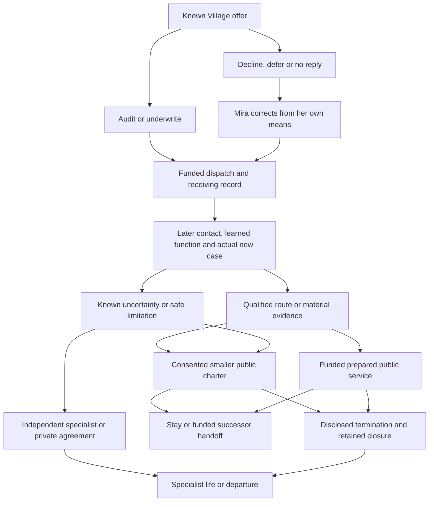
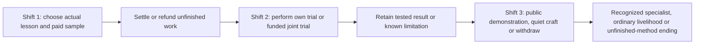

# Frontier timeline, cumulative choices and endings

Planning revision 1, 2026-10-05, under the [timeline/ending dispatch](../../gm/dispatch/TIMELINES_ENDINGS_AND_VISION_DEPTH_2026_10_05.md). This extends the same finite [completion contract](WORLD_COMPLETION.md), without resuming code. Endings below are original proposals; none is claimed implemented. Existing opening, clocks, access, stock and one optional prestige keep their owners.

## Recommended timeline

Use an **open persistent chronicle with causal milestone phases**. The current saved adventure continues; local arcs have explicit states, actual response windows and paid work. Early/established/mature means demonstrated competence and consequences, not a silently advanced age. Native quests stay available according to their own actual history. Finishing a campaign arc does not erase the world, refill shops or advance everyone by ten years.

| Style | Frontier fit and cost | Decision |
|---|---|---|
| Linear chapters | Easy summary, but unconditional chapter skips could erase unpaid work, private relationships and native clocks | Use chapter-like recap labels after actual settlements, not time-skipping state replacement |
| Persistent chronicle + milestones | Accommodates overlapping careers, paid residents, discovery and useful revisits; needs exact work/offer/closure records | Selected first-pass proposal for the represented pack |
| Calendar/deadline/season opportunities | Useful for native hours/seasonal jobs and disclosed offers; too many mandatory windows turn preparation into chores | Optional local pressure, never the only basic learning route; actual supported played clock only |
| Life-stage/career history | Useful maturity/teaching recognition; physiological aging and household years are separate policies | Competence/career stages only; no new aging or real-time childhood wait |
| Loop/regression/earlier branch | Could support other original/reference scenarios but needs reset/retention/stock lineage and independent identity contracts | Outside this pack; field renewal is not temporal rewind |

Keep five time views separate: native saved calendar; common supported played-time job/offer clock; actual occurrence time; player discovery/reveal time; and each resident's knowledge timestamp. No additional subjective/outside clock is needed for this present Frontier body. A late report names when something happened and when the player heard it. Knowing an old route does not make it current intelligence. Supported native travel advances its actual time; closed-browser activity and new unsupported off-screen decisions remain frozen. Existing common-clock rules are not replaced just because this plan calls an outing an expedition.

## Cumulative ending state without a morality bar

An ending is a projection of specific settled evidence, methods, agreements and actions, not a last-menu choice or universal karma total. Candidate inputs use current facts/claims/knowledge/stock/progression/relationship owners after actual adapters are frozen:

- **Order history:** audit/underwritten/declined/deferred/unanswered, actual received quantity and each person's paid means. Donation is not automatically superior to correcting a contract.
- **Evidence and competence:** firsthand versus offered report; contradicted or withdrawn recommendation; real fit-stock/control/route feat; learner's actual source/body/tools. Existing mastery can be a prerequisite but cannot fake a new feat.
- **Commitments:** signed or unsigned public agreement, exact permission to split/reassign a lot, a completed or terminated obligation and its disclosed terms.
- **Capacity and continuity:** available customer funds/stock/site/person, a willing funded successor's taught operation, current supported clock and a retained terminal closure.

There is no fake `publicGood >= 10` test or requirement to read private NPC beliefs. Rendering shows only the player's actual records and known commitment terms. Private decisions can change an offered agreement; the player hears the explanation only through contact/report. Reconverging at the same counter retains earlier material contributions, smaller shipment, disagreement and costs.

## Worked graph A: order history becomes a local outcome

This uses existing Short Measure as the first checkpoint, not a reimplementation of its scene. The graph adds later planned cases. Labels are authored node IDs; concrete conditions are in the table.

| Node/edge | Actual prerequisites, information, means and time | Choice/independent action and aftermath |
|---|---|---|
| A → B/C | Elder met, actual Town access, known local offer. Initial discrepancy/purse/stock stay the held draft's declared facts; no invented starting reward | Reply at Village within its disclosed 12 played-minute window. Audit reserves one stamina/four minutes and employer two coins; underwrite one player log/two stamina/two minutes and employer four coins. Decline/defer costs nothing. Accepted job cancellation follows its refund policy. |
| C → E → D | No accepted player order. Mira uses one own coin/stamina for two-minute correction, then her paid actual geographic legs; Wen pays his receiving work | Silence is not consent; explicit refusal and no answer retain distinct records. Two-log fallback leaves reserve. Arrival/report is not exposed by private live telemetry. |
| B → D | Actual two- or three-log transfer and one retained Village reserve, conserved fees; native journey scale and stock guards repaired later | Player fee settles once. An already committed job keeps its cost/result policy when the response deadline passes. Native travel to Town is 520 base minutes before modifiers; no two-coin task requires doing that solely for its wage. |
| D → F | Actual receiving contact or a later offered local report; compatible source/lesson/power and tool/body/attention requirements | Wen's receiving result differs with order history. Player may learn/train or continue native life. For progressed saves, a new accepted comparison/trial exists rather than replaying crossing/ledger rewards. |
| F → G/H | Paid or ordinary case at reached road/cave margin, actual samples/evidence/participant resources. Proposed comparison five minutes/two stamina; stronger functions keep declared cost/output limits | Safe-parent investigation, post-acceptance native encounter, compatible frame control or fit-stock trial produce different usable evidence. Safe abort/failed trial can preserve a bounded limitation. Refusing dangerous work does not pretend it was completed. |
| G/H → I/J/K | Known finite charter quote and actual willing stock/slot owners. Small public service needs known adequate evidence and split permission; resilient service additionally needs tested preparation, funded substitute/worker and an actual completed supported workday | Later signing chooses among options currently possible, not imaginary endings. A buyer may legally obtain a slot with its finite purse while player is occupied; do not manufacture omniscient pursuit or universal price failure. Uncertainty permits a smaller/specialist service, not a forged safety certificate. |
| I/J → L/M | Signed terms, exact outstanding duties, remaining budget and willing learner or disclosed termination | Teach/fund one operation before handoff. New successor acts from its own means; player leaves no copied skill set. Termination can forfeit a stated deposit/unfinished contribution and close that charter, without deleting native home, skills or other stock. |
| K/M → N | Resolved or consciously declined local offer; no invisible accepted debt. Own mastered function and actual native access remain | Specialist/private/native livelihood or voluntary departure is meaningful. Revisit reads the retained closed/private arrangement; a new agreement needs new permission/funds, not missed backpay. |

First-pass optional charter pressure: one **disclosed 1,440-game-minute** response period after actual local notice, chosen to allow a baseline 1,040-minute corridor round trip plus preparation. This is a reversible balance proposal, not an implemented deadline or guarantee for every busy schedule. A costly commitment can still make the window missable. Basic practice/native livelihood and a smaller later service remain viable; unsupported browser absence consumes none of this window. No guaranteed rescue or hidden refund is implied.

## Required ending cases

These seven cases are required alternate content under OF.ARC04/05, OF.MECH.CONSEQUENCE/HANDOFF and AC07–AC10. They are composable local/career/exit projections, not seven mutually exclusive final-save resets. A player can be a specialist inside a public-service ending or return after a funded succession.

| Case | Cumulative cause and resolution | Changed world and useful post-arc life | Closure/revisit |
|---|---|---|---|
| OF.END.01 Small public counter | Actual revised/qualified order, adequate limited evidence and consenting split owners; do not require a donation or full charter | Lower throughput, conserved reserve and funded small jobs. Inquiry/ordinary native work remains useful | Larger promise is not falsely fulfilled; revisit remembers the smaller agreement |
| OF.END.02 Resilient public service | Tested preparation plus real substitute resources/paid worker or supported control workday; owners sign feasible public terms | One functional process/site/known route and a funded next need; no infinite wages or hostile native-market takeover | Stronger function can remove a real bottleneck; future capacity still depends on actual means |
| OF.END.03 Independent specialist | Real mature inquiry/craft/control/mastery feat, useful output/report and consciously declined or separately resolved institution role | Personal practice, tested procedure and elective paying customers; not compulsory management | Native gathering/trade/rest and new funded specialist work continue; personal method survives service closure |
| OF.END.04 Lawful private agreement | Producer/receiver chooses an actual paid exclusive agreement, or player negotiates that route with evidence/consent rather than preventing it | Public capacity narrows/closes, but a legitimate private career/service continues. Relationships retain specific agreements | No universal villain penalty or duel erases the contract; later reopening needs parties' new consent |
| OF.END.05 Failed/withdrawn charter | Actual funded attempt fails or a signed obligation is terminated under disclosed terms; retain paid costs and witnessed result | Counter closes for this charter, trained methods/observations/home/native livelihoods survive; narrow repair/retry may exist | Terminal record cannot be reset by field renewal. A future project is a new funded cause, not undoing failure or awarding missed wages |
| OF.END.06 Willing succession | Learner owns one taught ordinary operation and actual tools/body/fuel, consents, receives finite funds/stock and completes a supported independent contribution | Resident has a genuine capability, player can explore or retire from management; limited continuing service and remembered lineage | Report only known results. Funds/access loss can pause the next task without erasing teaching; handoff is not NPC/player cloning |
| OF.END.07 Departure with retained home | Local duties are settled/declined/terminated; chosen actual exit/native journey costs and terms are known | The campaign remains with its agreements/stock/methods. Player can keep home, visit another supported place or simply stop managing | On return, actual known changes and last reports are distinguished. No new off-screen aging/loss/death or extraction timer is inferred |

Arc resolution (an order/case settled), career maturity (a useful feat), institution outcome (service/private/closed), departure (location/role change), retirement (no more accepted management), and succession (another capable consenting actor) are separate facts. Bodily death, end of a life and world destruction remain outside this finite pack. Ordinary fainting is not reclassified; severe fictional risk does not authorize a new lethal save policy.

## Worked graph B: original chaptered training-week comparator

Optional **original Training Week** illustrates a different style for a future scenario. It is not another selected world, implemented chapter API, Frontier start replacement or an adaptation of a book. Three declared work shifts have distinct outputs; a chapter may advance only after actual commitments are settled/cancelled. No automatic years, age or wages.

Shift 1 has one willing instructor, one real sample and a quoted two-stamina/three-minute lesson. Refund of a cancelled lesson leaves no method. Shift 2 permits four-minute own practice or a consenting collaborator's one-coin funded contribution; each yields its actually observed narrow result. Shift 3 can demonstrate an owned compatible method on the retained sample, offer an ordinary craft/service instead, or explicitly close the attempt. Strong earlier results can enable a different demonstration; a paid failure remains a limitation rather than being overwritten by a final boast. The instructor may use its last funded slot on another learner after a disclosed chapter decision, retaining specific memory.

A future chapter-advance planner would need outstanding job/stock/relationship/clock policies and an explicit duration. Its implementation is optional outside the 33 Frontier parent IDs. Merely choosing a chapter label cannot simulate a season or replenish the instructor. This comparator makes clear why milestone recaps fit current persistent Frontier better than compulsory scene advancement.

## Acceptance and plan integration

The [ledger](COMPLETION_LEDGER.json) maps all seven ending cases to their parent requirements and later AC07–AC10. Add native ending/return UI to E06/E07/E08 after the reviewed plan authorizes world work. Show known commitment costs and current feasible options; future private outcomes remain unknown. A recap derives from actual settled records and cannot assign an ending or reward by rendering.

Deliver all declared ending alternatives and substeps in the represented scope; allow an individual player to choose one compatible conclusion. Director review should compare the quiet specialist, failed service and strong-control conclusions with the cooperative path, not only the richest outcome. All graph nodes/edges, numerical windows and endings here are proposed planning. No new temporal/save/runtime mechanism or behavioral test was delivered.
