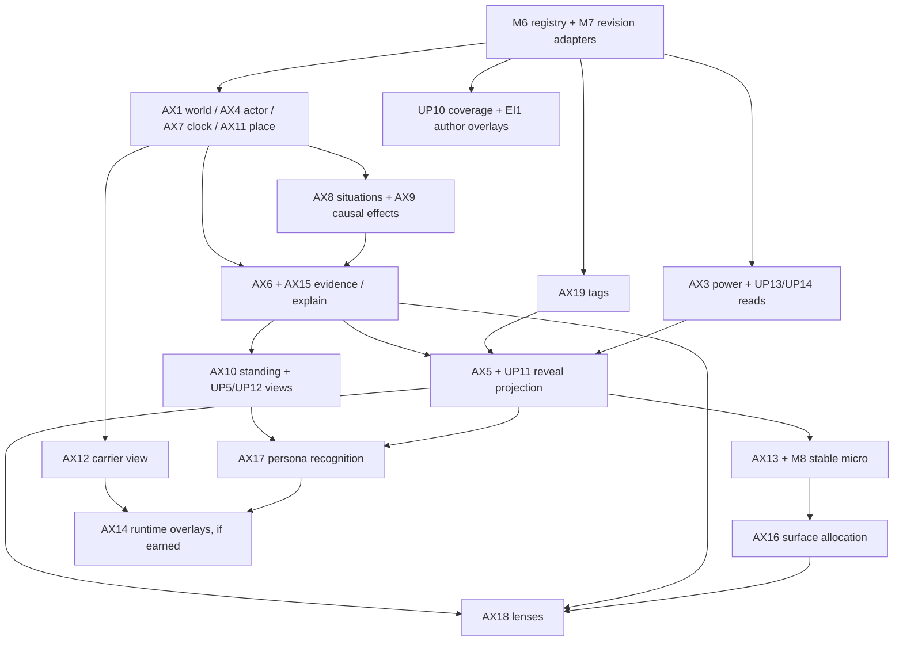

# W18: abstraction map (design proposal, 2026-10-14)

## CHECKPOINT

Complete design pass. Owns this file and [W18 report](../../gm/dispatch/world-core-kit-2026-10-14/W18_REPORT.md) only. Read live source on branch `codex/gameplay-foundations`, HEAD `2874c613`. No source, tests, bundles, saves or private packs changed; no build, test or browser run. Resume by refreshing COMMON, the root AX rows, lane availability and cited source before implementation. Other lanes remain read-only.

Authority: [COMMON](../../gm/dispatch/world-core-kit-2026-10-14/COMMON.md), [root palette](../WORLD_CORE_KIT_2026-10-14.md) round 6, PROJECT.md standing priorities and USER_VISION.md. These are considerations, not accepted interfaces or permission to land them. Canon-first priority, paused A Soldier's Life runtime, and one-realm/one-prestige first milestone remain intact. Comic demands do not raise comic priority. Future surface acceptance targets rebuilt 1366x768 and a wider desktop/laptop viewport; mobile optimization is deferred. No UI behavior is claimed here.

Evidence key: **SHOWN** means inspected local text/code with locator, **STATED** means a source owner's claim, **INFERRED** means a proposed shape or demand. No unchecked canon MEMORY claims, novels, private packs or SECRETS files were opened. World examples below are design floors from local owners, not independently verified franchise rules.

## F1-F5: what the live tree changes about the palette

| Code | Finding (SHOWN) | Consequence (INFERRED) |
|---|---|---|
| F1 | Scorecard U04 says streams are unmerged at its `5c084e50` snapshot. This checkout has `src/seeded_streams.js:23` createStreams, `:47` pure unitDecision, and a native caller at `src/models/location.js:1`. | Do not require a second RNG module. Verify current integration separately; a file/caller does not prove replay or save compatibility. |
| F2 | Root AX9 says 33 operations; `src/simulation_contracts.js:44` confirms 33, including container and foundationInteraction. | Wrap typed effect records, not an assumed fixed count. An operation vocabulary is not yet a causal explanation graph. |
| F3 | `src/simulation_effects.js:132` onward builds actual target facts. Its `:145` comment distinguishes execution truth from observer introduction. `src/people_knowledge.js:28` excludes private axes and state. | Keep execution truth available to authoritative resolution. Build a distinct observer projection for choices, hints and explanations; replacing every truth read with belief would make effects resolve against guesses. |
| F4 | `src/status_window.js:7` is a stat panel, while `src/world_completion_lens_runtime.js:22` records paid command commits and `:64` job completion. `src/world_completion_lens_facts.js:44` binds an actual sample cause. | The paid instrument is a means of obtaining evidence, not merely an AX18 renderer. A shared lens view must not erase its job, custody or costs. |
| F5 | A1/A2/A4 assignment files exist, but their owned `a1/`, `a2/`, `a4/` outputs were absent in the main checkout at inspection. W15 arrived during this pass; W6 and W9 exist. | Coordinate through those owners when outputs arrive. W15 D1-D2 confirms an author-side composite card and read interface, not a seventh saved power store. No claim that A2 tags, A4 relationship reads or W15 proposed reader are available APIs. This lane does not inspect or mutate their worktrees. |

## D1: one read context, several owned stores

Every signature below is **INFERRED**, even when it wraps a SHOWN function. Default: immutable projections over existing stores and registries. Dial: move storage only when a selected consumer requires a durable field, because an observer's view need not rearrange the world's history.

```ts
// Proposal notation, not executable TypeScript or a runtime schema.
type ReadContext = {
  viewerActorId: Id; instanceId: Id; at: {clockId: Id; minute: number};
  purpose: 'self' | 'observer' | 'author'; snapshotRevision: number;
};
type Ref = {owner: Id; id: Id; revision: number};
type Known<T> = {grade: 'hidden'|'rumor'|'silhouette'|'fogged'|'known';
  value?: T; evidenceRefs: Ref[]; confidence?: string};
```

Public calls return opaque display references for unrevealed entities, not secret-bearing author IDs. `purpose:'author'` is an agent/tool permission boundary, not a user-selectable way to bypass discovery. Execution reads remain a separate trusted API. Missing evidence means unknown, not false. Read calls never initialize stores, charge resources, reveal knowledge, sample live state, advance clocks or draw mutable RNG. Admission/charging belongs to quote then commit, followed by another read.

## AX1-AX19: live seams, mapping and minimum proposed read

SHOWN columns name current code support only. Partial means a building block exists, not a playable world floor. Merge/wrap choices and every signature are INFERRED. UP codes are [part 23](../world-depth-2026-10-13/23_DEEPER_SYNTHESIS.md); RF/EI are [part 07](../world-depth-2026-10-13/07_REQUIRED_FEATURES_AND_ENGINE.md); U codes are the [scorecard](../../CORE_FOUNDATIONS_SCORECARD_2026-10-14.md).

| AX / support today | SHOWN code and owner mapping | Duplicate to merge or wrap | Minimal proposed read interface |
|---|---|---|---|
| AX1 WorldDefinition, partial | `src/world_instances.js:54` strict definition validator; `:187` instance facts; `src/world_knowledge.js:3` known identity. U14/U15, UP9, RF4, EI2/EI5. | Registry world identity, retained definition and structured pack metadata behind one adapter; no second world database. | `readWorld(ref, ctx) -> {ref, identity:Known<Label>, rulesProfileRef, clockRef, paletteRef, packRefs, available:boolean}`. Definition pointers can live in author sidecars until consumed. |
| AX2 Law, partial scoped rules | `src/realm_boundary_rules.js:46` rule validator, `:103` boundary evaluation, `:144` view; `src/simulation_contracts.js:28` predicates, `:38` meets. U11, scorecard K2, RF16. | Boundary checks and predicate result formatting share reasons; hard/soft law semantics stay in typed resolvers. Not all world laws are crossing laws. | `readApplicableLaws(worldRef, operation, ctx) -> {lawRef, kind:'hard'|'soft', applicability:Known<boolean>, reasonRefs, importPolicyRef?}[]`. Unknown exception truth omitted. |
| AX3 PowerCore, fragmented | `src/capabilities.js:41` pure contributions; `src/energy_resources.js:57` reserves/strain view; `src/power_models.js:5` model preview; `src/techniques.js:85` facts; `src/simulation_effects.js:115` powers, `:116` faculties, `:124` progression. U07, UP13/UP14, RF17/RF16, II31; W15 owns schema. | Read adapters over skills, sources, techniques, powers, faculties, energies/progression. Do not collapse different metaphysics or double-count one source represented twice. | `readPowerCores(actorId, ctx) -> {coreRef, resourceViews:Known<Resource>[], growthRoutes:Known<Route>[], rank:Known<Label>, sourceRefs, techniqueRefs, limits:Known<Limit>[]}[]`. Array per actor and world; rank is not universal level. |
| AX4 Actor, partial | `src/simulation_effects.js:59` person lookup; `:214` body/controller relocation gate; `src/models/person.js:47` legacy Person. U01/U02/U10, RF5/RF15, UP3/UP4. | Legacy Person/Hero and simulation person through body-owner adapters, under nonhuman-starts owner. Never alias controller, owner and public identity. | `readActor(actorId, ctx) -> {actorRef, life:Known<State>, bodyRefs:Known<Ref>[], controller:Known<Ref>, location:Known<Ref>, meansRefs:Known<Ref>[]}`. Self/execution body reads may be exact; other-actor reads need evidence. |
| AX5 PerceptionProfile, missing general profile | `src/people_knowledge.js:12` known projection and `:29` privacy fence; `src/observation_channels.js:313` recipient replay; `src/body_progression.js:65` narrow body facts. U02/U06, UP3/UP11, RF14/RF19. | Wrap sight checks and channel admission in a body-aware evidence resolver; retain individual observation-channel activation policies. | `readPerception(actorId, ctx) -> {channels:{id, supported:boolean, rangePolicyRef, filterRefs}[], knowledgeRef, modifierRefs}`; `readEvidenceAccess(evidenceRef, profile, ctx) -> {grade, reasonRefs}`. No live sampling. |
| AX6 Observation, partial split evidence | `src/simulation_effects.js:282` knowledge record; `src/causal_situations.js:52` four basis kinds; `src/observation_channels.js:126` receipts and `:313` replay. U06, UP1/UP3, RF11/RF14, EI9. | One evidence view over knowledge bases and channel receipts; witnesses and recipients stay distinct. Do not convert transmitted claims into direct sightings. | `readObservations(subjectRef, ctx) -> {ref, subject:Known<Ref>, observerRef, observedAt, receivedAt?, basis:{kind, attributedTo?, situationRef?}, claim:Known<Value>, scopeRef, causeRef?}[]`. Unavailable time/scope stays absent rather than invented. |
| AX7 Clock, partial | `src/world_instances.js:310` freeze clock planning; `src/world_rhythm.js:5` calendarMinutes and `:20` recurringWindow; `src/realm_clock_leases.js:179` supported activity-clock plan, `:214` activation. U05, UP6, RF6/RF7/RF15, EI10. | Home calendar, instance played minutes and supported clock leases read through adapters. Do not replace finite funded time with general catch-up. | `readClock(clockRef, ctx) -> {elapsed, localDate?, absencePolicyRef, nextBoundary?, activeSupportRefs}`. Every time field carries clock identity; no speculative date conversion. |
| AX8 Situation, partial | `src/causal_situations.js:4` phases/context, `:16` effects, `:25` receipts; `src/simulation.js:85` waiting choice, `:416` inspected events. U05/U11, UP7, EI10. | Caused-event and phase-situation read models joined through refs, not merged into one mutable state machine. Signals are evidence about a situation, not duplicate situations. | `readSituations(scopeRef, ctx) -> {ref, phase:Known<Id>, responseWindow:Known<Window>, pressure:Known<Value>, choices:Known<Ref>[], outcomeRefs:Known<Ref>[]}[]`. Never return privateTruth. |
| AX9 CausedEffect, partial mutation vocabulary | `src/simulation_effects.js:174` effect application, `:309` condition cause/expiry, `:375` caused-event schedule; `src/simulation_contracts.js:44` 33 operations. U11, UP2/UP7, RF17. | Typed effects across action/job/event publishers get one causal projection. Numerical mutation and remembered evidence are separate records. | `readEffects(causeRef, ctx) -> {ref, operation, target:Known<Ref>, change:Known<Value>, effectiveAt, expiresAt?, parentCauseRefs, evidenceRefs}[]`. Fade of evidence is not expiry of the actual injury. |
| AX10 Standing, partial directed memory | `src/simulation_effects.js:285` regard and `:287` deduped cause; `src/chronicle.js:62` relationshipChange, `:129` facts; `src/reputation_state.js:6` saved region validation. U08, UP2/UP4, RF12; A4 owns read/standing design. | Two directed relationship stores and regional reputation wrapped first. Institution membership, personal trust and public renown remain named facets; do not sum them blindly. | `readStanding(subjectRef, holderRef, ctx) -> {direction, axes:Known<Axis>[], ties:Known<Tie>[], membership:Known<State>, memoryRefs, regionLegacy?:Known<Value>}`. Persona-aware holder evidence later, never an automatic actor+persona storage rewrite. |
| AX11 Place, partial | `src/models/location.js:109` description, `:115` tags, `:200` routes; `src/world_instances.js:69` sites, `:407` instance view. U09/U12/U15, UP6/UP11, RF2/RF6. | Native location and retained site adapters, sharing scoped place refs and access reasons. Native location IDs need not be renamed in saves. | `readPlace(placeRef, ctx) -> {label:Known<Label>, access:Known<State>, routeRefs:Known<Ref>[], rhythmRef?, state:Known<Value>, microTableRefs}`. Access truth goes to the command resolver separately. |
| AX12 Carrier, partial conserved transport | `src/realm_cargo.js:97` stock snapshot, `:187` passage preview; `src/book_world_paradise_carriers.js:52` preview and `:66` knowledge; `src/feature_expansion_nested_carriers.js:53` parallel adapter; `src/heir_inheritance.js:32` leftovers. U09/U12/U13, UP8/UP14, RF8/RF9/RF16. | Shared manifest vocabulary over cargo, nested/Paradise transit and heirs; letters add information receipts, never duplicate physical stock. | `readCarrierManifest(carrierRef, ctx) -> {from:Known<Ref>, to:Known<Ref>, kept, converted, lost, waiting, costRefs, permissionRefs, deliveryEvidenceRefs}`. Rows contain typed carrier/stock refs and disposition, not copied inventories. |
| AX13 MicroTable + Picker, missing general picker | `src/models/location.js:110` getDescription seam; `src/seeded_streams.js:47` pure unitDecision; W9 ME9/PG1 describe stable micro anchor. U04/U15, UP11, RF2/RF14, II8. | Wrap one look-text surface before adding more per-world string selectors. Flavour candidates with actual clues depend on AX6; cosmetic rows need no saved observation. | `pickMicro(tableRef, ctx, profile, anchor) -> {rowRef, surface, textKey, args, reasonRefs}|null`, where anchor includes instance, pinned content/picker revision, stable root and exposure bucket. Never call ensureStreams from a read. |
| AX14 Overlay, partial copy primitives | `src/structured_pack_definitions.js:32` compilation; `src/content_packs.js:137` pack provenance; `src/world_instances.js:97` continuity/era/parent validation; `src/structured_pack_state.js:29` exact content binding. U03/U14, UP9, RF10, EI1-EI11. | Author patch compiler wraps pack compilation; runtime namespace/atlas adapters only when actually needed. Era, edition and divergence are separate axes. | `readOverlay(ref, ctx) -> {baseRef, pinnedHash, patchRevision, divergence:Known<Ref>, publicLabel:Known<Label>, counterpartRefs:Known<Ref>[], diffRefs:Known<Ref>[]}`. No save rewrite or retcon commit here. |
| AX15 Receipt / Explain, partial many receipt forms | `src/simulation_effects.js:287` cause memory; `src/causal_situations.js:26` phase receipts; `src/observation_channels.js:313` replay; `src/capabilities.js:59` contribution receiptId; `src/structured_pack_runtime.js:43` selection receipt. U06/U11/U14, UP2, RF11/RF12. | Merge AX6/AX15 as one evidence service with distinct observation and explain projections. Keep proof artifacts separate from in-world evidence. | `explain(viewRef, ctx) -> {statement:Known<Text>, because:{evidenceRef, relation, basis}[], gaps:Known<Text>[]}`. Unknown cause nodes end the chain; do not reconstruct authoritative causes from decorative prose. |
| AX16 AttentionBudget, missing shared allocator | `src/adventure_notebook.js:22` current attention priority chain; `src/event_feed.js:5` feed projection; `src/status_window.js:41` independent render timer. U15, UP11, RF13/RF14, II18. | One surface allocation view replaces independent ambient priority picks. A real response window remains visible even if ambient output is silent. | `allocateSurface(candidates, {viewport, surfaceSlots, urgentRefs, exposureBucket}) -> {shown:Ref[], deferred:Ref[], reasonRefs}`. Feed known candidates only; presentation slots differ from a lens's fictional fatigue budget. |
| AX17 Persona, missing identity model | `src/simulation_effects.js:285` actor-keyed relationships; `src/people_knowledge.js:12` introduced people; `src/simulation_effects.js:214` distinct controller gate. U01/U06/U08, UP3/UP4, RF12, CW5/CWS4/II28. | Add recognition projection over actor refs, then scoped public-standing adapter. Disguise is a face, possession is control transfer, nonhuman form is body state. They can affect recognition without becoming the same object. | `readPresentedIdentity(actorRef, observerRef, ctx) -> {personaRef:Known<Ref>, publicTraits:Known<Trait>[], recognizedActor:Known<Ref>, linkEvidenceRefs}`. Author-only actor lookup stays separate. |
| AX18 Lens, partial status read | `src/status_window.js:7` panel and `:23` snapshot render; `src/cheat_cards.js:85` awakened card; `src/world_completion_lens_host.js:39` instrument presentation. U06/U07/U15, UP11/UP13, RF11/RF13, CL1-CL15/CLR1-CLR6. | Wrap the status window as first self lens. Instrument evidence acquisition stays with commands. One filter/strength/framing renderer consumes AX6/AX15 projections. | `readLens(lensRef, ctx, admittedReceiptRef) -> {rows:Known<Value>[], explanationRefs, framingRef, unavailableReason?:Known<Text>}`. A separate `quoteLensUse` proposes costs; the read never pays them. |
| AX19 Tag store, no shared store here | `src/items.js:203` item tag copy and `:205` item tag; `src/models/location.js:115` place tags. Scorecard K1, U02/U06/U07, RF16; A2 assignment names implication/visibility API. | Wrap item/place dictionaries as inputs to A2, preserving exact legacy readers until their first consumer moves. Derived implications need visibility rules. | `readTags(entityRef, ctx) -> {tagRefs:Known<Ref>[], registryRevision, unknownRefs:Ref[]}`; `queryVisibleTags(entityRef, {all,any,not}, ctx) -> 'yes'|'no'|'unknown'`. Negative queries must not expose hidden positive tags. |

## D2: AXR1, earned by two concrete floors

The root declares all five new rows passed. W18 narrows that claim: two local design floors justify a proposal, not a landed implementation. A consumer must show that both floors need the shared behavior, and that a smaller existing adapter cannot do it. These are **INFERRED demands**, grounded in named local floor owners.

| New abstraction | Floor A | Floor B | AXR1 verdict and smallest shared consumer |
|---|---|---|---|
| AX5 | HP W9 HP first day, HP14 and W7 HP-KM rows: known ordinary nursery details without school-only cues or private intent. | JJK W9 JK first day and W2 JJ: curtain/support role must distinguish ordinary observation from a supported curse-sensing channel. | Design pass: same observer/channel/body filter needed. Land on these two candidate projections, with actual supported senses; no universal acuity number. |
| AX13 | HP W9 HP14: one yard-door weather/look line locally eligible and subordinate to actionable news. | MoL W9 ML first day: Cyoria look detail at the actual place/era and local exposure bucket. | Design pass: stable row selection and eligibility shared. W9's old mutable-root gap now has a live pure stream seam, but no micro consumer/anchor compatibility proof. |
| AX16 | HP W9 HP14: a rain detail shares space with news and duties. | MoL W9 ML first day: ward pressure, work and ambient detail compete for first-day attention. | Conditional design pass: shared surface arbitration is justified by those simultaneous candidates. If only one look line is implemented, reuse a local limit until the second surface/world exists. |
| AX17 | LOTM W6-LM cover-job floor and part 09 QLM: present cover identity and institutional evidence separately when the selected slice includes concealment. | Naruto W2 NR plus W7 NA: a selected disguise/mission floor needs observed identity without moving body ownership. | Conditional, not unconditional floor requirement. Both slices could start without disguise. CW5 offers strong comic demand but comics are deferred. Do not require Persona to ship the initial HP or MoL floor. Select two identity-sensitive slices before landing durable persona state. |
| AX18 | HP root CL1 report-card framing + CL11 appraisal, with K11 actor-known supplies in W9 HP. | D&D root CL11 Identify framing + K11 local appraisal, W6-DD repair/learning slice. | Design pass for a shared known-fact/appraisal view when those routes are selected. A reveal cheat is optional; basic K11 alone does not require a paid cheat runtime. Status-window wrapper can land cheaply without making every world acquire a cheat. |
| AX19 (new, A2-owned) | D&D W6-DD item/craft floor: tool/material properties used by repair and inspection. | FMA W2 FM material-transformation floor: applicable material properties and conserved inputs. | Design pass for typed visible tags and implication; no claim that registry integration is built. Do not make every craft recipe wait for tags if explicit predicates already suffice. |

## D3: merges and abstractions the list misses

Default: these are refinements to existing UP/U/RF owners, not nineteen more frameworks. Dial: a new module only when two selected consumers need the same semantics, because shared names alone do not earn shared behavior.

| Code | Merge or omission | Concrete demand, existing seam, proposed read | Boundary / AXR1 disposition |
|---|---|---|---|
| M1 | AX6 + AX15 evidence service | MoL attributed meeting and Paradise attributed report already join through `src/people_knowledge.js:101` and `:97`; channel replay at `src/observation_channels.js:313`. Separate `readObservations` from `explain`, sharing refs and visibility. | One service, not one record kind. Observations describe claims; explanations traverse reasons. Receipt IDs need owner/revision namespaces. |
| M2 | AX5 + UP11 reveal policy + AX19 visibility | HP known supplies and JJK sensed hazards need one projection fence. `src/skill_discovery.js:54` already grades feature projections. Proposed `projectKnown(valueRef, evidenceRefs, ctx) -> Known<Value>`. | Keep PerceptionProfile configuration and reveal output together without creating a second knowledge store. Missing tags and hidden tags differ. |
| M3 | UP5 obligation view omitted | HP guardian duty (part 07 BO4) and D&D shrine work (BO3); `src/people_knowledge.js:16` elder duty and `src/heir_inheritance.js:32` actual leftovers. `readObligations(actorRef, ctx) -> {ref, creditor:Known<Ref>, terms:Known<Terms>, deadline?, status:Known<State>, scopeRef}[]`. | Two-world design pass. Wrap actual duty/favor/claim stores; no universal contract enforcement engine or inheritance-by-string. |
| M4 | UP12 group/membership ledger omitted | HP house/school K7 and Bleach squad K7 floors in part 07 RF12. `src/village_career.js:140` recruit assignment, `:161` mentoring. `readGroup(groupRef, ctx) -> {members:Known<Ref>[], offices:Known<Office>[], obligationRefs, stockRefs, standingRefs}`. | Two-world design pass. AX10 covers regard, not roster/stock authority. Default derive weekly beat from evidence; persist actual membership only through its owner. |
| M5 | UP13 practice + UP14 provenance buried in AX3 | MoL learning/ward practice and Naruto selected practice/clone-return in W6-MO/W6-NA; `src/village_career.js:118` practice and `src/capabilities.js:4` kinds/`:5` origins. `readPractice(actor, route, ctx)` and `readSourceProvenance(sourceRef, ctx)`. | Child reads of AX3, not separate new stores. A counter's minute/attempt/success units and eligibility must remain explicit. Knowledge of a technique never implies possession or execution. |
| M6 | World registry/adapter contract missing | MoL and Paradise imports in `src/people_knowledge.js:2`/`:5`, plus target movement gates `src/simulation_effects.js:216`/`:217`. A1 M3 owns registration; propose `readWorldAdapter(worldRef) -> {factsReader, projectionReaders, gateRefs, boundaryReader, schemaRef}`. | Two existing world consumers earn decoupling now. Registration at composition root, not a core import of every plugin; A1 retains implementation order. |
| M7 | Revision/availability/migration view missing | MoL retained footprint vs Paradise two footprints, W6-MO/W6-RP; `src/structured_pack_state.js:29` binding and `src/content_packs.js:152` parking. `readCompatibility(ref) -> {contentHash, versions, status:'present'|'dormant'|'needsMigration', decisionRef}`. | AX1/AX14/U14 child contract, A1 M4 owner. Pack absence is not fictional death or erased knowledge. Pure migration reads do not perform migrations. |
| M8 | Deterministic text/exposure anchor missing | HP and MoL micro floors above; `src/seeded_streams.js:23` saved root, `:47` pure unitDecision, `:56` streamSeed invokes ensureStreams. `readMicroAnchor(instanceRef) -> {root, contentRevision, pickerRevision, bucketPolicyRef}|null`. | AX13 child contract. Prefer existing pinned root with text namespace; migration initialization happens on load/commit, never rendering. A stable numeric seed alone does not pin revised tables. |
| M9 | UP10 coverage/proof view omitted | HP and D&D K18 W6-HP/W6-DD need implemented/tested/native/human distinctions. `src/structured_pack_definitions.js:100` checks consumers, not proof. `readFacetCoverage(manifestRef, proofIndex) -> {facetRef, tier, implementationRefs, testRefs, journeyRefs, humanStatus, staleReasons}[]`. | Author-only computed read, two-world design pass; no saved runtime “complete world” flag. Keep acceptance evidence separate from in-world receipts. |
| M10 | UP15 profile layer omitted | HP earned starts and D&D later-life starts in part 23 UP15/part 07 RF5. | Floor need not proven for the first slice; defer new profile storage and power-grant union semantics. Browser layout preference is not a durable gameplay profile. |
| M11 | CL13 retcon is a command, CL14/CL15 are presentation/tooling | `src/expansion_engine.js:671` rewind preview and `:678` rewind; `src/panel_kit.js:7` presentation binding. | AX18 reads the retcon quote/history only. Retcon commits belong to AX14/U11/U14; jokes use voice configuration and sandbox coverage uses M9. CLR1 cannot make an undo operation read-only. |
| M12 | Defeat/continuation policy missing from AX1 | D&D K10 nonlethal recovery and Paradise K16 extraction/settlement in W6-DD/W6-RP; `src/simulation.js:390` withdrawal, `src/heir_inheritance.js:32` leftovers. `readContinuationPolicy(worldRef, ctx) -> {defeatRouteRefs, deathPermanence, repairPolicyRef, carrierPolicyRefs}`. | AX1/U13 child read, two-world design pass for policy vocabulary. II33 must be read by actual defeat flow before calling the dial implemented. Never reset a world by interpreting a caption. |

AX8 + AX9 can share causal refs but should not merge state: a situation has phases, while an effect can expire without advancing any phase. AX1 + AX14 share revision pins but differ between a world and a patch. AX17 remains separate from AX4 body/control; possession, disguise, and mantle succession may join them through explicit evidence, not identity aliasing. AX16 is surface allocation, not the fictional attention cost in CLR4.

## D4: dependency graph and staged order

Arrows mean “reader needs this contract,” not imports or forced storage merges. This refines II35: contracts can be designed together; visibility context and adapter dispatch must exist before downstream reads. Core sources do not import world implementations (AXR4). OV1's one-layer-below rule is a useful ownership guide, but the surface needs stable projections across several lower layers, as root CL1/CL11 already show.



The graph uses current state only: AX8/AX9 reads facts and produces projections; evidence adapters read committed records. It does not require a cycle where rendering creates evidence. Persona is not a prerequisite for every copy; the edge applies only to identity-sensitive copies. Author-time EI1 overlays can proceed before Persona and runtime plurality.

| Step | Order and first bounded consumer | Retire/wrap at this step; keep retirement measurable |
|---|---|---|
| O1 | A1/A2/W15 D1-D2 coordination: registry/revision read contract, AX19 tag view and AX3 multi-core read. First target self-power status; keep nonhuman storage with its owner. | Move one capability read from raw energy/faculty/source access to AX3; move one item tag query to A2 wrapper; move one world projection import from core to composition root. No removal of legacy saves. |
| O2 | AX6/AX15 evidence + AX5 reveal fence using MoL and Paradise received knowledge; AX8/AX9 existing receipts behind views. | Wrap duplicated basis-to-person-memory formatting in `people_knowledge.js`; retire one direct hidden-state surface read. Keep execution predicates exact. |
| O3 | AX7/AX11 adapters and AX12 manifest reads; A4 AX10 plus derived UP5/UP12 views. First consumer one obligation/standing card. | Replace one local calendar formatting path, one per-host manifest formatter and one two-store relationship read. No new absence policy. |
| O4 | AX13 deterministic look-text for two selected world slices, then AX16 as another surface joins. | Replace one hand-coded ambient selector per adopted world; redirect one notebook attention branch to known candidate allocation. Keep mandatory event controls independently accessible. |
| O5 | AX18 status wrapper, then selected appraisal projection; AX17 only for two identity-sensitive floors; EI1 author overlays first, AX14 runtime only for a selected copy need. | Remove one hardcoded status-row read behind AX18; wrap one actor-only recognition read behind AX17; replace one copied pack-generation path with pinned overlay compiler. Retcon write path remains explicit. |

Every future landing names its exact reader, old path retired/wrapped, invariant check and remaining native acceptance. Additive wrappers are temporary if callers keep bypassing them. Do not schedule a broad store merge just to satisfy AXR3.

## D5: save impact per abstraction

“None” means the proposed read wrapper itself changes no durable state. It does not mean future behavior needs no compatibility review. A global schema bump is not automatically needed; A1 owns migration chain decisions, W6 K18 owns proof joins. Existing strict validators and exact bindings decide whether additive fields are accepted. Older readers must refuse unsupported semantics recoverably, without overwriting the original envelope.

| AX | Initial read landing | If later behavior requires durable state | Retained invariant / retirement target |
|---|---|---|---|
| AX1 | None, registry/sidecar reads. | Persist selected rules/content revision only if not already pinned; do not silently change saved world meaning. | Wrap duplicate identity/palette lookup. |
| AX2 | None for current predicates/rules. | Pin new law profile when rules change pending quotes/jobs. | Retire one repeated boundary-reason formatter; retain resolver semantics. |
| AX3 | None across current stores. | New core/source fields or mechanics need domain migration; preserve old balances, progression units and pending costs. | Retire one raw capability read, not all six stores at once. |
| AX4 | None. | Multiple bodies/controller transfer requires nonhuman owner migration; one-body old saves remain coherent. | Wrap legacy/simulation lookup; do not duplicate inventories. |
| AX5 | None for derived supported channels. | Persist acquired sense only when gameplay actually grants it; no stored profile cache needed. | Replace one surface's direct target-state check. |
| AX6 | None for evidence adapters. | New instance/confidence/receivedAt fields need validator and compatibility decision; old records have unknown scope/time. | Replace one basis display; never invent historical witnesses. |
| AX7 | None for calendar mapping. | New absence enum/activity authority belongs to clock owner, with old freeze default and pending-boundary proof. | Wrap one home/away date path; no closed-browser credit implied. |
| AX8 | None for phase/event view. | New scoped phases/seasons need pinned definition and ordered transition history. | Wrap one event-list projection; do not refire settled events. |
| AX9 | None for current cause/expiry view. | Missing parent-cause links can be added only for future commits; historical explanation stays partial. | Retire one string-based cause reconstruction. |
| AX10 | None over both stores. | Institution membership, decay and persona-addressed standing need A4 migration, without treating existing region totals as witnessed records. | Replace one raw store reader; preserve direction and negative values. |
| AX11 | None for location/site view. | Durable local changes stay with owning world instance/domain; new micro tables are definition data. | Wrap one location description/access view. |
| AX12 | None for manifests. | Information delivery, provenance side tables or inherited duties need precise ledger migration; physical rows never cloned by projection. | Wrap per-host manifest display; keep one custody record. |
| AX13 | None if a usable saved immutable anchor is already pinned. | Otherwise add/load-initialize anchor once with explicit revision policy; optional seen rows only when actual remembered evidence requires them. | Replace per-world picker; unchanged redraw leaves RNG and knowledge untouched. |
| AX14 | None for author-built new pack/ref map. | Runtime multi-instance records require per-owner migration and independent stock, actor, clock and knowledge namespaces. | Retire duplicate pack-copy builder; do not rewrite base pack. |
| AX15 | None for derived explain view. | Additional receipt kinds/links need their owning validator; retain source refs rather than duplicating world truth. | Replace duplicated explanation formatting. |
| AX16 | None for deterministic surface arbitration. | A cross-session “already delivered” cursor needs explicit exposure policy/migration if chosen; no saved per-frame budget. | Wrap independent ambient arbitration; urgency is never dropped. |
| AX17 | None for default single identity projection. | Actual public faces/recognition evidence need default-one-persona migration. Existing standing is unattributed to a face, not automatically copied to every face. | Wrap actor-only public identity lookup; preserve real body/controller. |
| AX18 | None for admitted read projection/framing. | Persist earned lens source/practice and actual use costs through existing source/command owners, with explicit new-policy review. | Wrap status hardcoding; do not turn instrument measurement into free reveal. |
| AX19 | None for legacy tag adapter. | Saved assigned tags need A2 registry revision/unknown-tag handling; implication changes can alter old eligibility and need compatibility decision. | Replace one dictionary query; retain unknown future tags without using them. |

Future save-changing acceptance must include old supported save, pending and settled state, save/reload, export/literal-file import, unavailable/revised pack refusal or parking, and independent copy/custody checks as applicable. This is a proposed gate list, not work performed. Native rebuilt desktop journeys and human acceptance remain separate from unit/source proof.

## D6: priority-world abstraction floors and local angles

This matrix covers the shared contracts in this lane, not all K floors. SHOWN runtime support is partial where a local source seam exists; missing means no selected unified reader proved here. No world is marked floor met from documentation alone. [W6 per-world K17/K18 rows](W6_ENGINE_TEMPLATE.md), [W15 worked cards and consumer gaps](W15_POWER_CORE_SCHEMA.md) and W2/W9 own the detailed proposals. Every next-floor and local angle below is INFERRED.

| World / code | Floor today and pointer | Smallest proposed shared floor | World-specific more to consider |
|---|---|---|---|
| HP | Partial design, missing unified runtime reader: W15.W1/EX0, W9 HP. | AX3 source/technique read, AX6 known supplies/teacher evidence, AX10 guardian/school authority. | Borrowed wand custody and cooperation differ; adult nursery and school micro tables need separate access scopes. No invented mana meter. |
| DD D&D | Partial design, missing unified runtime reader: W15.W2/C2, W6-DD. | AX3 reads known/prepared spells and typed available slots independently; AX11 qualified repair target; AX12 material custody. | W15's illustrative SRD 5.1 profile differs from the existing 5.2.1 candidate. Preserve both as profile-qualified design, not a silent edition change. |
| TT TTKS | Partial design across five book worlds, missing one shared reader: W2 TT1-TT5, W15 C10-C14. | AX3 each selected source/core, AX12 actual carriers, AX6 inspection evidence with book-specific profile. | Do not unify mimic vessel, annual trait, challenge archive, machine authorization and border-detection progression into one TTKS meter. |
| MO MoL | Partial runtime source: `src/book_world_mol_state.js:27`, W15 C9, W9 ML; no W18 play. | AX3 retained visitor's device means, AX7 local clock, AX8 ward situation, AX6/AX15 received evidence. | Reading a method does not grant personal magic; a copy/reset changes carrier policy without treating save reload as a loop. |
| LM LOTM | Partial design, missing shared runtime reader: W15.W3/C3, W6-LM. | AX3 qualified role-act/advancement view; AX5 appraisal; UP5 obligations and AX10 institutional recognition. | Keep role evidence, digestion and natural progression separate. Cover persona remains optional until the chosen floor needs concealment. |
| CI CoI | Partial design, missing shared runtime reader: W15 C4, W6-CI. | AX3 borrowed source/eligibility plus UP5 continuing obligation, AX7/AX14 separate era/reset metadata. | Source revocation can stop use without erasing learned knowledge or unrelated acquired powers. Do not generalize earlier LOTM thresholds across eras. |
| SS Shadow Slave | Partial design, missing shared runtime reader: W15 C5, W9 SS. | AX4 body/controller ref, AX3 sourced stage/Flaw view, AX12 actual item retention. | Award, deliberate essence access and external services need independent source-qualified stage gates; guarded sleep needs real support. |
| RP Paradise | Partial runtime source: `src/book_world_paradise_state.js:34`, W15 C15, W6-RP; no W18 play. | AX12 hub/destination manifests, AX8 mission/settlement read, AX6 attributed reports. | Extraction, arrival, repair and reward claim are separate commitments. Existing original credits do not become canonical currency by relabeling. |
| JJ JJK | Partial design, missing unified runtime reader: W15 C6, W9 JK. | AX3 engraved-source/ceremony view; AX5 supported perception; AX8 curtain pressure. | Technique burnout and observer detection differ. A mutual-vow penalty with uncertain source support stays unknown, not a generic contract debit. |
| BL Bleach | Partial design, missing unified runtime reader: W15 C7, W6-BL. | AX4 spirit/body binding, AX3 release availability, AX10 squad standing. | Blade cooperation and known name join knowledge/regard without revealing either to every observer. |
| FA Fate | Partial design, missing unified runtime reader: W15 C16, W6-FA. | AX3 typed charge/source read and UP5 contract authority, AX12 actual carrier accounting. | Vessel, supplier, command authority and consenting actor are separate refs; charge order needs a named resolver. |
| HX Hunter x Hunter | Partial design, missing unified runtime reader: W15 C17, W6-HX. | AX3 continuing eligibility/owned method, UP5 vow view, AX10 known credential. | License, competence and mastery differ; reader knowledge of a restriction cannot create its executable meaning. |
| FM FMA | Partial design, missing unified runtime reader: W15 C18, W6-FM. | AX19 visible material properties, AX3 supported transformation route, AX12 conserved input/output refs. | Actual mass/material identity and the source paying a substitution survive the generic effect display. |
| NA Naruto | Partial design, missing unified runtime reader: W15 C8, W6-NA. | AX3 paid practice/source eligibility, AX4 body/controller and AX12 memory carrier on selected clone return. | Concurrent work must aggregate actual costs/fatigue into one parent; clone count alone cannot multiply progress. |
| SL A Soldier's Life | Partial documented/private-runtime precedent, not inspected private state: W6-SL, W15 C20. Runtime paused. | Author-side source/core card and opaque compatibility refs only. | Soldier effects, duties and taught methods keep distinct carrier scopes; no new runtime gate assigned here. |
| OF Original Frontier | Partial native/shared source: `src/village_career.js:118`, `src/techniques.js:85`, W15 C19. | Parity adapter for actual technique/practice, obligation and standing reads. | Ordinary wages still work when a repeated task stops challenging a skill; preserve funded queues and comfortable unfed play. |

Fallout, Skyrim and Elden Ring remain deprioritized; existing RF/EI seams apply, with no new abstraction landing assigned here.

## More to consider, other stuff

Subtle abstraction risks and cross-world angles missing from the root palette. All **INFERRED**; extend existing AX/UP owners instead of adding parallel storage.

| Code | Risk / angle | Default + dial + reason |
|---|---|---|
| R1 | Receipt existence leaks a sealed entity even when text is hidden. | Default opaque refs and unknown counts for public output; dial known evidence counts after introduction. Titles, errors, DOM attributes and explanation depth can reveal the same truth as prose. |
| R2 | Explain traversal upgrades a rumor into truth. | Default preserve claim, basis, issuer and confidence on every edge; dial verified cross-check only after its own evidence. Multiple people repeating one carrier are not independent witnesses. |
| R3 | Persona merge creates omniscient standing. | Default observer/group-scoped recognition evidence; dial institution-shared recognition through an actual carrier. One guard noticing the same limp does not tell every faction. Mantle reputation can outlive a person without becoming that person's private trust. |
| R4 | Universal resources erase world laws. | Default separate pool refs, cost dimensions and interaction rules; dial authored conversion. “Energy 10” cannot establish interchangeability of spell slots, reserves, strain or electricity. |
| R5 | Read helper mutates on first paint. | Default load/commit initialization and snapshot-only reads; dial explicit refresh command. `streamSeed` calls ensureStreams, so a pure numerical return is insufficient evidence of a pure read. |
| R6 | Clock timestamps appear comparable but are not. | Default clock-tagged order and explicit boundary conversion; dial policy-authorized mapping. A rumor may be observed before departure and received after arrival under a different calendar. |
| R7 | Bounded memory eviction breaks causal history. | Default absent older evidence yields a gap; dial retained durable anchor for a consequential grant or obligation. Relationship memory capped at 32 is a summary, not an unlimited audit trail. Do not backfill a receipt from current totals. |
| R8 | Filtering after allocation advertises hidden urgency. | Default reveal/admission before AX16 and stable ordering by public refs; dial authored hint if supported. Hidden candidates must not consume a visible slot or change its empty-space pattern. |
| R9 | Table revision changes a remembered past. | Default pinned picker/content revision; dial declared one-time reshuffle of cosmetic rows. Learned clues and actionable records remain durable even if their ambient table disappears. |
| R10 | OV1 layering becomes a data-copy ladder. | Default stable owned projections over lower-layer refs; dial cached views keyed by snapshot/revision with explicit invalidation. Surface reads can span rules/life/story without importing their world modules or making duplicate truths. |
| R11 | Surface silence is mistaken for consequence silence. | Default mandatory response/action controls survive attention allocation; dial ambient density only. Clearer signal output does not delay the actual event or erase abstention. |
| R12 | Compatibility gets confused with fictional continuity. | Default pack unavailable means dormant data, not retconned history; dial reviewed migration. Removing a module must not kill its cast, forgive its debt or grant a fresh origin. |

### Three ranked suggestions

1. **S1:** Define AX6/AX15 with separate trusted execution and observer reads, then wrap MoL and Paradise attributed reports. This earns reuse from actual consumers and gives micro, standing and lenses a safe evidence boundary.
2. **S2:** Reconcile A1/A2/A4/W15 outputs when they arrive; adopt narrow read adapters and name one retired caller per landing. Keep AX3 multi-core, AX10 directed memory and AX19 visible implications distinct where semantics differ.
3. **S3:** Prove one two-world micro/lens read slice using pinned text anchors and existing status/appraisal seams before durable Persona or runtime Overlay. Defer those larger save changes until two selected identity/copy floors require them, preserving canon-first order and native acceptance limits.
