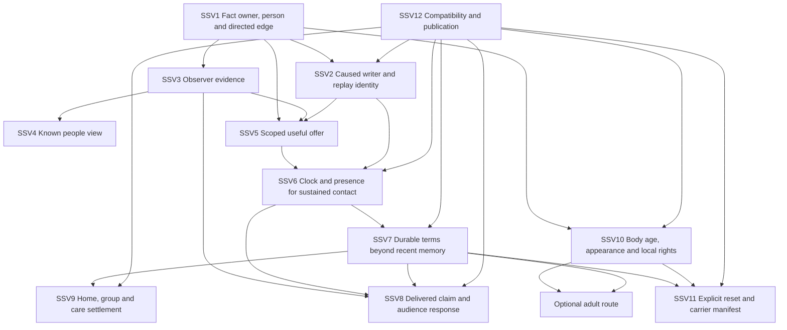

# Social systems spine (proposal, 2026-10-14)

Weibao: "more to consider? other stuff and more? save and extend accordingly Send out codex as usesful?"

**Start with a known person, a remembered act and one useful offer in the home Village.** This is a navigation and dependency proposal, not a replacement specification. Existing ideas stay in their owners. Canonical rows below are proposed entry points, not accepted decisions or instructions to delete other rows. The build order is specified, not run.

Evidence labels: **SHOWN** means inspected current public source; **STATED** means a document says it; **INFERRED** means synthesis or proposal; **UNKNOWN** means this pass has not established it. SHOWN does not mean rebuilt, browser exercised or human accepted. Source lines describe the dirty checkout read on 2026-10-14 and must be refreshed before implementation. No `SECRETS*`, private pack or personal save was opened.

Authority: [USER_VISION](../../USER_VISION.md), [PROJECT](../../../PROJECT.md), then the fitting design owners. STATED accepted direction: desktop/laptop first, information appears through discovery, applicable idle progression can be passive, food gives benefits without hunger death, and local life stages fit world/era/lore. The fixed romance/partner rule in [COMMON](../../gm/dispatch/relationship-prereqs-2026-10-14/runs/COMMON.md) and 29:DV1 requires **both people 18+ by body age and adult in appearance**; claimed, soul or species age cannot substitute. Everything reasonable remains reachable through fitting world/person/means; these tables are palettes, not a universal release checklist. The one-realm/one-prestige milestone and held Soldier's Life work remain as owned in PROJECT.

## 1. One-page map

Read downward for an act, then back upward for its consequences. All map rows are INFERRED. The six layers name responsibilities, not six new stores.

| Code / layer | Job and owning rows | Small Village reading path |
|---|---|---|
| SSP1 Data | **Who, which direction, what happened, who knows.** [29] RQ1-RQ3/RQ9-RQ10/RQ15, RZ1-RZ3, RCL1-RCL2; [20] RM1-RM5/RM9/RM13-RM15; [21] RN1-RN4/RN9; [30] LSP1/LSP4/LSP9; [23] UP1-UP5/UP12. | Person id and world instance → owned bond or elder tie → durable terms and observer evidence. Do not identify two people by a shared name. |
| SSP2 Clock | **When contact, expiry, change and delivery count.** [29] RQ4-RQ5, RI1-RI8, RZ4-RZ5; [20] RM7-RM8; [23] UP6; [30] LSL9-LSL11/LSX6/LSP5/LSP8; [31] IL25. | Existing played-time boundary → eligible local contact → exact consumed time. Another world, pause and browser closed each need a declared policy. |
| SSP3 Writers | **Acts produce caused changes.** [19] DA1-DA25/IC1-IC15; [20] MF1-MF15; [29] RQ7/RQ11, RAU3-RAU5, RHE1-RHE8, BK1-BK18; [31] IL1-IL10/IL13/IL17/IL20-IL24. | Ask, do shared work, repair a harm → staged evidence, regard, obligation or condition. Retried delivery retains its cause; a later genuine act gets a new cause. |
| SSP4 Readers | **Changes matter to the next act.** [29] RQ8/SH1-SH10/RZ6-RZ7/RFM1-RFM8; [20] RD1-RD17; [21] RE1-RE13; [28] DS1-DS6/NS1-NS7/SF2/SF6-SF9; [30] LSP2-LSP3/LSP6. | The NPC's willingness plus actual presence, means and terms → optional lesson, introduction or favor. A regard score grants neither stock nor permission. |
| SSP5 Views | **Show what this character can know and do.** [29] RQ14/RUI1-RUI8/DV24; [19] CF1-CF14; [20] UF1-UF5; [21] RN13; [22] FI23-FI25/LN1-LN10; [28] LS3/SF1; [30] LSD1-LSD8. | Known-person list, selected evidence/history and relevant actions together at 1366x768. Words or numbers format known information; hidden truth needs its own route. |
| SSP6 Content | **Fit the person, world, era and route.** [29] RAU1-RAU8/RPW1-RPW8; [30] LSE1-LSE21/LSW1-LSW26/LSP7; [28] LS1-LS5/PT1-PT6; [23] UP9-UP11; [31] IL11-IL19/IL26-IL30. | Author one original Village neighbor/custom first; later apply fitting profiles to priority canon worlds. Shared plumbing does not make their rules identical. |

**Find the owner:** [19] verbs and talk form; [20] bond forms and payoffs; [21] public audiences; [22] feature placement and comfort controls; [23] shared primitives and larger joins; [28] life-function layers; [29] corrected prerequisites plus CQ/DV/BK addenda; [30] age, stages and local custom; [31] inner life, home and neighborhood. Older S/T/U/V names mean parts 19/20/21/22. Use `part:code`, since X, A, T, RN, RZ and other short prefixes recur.

The [character owner](../../CHARACTERS_AND_WORLD_EVENTS.md#broader-character-interactions-2026-10-02) explains motives and interaction outcomes; the [engine owner](../../ENGINE_EXPANSION.md#encounter-driven-scenes-and-relationship-conditions-2026-10-02) explains commitment, queue and settlement contracts; the [north star](../../LIFE_SIM_NORTH_STAR.md#romance-and-dating-mechanics-proposal-2026-10-08) preserves wider optional life paths. Their proposal sections are not evidence that all their mechanisms run today. [Audit](../../gm/dispatch/relationship-prereqs-2026-10-14/AUDIT.md) corrects older source claims.

## 2. Duplicate and near-duplicate clusters

All SSC rows are INFERRED. Each **canonical proposal** is one navigational anchor. Linked angles keep their distinct questions and examples. This is a semantic cluster inventory, not a claim that the source rows are word-for-word duplicates.

| Code | Linked code group | Canonical proposal and retained angles |
|---|---|---|
| SSC1 | [23] UP4; [20] RM1/RM9; [29] RQ1/RQ3/RAU3 | **29:RQ1**, authority per directed fact. RM1 keeps vocabulary; RM9 keeps asymmetry; UP4 keeps the broader shape. Do not merge stores merely to consolidate prose. |
| SSC2 | [23] UP1/DA2-8/DA2-12; [19] DA1-DA3/IC6; [20] RM3/MF5; [28] SF1; [29] RQ10/RUI2/DV9/DV21/DV24 | **29:RUI2**, evidence versus feeling. UP1 owns belief mechanics; RM3 owns person knowledge; SF1 keeps fallibility; DA3/IC6 keep deception. |
| SSC3 | [23] UP2/DC2-12; [19] IC1/X8; [20] RM2/RM6; [29] RZ1-RZ2/CQ4/RI5/RHE8 | **29:RZ1**, recent memory versus durable truth. RZ2 owns replay identity; RI5 genuine repeats; CQ4 compaction; RM6 response pace. One receipt is not every kind of social memory. |
| SSC4 | [19] DA4/DA22-DA23/IC5/SG2; [20] RM5/RD1/RD17; [23] UP5/DC2-13; [29] RQ9/RAU4/BK1/BK3 | **29:RQ9**, typed terms and closure. DA4/IC5 keep conversation; BK1/BK3 keep source-specific magical enforcement; UP5 keeps cross-life scope. |
| SSC5 | [20] MF1/MF2/MF8/MF14/RD8; [28] SF4; [29] RQ4/RI1-RI3/BK15; [31] IL12-IL13/IL19 | **29:RI1**, elapsed eligible contact. RI2 keeps reliable shared work, SF4 impersonal upkeep, MF8 meals, BK15 traditions, IL13 chores. These need different response dials. |
| SSC6 | [20] RM7-RM8/RD9; [19] CF9/IC14; [23] UP6/TN2/DA2-7; [29] RI4/RI7/RUI6; [30] LSL10/LSX6 | **29:RI4**, clock classification. RM7 owns drift; RUI6 informed recap; LSX6 participant exposure. Mail delivery is not automatic wall-time friendship. |
| SSC7 | [19] DA14/IC7/IC9; [21] RN3-RN5; [29] DV19/BK18; [31] IL20-IL22/IL28 | **21:RN5**, carrier/channel. IC7 keeps retelling error; DV19 false public story; BK18 collective retention; IL20 actual neighborhood paths. |
| SSC8 | [19] X11/CF4/CF7; [20] MF15; [21] RN8/RN12; [23] UP3; [29] RAU2/RHE2 | **23:UP3**, witness set. CF4 is its view; RN12 credit attribution; RAU2 disclosure. An authored audience still needs valid perception and later delivery. |
| SSC9 | [19] DA25; [20] MF9/RD4/RD11; [28] SF6; [29] RQ2/RQ11/RCL2 | **20:MF9**, introduction. SF6 access through a person; RCL2 counterpart identity; RQ11 NPC edges. An introduction discovers someone without merging their id. |
| SSC10 | [20] RM10/RM11; [29] RQ6/RHE4; [31] IL1-IL4/IL7-IL10 | **29:RQ6**, person response profile. RM10 owns temporary mood; IL1 proposed player spirits; IL7 trauma; RHE4 learned grief. Mood, temperament and long-term regard remain different. |
| SSC11 | [20] RM14/RD12; [23] UP12; [28] SF8; [29] RQ12/RFM4; [31] IL11-IL19 | **29:RFM4**, household authority for a home slice. RQ12 general groups; UP12 meso duties; RD12 projects; IL11 residence. Household, party, kinship and business are linked structures rather than synonyms. |
| SSC12 | [20] RD10/RX7-RX8; [23] UP8/AR6-AR7; [29] RQ13/RCL3-RCL5/RFM8; [30] LSX3-LSX4/LSP8; [31] IL28 | **29:RCL3**, carrier manifest. RFM8 succession rights; LSP8 body-age continuity; AR6-AR7 one proposed presentation arc; IL28 community story. Nobody inherits another person's affection automatically. |
| SSC13 | [29] CQ1/CQ17/DV1/RFM6; [30] LSL1-LSL8/LSP1-LSP2/LSP9 | **30:LSP2**, shared two-party content/act gate, retaining **29:DV1** as the fixed rule. LSP1 owns proof, LSP9 unknown legacy data, LSL3 local rights. Body age, appearance and local law cannot collapse into one adult flag. |
| SSC14 | [28] DS3/DS5/RC3; [29] CQ16/CQ19/CQ28/RPW8; [30] LSE1-LSE21/LSX8/LSX12/LSP3/LSP7; [31] IL25/IL27 | **30:LSP7**, scoped dated custom profile. LSE is the palette, LSP3 domain-specific readers, IL25 calendar and IL27 daily class experience. Period labels alone prove no law. |
| SSC15 | [19] CF11; [20] UF1-UF3; [21] RN13; [22] FI24-FI25; [23] AR1-AR2/DC2-27; [29] RUI2-RUI4; [30] LSD2-LSD4 | **29:RUI3**, holder/direction and disclosure. RUI4 desktop layout; FI24 formatting dial; CF11 conversation history. A words-only display can still leak truth. |
| SSC16 | [19] DA9/IC13; [20] RM13/MF11/RD14-RD15; [28] SF5; [29] RHE1-RHE7/BK12; [30] LSE16/LSX10 | **29:RHE5**, repair preserves history. RHE1 influence source; RHE3 estrangement; RHE4 notification/grief; LSE16 property/care aftermath; BK12 refusal. Settlement does not manufacture affection. |
| SSC17 | [22] LN1-LN4/LN6/LN10; [28] PT1/NS line; [29] RUI7; [30] LSD7 | **22:LN1**, comfort outside character power. Other LN rows keep save, pause, readable log and spoilers; NS/LSD7 keep these usable after loss of in-world rights. |
| SSC18 | [19] DA17/IC12; [20] RD2; [28] LF8-LF9; [29] SH1/BK19-BK22; [30] LSE18/LSX7 | **29:SH1**, fitting teacher and term. BK19 keeps lineage provenance; BK20 student agency; BK22 founding; LSX7 actual learning versus credentials. |
| SSC19 | [23] UP11; [22] T1/FR1; [28] LS1-LS5/PT1-PT6; [29] RPW8/RAU1; [30] LSX5 | **28:LS1**, entry to the LS1-LS5 placement stack. T1 handles panel homes; DS handles a life's baseline; RPW8 world fit. Selecting a stack does not require implementing every layer. |
| SSC20 | [20] MF10/MF12; [23] UP7; [29] RQ11/CQ6/RAU5; [31] IL23-IL24 | **29:RQ11**, selected NPC contact/initiative. CQ6 broader lives, UP7 situations, IL23 mutual aid and IL24 shared crises retain their own means and authored outcomes. |

## 3. Contradictions and tensions, both sides

SSX reconciliations are INFERRED proposals and have not been applied to other files. Some rows are stale factual claims, some are scope tensions. Neither is a new accepted product decision.

| Code | Side A | Side B | Proposed reconciliation |
|---|---|---|---|
| SSX1 | STATED [20] X4 says negative writers are attacks only; [19] X14 suggests a broadly missing verb layer. | SHOWN interruption and practical apology already exist (`src/everyday_life.js:25-36`). [29] RQ7 and audit H07 correct the older claim. | Route readers to corrected RQ7. Inventory each proposed verb's missing consumer instead of calling all social verbs absent. Generic lies/gossip remain separate unproved scope. |
| SSX2 | STATED [20] X6 calls elder the only meaningful reader; [23] AR2 calls a trust lesson content-only/save-free. | SHOWN the literal fact reads actor→target (`src/simulation_effects.js:156`); current elder lesson also needs evidence and event resolution (`src/chronicle.js:212-214`). [29] RQ8/A1 qualify direction and save effects. | Bind issuer, recipient and willingness first. A reverse edge needs an explicit projection. Derived availability may be save-free; new learned effects are not. |
| SSX3 | STATED [28] LS1 says simulation is always on/never earned; LS2 suggests day-one functions. | STATED accepted rules are world/body/role fitted, not global defaults (PROJECT accepted Rulebook). [29] RPW8 and [23] UP10 allow selective depth; [28] DS/NS itself permits absent means/institutions. | Interpret LS1 as no panel-dependent reality for selected facts. Do not require every distant NPC to run a full social tick. LS2 is a life-relative baseline, with workarounds where fitting. |
| SSX4 | STATED [20] X2/DA6 in [19] use anti-farm language; [20] MF1/MF14 propose daily caps and RM6 discourages idle grinding; [28] SF4 lets automation maintain familiarity, not trust. | STATED accepted passive progression and no fixed once limits; [29] RI2/RI5/RHE8 distinguish reliable shared work and fresh causes. SHOWN receipts key delivery, not all future acts (`src/simulation_effects.js:289-292`). | Exact retries stay one event; new eligible work can deepen fitting axes while idle. Cadence/saturation are local dials. Form letters and sincerely performed delegated care can differ. |
| SSX5 | STATED [19] CF9, [20] RD9 and [31] IL20 imply away-time conversations/mail; [22] X8/[23] DC2-18 broadly say closed-browser progress grants nothing. | SHOWN narrow reviewed funded packing exists (`src/backlog_expansion_time.js:197-216`); [29] RI4 distinguishes clocks. Accepted passive play does not establish general wall catch-up. | Keep played idle, local absence, world absence, pause and wall time explicit. Retain the packing exception. General offline social effects need separate authorization, cursor policy and evidence. |
| SSX6 | STATED [22] FI24 and [21] RN13 offer numbers via setting/tooltip; [23] DC2-27 proposes one common dial. | STATED [28] SF1, [29] RUI2/DV24 and accepted discovery keep private truth hidden. | Format known estimates or official public scores. A numeric setting grants no new evidence. Exact mind/heart truth, where possible, needs its fitting capability and disclosure route. |
| SSX7 | STATED [20] X9/RWML1 and [19] DW19 explain absent regard through loop reset; [21] RW2-ML1 says reset every audience to zero. | SHOWN current Cyoria declares a retained-body branch (`src/book_world_mol_content.js:5`). [29] RPW5/audit F18 reject the inference that no regard writer means forgetting. Existing pre-loop public standing also needs a selected reset snapshot. | Mark loop rows future source-qualified profiles. Preserve existing visit history. A later reset restores its declared snapshot and retention list, not an assumed universal zero. |
| SSX8 | STATED [20] X12/[23] UP4 say rebirth wipes both directions and wider carrier work is absent. | SHOWN only an explicit relationships reset removes both sides (`src/simulation.js:577,584`); bounded elder heir recognition/obligations are rebuilt (`src/chronicle.js:297-301`). [29] RQ13 corrects both absolutes. | Record each transition's reset/retain policy and the existing narrow carrier. Broader friend/carer/property continuity needs a separate manifest; heir identity stays new. |
| SSX9 | STATED [20] MF12 builds friendship on yearly `npc_lives`; [31] IL29 says most rows extend existing owners with new home/news stores. | SHOWN yearly advance reveals preauthored events (`src/npc_lives.js:33-37`), not generated bonds. [29] RQ11/RQ12 separate contacts/groups; SH adapters need settlement and authority. | Add a selected due-contact controller, not an annual-news friendship shortcut. Enumerate new cursors, duties and stock authority per slice; do not infer only two new persistent structures. |
| SSX10 | STATED [31] opening/IL1/IL23 extend food benefits into no forced losses or death spirals; IL3 itself slows practice under stress. | STATED food acceptance bars hunger death, not every possible loss. [29] RHE/RI7 and [31] IL7-IL8 retain grief, harm and source-specific danger; USER_VISION says part 31 is proposal. | Recommend gentle ordinary spirits/chores as a default proposal. Keep stress slowdown explicit in tuning. Do not make universal immunity from all social loss an accepted rule or use famine to kill. |
| SSX11 | STATED older romance ladders in [20] and north-star layer list can read as linear friendship→romance; [28] LF5 names magical courtship without the later floor. | STATED [29] RFM7/DV1 and [30] LSX1-LSX2 keep complete friendship, optional romance and both-body 18+/adult-appearance requirements. Lore law fits era but cannot lower this fixed rule. | Use branching/stacked ties, not inevitable promotion. Fixed content/act checks apply to authored/generated offers, mail and NPC outputs, including body changes. Keep childhood political contracts offscreen and nonromantic. |
| SSX12 | STATED [23] DA2-16 puts rumor expectations in an obligation list; [21] RN11 calls them expectation debt. | STATED [29] RFM1/RI6/RAU4 require actual scoped agreement and settlement; character owner says declining optional invitations is not automatic betrayal (`docs/CHARACTERS_AND_WORLD_EVENTS.md:15`). | A crowd's expectation is audience belief, separately tagged if shown beside promises. It grants no consent, enforceable debt or hidden penalty for declining an unaccepted offer. |

## 4. Dependency graph and current code evidence

The graph is **INFERRED build dependencies**, not an inventory of built systems. SSV rows verify the reused seams. Solid arrows mean the proposed consumer needs that contract. The first view and offer bypass new schedules, groups, romance and a store merge.

| Code | SHOWN seam, inspected file:line | INFERRED prerequisite / limit |
|---|---|---|
| SSV1 | `src/simulation_contracts.js:232,237-250`: registered person binding, location and directed finite axes; `src/chronicle.js:34-39,62-69`: separate typed ties, ±100 axes, 32 memories. | 29:RQ1/RQ2/RQ3. Declare field owner, holder, counterpart and semantic mapping. Same-name merge and store convergence are optional migrations. |
| SSV2 | `src/simulation_effects.js:285-292`: relationship receipt is cause:actor:target:axis, with a separate causes entry and recent-memory trim. | 29:RI5/RZ2. Combine or explicitly handle multiple same-axis changes under one cause; later genuine acts use new interval/epoch causes. Not every direct writer uses this branch. |
| SSV3 | `src/simulation_effects.js:281-284,158`: staged knowledge with optional basis, and actor-held person observations. `src/structured_pack_definitions.js:80,84`: introduction key and explicit command audience. | 23:UP1/UP3, 29:RAU2/RUI2. Evidence delivery/perception is a consumer contract; an audience list alone proves no general gossip engine. |
| SSV4 | `src/people_knowledge.js:16-39,50-63`: elder/craftsman evidence plus helper→player and player→porter/clerk reads. `src/people_ui.js:12-26`: role/location title handling, cards and history. | 29:RUI3/RUI4. Label direction and basis, preserve known-only filtering. Current card rendering is not the proposed list/card/action layout or its browser proof. |
| SSV5 | `src/simulation_effects.js:131,156`: target-relative actor→target axes. `src/chronicle.js:212-214`: lesson trust/evidence/grievance and event resolution. `src/party_battle.js:20-38`: willingness, presence, occupation, resources and bounded shared contest. | 29:RQ8/RZ6/RZ7. Reuse a lesson before extending trader quote/settlement. Player trust does not prove NPC willingness; a warm edge does not provision a companion. |
| SSV6 | `src/expansion_engine.js:588-626`: supported ordered boundaries, blocking choice stop and 512-boundary budget. `src/simulation.js:480-484,522-529`: condition expiry/ticks and due controllers. `src/everyday_life.js:49-56`: craftsman busy/hours/presence. | 29:RQ4/RQ5/RI1/RI8. Generic overlap-contact schedules/drift are proposed additions. Boundary budget leaves unspent time. Do not equate elapsed wall time to accepted game time. |
| SSV7 | `src/simulation_contracts.js:250` and `src/chronicle.js:69`: recent memory bounds. `src/chronicle.js:217-219`: restitution closes grievance without erasing attack; `src/simulation_effects.js:294-300`: unique claims and settlement. | 29:RZ1/RQ9/RHE5. Durable kind/term/closure records need their own owner; a generic claim is not already a full obligation ledger. |
| SSV8 | `src/npc_lives.js:33-42`: yearly preauthored news and known joined people. `src/structured_pack_runtime.js:89-94`: introduction-held people/status display. | 21:RN3/RN5, 31:IL20/IL21. New claim hops need sender, recipient, evidence, clock and audience reader. Household news is a seed, not autonomous propagation. |
| SSV9 | `src/npc_lives.js:12-20,26-28`: bounded parents/spouse fixtures, up to 32 people. `src/simulation_contracts.js:218,243-248,261-262`: party, inventory/custody and occupation owners. | 29:RFM4, 30:LSP6, 31:IL11-IL17. Shared home rights, funds, care authority and duty allocation are new selected contracts, not inferred from spouse or party membership. |
| SSV10 | `src/chronicle.js:78-80`: enrolled age starts at 18; `src/npc_lives.js:8-20,42`: household birth-year ages; `src/simulation_contracts.js:238`: simulation birth anchor. | 30:LSP1/LSP2/LSP9. These are different clocks/bindings, not established body-age and adult-appearance proof for every person. General shared romance eligibility remains UNKNOWN, not verified implemented. |
| SSV11 | `src/simulation.js:577,584-587`: explicit relationship resets and separate rebirth life anchor. `src/chronicle.js:288-301`: bounded heir recognition and carried elder obligations. | 29:RCL3-RCL5, 30:LSP8. Declare both sides, identity, age, terms, recognition and scope at every selected boundary. Do not infer total wipe or total carry from rebirth alone. |
| SSV12 | `src/expansion_engine.js:146-147`: chronicle/simulation validation; `src/save_files.js:185-190`: structural decode and loader preflight precede storage write. | 29:RQ15/RZ8/RAU7. Each added field needs old/missing/unsupported/reset/content-revision disposition and authoritative native publication. No new schema or import was exercised here. |

## 5. One build order, cheapest to deepest

All SSB rows are **INFERRED future slices**. Approximate effort order, not a measured estimate or global project priority. Finish one playable checkpoint before proceeding. Default: use a small original Village cast and existing owners. Dial: contact rate, response, detail and local custom. Reasonably: expand only after the selected consumer uses the data. No fixed one-use limits on a person's future life are proposed.

Every step requires an **own rebuild, fresh test origin and browser exercise at 1366x768**, with useful outcome and known actions visible at comfortable text size. Mobile deferred. Use generated fixtures, not personal saves. For every persistent change, additionally **save, reload, export and supported literal-file import**, including relevant old-save/missing-field and failed-publication cases. Source checks, rebuilt presentation, persistence and Weibao's feel/fiction judgment are separate evidence. The following specifies evidence, it does not claim any was run.

| Code / order | Visible playable outcome in home Village | Save impact and owning ideas | Acceptance evidence beyond the common gate |
|---|---|---|---|
| SSB1 | Select an already known person and read who remembers what, where the account came from, and their distinct role. | Derived only if stored basis suffices; no saved axis rename or id merge. 29:A2/A3/A4, RUI2-RUI4; 23:AR1. | Known/unknown and both-direction fixtures; same-name role clarity; hidden reverse-edge facts never leak through words, number formatting, search or empty panels. |
| SSB2 | An existing remembered act opens an optional fitting lesson; a known block gives a useful reason. A paid or ordinary nonbond route remains where authored. | Availability derives from existing facts; new lesson completion/evidence uses existing validated state or additive content with compatibility. 29:A1/RQ8; 20:RD2; 28:A2/A3. | Explicit NPC→player willingness or NPC-issued offer; low/high relevant edge, evidence missing, teacher busy/departed and declined offer; quote/commit conditions and actual useful learned result. Roundtrip if new effects/ids persist. |
| SSB3 | One repeated shared Village work routine builds fitting familiarity/respect without a greeting chore, with a legible contact recap. | Additive interval cursor, causes and retained summary; empty/unknown old-save default. 29:A5/RI1-RI5/RI8/RZ1-RZ5; 20:MF1/MF2. | Eligible versus nonoverlap, busy and paused controls; same result through stepped and supported longer advancement; interruption returns exact unused time; replay does not duplicate, later real intervals still count. Persistence required. |
| SSB4 | Ask a favor or promise a small delivery; keep, decline, release or repair it, then see both the practical result and retained history. | Additive typed obligation if existing bounded states cannot represent it; preserve current elder/favor meanings. 29:RQ9/RAU4/RHE5; 19:DA4/DA22-DA23/IC5. | Actual goods/time/means settle through their owner; no second payout after reload/import; unrelated grievance survives; expiry clock and refusal distinct; durable status survives more than 32 recent memories. |
| SSB5 | A public Village act reaches one known neighbor later through a named speaker; the neighbor then offers a fitting warning or introduction. | Additive delivered-claim/receipt and clock cursor; derive current standing where possible, do not silently add native reputation regions. 21:RN3/RN5; 19:DA14/IC9; 31:IL20/IL21. | Private-act control, unheard/unknown target control, observed versus reported claim; lag and correction remain distinct; receiver changes only after delivery; replay-safe persistence. |
| SSB6 | A disclosed taste makes a simple shared meal or hobby feel personal; a quiet rest improves the character's ordinary spirits without making food mandatory. | Reuse knowledge and condition owners; new tastes/condition ids/contact memory require compatibility. 29:RQ6/CQ12; 20:MF4/MF8; 31:IL1/IL4/IL5/IL10. | Correct/wrong/unknown taste; genuine item custody/consumption, elapsed hobby contact, condition expiry; ordinary unfed/no-hobby route remains comfortable, no hunger death or hidden mandatory maintenance. Persistence where written. |
| SSB7 | A known local apprenticeship/custom changes the next nonromantic offer; a rite or release produces a useful credential and new expectations. | Derived rule profile where possible; new credential/milestone/profile revision is persistent. 30:LSA2/LSA3/LSA5/LSP3/LSP5/LSP7; 29:BK14/BK19. | Custom appears only when taught/witnessed; school/work/contract rights differ; stepped/jump transition and repeated teaching preserve exact credential and causes. No soul-age or rank-to-body-age substitution. |
| SSB8 | Share an original Village home: choose a dinner or care duty, delegate a fitting chore, and see who owns/spends what. Departure leaves coherent rights and unfinished duties. | New home membership/residence-rights/household duty/ledger fields need explicit ownership and compatibility; reuse personal inventory owners. 29:RFM4/RQ12; 30:LSP6; 31:IL11-IL19. | Shared versus private stock, insufficient funds/time, caregiver availability, opt-out/leave and nonromantic family alternatives; no double-booked person or unreserved spend; exact midway and departure persistence. |
| SSB9 | If a later optional adult route is selected, two eligible Village adults can accept or refuse a specific invitation, while friendship remains a complete path. | Validated body-age basis, appearance status and revision likely add state; legacy unknowns retain ordinary play and remain ineligible for this new route. 29:DV1/RFM1/RFM7; 30:LSA4/LSP1/LSP2/LSP9. | Both 18+ body ages and adult appearances independently checked at emission/offer/commit; below-floor, unknown, false papers, body regression/replacement and changed content negatives across every selected caller, including mail/NPC output. No age countdown or underage romance teaser. Persistent proof required. |
| SSB10 | End or leave a Village life, inspect actual leftovers and open duties, then meet a new heir or returnee through the declared recognition route. Community memory and private recognition can differ. | Extend the existing bounded heir/carrier seam with explicit compatibility; retained body age/history/terms never inferred. 29:RCL3-RCL8/RFM8; 30:LSP8; 21:RC5-RC6; 31:IL28. | Kept/converted/lost/waiting manifest, both sides of reset, distinct person identity, informed survivor versus uninformed control, unresolved duties and actual assets; old-rule/new-rule heir plus missing-content roundtrips. |

SSB9 is an optional deeper branch, not a gate on SSB10 or on friendship, teaching, home life or the milestone. SSB6's spirits and SSB8's household do not have to precede every custom reader. This is one reviewable sequence rather than a demand for one universal pipeline. Wider autonomous communities, cross-world messages, canon romance, generic parties, reforms and population generation remain fitting later work, not completion gates for SSB1-SSB3.

## 6. Gaps still needing explicit contracts

All SSG rows are **INFERRED gaps in these named parts**, not claims that the whole repository contains no related idea. Each names nearby coverage and the narrower missing specification. Related lanes may supply it; check their live owners before creating a new design.

| Code | Missing detail and why it matters | Nearby coverage / proposed next question |
|---|---|---|
| SSG1 | **One occurrence with several social contributors.** A meal, work shift or festival can trigger contact, a gift, a tradition and a public claim. The parts do not settle how combined contributions avoid double counting while retaining distinct effects. | 19:IC1, 20:RM6/MF8, 29:RI5/BK14-BK15. Define occurrence id, contribution components and per-axis combination before a multi-trigger slice. |
| SSG2 | **Correction and retraction delivery after a rumor spreads.** Truth/lie/drift rows describe catching or correcting, but not a full recipient-by-recipient correction lifecycle after branches have already acted. | 19:IC6-IC7, 21:RN3-RN5, 29:DV19/DV21. Keep original claim, superseding evidence and each receiver's delivery/response. A correction must not retroactively erase purchases, warnings or hurt. |
| SSG3 | **Several compatible standing social plans competing for time.** Presence and busy reservations exist, but a reusable policy for overlapping dinner/care/work plans and a helper's partial attendance is not specified here. | 29:RQ4/RI6/RZ5, 31:IL13/IL17. State priority, interruption, missed/partial contact and who pays each reserved cost. Distinguish an NPC independently changing plans from the game accepting a new player promise. |
| SSG4 | **Group decisions with actual authority.** Groups and factions have internal ties, but the parts do not define quorum, delegated authority, dissent, expulsion appeal and stock rights for a selected club/home project. | 20:RM14/RD12, 29:RQ12/BK11, 31:IL19/IL23. Start with a small authority table for one Village group; link the sibling institutions lane rather than inventing global politics. |
| SSG5 | **Explain a changed offer without disclosing its private cause.** Evidence boundaries and short block reasons exist, but the parts do not provide a tested fallback wording/trace matrix when the actual blocker is an unknown belief, private pressure or stale public report. | 29:RUI2/RUI5/DV24, 28:A3. Author known reason, uncertain signal and nondisclosing fallback separately from execution/debug trace; check preview, error, log and search together. |
| SSG6 | **Acceptance coverage and cost budgets for generated social combinations.** Byte/sparse-graph ideas and fixtures exist, but no selected measurable budget or matrix covers combined body/custom/tie/clock/content revisions and their reader effects. | 29:RZ3-RZ4/RAU5-RAU7, 30:LSP10. Choose a bounded cast, bytes, due work, frame/render cost and meaningful combination cases for the next slice. UNKNOWN performance stays unknown until measured; validation bounds are not conceptual friend limits. |

**Status:** documentation synthesis only. All recommendations remain proposals. No gameplay source, bundle, test, browser, save, private content, commit or push changed. The [spine report](../../gm/dispatch/relationship-prereqs-2026-10-14/SPINE_REPORT.md) owns counts, checks, index proposal and open decisions.

[19]: 19_DIALOGUE_ACTIONS.md
[20]: 20_FRIENDS_AND_RELATIONSHIPS.md
[21]: 21_RENOWN_AND_SUBTLE.md
[22]: 22_FEATURES_AS_CHEATS.md
[23]: 23_DEEPER_SYNTHESIS.md
[28]: 28_FOUNDATIONAL_FUNCTIONS.md
[29]: 29_RELATIONSHIP_PREREQUISITES.md
[30]: 30_LIFE_STAGES_AND_CUSTOM.md
[31]: 31_INNER_LIFE_HOUSEHOLD_COMMUNITY.md
